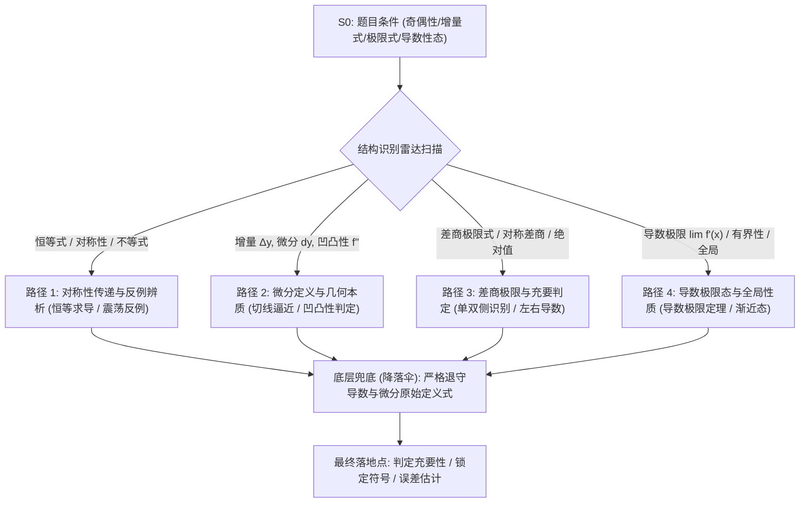

# 基础概念｜按刷题顺序重排

- 分类ID：`369`
- 分类路径：高等数学 / 一元微分 / 导数与微分概念 / 基础概念
- 题量：`35`

> [!tip]- 本页刷题结构与执行说明
> 1. **核心认知模型**：以“定义法为降落伞（底层兜底），高阶框架为雷达（高维识别）”为指导原则。常规题通过特征雷达直接识别结构、秒杀选项；偏怪题与陷阱题坚决退守导数与微分的原始定义式，保证题题有路可走、万无一失。
> 2. **执行原则**：
>    - **第一阶段（独立锚点）**：覆盖本节 4 大方法簇的核心认知入口与落地点，务必独立闭卷完成，不预看解析。
>    - **第二阶段（必要变式）**：检验路径跨越函数形态、增量符号、阶数与复合结构的迁移能力。
>    - **第三阶段（同构确认）**：识别同一数学本质在不同题面包装下的同构性，形成敏锐的考场特征雷达。
> 3. **每簇闭环要求**：每完成一组题目，用一句话总结：“题面信号 $\to$ 方法选择 $\to$ 抽象模板 $\to$ 变式边界”。

## 本节总主线与状态转移模型

$$
S_0 \longrightarrow G \longrightarrow \text{强信号} \longrightarrow \text{候选工具} \longrightarrow \text{第一操作} \longrightarrow \text{中间状态} \longrightarrow \text{落地点}
$$

本节研究的是**导数与微分在“点”上的微观态与局部几何性态**。35 道考题全部围绕以下 4 大核心状态转移路径展开：

## 建议刷题顺序

### 第一阶段｜独立锚点（共 8 题）
> 建立 4 大路径的核心识别与解题规范。做完后必须能独立说出入口信号与落地点。
001 [基本概念] $\to$ 004 [基本概念] $\to$ 001 [微分概念] $\to$ 004 [微分概念] $\to$ 001 [极限与导数] $\to$ 007 [概念综合] $\to$ 003 [极限与导数] $\to$ 004 [概念综合]

### 第二阶段｜必要变式（共 18 题）
> 跨越变量变号、复合函数、绝对值、高阶无穷小与条件微调。
- **对称与不等式变式**：002 [基本概念] $\to$ 003 [基本概念] $\to$ 005 [基本概念]
- **微分增量计算与估算**：002 [微分概念] $\to$ 005 [微分概念] $\to$ 006 [微分概念] $\to$ 007 [微分概念]
- **差商极限与充要辨析**：004 [极限与导数] $\to$ 006 [极限与导数] $\to$ 009 [概念综合] $\to$ 010 [概念综合] $\to$ 011 [概念综合] $\to$ 012 [概念综合] $\to$ 013 [概念综合]
- **导函数态与综合分析**：001 [概念综合] $\to$ 002 [概念综合] $\to$ 003 [概念综合] $\to$ 006 [概念综合]

### 第三阶段｜同构确认（共 9 题）
> 检验同一数学内核在不同题源与包装下的辨识度，固化“雷达秒杀”直觉。
006 [基本概念] $\to$ 003 [微分概念] $\to$ 008 [微分概念] $\to$ 002 [极限与导数] $\to$ 008 [概念综合] $\to$ 014 [概念综合] $\to$ 015 [概念综合] $\to$ 005 [极限与导数] $\to$ 005 [概念综合]

## 方法簇 01｜函数的对称性、保号性与导数传递（整体性质推导）

> **【强信号】**：题干给出 $f(-x) = \pm f(x)$，或不等式 $f(x) < g(x)$，或导数乘积求导法则的定义证明。
> **【雷达识别】**：
> 1. 奇偶性求导必变性（奇导为偶，偶导为奇；$k$ 阶导数交替变换）；
> 2. “函数值不等”绝不传递为“导数值不等”（反例：$f(x) < g(x)$ 时切线斜率完全由局部的变化率决定，可快可慢）；
> 3. 乘积法则不仅要记公式，还要警惕乘积可导推不出单个函数可导的反例（如 $f(x)=|x|, g(x)=|x|$ 在 0 处不可导但乘积可导）。
> **【降落伞兜底】**：严格两边复合求导 $f(-x) = \pm f(x) \implies -f'(-x) = \pm f'(x)$；面对命题判断，坚决用极简模型（线性函数、常数、$x^2$、震荡函数）排除。

### 锚点题

#### 001 [基本概念]. 1993 数二; 880 第二章基础选择 9

- 题目ID：`1306`
- 题号：`1`
- 题源：1993 数二; 880 第二章基础选择 9
- 分类：高等数学 / 一元微分 / 导数与微分概念 / 基础概念
- 来源原题集：`01 基本概念题.md`
- 选做：否

若 $f(x) = -f(-x)$，在 $(0, +\infty)$ 内 $f'(x) > 0$， $f''(x) > 0$，则 $f(x)$ 在 $(-\infty, 0)$ 内（）

### 选项

A. $f'(x)<0, f''(x)<0$
B. $f'(x)<0, f''(x)>0$
C. $f'(x)>0, f''(x)<0.$
D. $f'(x)>0, f''(x)>0.$

> [!success]- 答案解析
> **答案**
>
> C
>
> **解析**
>
> 由于 $f(x) = -f(-x)$，函数为奇函数。对 $f(x) = -f(-x)$ 两边求导得 $f'(x) = f'(-x)$，再求导得 $f''(x) = -f''(-x)$。当 $x \in (0, +\infty)$ 时， $f'(x) > 0$， $f''(x) > 0$。对于 $x \in (-\infty, 0)$，令 $u = -x > 0$，则 $f'(x) = f'(-u) = f'(u) > 0$， $f''(x) = -f''(-u) = -f''(u) < 0$。因此，在 $(-\infty, 0)$ 内 $f'(x) > 0$， $f''(x) < 0$。

^q-1306

#### 004 [基本概念]. 1988 数二

- 题目ID：`1309`
- 题号：`4`
- 题源：1988 数二
- 分类：高等数学 / 一元微分 / 导数与微分概念 / 基础概念
- 来源原题集：`01 基本概念题.md`
- 选做：否

设 $f(x)$ 与 $g(x)$ 在 $(-\infty, +\infty)$ 上皆可导，且 $f(x) < g(x)$，则必有（）

### 选项

A. $f(-x) > g(-x)$.
B. $f'(x) < g'(x)$.
C. $\lim\limits_{x\to x_0}f(x)<\lim\limits_{x\to x_0}g(x)$.
D. $\int_{0}^{x}f(t)dt<\int_{0}^{x}g(t)dt$.

> [!success]- 答案解析
> **答案**
>
> C
>
> **解析**
>
> 由 $f(x)$ 与 $g(x)$ 在 $(-\infty, +\infty)$ 上可导，知 $f(x)$ 与 $g(x)$ 在 $(-\infty, +\infty)$ 上连续。若 $f(x)$ 连续，则 $\lim_{x \to x_0} f(x) = f(x_0)$。则 $\lim_{x \to x_0} f(x) = f(x_0)$， $\lim_{x \to x_0} g(x) = g(x_0)$。又 $f(x) < g(x)$，故 $f(x_0) < g(x_0)$，从而 $\lim_{x \to x_0} f(x) < \lim_{x \to x_0} g(x)$。故本题应选(C)。

^q-1309

### 变式题

#### 002 [基本概念]. 1997 数三; 26 版 660 数二第 535 题

- 题目ID：`1307`
- 题号：`2`
- 题源：1997 数三; 26 版 660 数二第 535 题
- 分类：高等数学 / 一元微分 / 导数与微分概念 / 基础概念
- 来源原题集：`01 基本概念题.md`
- 选做：否

若 $f(-x) = f(x) (-\infty < x < +\infty)$，在 $(-\infty, 0)$ 内 $f'(x) > 0$，且 $f''(x) < 0$，则在 $(0, +\infty)$ 内有（）

### 选项

A. $f'(x) > 0, f''(x) < 0$
B. $f'(x) > 0, f''(x) > 0$
C. $f'(x) < 0, f''(x) < 0$
D. $f'(x) < 0, f''(x) > 0$

> [!success]- 答案解析
> **答案**
>
> C
>
> **解析**
>
> 由于 $f(-x) = f(x)$，函数为偶函数。对 $f(-x) = f(x)$ 两边求导得 $-f'(-x) = f'(x)$，即 $f'(x) = -f'(-x)$。再求导得 $f''(x) = f''(-x)$。当 $x \in (-\infty, 0)$ 时， $f'(x) > 0$， $f''(x) < 0$。对于 $x \in (0, +\infty)$，令 $u = -x < 0$，则 $f'(x) = -f'(-u) = -f'(u) < 0$， $f''(x) = f''(-u) = f''(u) < 0$。因此，在 $(0, +\infty)$ 内 $f'(x) < 0$， $f''(x) < 0$。

^q-1307

#### 003 [基本概念]. 900 第二章数二 A 类 4

- 题目ID：`1308`
- 题号：`3`
- 题源：900 第二章数二 A 类 4
- 分类：高等数学 / 一元微分 / 导数与微分概念 / 基础概念
- 来源原题集：`01 基本概念题.md`
- 选做：否

若函数 $f(x)$, $g(x)$ 满足 $f(x) = f(-x)$, $g(x) = -g(-x)$, 在 $(0, +\infty)$ 内, $f'(x) > 0$, $f''(x) > 0$, $g'(x) > 0$, $g''(x) < 0$, 则在 $(- \infty, 0)$ 内恒成立的是（）

### 选项

A. $f'(x)>g'(x).$
B. $f'(x) < g'(x).$
C. $f''(x)>g''(x).$
D. $f''(x) < g''(x).$

> [!success]- 答案解析
> **答案**
>
> B
>
> **解析**
>
> 由于 $f(x) = f(-x)$，故 $f'(x) = [f(-x)]' = f'(-x) \cdot (-1) = -f'(-x)$， $f''(x) = [-f'(-x)]' = -f''(-x) \cdot (-1) = f''(-x)$。当 $x \in (-\infty, 0)$ 时， $-x \in (0, +\infty)$。由于当 $u \in (0, +\infty)$ 时， $f'(u) > 0$， $f''(u) > 0$，故 $f'(-x) > 0$， $f''(-x) > 0$。于是， $f^{\prime}(x)=-f^{\prime}(-x)<0,\ f^{\prime \prime}(x)=f^{\prime \prime}(-x)>0$。由于 $g(x) = -g(-x)$，故 $g'(x) = \left[-g(-x)\right]' = -g'(-x) \cdot (-1) = g'(-x)$， $g''(x) = \left[g'(-x)\right]' = g''(-x) \cdot (-1) = -g''(-x)$。当 $x \in (-\infty, 0)$ 时， $-x \in (0, +\infty)$。由于当 $u \in (0, +\infty)$ 时， $g'(u) > 0$， $g''(u) < 0$，故 $g'(-x) > 0$， $g''(-x) < 0$。于是， $g^{\prime}(x)=g^{\prime}(-x)>0,\quad g^{\prime \prime}(x)=-g^{\prime \prime}(-x)>0$。因此，当 $x \in (-\infty, 0)$ 时， $f'(x) < 0 < g'(x)$，选项 A 不正确，选项 B 正确。由上述推理我们仅得到 $f^{\prime\prime}(x)$与 $g^{\prime\prime}(x)$均大于0，而它们的大小关系无法确定，故选项C和选项D均不正确。

^q-1308

#### 005 [基本概念]. 26 版 660 数二第 551 题

- 题目ID：`1310`
- 题号：`5`
- 题源：26 版 660 数二第 551 题
- 分类：高等数学 / 一元微分 / 导数与微分概念 / 基础概念
- 来源原题集：`01 基本概念题.md`
- 选做：否

设函数 $f(x)$ 与 $g(x)$ 在 $(a,b)$ 上可导，考虑下列叙述：① 若 $f(x) > g(x)$，则 $f'(x) > g'(x)$; ② 若 $f'(x) > g'(x)$ 则 $f(x) > g(x)$，则

### 选项

A. ①② 都正确.
B. ①② 都不正确.
C. ① 正确，但 ② 不正确.
D. ② 正确，但 ① 不正确.

> [!success]- 答案解析
> **答案**
>
> B
>
> **解析**
>
> ① 反例： $f(x)=1, g(x)=0$，在区间上 $f(x) > g(x)$，但 $f'(x) = 0$， $g'(x) = 0$，不满足 $f'(x) > g'(x)$。② 反例： $f(x)=-e^{-x}, g(x)=e^{-x}$， $f'(x) = e^{-x}$， $g'(x) = -e^{-x}$，在 $x>0$ 时 $f'(x) > g'(x)$，但 $f(x) < 0 < g(x)$，即 $f(x) < g(x)$。因此①②都不正确。

^q-1310

### 同构题

#### 006 [基本概念]. 2015 数一三

- 题目ID：`1311`
- 题号：`6`
- 题源：2015 数一三
- 分类：高等数学 / 一元微分 / 导数与微分概念 / 基础概念
- 来源原题集：`01 基本概念题.md`
- 选做：否

(I) 设函数 $u(x)$, $v(x)$ 可导, 利用导数定义证明 $[u(x)v(x)]' = u'(x)v(x) + u(x)v'(x)$;（Ⅱ）设函数 $u_{1}(x),u_{2}(x),\cdots,u_{n}(x)$可导， $f(x)=u_{1}(x)u_{2}(x)\cdots u_{n}(x)$，写出 $f(x)$的求导公式.

> [!success]- 答案解析
> **答案**
>
> 无
>
> **解析**
>
> (1) 
>
> $$
> \begin{aligned} \left[u(x)v(x)\right]^{\prime}&= \lim_{\Delta x\rightarrow0}\frac{u(x+\Delta x)v(x+\Delta x)-u(x)v(x)}{\Delta x}\\&=\lim_{\Delta x\rightarrow0}\frac{u(x+\Delta x)v(x+\Delta x)-u(x+\Delta x)v(x)}{\Delta x}+\lim_{\Delta x\rightarrow0}\frac{u(x+\Delta x)v(x)-u(x)v(x)}{\Delta x}\\&=\lim_{\Delta x\rightarrow0}u(x+\Delta x)\cdot\frac{v(x+\Delta x)-v(x)}{\Delta x}+\lim_{\Delta x\rightarrow0}\frac{u(x+\Delta x)-u(x)}{\Delta x}\cdot v(x)\\&=u(x)v'(x)+u'(x)v(x)\end{aligned}
> $$
>
>  (2) 
>
> $$
> (u_{1}u_{2}\cdots u_{n})^{\prime}=u_{1}^{\prime}u_{2}\cdots u_{n}+u_{1}u_{2}^{\prime}\cdots u_{n}+\cdots+u_{1}u_{2}\cdots u_{n}^{\prime}
> $$

^q-1311

## 方法簇 02｜微分定义与几何本质（$\Delta y$ 与 $dy$ 的代数与凹凸关系）

> **【强信号】**：题干出现 $\Delta x, \Delta y, dy$，或讨论 $\Delta y - dy$ 的正负大小，或伴随二阶导数 $f''(x) > 0 / < 0$ 条件。
> **【雷达识别】**：
> 1. **代数雷达**：$\Delta y = A \Delta x + o(\Delta x) = dy + o(\Delta x)$。误差是高阶无穷小；当 $f'(x_0) \neq 0$ 时，$\Delta y \sim dy$（同阶等价）。
> 2. **几何雷达（凹凸性与切线）**：
>    - $f''(x) > 0$（凹向上/下凸）时，曲线在切线上方，割线高于切线，恒有 $\Delta y > dy$（无论 $\Delta x > 0$ 还是 $\Delta x < 0$）；
>    - $f''(x) < 0$（凹向下/上凸）时，曲线在切线下方，恒有 $\Delta y < dy$。
> **【降落伞兜底】**：代数上退守带拉格朗日余项的二阶泰勒展开式：$\Delta y - dy = \frac{1}{2}f''(\xi)(\Delta x)^2$，由 $(\Delta x)^2 > 0$ 判定符号；增量方程退守分离变量导数定义。

### 锚点题

#### 001 [微分概念]. 1988 数一二; 880 第二章基础选择 8

- 题目ID：`1312`
- 题号：`1`
- 题源：1988 数一二; 880 第二章基础选择 8
- 分类：高等数学 / 一元微分 / 导数与微分概念 / 基础概念
- 来源原题集：`02 微分概念.md`
- 选做：否

若函数 $y = f(x)$，有 $f'(x_{0}) = \frac{1}{2}$，则当 $\Delta x \to 0$ 时，该函数在 $x = x_{0}$ 处的微分 dy 是（）

### 选项

A. 与 $\Delta x$ 等价的无穷小
B. 与 $\Delta x$ 同阶的无穷小
C. 比 $\Delta x$ 低阶的无穷小
D. 比 $\Delta x$ 高阶的无穷小

> [!success]- 答案解析
> **答案**
>
> B
>
> **解析**
>
> 由微分的定义，$dy = f'(x_0) \Delta x = \frac{1}{2} \Delta x$。因此，$\lim_{\Delta x \to 0} \frac{dy}{\Delta x} = \frac{1}{2} \neq 0$，故 dy 是与 $\Delta x$ 同阶的无穷小。

^q-1312

#### 004 [微分概念]. 2006 数一二三

- 题目ID：`1315`
- 题号：`4`
- 题源：2006 数一二三
- 分类：高等数学 / 一元微分 / 导数与微分概念 / 基础概念
- 来源原题集：`02 微分概念.md`
- 选做：否

设函数 $y = f(x)$ 具有二阶导数，且 $f'(x) > 0$，$f''(x) > 0$，$\Delta x$ 为自变量 x 在 $x_{0}$ 处的增量，$\Delta y$ 与 dy 分别为 $f(x)$ 在点 $x_{0}$ 处对应的增量与微分，若 $\Delta x > 0$，则（）

### 选项

A. $0 < dy < \Delta y$
B. $0 < \Delta y < dy$
C. $\Delta y < dy < 0$
D. $dy < \Delta y < 0$

> [!success]- 答案解析
> **答案**
>
> A
>
> **解析**
>
> 由 $f'(x) > 0$ 且 $f''(x) > 0$，可知函数单调递增且是凹函数。当 $\Delta x > 0$ 时，微分 $dy = f'(x_0) \Delta x > 0$。对于凹函数，其切线位于函数图像下方，因此有 $\Delta y > dy > 0$，即 $0 < dy < \Delta y$。

^q-1315

### 变式题

#### 002 [微分概念]. 2002 数二

- 题目ID：`1313`
- 题号：`2`
- 题源：2002 数二
- 分类：高等数学 / 一元微分 / 导数与微分概念 / 基础概念
- 来源原题集：`02 微分概念.md`
- 选做：否

设函数 $f(u)$ 可导，$y = f(x^{2})$ 当自变量 x 在 x = -1 处取得增量 $\Delta x = -0.1$ 时，相应的函数增量 $\Delta y$ 的线性主部为 0.1，则 $f'(1)$ 等于（）

### 选项

A. -1
B. 0.1
C. 1
D. 0.5

> [!success]- 答案解析
> **答案**
>
> D
>
> **解析**
>
> 函数增量的线性主部即微分 dy。由 $y = f(x^2)$，得 $dy = f'(x^2) \cdot 2x \, dx$。代入 x = -1，$dx = \Delta x = -0.1$，$dy = 0.1$，得到方程 $0.1 = f'(1) \cdot 2 \cdot (-1) \cdot (-0.1)$，解得 $f'(1) = 0.5$。

^q-1313

#### 005 [微分概念]. 26 版 1000 第三章基础 9

- 题目ID：`1316`
- 题号：`5`
- 题源：26 版 1000 第三章基础 9
- 分类：高等数学 / 一元微分 / 导数与微分概念 / 基础概念
- 来源原题集：`02 微分概念.md`
- 选做：否

设函数 $f(x)$ 在 x=1 处可导，且 $\Delta f(1)$ 是 $f(x)$ 在增量为 $\Delta x$ 时的函数值增量，则 $\lim_{\Delta x \to 0} \frac{\Delta f(1) - \mathrm{d}f(1)}{\Delta x} =$（）

### 选项

A. $f'(1)$
B. 1
C. $\infty$
D. 0

> [!success]- 答案解析
> **答案**
>
> D
>
> **解析**
>
> 由定义，$\Delta f(1) = f(1+\Delta x) - f(1)$，$\mathrm{d}f(1) = f'(1) \Delta x$。因此，$\lim_{\Delta x \to 0} \frac{\Delta f(1)}{\Delta x} = f'(1)$，且 $\lim_{\Delta x \to 0} \frac{\mathrm{d}f(1)}{\Delta x} = \lim_{\Delta x \to 0} \frac{f'(1) \Delta x}{\Delta x} = f'(1)$。故原极限为 $f'(1) - f'(1) = 0$。

^q-1316

#### 006 [微分概念]. 880 第二章基础填空 23

- 题目ID：`1317`
- 题号：`6`
- 题源：880 第二章基础填空 23
- 分类：高等数学 / 一元微分 / 导数与微分概念 / 基础概念
- 来源原题集：`02 微分概念.md`
- 选做：否

设 $f(x)$ 在 $(-\infty, +\infty)$ 内有定义，且对任意的 x, y，有 $f(x + y) - f(x) = [f(x) - 1]y + \alpha(y)$，其中 $\lim_{y \to 0} \frac{\alpha(y)}{y} = 0$，且 $f(0) = 2$，则 $f(x) =$ ___。

> [!success]- 答案解析
> **答案**
>
> $e^{x}+1$
>
> **解析**
>
> 将 y 视为 $\Delta x$，由条件 $f(x + \Delta x) - f(x) = [f(x) - 1]\Delta x + \alpha(\Delta x)$，且 $\lim_{\Delta x \to 0} \frac{\alpha(\Delta x)}{\Delta x} = 0$，根据微分定义可知 $f(x)$ 可微，且 $f'(x) = f(x) - 1$。解微分方程 $\frac{df}{dx} = f - 1$，分离变量得 $\frac{df}{f-1} = dx$，积分得 $\ln|f-1| = x + C$。由 $f(0)=2$ 得 $C=0$，故 $f(x) = e^{x} + 1$。

^q-1317

#### 007 [微分概念]. 900 第二章数二 B 类 5

- 题目ID：`1318`
- 题号：`7`
- 题源：900 第二章数二 B 类 5
- 分类：高等数学 / 一元微分 / 导数与微分概念 / 基础概念
- 来源原题集：`02 微分概念.md`
- 选做：否

设函数 $f(x)$ 具有二阶导数， $\Delta x$ 为自变量 x 在 $x_{0}$ 处的增量， $\Delta y$ 与 dy 分别为 $f(x)$ 在 $x_{0}$ 处对应的增量与微分，则 $dy < \Delta y$ 是 $f''(x)$ 在 $x_{0}$ 的某邻域内大于 0 的（）

### 选项

A. 充分必要条件.
B. 充分不必要条件.
C. 必要不充分条件.
D. 既不充分也不必要条件.

> [!success]- 答案解析
> **答案**
>
> C
>
> **解析**
>
> 由 $f(x)$ 的泰勒公式可得 
>
> $$
> f(x+\Delta x)=f(x)+f^{\prime}(x)\Delta x+\frac{1}{2}f^{\prime \prime}(\xi)\left(\Delta x\right)^{2},
> $$
>
>  其中 $\xi$ 介于 x 与 $x + \Delta x$ 之间。若 $f''(x)>0$，则 
>
> $$
> \Delta y=f(x+\Delta x)-f(x)=\mathrm{d}y+\frac{1}{2}f^{\prime \prime}(\xi)\left(\Delta x\right)^{2}>\mathrm{d}y.
> $$
>
>  由此可知，$dy<\Delta y$ 是 $f^{\prime\prime}(x)$ 在 $x_{0}$ 的某邻域内大于0的必要条件。但是，由 $\Delta y > dy$ 不能得到 $f''(x) > 0$。例如，取 $f(x) = \left\{ \begin{aligned} & \frac{1}{3}x^{2} + x^{4}\sin\frac{1}{x}, & x \neq 0, \\ & 0, & x = 0, \end{aligned} \right.$，则 $f^{\prime}(x)=\left\{\begin{aligned}&\frac{2}{3}x+4x^{3}\sin\frac{1}{x}-x^{2}\cos\frac{1}{x},&x\neq0,\\ &0,&x=0,\end{aligned}\right.$， $f^{\prime \prime}(x)=\left\{\begin{aligned}&\frac{2}{3}+12x^{2}\sin\frac{1}{x}-6x\cos\frac{1}{x}-\sin\frac{1}{x},&x\neq0,\\&\frac{2}{3},&x=0.\end{aligned}\right.$ 在 x = 0 处，$dy = f'(0)\Delta x = 0$。当 $\Delta x$ 充分小时， 
>
> $$
> \Delta y=f(\Delta x)-f(0)=\frac{1}{3}(\Delta x)^{2}+(\Delta x)^{4}\sin\frac{1}{\Delta x}=\left(\Delta x\right)^{2}\left[\frac{1}{3}+\left(\Delta x\right)^{2}\sin\frac{1}{\Delta x}\right]>0.
> $$
>
>  于是，$\Delta y > dy$。但是，$f''(x)$ 在 0 的任何一个小邻域内都不恒大于 0。取 $x_{n} = \frac{1}{2n\pi + \frac{\pi}{2}}$，n 为整数，则 $f^{\prime \prime}(x_{n})=\frac{2}{3}+12x_{n}^{2}-1=12x_{n}^{2}-\frac{1}{3}$。当 n 充分大时，$f^{\prime \prime}(x_{n})<0$。因此，$dy<\Delta y$不是 $f''(x)$在 $x_{0}$的某邻域内大于0的充分条件。综上所述，应选C。

^q-1318

### 同构题

#### 003 [微分概念]. 900 第二章数二 A 类 1

- 题目ID：`1314`
- 题号：`3`
- 题源：900 第二章数二 A 类 1
- 分类：高等数学 / 一元微分 / 导数与微分概念 / 基础概念
- 来源原题集：`02 微分概念.md`
- 选做：否

设函数 $f(x)$ 可导，$y=f(x)\cos x$ 当自变量 x 在点 x=0 处取得增量 $\Delta x=0.2$ 时，相应的函数增量 $\Delta y$ 的线性主部为 0.4，则 $f'(0)=$（）

### 选项

A. 2
B. 0.2
C. 1
D. 0.1

> [!success]- 答案解析
> **答案**
>
> A
>
> **解析**
>
> 函数增量的线性主部即微分 dy。由 $y = f(x) \cos x$，得 $y'(x) = f'(x) \cos x - f(x) \sin x$。在 x=0 处，$y'(0) = f'(0) \cdot 1 - f(0) \cdot 0 = f'(0)$。根据微分定义，$dy = y'(0) \Delta x = f'(0) \cdot 0.2$。已知 $dy = 0.4$，故 $0.4 = 0.2 f'(0)$，解得 $f'(0) = 2$。

^q-1314

#### 008 [微分概念]. 900 第二章数二 B 类 4

- 题目ID：`1319`
- 题号：`8`
- 题源：900 第二章数二 B 类 4
- 分类：高等数学 / 一元微分 / 导数与微分概念 / 基础概念
- 来源原题集：`02 微分概念.md`
- 选做：否

设函数 $f(x)$ 具有二阶导数， $\Delta x$ 为自变量 x 在 $x_{0}$ 处的增量， $\Delta y$ 与 dy 分别为 $f(x)$ 在 $x_{0}$ 处对应的增量与微分，则下列说法中，正确的是（）

### 选项

A. 若在 $x_{0}$ 的某邻域内有 $\mathrm{d}y < \Delta y$，则 $f''(x)$ 在该邻域内恒大于 0.
B. 若在 $x_{0}$ 的某邻域内有 $\left|dy\right| < \left|\Delta y\right|$，则 $f''(x)$ 在该邻域内恒大于 0.
C. 若 $f''(x)$ 在 $x_{0}$ 的某邻域内恒大于 0，则在该邻域内有 $\mathrm{d}y < \Delta y.$
D. 若 $f''(x)$ 在 $x_{0}$ 的某邻域内恒大于 0，则在该邻域内有 $|dy| < |\Delta y|$.

> [!success]- 答案解析
> **答案**
>
> C
>
> **解析**
>
> 由 $f(x)$ 的泰勒公式可得 
>
> $$
> f(x+\Delta x)=f(x)+f^{\prime}(x)\Delta x+\frac{1}{2}f^{\prime \prime}(\xi)\left(\Delta x\right)^{2},
> $$
>
>  其中 $\xi$ 介于 x 与 $x + \Delta x$ 之间。若 $f''(x)>0$，则 
>
> $$
> \Delta y=f(x+\Delta x)-f(x)=\mathrm{d}y+\frac{1}{2}f^{\prime \prime}(\xi)\left(\Delta x\right)^{2}>\mathrm{d}y.
> $$
>
>  由此可知，选项 C 正确。下面分别说明选项 A、B、D 不正确。对选项A，取 $f(x)=x^{4}$，则 $f^{\prime}(0)=0$，在x=0处，$\Delta y=(0+\Delta x)^{4}-0=(\Delta x)^{4}$，$\mathrm{d}y=f^{\prime}(0)\Delta x=0$，$\Delta y>\mathrm{d}y$。但是 $f^{\prime\prime}(0)=0$，不满足 $f^{\prime\prime}(x)$恒大于0。对选项 B，取 $f(x) = \tan x$，则 $f'(x) = \sec^{2}x$，在 x = 0 处，$\Delta y = \tan(0 + \Delta x) - \tan 0 = \tan \Delta x$，$\mathrm{d}y = f'(0) \Delta x = \Delta x$，$|\Delta y| > |\mathrm{d}y|$，但 $f''(x) = 2\sec^{2}x\tan x$，在 0 的左侧小邻域内，$f''(x) < 0$，不满足 $f''(x)$ 恒大于 0。对选项D，取 $f(x)=x^{2}$，则 $f''(x)=2>0$，在x=-1处，$\Delta y=(-1+\Delta x)^{2}-(-1)^{2}=(\Delta x)^{2}-2\Delta x$，$\mathrm{d}y=f'(-1)\Delta x=-2\Delta x$。解 $\left|\Delta y\right|<\left|\mathrm{d}y\right|$，即 $\left[(\Delta x)^{2}-2\Delta x\right]^{2}<(-2\Delta x)^{2}$，可得 $0<\Delta x<4$。因此，当 $0<\Delta x<4$时，$\left|\Delta y\right|<\left|\mathrm{d}y\right|$，不满足 $\left|\mathrm{d}y\right|<\left|\Delta y\right|$。综上所述，应选C。

^q-1319

## 方法簇 03｜差商极限与导数充要性（微观定义守恒底线与变形失效边界）

> **【核心认知模型】**：
> 导数在 $x_0$ 处的微观定义式：
> $$f'(x_0) = \lim_{\Delta x \to 0} \frac{f(x_0 + \Delta x) - f(x_0)}{\Delta x}$$
> 其能成立且可逆回归，必须同时守住**三大守恒底线（底层降落伞）**：
> 1. **锚点刚性**：分子中必须有且仅有一个**死死钉在 $x_0$ 处、采样真实函数值 $f(x_0)$ 的静止锚点**；
> 2. **趋近双侧完备性**：动点 $x_0 + \Delta x$ 逼近 $x_0$ 时，必须**在去心邻域 $\mathring{U}(x_0)$ 内无死角、双侧连续可逆地滑向 $x_0$**；
> 3. **阶数刚性匹配**：分母度量尺必须与分子自变量位移保持**严格的同阶（一阶线性）**关系。
> 
> **【五大变形维度与充要边界雷达矩阵】**：
> 
> | 变形维度 | 常见题面形式 | 能回归的安全区（充要等价） | 越界失效带（单向/不保） | 考场秒杀口诀与致命反例 |
> | :--- | :--- | :--- | :--- | :--- |
> | **维度 1：复合变元代换** | $\frac{f(\phi(h))}{\psi(h)}$ | $\phi(h)$ 展开首项为**奇数次幂**（保单调、双侧覆盖），且分母同阶 $\psi(h) \sim c\phi(h) (c\neq 0)$ | 展开首项为**偶数次幂**（只能从单侧趋于 0）；或阶数不对齐 | 偶次截断只保单侧导数（反例：$f(x)=|x|$） |
> | **维度 2：双动点差商** | $\frac{f(x_0+\alpha)-f(x_0+\beta)}{\gamma}$ | **仅已知可导时**用于正向计算极限值 $(\alpha'-\beta')f'(x_0)$ | **反推充分性 100% 失效**（基准锚点 $f(x_0)$ 丢失） | 测不出间断点与尖点（反例：偶函数对称差商恒为 0） |
> | **维度 3：阶数缩放偏离** | $\frac{f(x)}{x^p} (p\neq 1)$ | 仅 $p=1$ 时充要等价 | $p<1$ 分母太弱容忍尖点；$p>1$ 分母太强强锁零导 | $p=1/2$ 时 $x^{2/3}$ 极限为 0 但不可导；$p=2$ 推不出 $f''$ |
> | **维度 4：绝对值折痕算子** | $\frac{|f(x)|}{x}, \frac{f(x)}{|x|}$ | $f(x_0)\neq 0$（保号脱模）；$f(x_0)=0$ 且导数夹逼为 0 | 分母带绝对值且极限非零；零点处非平缓切入 | $\frac{f(x)}{|x|}\to 1$ 左右导数异号必不可导 |
> | **维度 5：基准连续性脱缰** | $\lim_{x\to 0}\frac{f(x)}{x}=m$ | 显式包含 $f(0)$ 或题干给出连续性条件 | 题设仅给 $\lim f(x)=0$，中心点 $f(0)$ 可能是孤立点 | 孤立点反例：$f(x)=x^2 (x\neq 0), f(0)=1$ |
> 
> **【降落伞兜底】**：面对任何复杂的极限命题，坚决退守单侧导数原始定义：$f'_+(x_0) = \lim_{x\to x_0^+} \frac{f(x)-f(x_0)}{x-x_0}$ 与 $f'_-(x_0) = \lim_{x\to x_0^-} \frac{f(x)-f(x_0)}{x-x_0}$。可导的唯一充要判定标准是：**左右导数均存在且相等**！

### 3.1 复合变元代换边界（奇次单调可逆 vs 偶次单侧截断）

> **【边界破局】**：令 $u=\phi(h)$。若 $\phi(h) \sim a h^{2k+1}$（奇数次），在 0 附近严格单调且双侧覆盖，可逆代换回归导数定义；若 $\phi(h) \sim a h^{2k}$（偶数次），自变量被钉在单侧（全非负或全非正），极限存在只代表单侧导数，绝不能反推可导！阶数不对齐则导致信息抹平或发散。

#### 001 [极限与导数]. 2001 数一

- 题目ID：`1353`
- 题号：`1`
- 题源：2001 数一
- 分类：高等数学 / 一元微分 / 导数与微分概念 / 基础概念
- 来源原题集：`03 极限存在与导数存在.md`
- 选做：否

设 $f(0)=0$ , 则 $f(x)$ 在点 $x=0$ 可导的充要条件为（）

### 选项

A. $\lim_{h\to0}\frac{1}{h^{2}}f(1-\cos h)$ 存在.
B. $\lim_{h\to0}\frac{1}{h}f(1-\mathrm{e}^{h})$ 存在.
C. $\lim_{h\to0}\frac{1}{h^{2}}f(h-\sin h)$ 存在.
D. $\lim_{h\to0}\frac{1}{h}[f(2h)-f(h)]$ 存在.

> [!success]- 答案解析
> **答案**
>
> B
>
> **解析**
>
> 对于选项(B): 
>
> $$
> \lim_{h\to0}\frac{f(1-e^{h})}{h}=\lim_{h\to0}\frac{f(1-e^{h})-f(0)}{1-e^{h}}\cdot\frac{1-e^{h}}{h} \Leftrightarrow f^{\prime}(0) \text{存在}.
> $$
>
>  对于选项(A): 
>
> $$
> I=\lim_{h\to0}\frac{f(1-\cos h)-f(0)}{1-\cos h}\cdot\frac{1-\cos h}{h^{2}} \text{ 与 } f'(0) \text{ 存在性不等价}.
> $$
>
>  对于选项(C): 当 $h \to 0$ 时， $h - \sin h \sim \frac{h^3}{6}$，因此 $\lim_{h\to0}\frac{f(h-\sin h)}{h^{2}} = \lim_{h\to0}\frac{f(\frac{h^3}{6}+o(h^3))}{h^{2}}$，这不能保证 $f'(0)$ 存在。对于选项(D): 取 $f(x) = \sin x$，则 $f(0)=0$，但 $\lim_{h\to0}\frac{1}{h}[f(2h)-f(h)] = \lim_{h\to0}\frac{\sin(2h)-\sin h}{h} = 1$ 存在，而 $f'(0)=1$ 也存在。但该选项并非充要条件，存在反例（如 $f(x) = |x|$ 在 $x=0$ 不可导，但该极限可能不存在或存在）。分析表明只有选项(B)是充要条件。

^q-1353

#### 004 [极限与导数]. 26 版 660 数一二三第 164 题

- 题目ID：`1356`
- 题号：`4`
- 题源：26 版 660 数一二三第 164 题
- 分类：高等数学 / 一元微分 / 导数与微分概念 / 基础概念
- 来源原题集：`03 极限存在与导数存在.md`
- 选做：否

设 $f(x)$ 在 $x = 0$ 的某邻域内有定义， $f(0) = 0$，则下述条件能保证 $f'(0)$ 存在的是

### 选项

A. $\lim_{h\to0}\frac{1}{h}f\left[\ln(1-h)\right]$ 存在.
B. $\lim_{h\to0}\frac{1}{h^{2}}f\left(\sqrt{1+h^{2}}-1\right)$ 存在.
C. $\lim_{h\to0}\frac{1}{h^{2}}f(\tan h-\sin h)$ 存在.
D. $\lim_{h\to0}\frac{1}{h}\left[f(2h)-f(h)\right]$ 存在.

> [!success]- 答案解析
> **答案**
>
> A
>
> **解析**
>
> 本题是(A)(B)(C)(D)4个极限式中，哪个存在能保证 $f'(0)$ 存在。因此应将 $f'(0)$ 的定义式用所给的极限式表示。例如对于(A)，将(A)的那个极限值记为A，于是 $\lim_{x\to0}\frac{f(x)-f(0)}{x-0}=\lim_{x\to0}\frac{f(x)}{x}\xlongequal{ 令 x=\ln(1-h)}\lim_{h\to0}\frac{f\left[\ln(1-h)\right]}{\ln(1-h)}=\lim_{h\to0}\left[\frac{f(\ln(1-h))}{h}\cdot\frac{h}{\ln(1-h)}\right]=A\cdot(-1)=-A$，所以 $f'(0)$ 存在且等于 -A。 (A) 的存在保证了 $f'(0)$ 存在，选(A)。

^q-1356

#### 007 [概念综合]. 2006 数三

- 题目ID：`1365`
- 题号：`7`
- 题源：2006 数三
- 分类：高等数学 / 一元微分 / 导数与微分概念 / 基础概念
- 来源原题集：`04 概念综合题.md`
- 选做：否

设函数 $f(x)$ 在 x=0 处连续，且 $\lim_{h\to0}\frac{f(h^2)}{h^2}=1$，则（）

### 选项

A. $f(0)=0$ 且 $f_{-}^{\prime}(0)$ 存在
B. $f(0)=1$ 且 $f_{-}^{\prime}(0)$ 存在
C. $f(0)=0$ 且 $f_{+}^{\prime}(0)$ 存在
D. $f(0)=1$ 且 $f_{+}^{\prime}(0)$ 存在

> [!success]- 答案解析
> **答案**
>
> 无
>
> **解析**
>
> 由 $\lim_{h\to0}\frac{f(h^2)}{h^2}=1$ 及 $f(x)$ 在 x=0 处连续，可得 $\lim_{h\to0}f(h^2)=0=f(0)$。进而 $\lim_{h\to0}\frac{f(h^2)-f(0)}{h^2}=1$，即 $f'(0)=1$ 存在。由于 $h^2 \ge 0$，该极限过程只涉及 $h^2 \to 0^+$，故为右导数，即 $f_{+}^{\prime}(0)=1$。因此 $f(0)=0$ 且 $f_{+}^{\prime}(0)$ 存在。

^q-1365

#### 008 [概念综合]. 26 版 660 数一二三第 149 题

- 题目ID：`1366`
- 题号：`8`
- 题源：26 版 660 数一二三第 149 题
- 分类：高等数学 / 一元微分 / 导数与微分概念 / 基础概念
- 来源原题集：`04 概念综合题.md`
- 选做：否

设 $f(0)=0$，则 $\lim_{x\to0}\frac{f(x^{2})}{x^{2}}$ 存在是 $f(x)$ 在 x=0 可导的

### 选项

A. 充分非必要条件.
B. 必要非充分条件.
C. 充分必要条件.
D. 既非充分又非必要条件.

> [!success]- 答案解析
> **答案**
>
> 无
>
> **解析**
>
> 无

^q-1366

#### 002 [极限与导数]. 900 第二章数二 B 类 2

- 题目ID：`1354`
- 题号：`2`
- 题源：900 第二章数二 B 类 2
- 分类：高等数学 / 一元微分 / 导数与微分概念 / 基础概念
- 来源原题集：`03 极限存在与导数存在.md`
- 选做：否

设函数 $f(x)$ 满足 $f(0) = 0$，则 $f(x)$ 在 $x = 0$ 处可导的充分必要条件为（）

### 选项

A. $\lim_{h\to0}\frac{1}{h^{3}}f(\tan h-h)$ 存在.
B. $\lim_{h\to0}\frac{1}{h^{2}}f(\ln(1+h)-h)$ 存在.
C. $\lim_{h\to0}\frac{1}{h}f(\arctan h-h)$ 存在.
D. $\lim_{h\to0}\frac{1}{h}[f(h)-f(-h)]$ 存在.

> [!success]- 答案解析
> **答案**
>
> A
>
> **解析**
>
> 考虑必要性。若 $f'(0)$ 存在，则由泰勒公式可知 $f(x)=f(0)+f^{\prime}(0)x+o(x)\xlongequal{f(0)=0}f^{\prime}(0)x+o(x)$。对选项A，由 $\tan x$ 的泰勒公式 $\tan x = x + \frac{x^{3}}{3} + o(x^{3})$ 可知， $\tan h - h = \frac{h^{3}}{3} + o(h^{3})$，故 $\lim_{h\to0}\frac{1}{h^{3}}f(\tan h-h)\xlongequal{ 见注 }\lim_{h\to0}\frac{1}{h^{3}}\Big[\frac{1}{3}f^{\prime}(0)h^{3}+o(h^{3})\Big]=\lim_{h\to0}\Big[\frac{1}{3}f^{\prime}(0)+\frac{o\big(h^{3}\big)}{h^{3}}\Big]=\frac{1}{3}f^{\prime}(0)$。对选项B，由 $\ln(1+x)$ 的泰勒公式 $\ln(1+x)=x-\frac{x^{2}}{2}+o(x^{2})$ 可知， $\ln(1+h)-h=-\frac{h^{2}}{2}+o(h^{2})$，故 $\lim_{h\to0}\frac{1}{h^{2}}f(\ln(1+h)-h)\xlongequal{ 见注 }\lim_{h\to0}\frac{1}{h^{2}}\Big[-\frac{1}{2}f^{\prime}(0)h^{2}+o(h^{2})\Big]=\lim_{h\to0}\Big[-\frac{1}{2}f^{\prime}(0)+\frac{o\big(h^{2}\big)}{h^{2}}\Big]=-\frac{1}{2}f^{\prime}(0)$。对选项C，由 $\arctan x$ 的泰勒公式 $\arctan x = x + o(x)$ 可知， $\arctan h - h = o(h)$，故 $\lim_{h\to0}\frac{1}{h}f(\arctan h-h)\xlongequal{ 见注 }\lim_{h\to0}\frac{1}{h}\cdot o(h)=0$。对选项D， $\lim_{h\to0}\frac{1}{h}\left[f(h)-f(-h)\right]=\lim_{h\to0}\frac{1}{h}\left[f^{\prime}(0)h-f^{\prime}(0)\left(-h\right)+o(h)\right]=\lim_{h\to0}\left[2f^{\prime}(0)+\frac{o(h)}{h}\right]=2f^{\prime}(0)$。因此，四个选项均为必要条件。下面证明选项A是充分条件。考虑函数 $g(h) = \tan h - h, h \in \left( -\frac{\pi}{4}, \frac{\pi}{4} \right)$，则 $g'(h) = \sec^{2}h - 1 \geqslant 0$，且 $g'(h) = 0$ 当且仅当 $h = 0$。于是， $g(h)$ 单调增加。记 $a = g\left( \frac{\pi}{4} \right) = 1 - \frac{\pi}{4}$。由 $g(h)$ 单调增加可知 $g(h)$ 在 $\left( -\frac{\pi}{4}, \frac{\pi}{4} \right)$ 上有反函数 $g^{-1}(x)$，且反函数的定义域为 $(-a, a)$。由于 $g(0) = 0$，故 $\lim_{x \to 0} g^{-1}(x) = g^{-1}(0) = 0$。由此可知， $x \to 0$ 当且仅当 $h \to 0$。根据以上分析，可得 $f^{\prime}(0)=\lim_{x\to0}\frac{f(x)-f(0)}{x-0}\xlongequal{x=g(h)}\lim_{h\to0}\frac{f(\tan h-h)}{\tan h-h}=\lim_{h\to0}\left[\frac{h^{3}}{\tan h-h}\cdot\frac{f(\tan h-h)}{h^{3}}\right]=\lim_{h\to0}\frac{h^{3}}{\frac{h^{3}}{3}+o\left(h^{3}\right)}\cdot\lim_{h\to0}\frac{f(\tan h-h)}{h^{3}}=3\lim_{h\to0}\frac{f(\tan h-h)}{h^{3}}$。因此，若 $\lim_{h\to0}\frac{f(\tan h-h)}{h^{3}}$ 存在，则 $f'(0)$ 存在。综上所述，选项A是充分必要条件。下面举例说明选项B、C、D都不是充分条件。考虑函数 $f(x)=\left|x\right|$。由于 $\lim_{x\to0^{-}}\frac{f(x)-f(0)}{x-0}=\lim_{x\to0^{-}}\frac{-x}{x}=-1,\lim_{x\to0^{+}}\frac{f(x)-f(0)}{x-0}=\lim_{x\to0^{+}}\frac{x}{x}=1$ 故 $f^{\prime}(0)$ 不存在。但是， $\lim_{h\to0}\frac{1}{h^{2}}f(\ln(1+h)-h)=\lim_{h\to0}\frac{1}{h^{2}}\left|-\frac{1}{2}h^{2}+o(h^{2})\right|=\frac{1}{2}$， $\lim_{h\to0}\frac{1}{h}f(\arctan h-h)=\lim_{h\to0}\frac{1}{h}\mid o(h)\mid=0$。因此，选项B、C都不是充分条件。考虑函数 $f(x)=\left\{\begin{aligned}&1,&x\neq0,\\ &0,&x=0,\end{aligned}\right.$ 则 $\lim_{h\to0}\frac{1}{h}[f(h)-f(-h)]=0$，但是因为 $f(x)$ 在 $x=0$ 处不连续，所以 $f^{\prime}(0)$ 不存在。因此，选项D不是充分条件。

^q-1354

### 3.2 双动点差商边界（基准锚点缺失与对称陷阱）

> **【边界破局】**：差商必须“一动一静”。只要两头都在动（无论是对称跨越 $f(h)-f(-h)$ 还是同侧双动 $f(2h)-f(h)$），真实基准点 $f(x_0)$ 均未被采样。由极限存在反推可导 100% 暴毙，测不出间断点与折角尖点！

#### 011 [概念综合]. 2007 数一二三

- 题目ID：`1369`
- 题号：`11`
- 题源：2007 数一二三
- 分类：高等数学 / 一元微分 / 导数与微分概念 / 基础概念
- 来源原题集：`04 概念综合题.md`
- 选做：否

设函数 $f(x)$ 在 $x=0$ 处连续，以下命题错误的选项是（）

### 选项

A. 假设 $\lim_{x\to0}\frac{f(x)}{x}$存在，则 $f(0)=0$
B. 假设 $\lim_{x\to0}\frac{f(x)+f(-x)}{x}$存在，则 $f(0)=0$.
C. 假设 $\lim_{x\to0}\frac{f(x)}{x}$存在，则 $f'(0)$存在
D. 假设 $\lim_{x\to0}\frac{f(x)-f(-x)}{x}$ 存在，则 $f'(0)$ 存在.

> [!success]- 答案解析
> **答案**
>
> D
>
> **解析**
>
> 这道题考察的是函数极限、连续性与可导性之间的概念关系。
>
> 正确的选项是 **D** （即命题错误的选项是 D）。
>
> 以下是每个选项的详细解析：
>
> ### **选项 A：正确**
> **命题：** 假设 $\lim_{x\to 0} \frac{f(x)}{x}$ 存在，则 $f(0)=0$。
>
> **证明：**
> 设 $\lim_{x\to 0} \frac{f(x)}{x} = L$（$L$ 为常数）。
> 根据极限的四则运算法则，我们可以求 $f(x)$ 在 $x \to 0$ 时的极限：
>
> $$
> \lim_{x\to 0} f(x) = \lim_{x\to 0} \left( \frac{f(x)}{x} \cdot x \right) = \lim_{x\to 0} \frac{f(x)}{x} \cdot \lim_{x\to 0} x = L \cdot 0 = 0
> $$
>
> 已知题目条件 $f(x)$ 在 $x=0$ 处连续，连续的定义是极限值等于函数值，即：
>
> $$
> f(0) = \lim_{x\to 0} f(x) = 0
> $$
>
> 因此该命题成立。
>
> ---
>
> ### **选项 B：正确**
> **命题：** 假设 $\lim_{x\to 0} \frac{f(x)+f(-x)}{x}$ 存在，则 $f(0)=0$。
>
> **证明：**
> 设令 $g(x) = f(x) + f(-x)$。因为 $f(x)$ 在 $x=0$ 处连续，所以 $g(x)$ 在 $x=0$ 处也连续。
> 已知 $\lim_{x\to 0} \frac{g(x)}{x}$ 存在，利用与选项 A 完全相同的逻辑，可以得出：
>
> $$
> \lim_{x\to 0} g(x) = 0
> $$
>
> 再由 $g(x)$ 的连续性可知：
>
> $$
> g(0) = f(0) + f(-0) = 2f(0) = 0
> $$
>
> 从而解得 $f(0) = 0$。该命题成立。
>
> ---
>
> ### **选项 C：正确**
> **命题：** 假设 $\lim_{x\to 0} \frac{f(x)}{x}$ 存在，则 $f'(0)$ 存在。
>
> **证明：**
> 由选项 A 的推导我们已经知道，如果 $\lim_{x\to 0} \frac{f(x)}{x}$ 存在，那么必然有 $f(0) = 0$。
> 根据函数在 $x=0$ 处导数的定义：
>
> $$
> f'(0) = \lim_{x\to 0} \frac{f(x) - f(0)}{x - 0}
> $$
>
> 将 $f(0) = 0$ 代入上式：
>
> $$
> f'(0) = \lim_{x\to 0} \frac{f(x) - 0}{x} = \lim_{x\to 0} \frac{f(x)}{x}
> $$
>
> 因为已知题设条件就是该极限存在，所以 $f'(0)$ 也必然存在，且等于该极限值。该命题成立。
>
> ---
>
> ### **选项 D：错误**
> **命题：** 假设 $\lim_{x\to 0} \frac{f(x)-f(-x)}{x}$ 存在，则 $f'(0)$ 存在。
>
> **证伪（寻找反例）：**
> 如果 $f(x)$ 是一个**连续的偶函数**，那么 $f(-x) = f(x)$ 恒成立。
> 此时，分子 $f(x) - f(-x) = 0$，所以极限：
>
> $$
> \lim_{x\to 0} \frac{f(x)-f(-x)}{x} = \lim_{x\to 0} \frac{0}{x} = 0
> $$
>
> 这意味着对于**任何**连续偶函数，这个极限都是存在的（且等于0）。
> 但是，连续的偶函数在 $x=0$ 处并不一定可导。
>
> **经典反例：** 取 $f(x) = |x|$。
> 1.  它在 $x=0$ 处连续。
> 2.  $\lim_{x\to 0} \frac{|x|-|-x|}{x} = \lim_{x\to 0} \frac{0}{x} = 0$，极限存在。
> 3.  但是在 $x=0$ 处，其左导数为 $-1$，右导数为 $1$，左右导数不相等，因此 **$f'(0)$ 不存在**。
> 由此可见，该命题无法成立

^q-1369

### 3.3 阶数缩放偏离边界（$p \neq 1$：弱分母容尖点 vs 强分母锁零导）

> **【边界破局】**：$p=1$ 是微积分导数定义的刚性标尺。$p<1$（分母衰减慢，尺度过宽）使得分子只要比 $x^p$ 略高阶即可（如 $x^{2/3}$），容忍尖点不可导，故充分性失效；$p>1$（分母衰减快，尺度过严）强行将导数压缩锁定为 0，故必要性失效。

#### 012 [概念综合]. 2020 数一

- 题目ID：`1370`
- 题号：`12`
- 题源：2020 数一
- 分类：高等数学 / 一元微分 / 导数与微分概念 / 基础概念
- 来源原题集：`04 概念综合题.md`
- 选做：否

设函数 $f(x)$ 在区间 $(-1,1)$ 内有定义，且 $\lim_{x\to0}f(x)=0$，则()

### 选项

A. 当 $\lim_{x\to0}\frac{f(x)}{\sqrt{|x|}}=0$时， $f(x)$在$x=0$处可导.
B. 当 $\lim_{x\to0}\frac{f(x)}{x^{2}}=0$时， $f(x)$在$x=0$处可导.
C. 当 $f(x)$ 在 $x = 0$ 处可导时， $\lim_{x \to 0} \frac{f(x)}{\sqrt{|x|}} = 0.$
D. 当 $f(x)$ 在 $x = 0$ 处可导时， $\lim_{x \to 0} \frac{f(x)}{x^{2}} = 0.$

> [!success]- 答案解析
> **答案**
>
> C
>
> **解析**
>
> 根据可导的定义， $f(x)$ 在 $x = 0$ 处可导等价于 $\lim_{x \to 0} \frac{f(x) - f(0)}{x - 0}$ 存在。若 $f(x)$ 在 $x = 0$ 处可导，则 $f(x)$ 在 $x = 0$ 处连续。由 $\lim_{x \to 0} f(x) = 0$ 可得 $f(0) = 0$。并且，由 $f(x)$ 在 $x = 0$ 处可导可得 $f^{\prime}(0)=\lim_{x\to0}\frac{f(x)-f(0)}{x-0}\xlongequal{f(0)=0}\lim_{x\to0}\frac{f(x)}{x}.$ 计算 $\lim_{x\to0}\frac{f(x)}{\sqrt{|x|}}$： $\lim_{x\to0^{+}}\frac{f(x)}{\sqrt{\left|x\right|}}=\lim_{x\to0^{+}}\frac{f(x)}{\sqrt{x}}=\lim_{x\to0^{+}}\frac{f(x)}{x}\cdot\sqrt{x}=\lim_{x\to0^{+}}\frac{f(x)}{x}\cdot\lim_{x\to0^{+}}\sqrt{x}=0.$ $\lim_{x\to0^{-}}\frac{f(x)}{\sqrt{\left|x\right|}}=\lim_{x\to0^{-}}\frac{f(x)}{\sqrt{-x}}=\lim_{x\to0^{-}}\frac{f(x)}{-x}\cdot\sqrt{-x}=-\lim_{x\to0^{-}}\frac{f(x)}{x}\cdot\lim_{x\to0^{-}}\sqrt{-x}=0.$ $\lim_{x\to0^{+}}\frac{f(x)}{\sqrt{|x|}}=\lim_{x\to0^{-}}\frac{f(x)}{\sqrt{|x|}}=0$，即 $\lim_{x\to0}\frac{f(x)}{\sqrt{|x|}}=0$。选项C正确。选项 A、B: 取 $f(x) = \begin{cases} x^{3}, & x \neq 0, \\ 1, & x = 0, \end{cases}$ 则 $\lim_{x \to 0} \frac{f(x)}{\sqrt{|x|}} = 0, \lim_{x \to 0} \frac{f(x)}{x^{2}} = 0$，但 $f(x)$ 在 $x = 0$ 处不连续，当然也不可导。选项D: 取 $f(x)=x$，则 $f(x)$在$x=0$处可导，但 $\lim_{x\to0}\frac{f(x)}{x^{2}}$不存在。

^q-1370

#### 013 [概念综合]. 26 版 1000 第三章强化 4

- 题目ID：`1371`
- 题号：`13`
- 题源：26 版 1000 第三章强化 4
- 分类：高等数学 / 一元微分 / 导数与微分概念 / 基础概念
- 来源原题集：`04 概念综合题.md`
- 选做：否

设函数 $f(x)$ 在区间 $(-1,1)$ 内有定义，且在点 $x=0$ 处连续，则以下结论：①当 $\lim_{x\to0}\frac{f(x)}{\sqrt[3]{x}}=0$ 时， $f(x)$ 在点 $x=0$ 处可导；②当 $\lim_{x\to0}\frac{f(x)}{x^{2}}=0$ 时， $f(x)$ 在点 $x=0$ 处可导；③当 $f(x)$ 在点 $x=0$ 处可导时， $\lim_{x\to0}\frac{f(x)}{\sqrt[3]{x}}=0.$ 所有正确结论的序号为（）.

### 选项

A. ①
B. ②
C. ②③
D. ①②

> [!success]- 答案解析
> **答案**
>
> B
>
> **解析**
>
> 对于①，取 $f(x)=x^{\frac{2}{3}}$，则 $f(x)$ 在 $x=0$ 处连续但不可导，故①不正确；对于②，因 $\lim_{x\to0}f(x)=f(0)$，又由 $\lim_{x\to0}\frac{f(x)}{x^{2}}=0$，有 $f(0)=0$，则 $f^{\prime}(0)=\lim_{x\to0}\frac{f(x)-f(0)}{x-0}=\lim_{x\to0}\frac{f(x)}{x}=\lim_{x\to0}\frac{f(x)}{x^{2}}\cdot x=0,$ 故②正确；对于③，取 $f(x)=1$，此时 $\lim_{x\to0}\frac{f(x)}{\sqrt[3]{x}}=\infty$，故③不正确。

^q-1371

#### 015 [概念综合]. 900 数二第二章 B 类

- 题目ID：`1373`
- 题号：`15`
- 题源：900 数二第二章 B 类
- 分类：高等数学 / 一元微分 / 导数与微分概念 / 基础概念
- 来源原题集：`04 概念综合题.md`
- 选做：否

设函数 $f(x)$ 在 $x = 0$ 处连续，则下列命题中，错误的是()

### 选项

A. 若 $\lim_{x\to0}\frac{f(x)}{x}=a$ , 则 $f'(0)=a.$
B. 若 $f(0) = 0, f'(0) = a$，则 $\lim_{x \to 0} \frac{f(x)}{x} = a$.
C. 若 $\lim_{x\to0}\frac{f(x)}{x^{2}}=\frac{a}{2}$，则 $f''(0)=a.$
D. 若 $f(0) = f'(0) = 0$,  $f''(0) = a$, 则 $\lim_{x \to 0} \frac{f(x)}{x^2} = \frac{a}{2}$.

> [!success]- 答案解析
> **答案**
>
> C
>
> **解析**
>
> 对选项A，由 $\lim_{x\to0}\frac{f(x)}{x}=a$ 可得 $\lim_{x\to0}f(x)=0$。又由于 $f(x)$在x=0处连续，故 $f(0)=\lim_{x\to0}f(x)=0$，从而 $f^{\prime}(0)=\lim_{x\to0}\frac{f(x)-f(0)}{x-0}=\lim_{x\to0}\frac{f(x)}{x}=a.$ 选项 A 正确。\n对选项 B，由  $f(0)=0, f'(0)=a$ 可得  $\lim_{x\to0}\frac{f(x)}{x}=\lim_{x\to0}\frac{f(x)-f(0)}{x-0}=f'(0)=a.$ 选项 B 正确。\n对选项D，由 $f(0)=f'(0)=0,f''(0)=a$可得， $f(x)$在x=0处的带佩亚诺余项的二阶泰勒公式为 $f(x)=f(0)+f^{\prime}(0)x+\frac{f^{\prime \prime}(0)}{2}x^{2}+o\left(x^{2}\right)=\frac{a}{2}x^{2}+o\left(x^{2}\right).$ 于是, $\lim_{x\to0}\frac{f(x)}{x^{2}}=\lim_{x\to0}\frac{\frac{a}{2}x^{2}+o(x^{2})}{x^{2}}=\frac{a}{2}$.选项D正确。\n下面说明选项 C 错误。令 $f(x)=\left\{\begin{aligned}&x^{3}\sin\frac{1}{x},&x\neq0,\\ &0,&x=0,\end{aligned}\right.$ 则 $\lim_{x\to0}\frac{f(x)}{x^{2}}=\lim_{x\to0}x\sin\frac{1}{x}=0.$ 计算得  $f'(x) = \begin{cases} 3x^{2}\sin\frac{1}{x} - x\cos\frac{1}{x}, & x \neq 0, \\ 0, & x = 0. \end{cases}$ 因此， $f^{\prime \prime}(0)=\lim_{x\to0}\frac{f^{\prime}(x)-f^{\prime}(0)}{x-0}=\lim_{x\to0}3x\sin\frac{1}{x}-\lim_{x\to0}\cos\frac{1}{x}=-\lim_{x\to0}\cos\frac{1}{x}.$ 由于 $\lim_{x\to0}\cos\frac{1}{x}$不存在，故 $f''(0)$不存在。因此，选项C错误。\n综上所述，应选C。

^q-1373

### 3.4 绝对值折痕与保号算子边界（局部保号脱模 vs 零点平滑缝合）

> **【边界破局】**：$f(x_0) \neq 0$ 时靠局部保号性无损脱去绝对值；$f(x_0) = 0$ 时绝对值会将函数折叠，折痕处若想可导，切线必须水平（$f'(x_0)=0$），通过左右极限夹逼实现平滑缝合；若分母带绝对值且极限非零，左右导数必互为相反数，必不可导。

#### 006 [极限与导数]. 2025 数二; 26 版 1000 第三章强化 24

- 题目ID：`1358`
- 题号：`6`
- 题源：2025 数二; 26 版 1000 第三章强化 24
- 分类：高等数学 / 一元微分 / 导数与微分概念 / 基础概念
- 来源原题集：`03 极限存在与导数存在.md`
- 选做：否

设函数 $f(x)$ 连续，给出下列4个条件：① $\lim_{x\to0}\frac{|f(x)|-f(0)}{x}$ 存在；② $\lim_{x\to0}\frac{f(x)-|f(0)|}{x}$ 存在；③ $\lim_{x\to0}\frac{|f(x)|}{x}$ 存在；④ $\lim_{x\to0}\frac{|f(x)|-|f(0)|}{x}$ 存在. 其中可得到“ $f(x)$ 在 $x=0$ 处可导”的条件个数为（）.

### 选项

A. 1
B. 2
C. 3
D. 4

> [!success]- 答案解析
> **答案**
>
> D
>
> **解析**
>
> 这道题是一道非常经典的考研数学概念辨析题，核心考查的是**导数的定义**、**极限的性质（特别是保号性）**以及**连续函数的局部保号性**。
>
> 结论是：**4个条件都能得到 $f(x)$ 在 $x=0$ 处可导**。
>
> 下面是逐一的深度解析，为你理清这其中的逻辑链条：
>
> ### 预备知识：极限的分子趋零原则
> 对于这四个条件，分母当 $x \to 0$ 时都趋于 0。因为极限存在，所以分子在 $x \to 0$ 时的极限也必须为 0。结合 $f(x)$ 连续（即 $\lim_{x\to0} f(x) = f(0)$），这是我们破题的第一个突破口。
>
> ---
>
> ### ① $\lim_{x\to0}\frac{|f(x)|-f(0)}{x}$ 存在
>
> 根据分子趋零原则，有 $\lim_{x\to0} (|f(x)| - f(0)) = 0$，即 $|f(0)| = f(0)$，这说明 $f(0) \ge 0$。我们需要分两种情况讨论：
>
> * **当 $f(0) > 0$ 时：**
>     根据连续函数的**局部保号性**，在 $x=0$ 的某个去心邻域内，必有 $f(x) > 0$。
>     因此，在这个局部范围内 $|f(x)| = f(x)$。
>     原极限即可化为 $\lim_{x\to0}\frac{f(x)-f(0)}{x}$，这个极限存在，正好就是导数的定义，故 $f'(0)$ 存在。
> * **当 $f(0) = 0$ 时：**
>     原极限变为 $\lim_{x\to0}\frac{|f(x)|}{x}$ 存在。设该极限为 $A$。
>     我们分别看左右极限：
>     当 $x \to 0^+$ 时，$\frac{|f(x)|}{x} \ge 0$，由极限的保号性得 $A \ge 0$；
>     当 $x \to 0^-$ 时，$\frac{|f(x)|}{x} \le 0$（因为分子非负，分母为负），得 $A \le 0$。
>     因此 $A = 0$。
>     既然 $\lim_{x\to0} \left| \frac{f(x)}{x} \right| = 0$，去绝对值后依然成立，即 $\lim_{x\to0}\frac{f(x)-0}{x-0} = 0$。这不仅证明了可导，还求出了 $f'(0) = 0$。
>
> **结论：条件①可推导。**
>
> ---
>
> ### ② $\lim_{x\to0}\frac{f(x)-|f(0)|}{x}$ 存在
>
> 同样由分子趋零原则，有 $\lim_{x\to0} (f(x) - |f(0)|) = 0$，即 $f(0) = |f(0)|$，这也意味着 $f(0) \ge 0$。
>
> 既然 $f(0) \ge 0$，那么 $|f(0)| = f(0)$ 恒成立。
> 我们可以直接把条件中的 $|f(0)|$ 替换为 $f(0)$，原式直接变为：
>
> $$
> \lim_{x\to0}\frac{f(x)-f(0)}{x} \text{ 存在}
> $$
>
> 这正是标准定义的 $f'(0)$。
>
> **结论：条件②可推导。**
>
> ---
>
> ### ③ $\lim_{x\to0}\frac{|f(x)|}{x}$ 存在
>
> 由分子趋零原则：$\lim_{x\to0} |f(x)| = 0$，即 $f(0) = 0$。
>
> 这个情况与条件①中 $f(0)=0$ 的分析过程**完全一致**。
> 设极限为 $A$，通过左极限 $\le 0$ 且右极限 $\ge 0$，夹逼出 $A = 0$。
> 进而得到 $\lim_{x\to0}\frac{f(x)}{x} = 0$，即 $f'(0) = 0$。
>
> **结论：条件③可推导。**
>
> ---
>
> ### ④ $\lim_{x\to0}\frac{|f(x)|-|f(0)|}{x}$ 存在
>
> 这里的分子由于连续性天然趋于 0（$|f(0)| - |f(0)| = 0$），无法直接得出 $f(0)$ 的符号，因此我们需要对 $f(0)$ 进行全面的分类讨论：
>
> * **当 $f(0) > 0$ 时：** 由局部保号性，近旁 $f(x) > 0$。极限变为 $\lim_{x\to0}\frac{f(x)-f(0)}{x}$，即 $f'(0)$ 存在。
> * **当 $f(0) < 0$ 时：** 由局部保号性，在 $x=0$ 近旁有 $f(x) < 0$。此时 $|f(x)| = -f(x)$，$|f(0)| = -f(0)$。
>     代入原极限：$\lim_{x\to0}\frac{-f(x) - (-f(0))}{x} = - \lim_{x\to0}\frac{f(x)-f(0)}{x}$。该极限存在，意味着 $f'(0)$ 存在。
> * **当 $f(0) = 0$ 时：** 原式变为 $\lim_{x\to0}\frac{|f(x)|}{x}$ 存在。这又回到了条件③，证明过程相同，$f'(0) = 0$。
>
> 既然所有可能的情况（$f(0)$大于、小于、等于 0）都推导出了$f(x)$ 在 0 处可导，那么该条件成立。
>
> **结论：条件④可推导。**
>
> ---
>
> **最终答案：4个。**

^q-1358

#### 009 [概念综合]. 26 版 660 数二第 533 题

- 题目ID：`1367`
- 题号：`9`
- 题源：26 版 660 数二第 533 题
- 分类：高等数学 / 一元微分 / 导数与微分概念 / 基础概念
- 来源原题集：`04 概念综合题.md`
- 选做：否

设 $f(x)$ 在 x = 0 连续，又 $\lim_{x \to 0} \frac{f(x)}{|x|} = 1$，则

### 选项

A. $f(x)$ 在 x=0 可导， $f^{\prime}(0)=0$.
B. $f(x)$ 在 x=0 可导， $f^{\prime}(0)\neq0$.
C. $f_{+}^{\prime}(0)$， $f_{-}^{\prime}(0)$ 均存在但 $f_{+}^{\prime}(0)\neq f_{-}^{\prime}(0)$.
D. $f_{+}^{\prime}(0)$ 与 $f_{-}^{\prime}(0)$ 不存在.

> [!success]- 答案解析
> **答案**
>
> 无
>
> **解析**
>
> 由 $\lim_{x \to 0} \frac{f(x)}{|x|} = 1$ 及 $f(x)$ 在 x=0 连续，可得 $f(0)=0$。考虑左右导数：\n$f_{+}^{\prime}(0)=\lim_{x\to0^{+}}\frac{f(x)-f(0)}{x-0}=\lim_{x\to0^{+}}\frac{f(x)}{x}=1$（因为 $x>0$ 时 $|x|=x$）。\n$f_{-}^{\prime}(0)=\lim_{x\to0^{-}}\frac{f(x)-f(0)}{x-0}=\lim_{x\to0^{-}}\frac{f(x)}{x}=-1$（因为 $x<0$ 时 $|x|=-x$，且 $\lim_{x\to0^{-}}\frac{f(x)}{-x}=1 \Rightarrow \lim_{x\to0^{-}}\frac{f(x)}{x}=-1$）。\n因此 $f_{+}^{\prime}(0)=1$， $f_{-}^{\prime}(0)=-1$，两者存在但不相等，故 $f(x)$ 在 x=0 不可导。

^q-1367

### 3.5 基准锚点的连续性边界（孤立点陷阱与微观严密性）

> **【边界破局】**：极限式 $\lim_{x\to 0}\frac{f(x)}{x}$ 只能约束去心邻域 $\mathring{U}(0)$ 内的形态。若无“$f(x)$ 在 0 处连续”作为先验，原点处完全可以被人工挖成孤立点，导致可导性瞬间瓦解。

#### 014 [概念综合]. 2024 数一

- 题目ID：`1372`
- 题号：`14`
- 题源：2024 数一
- 分类：高等数学 / 一元微分 / 导数与微分概念 / 基础概念
- 来源原题集：`04 概念综合题.md`
- 选做：否

设函数 $f(x)$ 在区间 $(-1, 1)$ 内有定义，且 $\lim_{x \to 0} f(x) = 0$，则

### 选项

A. 当 $\lim_{x\to0}\frac{f(x)}{x}=m$ 时， $f'(0)=m.$
B. 当 $f'(0)=m$ 时， $\lim_{x\to0}\frac{f(x)}{x}=m.$
C. 当 $\lim_{x\to0}f'(x)=m$ 时， $f'(0)=m.$
D. 当 $f'(0)=m$ 时， $\lim_{x\to0}f'(x)=m.$

> [!success]- 答案解析
> **答案**
>
> B
>
> **解析**
>
> 因为已知条件只给出 $\lim_{x\to0}f(x)=0$而没有给出$x=0$点的函数值，不能得出 $f(0)=0$，所以得不到 $\lim_{x\to0}\frac{f(x)-f(0)}{x}=\lim_{x\to0}\frac{f(x)}{x}=m$。故选项A错误。由 $f(x)$ 在 $x=0$ 处可导知 $f(x)$ 在 $x=0$ 处连续，又 $\lim_{x\to0}f(x)=0$，所以 $f(0)=0$。所以 $\lim_{x\to0}\frac{f(x)}{x}=\lim_{x\to0}\frac{f(x)-f(0)}{x}=f'(0)=m$。故选项 B 正确。对于选项 C，因为从已知条件 $\lim_{x\to0}f'(x)=m$ 中得不出 $f'(0)$ 存在。例如 $f(x)=\begin{cases}x^{2}, & x\neq0,\\1,&x=0,\end{cases}$ 有 $\lim_{x\to0}f'(x)=\lim_{x\to0}(2x)=0$ ，但 $f(x)$ 在 $x=0$ 点不连续，所以不可导，即 $f'(0)$ 不存在。故选项 C 错误。对于选项D，函数在某点可导，推不出函数在此点导函数连续。例如 $f(x)=\begin{cases}x^{\frac{4}{3}}\sin\frac{1}{x},&x\neq0,\\0,&x=0,\end{cases}$由导数定义易得 $f^{\prime}(0)=0$，但当 $x\neq0$时， $f^{\prime}(x)=\frac{4}{3}x^{\frac{1}{3}}\sin\frac{1}{x}-x^{-\frac{2}{3}}\cos\frac{1}{x}$，极限 $\lim_{x\to0}f^{\prime}(x)$不存在。故选项D错误。

^q-1372

#### 010 [概念综合]. 900 第二章数二 A 类 33（重点）

- 题目ID：`1368`
- 题号：`10`
- 题源：900 第二章数二 A 类 33（重点）
- 分类：高等数学 / 一元微分 / 导数与微分概念 / 基础概念
- 来源原题集：`04 概念综合题.md`
- 选做：否

设函数 $f(x)$ 在 $x = 0$ 附近可导，且 $\lim_{x \to 0} \frac{f(x)}{x}$ 存在，则下列命题中，错误的是()

### 选项

A. $f(0)=0.$
B. $f^{\prime}(0)$存在.
C. $\lim_{x\to0}f'(x)=0.$
D. 在 $x=0$ 附近，存在常数 $C>0$，使得 $\left| f(x) \right| \le C|x|$

> [!success]- 答案解析
> **答案**
>
> C
>
> **解析**
>
> 设 $\lim_{x\to0}\frac{f(x)}{x}=A$。
> 1. **对选项 A**：因 $f(x)$ 在 $x=0$ 附近可导，必在 $x=0$ 处连续。由分子趋零原则，$\lim_{x\to0}f(x)=\lim_{x\to0}\left[\frac{f(x)}{x}\cdot x\right]=A\cdot0=0$。再由连续性得 $f(0)=\lim_{x\to0}f(x)=0$，故 A 正确；
> 2. **对选项 B**：由导数定义，$f'(0)=\lim_{x\to0}\frac{f(x)-f(0)}{x-0}\xlongequal{f(0)=0}\lim_{x\to0}\frac{f(x)}{x}=A$ 存在，故 B 正确；
> 3. **对选项 D**：由极限的局部有界性，当 $\lim_{x\to0}\frac{f(x)}{x}=A$ 时，存在 $\delta>0$ 及常数 $M>0$，使得当 $0<|x|<\delta$ 时，$\left|\frac{f(x)}{x}\right|\le M$，即 $|f(x)|\le M|x|$。在 $x=0$ 处 $|f(0)|=0\le M|0|$ 同样成立，取 $C=M>0$ 即可，故 D 正确；
> 4. **对选项 C（错误选项）**：
>    - **反例 1（非零常数导数）**：取 $f(x)=x$，满足条件且 $\lim_{x\to0}\frac{x}{x}=1$，但 $f'(x)\equiv 1$，故 $\lim_{x\to0}f'(x)=1\neq0$；
>    - **反例 2（导函数震荡发散）**：取 $f(x)=\begin{cases}x^2\sin\frac{1}{x},&x\neq0,\\0,&x=0,\end{cases}$，此时 $\lim_{x\to0}\frac{f(x)}{x}=0$，在 $x=0$ 处 $f'(0)=0$ 存在，但当 $x\neq0$ 时 $f'(x)=2x\sin\frac{1}{x}-\cos\frac{1}{x}$，当 $x\to0$ 时导函数极限根本不存在！
> 综上，C 命题错误，应选 C。

^q-1368

## 方法簇 04｜导函数的极限态与全局性质（两界极限、层级传递与反例反向工程）

> **【本质认知：三层物理量与层级传递】**
> 本簇研究当自变量走向边界时，微积分三层物理量之间的信息能否互相传递：
> - **顶层**：瞬时速度 / 导函数 $f'(x)$
> - **中层**：空间位置 / 原函数 $f(x)$
> - **底层**：宏观均值 / 割线斜率 $\frac{f(x)}{x}$ 或 积分时间均值 $\frac{\int_0^x f(t)dt}{x}$

> **【空间的两极舞台】**
> 1. **舞台 A：微观局部态（$x \to x_0$ / 去心邻域）**：核心研究点导数 $f'(x_0)$ 与邻域导函数极限 $\lim_{x\to x_0} f'(x)$ 的纠缠（对应题目：`1363`, `1368`, `1360` 选项 CD）；
> 2. **舞台 B：宏观无穷远态（$x \to \pm\infty$ / 渐近态）**：核心研究原函数增长/有界性与导函数终极归宿的博弈（对应题目：`1359`, `1360` 选项 AB, `1361`, `1362`, `1364`）。
> *(注：题集中的 `1355` 与 `1357` 本质属于方法簇 03 导数定义变形题，剔除后本簇纯度 100%)*

> **【三大信息传递铁律】**
> - **铁律一（顺推瀑布律：自上而下降维必成立）**：
>   - 宏观顺推：$\lim_{x\to\infty} f'(x) = A \implies \lim_{x\to\infty} \frac{f(x)}{x} = A$（洛必达顺推）；
>   - 均值顺推：$\lim_{x\to\infty} f(x) = A \implies \lim_{x\to\infty} \frac{\int_0^x f(t)dt}{x} = A$（瞬时值定时间均值，2025 数一 `1361`）；
>   - 发散顺推：$\lim_{x\to+\infty} f'(x) = +\infty \implies \lim_{x\to+\infty} f(x) = +\infty$（拉格朗日向右拽上天，1996 数二 `1359`）；
>   - 微观顺推：$f(x)$ 连续保驾下，$\lim_{x\to x_0} f'(x) = A \implies f'(x_0) = A$（导数极限定理，0/0 洛必达）。
> - **铁律二（逆推阻断律：自下而上默认必死于震荡）**：
>   - 低阶绝对推不出高阶！原函数无论多么平缓，导函数都能躲在暗处以疯狂震荡破坏极限。
> - **铁律三（破壁解药：如何解除震荡，让逆推奇迹复活？）**：
>   - **解药 A（二阶导保号 $f''>0$ 或 $f''<0$）**：单调性彻底抹杀正弦型永恒震荡，结合拉格朗日反证法排除发散到 $\pm\infty$，逼出导数极限必收敛（900 题 `1364` 命题 ④）；
>   - **解药 B（原函数有界性）**：有界原函数像上下水泥墙，若已知导数极限存在，拉格朗日反证迫使其只能为 0（660 题 `1362`，2002 数一二 `1360`）。

> **【核心方法论：反例反向工程与四大病态原型】**
> - **心法（漏洞诊断法）**：反例不是凭空创造的，而是顺着题目未设防的“漏洞”自然逆向生成的：$\text{反例} = \text{满足已知条件} + \text{击穿结论}$。
> 1. **原型 1：中心悬空点（孤立点破绽）**：
>    - 信号：条件给“去心邻域可导/有极限”，**唯独没给中心点连续**；
>    - 构造：平地抠洞，把中心点单独抬高 $f(x) = \begin{cases} 0, & x \neq a \\ 1, & x = a \end{cases}$；
>    - 专杀：“未给连续前提的导数极限定理”（`1363` A 选项）。
> 2. **原型 2：微观高频震荡（去心邻域破绽）**：
>    - 信号：条件给“点可导”，妄想推导“去心邻域导数存在/连续”；
>    - 构造：$x^2$ 强行按平中心点保证可导，$\sin(1/x)$ 产生无限频率疯狂抖动 $f(x) = \begin{cases} x^2 \sin \frac{1}{x}, & x \neq 0 \\ 0, & x = 0 \end{cases}$；
>    - 专杀：一切“点可导反推导函数连续/有极限”的逆推（`1363` B 选项，`1368` C 选项）。
> 3. **原型 3：宏观正弦波（瞬时导数破绽）**：
>    - 信号：自变量 $x \to +\infty$，条件给“比值/均值存在”，妄想推“导数存在”；
>    - 构造：原函数被除以 $x$ 压平衰减，但导函数振幅永远不衰减 $f(x) = \sin x$ 或 $f(x) = \frac{\sin x^2}{x+1}$；
>    - 专杀：洛必达逆命题、均值反推瞬时值（`1364` 命题 ③，`1361` A/C 选项）。
> 4. **原型 4：折痕尖点（单侧与非无穷破绽）**：
>    - 信号：涉及绝对值脱模、单侧导数符号、或“不可导必发散到无穷”的极端二极管思维；
>    - 构造：函数本身连续，但左右两侧斜率突变打折 $f(x) = |x|$ 或 $f(x) = x^{2/3}$；
>    - 专杀：“不可导就必须趋于无穷”的非此即彼谬误（`1363` D 选项）。

> **【考场 3 秒极速决策树】**
> 1. **看舞台**：$x \to x_0$ 走微观（查连续前提，警惕 $x^2\sin(1/x)$）；$x \to \infty$ 走宏观（顺推洛必达，逆推看震荡）。
> 2. **看方向**：高推低顺推大部成立；低推高逆推默认必死。
> 3. **查解药**：题干若给 $f''$ 保号单调，拉格朗日反证成立；题干若给有界，导数极限锁死在 0。

### 锚点题

#### 003 [极限与导数]. 1989 数二

- 题目ID：`1355`
- 题号：`3`
- 题源：1989 数二
- 分类：高等数学 / 一元微分 / 导数与微分概念 / 基础概念
- 来源原题集：`03 极限存在与导数存在.md`
- 选做：否

设 $f(x)$ 在点 $x=a$ 的某个邻域内有定义，则 $f(x)$ 在 $x=a$ 处可导的一个充分条件是（）

### 选项

A. $\lim_{h\to+\infty}h\left[f\left(a+\frac{1}{h}\right)-f(a)\right]$ 存在.
B. $\lim_{h\to0}\frac{f(a+2h)-f(a+h)}{h}$ 存在.
C. $\lim_{h\to0}\frac{f(a+h)-f(a-h)}{2h}$ 存在.
D. $\lim_{h\to0}\frac{f(a)-f(a-h)}{h}$ 存在.

> [!success]- 答案解析
> **答案**
>
> D
>
> **解析**
>
> 第一步：判断选项(A)。因 $\lim_{h \to +\infty} h \left[ f\left(a + \frac{1}{h}\right) - f(a)\right] = \lim_{h \to +\infty} \frac{\left[ f\left(a + \frac{1}{h}\right) - f(a)\right]}{\frac{1}{h}}$，令 $x = \frac{1}{h}$，则 $h \to +\infty$ 时 $x \to 0^{+}$，故 $\lim_{x \to 0^{+}} \frac{f(a + x) - f(a)}{x} = f_{+}^{\prime}(a)$ 存在，这只表明右导数存在，不符合双侧可导的原则，故排除选项(A)。第二步：判断选项(B)。取 $f(x)=\begin{cases}1,&x\neq a.\\0,&x=a.\end{cases}$，这时 $f(x)$ 有定义，但函数在 $x = a$ 不可导，然而 $\lim_{h \to 0} \frac{f(a + 2h) - f(a + h)}{h}$ 存在（例如，当 $h \neq 0$ 时，分子为 $1-1=0$，极限为0），但不能证明 $f(x)$ 可导，故选项(B)排除。第三步：判断选项(C)。 $\lim_{h\to0}\frac{f(a+h)-f(a-h)}{2h}$ 存在不能推导出函数在点 $x=a$ 可导，即此极限存在不是函数在点 $x=a$ 可导的充分条件，故选项(C)排除。第四步：判断选项(D)。 $\lim_{h\to0}\frac{f(a)-f(a-h)}{h}$ 存在等价于 $\lim_{h\to0}\frac{f(a-h)-f(a)}{-h}$ 存在，即 $f'(a)$ 存在，故选项(D)是充分条件。

^q-1355

#### 004 [概念综合]. 26 版 660 数一二三第 37 题

- 题目ID：`1362`
- 题号：`4`
- 题源：26 版 660 数一二三第 37 题
- 分类：高等数学 / 一元微分 / 导数与微分概念 / 基础概念
- 来源原题集：`04 概念综合题.md`
- 选做：否

设有界函数 $f(x)$ 在 $(c, +\infty)$ 内可导，且 $\lim_{x \to +\infty} f'(x) = b$，则 $b =$ ___.

> [!success]- 答案解析
> **答案**
>
> 无
>
> **解析**
>
> 由反证法可证 $b = 0$。假设 $b \neq 0$，不妨设 $b > 0$，则由极限的局部保号性，存在 $X > 0$，当 $x > X$ 时，有 $f'(x) > \frac{b}{2}$。对函数 $f(x)$ 在 $[X, x]$ 上使用拉格朗日中值定理可得 $f(x)-f(X)=f'(\xi)(x-X), \xi\in(X,x)$，即 $f(x)=f'(\xi)(x-X)+f(X) > \frac{b}{2}(x-X)+f(X)$。由于 $f(X)$ 是常数， $\lim_{x\to+\infty}\frac{b}{2}(x-X)=+\infty$，故有 $\lim_{x\to+\infty}f(x)=+\infty$，与 $f(x)$ 有界矛盾。同理可证当 $b < 0$ 时亦矛盾。因此 $b = 0$。

^q-1362

### 变式题

#### 001 [概念综合]. 1996 数二; 880 第二章 综合选择 13

- 题目ID：`1359`
- 题号：`1`
- 题源：1996 数二; 880 第二章 综合选择 13
- 分类：高等数学 / 一元微分 / 导数与微分概念 / 基础概念
- 来源原题集：`04 概念综合题.md`
- 选做：否

设 $f(x)$ 处处可导，则（）.

### 选项

A. 当 $\lim_{x\to-\infty}f(x)=-\infty$ 时, 必有 $\lim_{x\to-\infty}f'(x)=-\infty$.
B. 当 $\lim_{x\to-\infty}f'(x)=-\infty$ 时, 必有 $\lim_{x\to-\infty}f(x)=-\infty$.
C. 当 $\lim_{x\to+\infty}f(x)=+\infty$ 时, 必有 $\lim_{x\to+\infty}f'(x)=+\infty$.
D. 当 $\lim_{x\to+\infty}f'(x)=+\infty$ 时, 必有 $\lim_{x\to+\infty}f(x)=+\infty$.

> [!success]- 答案解析
> **答案**
>
> D
>
> **解析**
>
> 对于 (A) 和 (C)，取反例 $f(x)=x$，有 $\lim_{x\to-\infty}f(x)=-\infty$，$\lim_{x\to+\infty}f(x)=+\infty$，但 $f'(x)=1$ 为常数，$\lim_{x\to\pm\infty}f'(x)=1\neq\pm\infty$，故排除 (A) 和 (C)。对于 (B)，取反例 $f(x)=x^{2}$，有 $\lim_{x\to-\infty}f'(x)=\lim_{x\to-\infty}2x=-\infty$，但 $\lim_{x\to-\infty}f(x)=\lim_{x\to-\infty}x^{2}=+\infty\neq-\infty$，故排除 (B)。对于 (D)，由 $\lim_{x\to+\infty}f'(x)=+\infty$，对任意正数 M，存在 X，当 $x>X$ 时，有 $f'(x)>M$。由拉格朗日中值定理，当 $x>X$ 时，存在 $\xi\in(X,x)$，有 $f(x)-f(X)=f'(\xi)(x-X)$，得到 $f(x)>f(X)+M(x-X)\rightarrow+\infty$，因此 $\lim_{x\to+\infty}f(x)=+\infty$，故 (D) 正确。

^q-1359

#### 002 [概念综合]. 2002 数一二

- 题目ID：`1360`
- 题号：`2`
- 题源：2002 数一二
- 分类：高等数学 / 一元微分 / 导数与微分概念 / 基础概念
- 来源原题集：`04 概念综合题.md`
- 选做：否

设函数 $y = f(x)$ 在 $(0, +\infty)$ 内有界且可导，则（）.

### 选项

A. 当 $\lim_{x\to+\infty}f(x)=0$ 时, 必有 $\lim_{x\to+\infty}f'(x)=0$.
B. 当 $\lim_{x\to+\infty}f'(x)$ 存在时, 必有 $\lim_{x\to+\infty}f'(x)=0$.
C. 当 $\lim_{x\to0^{+}}f(x)=0$ 时, 必有 $\lim_{x\to0^{+}}f'(x)=0$.
D. 当 $\lim_{x\to0^{+}}f'(x)$ 存在时, 必有 $\lim_{x\to0^{+}}f'(x)=0$.

> [!success]- 答案解析
> **答案**
>
> B
>
> **解析**
>
> 对于选项 (A)，取反例 $f(x)=\frac{\sin x^{2}}{x}$，$x\in(0, +\infty)$。$f'(x)=\frac{2x^{2}\cos x^{2}-\sin x^{2}}{x^{2}}$。满足题干条件，且 $\lim_{x\to+\infty}f(x)=0$，但 $\lim_{x\to+\infty}f'(x)=\lim_{x\to+\infty}\left(2\cos x^{2}-\frac{\sin x^{2}}{x^{2}}\right)=2\lim_{x\to+\infty}\cos x^{2}$ 不存在，故 (A) 错误。对于选项 (B)，由于 $f(x)$ 在 $(0, +\infty)$ 内有界，若 $\lim_{x\to+\infty}f'(x)$ 存在且不为零，则 $f(x)$ 在无穷远处将无界，与条件矛盾，故必有 $\lim_{x\to+\infty}f'(x)=0$，因此 (B) 正确。对于选项 (C) 和 (D)，取反例 $f(x)=x\sin\frac{1}{x}$，在 $x=0^{+}$ 处，$\lim_{x\to0^{+}}f(x)=0$，但 $f'(x)=\sin\frac{1}{x}-\frac{1}{x}\cos\frac{1}{x}$，$\lim_{x\to0^{+}}f'(x)$ 不存在，故 (C) 和 (D) 均错误。

^q-1360

#### 003 [概念综合]. 2025 数一

- 题目ID：`1361`
- 题号：`3`
- 题源：2025 数一
- 分类：高等数学 / 一元微分 / 导数与微分概念 / 基础概念
- 来源原题集：`04 概念综合题.md`
- 选做：否

设函数 $f(x)$ 在区间 $[0,+\infty)$ 上可导，则（）

### 选项

A. 当 $\lim_{x\to+\infty}f(x)$ 存在时， $\lim_{x\to+\infty}f'(x)$ 存在.
B. 当 $\lim_{x\to+\infty}f'(x)$ 存在时， $\lim_{x\to+\infty}f(x)$ 存在.
C. 当 $\lim_{x\to+\infty}\frac{\int_{0}^{x}f(t)dt}{x}$ 存在时， $\lim_{x\to+\infty}f(x)$ 存在.
D. 当 $\lim_{x\to+\infty}f(x)$ 存在时， $\lim_{x\to+\infty}\frac{\int_{0}^{x}f(t)dt}{x}$ 存在.

> [!success]- 答案解析
> **答案**
>
> D
>
> **解析**
>
> A 错误，反例： $f(x)=\frac{\sin x^{2}}{x+1}$，但 $f'(x)=\frac{2x(x+1)\cos x^{2}-\sin x^{2}}{(x+1)^{2}}$，极限不存在。\nB 错误，反例： $f(x)=\sqrt{x+1}$， $f'(x)=\frac{1}{2\sqrt{x+1}}$， $\lim_{x\to+\infty}f'(x)=0$，极限存在，但 $\lim_{x\to+\infty}f(x)$ 极限不存在。\nC 错误，反例： $f(x)=\cos x$，则 $\lim_{x\to+\infty}\frac{\int_{0}^{x}f(t)dt}{x}=\lim_{x\to+\infty}\frac{\sin x}{x}$ 存在，但 $\lim_{x\to+\infty}f(x)=\lim_{x\to+\infty}\cos x$ 不存在。\nD 正确， $\lim_{x\to+\infty}\frac{\int_{0}^{x}f(t)dt}{x}=\lim_{x\to+\infty}\frac{f(x)}{1}=A$，故选 D。

^q-1361

#### 006 [概念综合]. 900 第二章数二 B 类 18（重点）

- 题目ID：`1364`
- 题号：`6`
- 题源：900 第二章数二 B 类 18（重点）
- 分类：高等数学 / 一元微分 / 导数与微分概念 / 基础概念
- 来源原题集：`04 概念综合题.md`
- 选做：否

设函数 $f(x)$ 在 $[0, +\infty)$ 上二阶可导，且 $f(0) = 0$. 下列命题中，正确命题的个数为（）

① 若在 $(0, +\infty)$ 上恒有 $f''(x) < 0$，则 $\frac{f(x)}{x}$ 在 $(0, +\infty)$ 上单调减少.

② 若 $\frac{f(x)}{x}$ 在 $(0,1]$ 上单调减少，则在 $(0,1]$ 上恒有 $f''(x) \leqslant 0$.

③ 若 $\lim\limits_{x\to+\infty}\frac{f(x)}{x}$ 存在，则 $\lim\limits_{x\to+\infty}f'(x)$ 存在.

④ 若在 $(0, +\infty)$ 上恒有 $f''(x) < 0$，且 $\lim\limits_{x\to+\infty}\frac{f(x)}{x}$ 存在，则 $\lim\limits_{x\to+\infty}f'(x)$ 存在.

### 选项

A. 1
B. 2
C. 3
D. 4

> [!success]- 答案解析
> **答案**
>
> B
>
> **解析**
>
> 这种考察抽象函数导数与极限定性关系的题目，非常契合考研数学中对微积分基本定理、中值定理以及函数性态（单调性、凹凸性、渐近态）的综合考察要求。
>
> 我们来逐一分析这四个命题：
>
> ### 命题 ①：正确
> **分析：** 我们可以通过求导来判断 $\frac{f(x)}{x}$ 的单调性。
> 设 $g(x) = \frac{f(x)}{x}$，对其求导：
>
> $$
> g'(x) = \frac{x f'(x) - f(x)}{x^2}
> $$
>
> 要判断 $g'(x)$ 的符号，我们只需要看分子 $h(x) = x f'(x) - f(x)$ 的符号。
> 对 $h(x)$ 求导：
>
> $$
> h'(x) = f'(x) + x f''(x) - f'(x) = x f''(x)
> $$
>
> 因为在 $x \in (0, +\infty)$ 上恒有 $f''(x) < 0$，且 $x > 0$，所以 $h'(x) < 0$。
> 这说明 $h(x)$ 在 $[0, +\infty)$ 上单调递减。
> 又因为 $h(0) = 0 \cdot f'(0) - f(0) = 0$，所以当 $x > 0$ 时，必有 $h(x) < h(0) = 0$。
> 因此，导数 $g'(x) < 0$，函数 $\frac{f(x)}{x}$ 在 $(0, +\infty)$ 上单调减少。此命题正确。
>
> ### 命题 ②：错误
> **分析：** 这是一个典型的逆推陷阱。整体函数的单调性不能必然推导出二阶导数的符号，我们可以通过构造反例来推翻。
> 我们需要寻找一个函数，使得 $\frac{f(x)}{x}$ 递减，但 $f''(x)$ 有大于 0 的部分。
> 令 $\frac{f(x)}{x} = x^2 - 2x$，它在 $(0, 1]$ 上的导数为 $2x - 2 \leqslant 0$，确实单调递减。
> 此时对应的原函数为：
>
> $$
> f(x) = x^3 - 2x^2
> $$
>
> 显然 $f(0) = 0$，满足题设。我们来求它的二阶导数：
>
> $$
> f'(x) = 3x^2 - 4x
> $$
>
> $$
> f''(x) = 6x - 4
> $$
>
> 在区间 $(0, 1]$ 上，当 $x = 1$ 时，$f''(1) = 2 > 0$。这与“恒有 $f''(x) \leqslant 0$”矛盾。此命题错误。
>
> ### 命题 ③：错误
> **分析：** 这是洛必达法则的经典“反向误区”。洛必达法则是“若导数极限存在，则原函数极限存在”，反之不成立。
> 构造一个带有振荡性质的反例：
> 令 $f(x) = \sin x$。显然 $f(0) = 0$ 且二阶可导。
> 当 $x \to +\infty$ 时：
>
> $$
> \lim_{x\to+\infty}\frac{f(x)}{x} = \lim_{x\to+\infty}\frac{\sin x}{x} = 0
> $$
>
> 极限存在。但是其导函数 $f'(x) = \cos x$，当 $x \to +\infty$ 时在 $[-1, 1]$ 之间不断振荡，极限不存在。此命题错误。
>
> ### 命题 ④：正确
> **分析：** 结合了单调性和极限的存在性准则。
> 已知在 $(0, +\infty)$ 上 $f''(x) < 0$，这意味着一阶导数 $f'(x)$ 在 $(0, +\infty)$ 上是**单调递减**的。
> 根据单调收敛定理，单调递减函数当 $x \to +\infty$ 时，极限要么存在（为一个常数），要么为 $-\infty$。设 $\lim_{x\to+\infty}f'(x) = L$。
> 已知 $\lim_{x\to+\infty}\frac{f(x)}{x} = A$ （$A$ 为有限常数）。
> 假设 $L = -\infty$。那么必然存在一个很大的数 $X > 0$，使得当 $x > X$ 时，$f'(x) < A - 1$。
> 在区间 $[X, x]$ 上使用拉格朗日中值定理：
>
> $$
> f(x) - f(X) = f'(\xi)(x - X) \quad (\xi \in (X, x))
> $$
>
> 因为 $f'$ 递减且 $\xi > X$，所以 $f'(\xi) < A - 1$，于是：
>
> $$
> f(x) - f(X) < (A - 1)(x - X)
> $$
>
> 两边同除以 $x$ ($x>0$) 并取极限：
>
> $$
> \lim_{x\to+\infty} \frac{f(x)}{x} \leqslant \lim_{x\to+\infty} \left[ \frac{f(X)}{x} + (A - 1)(1 - \frac{X}{x}) \right]
> $$
>
> 等式左边为 $A$，等式右边为 $A - 1$。由此得出 $A \leqslant A - 1$，这显然矛盾！
> 因此假设不成立，$L$ 不能是 $-\infty$，导数极限必须是一个有限常数。此命题正确。
>
> ---
>
> **最终结论：** 正确的命题为 ① 和 ④，共 **2** 个。

^q-1364

### 同构题

#### 005 [极限与导数]. 880 第二章基础选择 15

- 题目ID：`1357`
- 题号：`5`
- 题源：880 第二章基础选择 15
- 分类：高等数学 / 一元微分 / 导数与微分概念 / 基础概念
- 来源原题集：`03 极限存在与导数存在.md`
- 选做：否

设 $f(x)$ 在 $x=a$ 处连续，则 $f(x)$ 在 $x=a$ 处可导的一个充分条件是（）.

### 选项

A. $\lim_{x\to\infty}|x|\left[f\left(a+\frac{1}{|x|}\right)-f(a)\right]$ 存在
B. $\lim_{x\to0}\frac{f(a+x^{3})-f(a)}{x^{2}}$ 存在
C. $\lim_{\Delta x\to0}\frac{f(a+\Delta x)-f(a-\Delta x)}{2\Delta x}$ 存在
D. $\lim_{x\to0}\frac{f(a+x^{3})-f(a)}{\tan x^{3}}$ 存在

> [!success]- 答案解析
> **答案**
>
> D
>
> **解析**
>
> 解：
>
> $$
> \lim_{x\to0}\frac{f(a+x^{3})-f(a)}{\tan x^{3}}=\lim_{x\to0}\frac{f(a+x^{3})-f(a)}{x^{3}}=f^{\prime}(a).
> $$
>
>  对于选项 A，
>
> $$
> \lim_{x\to\infty}\mid x\mid\left[f\Big(a+\frac{1}{\mid x\mid}\Big)-f(a)\right]
> $$
>
>  
>
> $$
> \begin{aligned}=\lim_{x\rightarrow\infty}\frac{f\Big(a+\frac{1}{\mid x\mid}\Big)-f(a)}{\frac{1}{\mid x\mid}}\xlongequal{\frac{1}{\mid x\mid}=\Delta x}\lim_{\Delta x\rightarrow0^{+}}\frac{f(a+\Delta x)-f(a)}{\Delta x}=f_{+}^{\prime}(a),\end{aligned}
> $$
>
>  排除选项 A. 对于选项B, $\lim_{x\to0}\frac{f(a+x^{3})-f(a)}{x^{2}}=\lim_{x\to0}\frac{f(a+x^{3})-f(a)}{x^{3}}\cdot x$存在，有可能 $\lim_{x\to0}\frac{f(a+x^{3})-f(a)}{x^{3}}$为 $\infty$（因 $0\cdot\infty$型极限可能存在），排除选项B. 对于选项 C，
>
> $$
> \begin{aligned}&\lim_{\Delta x\rightarrow0}\frac{f(a+\Delta x)-f(a-\Delta x)}{2\Delta x}\\ &\quad=\lim_{\Delta x\rightarrow0}\left[\frac{f(a+\Delta x)-f(a)}{\Delta x}\bullet\frac{1}{2}+\frac{f(a-\Delta x)-f(a)}{-\Delta x}\bullet\frac{1}{2}\right].\\ \end{aligned}
> $$
>
>  不能确定 $\lim_{\Delta x\to0}\frac{f(a+\Delta x)-f(a)}{\Delta x}$与 $\lim_{\Delta x\to0}\frac{f(a-\Delta x)-f(a)}{-\Delta x}$均存在.排除选项C.选项D正确.

^q-1357

#### 005 [概念综合]. 26 版 1000 第三章强化 17

- 题目ID：`1363`
- 题号：`5`
- 题源：26 版 1000 第三章强化 17
- 分类：高等数学 / 一元微分 / 导数与微分概念 / 基础概念
- 来源原题集：`04 概念综合题.md`
- 选做：否

设 $f(x)$ 在 x = a 的某邻域内有定义，在 x = a 的某去心邻域内可导，下述论断正确的是（）.

### 选项

A. 若 $\lim_{x\to a}f'(x)=A$，则 $f'(a)=A$
B. 若 $f'(a)=A$，则 $\lim_{x\to a}f'(x)=A$
C. 若 $\lim_{x\to a}f'(x)=\infty$，则 $f'(a)$ 不存在
D. 若 $f'(a)$ 不存在，则 $\lim_{x\to a}f'(x)=\infty$

> [!success]- 答案解析
> **答案**
>
> C
>
> **解析**
>
> 选项(C)的证明：用反证法，设 $f'(a)$ 存在，则 $f(x)$ 在 x=a 处连续，再由题设， $f(x)$ 在 x=a 的某邻域内连续，从而 $f'(a)=\lim_{x\to a}\frac{f(x)-f(a)}{x-a}\xlongequal{ 洛必达法则 }\lim_{x\to a}f'(x)=\infty$，矛盾，所以 $f'(a)$ 必不存在。\n选项(A)的反例：令 $f(x)=\left\{\begin{aligned}&1,&x\neq0,\\ &0,&x=0,\end{aligned}\right.\lim_{x\to0}f'(x)=0,$ 但 $f'(0)$ 不存在。\n选项(B)的反例：令 $f(x)=\left\{\begin{aligned}&x^{2}\sin\frac{1}{x},&x\neq0,\\ &0,&x=0,\end{aligned}\right.$ $f'(0)$ 存在且等于 0 ，但 $\lim_{x\to0}f'(x)$ 不存在。\n选项(D)的反例同选项(A)的反例， $f'(0)$ 不存在，但 $\lim_{x\to0}f'(x)=0$。

^q-1363
