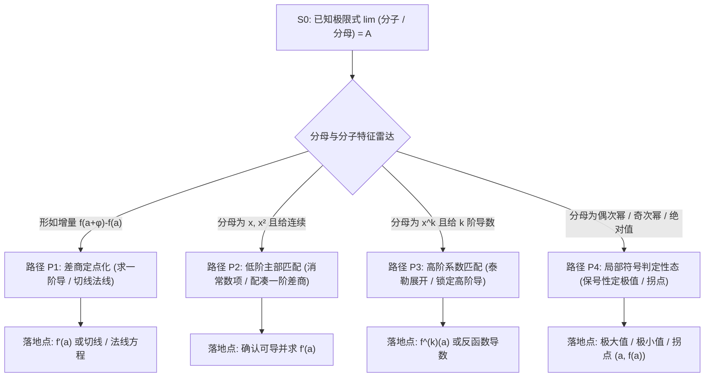

# 极限与导数定义式｜按刷题顺序重排

- 分类路径：高等数学 / 一元微分 / 导数与微分概念 / 极限与导数定义式
- 题量：`33`
- 组织架构：**严格按 4 大核心路径 P1～P4 纵向统筹**，每路径下设【锚点题 $\to$ 变式题 $\to$ 同构题】三级进阶

> [!tip]- 本页刷题结构与执行说明
> 1. **统领问题**：题面给出一个极限时，它究竟在锁定什么？
>    - **P1** 锁定一阶导数定义式与切线法线；
>    - **P2** 锁定连续函数值与低阶差商主部；
>    - **P3** 锁定泰勒多项式系数与高阶导数；
>    - **P4** 锁定左右局部符号与极值、拐点。
> 2. **做题纪律**：
>    - 绝不无脑套洛必达：先看题目是“已给高阶导求值”还是“未给高阶导判定存在”；
>    - 先写出“入口信号 $\to$ 第一操作 $\to$ 预计落点”；
>    - 答案解析默认折叠，独立作答后再展开核对。

## 状态转移全景图谱

## 33 题全局导航表

| 路径 | 锚点题 (建立直觉) | 变式题 (条件微调) | 同构题 (盲测确认) | 合计 |
| :--- | :---: | :---: | :---: | :---: |
| **P1 差商定点化** | 001, 002 | 003, 004, 005 | 006 | **6 题** |
| **P2 低阶主部匹配** | 007, 008 | 009, 010, 011, 012 | 013, 014, 015 | **9 题** |
| **P3 高阶系数匹配** | 016 | 017, 018 | — | **3 题** |
| **P4 局部符号判定性态** | 019, 020, 021 | 022, 023, 024, 025, 026, 027, 028 | 029, 030, 031, 032, 033 | **15 题** |
| **总计** | **8 题** | **16 题** | **9 题** | **33 题** |

## 路径 P1｜差商定点化（一阶导数与切线法线）

> **【核心逻辑】**：目标求 $f'(a)$ 或切线法线。题面出现 $f(a+\varphi(x))-f(a)$ 或 $f(a)-f(a-\varphi(x))$，通过换元令 $\Delta x = \pm\varphi(x)$，对齐标准一阶导数定义 $\frac{\Delta y}{\Delta x}$。
> **【强信号】**：自变量趋向同一点，分子形如函数增量。
> **【第一操作】**：核查自变量趋近方向（单侧 vs 双侧）与负号提取；两次代换仍未出差商，退回原始定义。

### 锚点题

#### 001 [差商定点]. 1995 数三; 880 第二章基础填空 16

- 题目ID：`1320`
- 题号：`1`
- 题源：1995 数三; 880 第二章基础填空 16
- 分类：高等数学 / 一元微分 / 导数概念 / 极限与导数 / 已知极限求导数 / 求一阶导
- 选做：否

设 $f(x)$ 为可导函数，且满足条件 $\lim_{x\to0}\frac{f(1)-f(1-x)}{2x}=-1$，则曲线 $y=f(x)$ 在点 $(1,f(1))$ 处的切线斜率为（）

### 选项

A. 2
B. -1
C. $\frac{1}{2}$
D. -2

> [!success]- 答案解析
> **答案**
>
> D
>
> **解析**
>
> 曲线 $y = f(x)$ 在点 $(1, f(1))$ 处的切线斜率为 $f(x)$ 在点 $x = 1$ 处的导数值。由导数定义： $f'(x_0) = \lim_{\Delta x \to 0} \frac{f(x_0 + \Delta x) - f(x_0)}{\Delta x}$。此处令 $\Delta x = -x$，则 $f'(1)=\lim_{x\to0}\frac{f(1-x)-f(1)}{-x} = \lim_{x\to0}\frac{f(1)-f(1-x)}{x}$。已知 $\lim_{x\to0}\frac{f(1)-f(1-x)}{2x}=-1$，所以 $\lim_{x\to0}\frac{f(1)-f(1-x)}{x} = 2 \times (-1) = -2$。故 $f'(1) = -2$。

^q-1320

#### 002 [差商定点]. 2022 数二

- 题目ID：`1322`
- 题号：`3`
- 题源：2022 数二
- 分类：高等数学 / 一元微分 / 导数概念 / 极限与导数 / 已知极限求导数 / 求一阶导
- 选做：否

已知函数 $f(x)$ 在 x=1 处可导且 $\lim_{x\to0}\frac{f\left(\mathrm{e}^{x^{2}}\right)-3f\left(1+\sin^{2}x\right)}{x^{2}}=2$，求 $f'(1)$。

> [!success]- 答案解析
> **答案**
>
> 无
>
> **解析**
>
> 由极限存在可知，当 $x \to 0$ 时，分子趋于 0，即 $f(1) - 3f(1) = 0$，故 $f(1) = 0$。利用泰勒展开或导数定义处理极限。设 $u = e^{x^2} - 1 \sim x^2$， $v = \sin^2 x \sim x^2$。则原极限可写为： 
>
> $$
> \lim_{x\to0}\frac{[f(1+u)-f(1)] - 3[f(1+v)-f(1)]}{x^{2}} = \lim_{x\to0}\frac{f'(1)u + o(u) - 3[f'(1)v + o(v)]}{x^{2}} = \lim_{x\to0}\frac{f'(1)(u - 3v) + o(x^{2})}{x^{2}} = f'(1) \lim_{x\to0}\frac{x^{2} - 3x^{2}}{x^{2}} + 0 = f'(1) \times (-2) = 2.
> $$
>
>  因此 $-2f'(1) = 2$，解得 $f'(1) = -1$。

^q-1322

### 变式题

#### 003 [差商定点]. 1998 数三

- 题目ID：`1321`
- 题号：`2`
- 题源：1998 数三
- 分类：高等数学 / 一元微分 / 导数概念 / 极限与导数 / 已知极限求导数 / 求一阶导
- 选做：否

设周期函数 $f(x)$ 在 $(-\infty,+\infty)$ 内可导，周期为 4。又 $\lim_{x\to0}\frac{f(1)-f(1-x)}{2x}=-1$，则曲线 $y=f(x)$ 在点 $(5,f(5))$ 处的切线的斜率为（）

### 选项

A. $\frac{1}{2}$
B. 0
C. $-1$
D. $-2$

> [!success]- 答案解析
> **答案**
>
> D
>
> **解析**
>
> 由 $\lim_{x\to0}\frac{f(1)-f(1-x)}{2x}=-1$，根据导数定义可得 $f'(1) = -2$。由于 $f(x)$ 周期为 4，即 $f(x)=f(x+4)$，两边求导得 $f^{\prime}(x)=f^{\prime}(x+4)$，故 $f'(5) = f'(1) = -2$。因此曲线在点 $(5, f(5))$ 处的切线斜率为 $-2$。

^q-1321

#### 004 [差商定点]. 26 版 ♣ 1000 第三章基础 3

- 题目ID：`1332`
- 题号：`13`
- 题源：26 版 ♣ 1000 第三章基础 3
- 分类：高等数学 / 一元微分 / 导数概念 / 极限与导数 / 已知极限求导数 / 求一阶导
- 选做：否

设连续函数 $f(x)$ 满足 $\lim_{x \to 2} \frac{\ln(x-1)}{f(3-x)} = 2$，且 $f(1) = 0$，则 $f'(1)$ 的值为（）.

### 选项

A. 2
B. $-2$
C. $\frac{1}{2}$
D. $-\frac{1}{2}$

> [!success]- 答案解析
> **答案**
>
> D
>
> **解析**
>
> 令 $\Delta x = x - 2$，当 $x \to 2$ 时， $\Delta x \to 0$，则
>
> $$
> \lim_{x\to2}\frac{\ln(x-1)}{f(3-x)}=\lim_{\Delta x\to0}\frac{\ln(1+\Delta x)}{f(1-\Delta x)}=\lim_{\Delta x\to0}\frac{\frac{\ln(1+\Delta x)}{\Delta x}}{\frac{f(1-\Delta x)}{\Delta x}}=2,
> $$
>
>  
> 故
>
> $$
> \lim_{\Delta x\to0}\frac{f(1-\Delta x)}{\Delta x}=\frac{1}{2},
> $$
>
>  
> 从而得
>
> $$
> f^{\prime}(1)=-\frac{1}{2}.
> $$

^q-1332

#### 005 [差商定点]. 880 第二章基础填空 17

- 题目ID：`1333`
- 题号：`14`
- 题源：880 第二章基础填空 17
- 分类：高等数学 / 一元微分 / 导数概念 / 极限与导数 / 已知极限求导数 / 求一阶导
- 选做：否

设 $f(x)$ 是连续函数，且 $\lim_{x\to1}\frac{f(2x-1)}{x-1}=1$，则 $\lim_{t\to0}\frac{f\left[(1+\sin t)^2\right]-f(1+\sin t)}{t}=$ ___

> [!success]- 答案解析
> **答案**
>
> 无
>
> **解析**
>
> 由 $\lim_{x\to1}\frac{f(2x-1)}{x-1}=1$，知 $\lim_{x\to1}f(2x-1)=f(1)=0$，故
>
> $$
> \lim_{x\to1}\frac{f(2x-1)-f(1)}{x-1}=\lim_{x\to1}\frac{f(1+2x-2)-f(1)}{2x-2}\cdot\frac{2x-2}{x-1}=2f^{\prime}(1)=1,
> $$
>
>  
>
> $$
> \begin{aligned} 从而 f^{\prime}(1)&=\frac{1}{2}.\\&\lim_{t\to0}\frac{f\left[(1+\sin t)^{2}\right]-f(1+\sin t)}{t}\\=&\lim_{t\to0}\frac{f\left[(1+\sin t)^{2}\right]-f(1)}{t}-\lim_{t\to0}\frac{f(1+\sin t)-f(1)}{t}\\=&\lim_{t\to0}\frac{f(1+2\sin t+\sin^{2}t)-f(1)}{2\sin t+\sin^{2}t}\cdot\frac{2\sin t+\sin^{2}t}{t}-\lim_{t\to0}\frac{f(1+\sin t)-f(1)}{\sin t}\cdot\frac{\sin t}{t}\\=&2f^{\prime}(1)-f^{\prime}(1)=f^{\prime}(1)=\frac{1}{2}.\end{aligned}
> $$

^q-1333

### 同构题

#### 006 [差商定点]. 26 版 1000 第三章强化 20

- 题目ID：`1334`
- 题号：`15`
- 题源：26 版 1000 第三章强化 20
- 分类：高等数学 / 一元微分 / 导数概念 / 极限与导数 / 已知极限求导数 / 求一阶导
- 选做：否

已知函数 $f(x)$ 在 x = 1 处可导，且 $\lim_{x \to 0} \frac{f(\cos x) - 3f(1 + \sin^2 x)}{x^2} = 2$，求 $f'(1)$.

> [!success]- 答案解析
> **答案**
>
> 无
>
> **解析**
>
> 因为 $f(x)$ 在 x = 1 处可导，所以 $f(x)$ 在 x = 1 处连续，从而
>
> $$
> \lim_{\tau\rightarrow0}[f(\cos x)-3f(1+\sin^{2}x)]=f(1)-3f(1)=-2f(1).
> $$
>
>  
> 由 $\lim_{x\to0}\frac{f(\cos x)-3f(1+\sin^{2}x)}{x^{2}}=2$ 可知 $\lim_{x\to0}\left[f(\cos x)-3f(1+\sin^{2}x)\right]=0$，所以 $f(1)=0$，从而有
>
> $$
> \begin{aligned}&\lim_{x\to0}\frac{f(\cos x)-3f(1+\sin^{2}x)}{x^{2}}\\&=\lim_{x\to0}\left[\frac{f(\cos x)-f(1)}{\cos x-1}\cdot\frac{\cos x-1}{x^{2}}-3\frac{f(1+\sin^{2}x)-f(1)}{\sin^{2}x}\cdot\frac{\sin^{2}x}{x^{2}}\right]\\&=-\frac{1}{2}f^{\prime}(1)-3f^{\prime}(1)=-\frac{7}{2}f^{\prime}(1)=2.\end{aligned}
> $$
>
>  
> 故 $f'(1) = -\frac{4}{7}$.

^q-1334

## 路径 P2｜低阶主部匹配（连续消项与差商配凑）

> **【核心逻辑】**：分母是 $x$ 或 $x^2$（或等价无穷小），分子混杂 $f(x)$ 与初等函数（$e^x, \ln(1+x), \sin x$），题目给连续性。
> **【强信号】**：有限非零极限迫使分子低阶项必须为 0。
> **【第一操作】**：先令常数项为 0 锁定 $f(a)$；再拆出线性项配凑标准差商 $\frac{f(x)-f(a)}{x-a}$ 提取 $f'(a)$ 或切线、法线。

### 锚点题

#### 007 [主部匹配]. 2025 数二 第18题

- 题目ID：`1323`
- 题号：`4`
- 题源：2025 数二 第18题
- 分类：高等数学 / 一元微分 / 导数概念 / 极限与导数 / 已知极限求导数 / 求一阶导
- 选做：否

设函数 $f(x)$ 在 x=0 处连续，且 $\lim_{x\to0}\frac{xf(x)-e^{2\sin x}+1}{\ln(1+x)+\ln(1-x)}=-3$。证明： $f(x)$ 在 x=0 处可导，并求 $f'(0)$。

> [!success]- 答案解析
> **答案**
>
> $f'(0) = 5$
>
> **解析**
>
> 这是一道非常经典的微积分综合题，主要考察了等价无穷小替换、泰勒公式（麦克劳林展开）以及导数定义的综合应用。
>
> 以下是完整的证明与求解过程：
>
> ### **第一步：化简分母并转化极限**
>
> 首先，观察极限式的分母。根据对数的性质和等价无穷小，当 $x \to 0$ 时：
>
> $$
> \ln(1+x) + \ln(1-x) = \ln(1-x^2)
> $$
>
> 因为当 $t \to 0$ 时，$\ln(1+t) \sim t$，所以令 $t = -x^2$，可得：
>
> $$
> \ln(1-x^2) \sim -x^2
> $$
>
> 将分母替换为等价无穷小，原极限式可以转化为：
>
> $$
> \lim_{x\to0}\frac{xf(x)-e^{2\sin x}+1}{-x^2} = -3
> $$
>
> 两边同乘 $-1$，得到：
>
> $$
> \lim_{x\to0}\frac{xf(x)-e^{2\sin x}+1}{x^2} = 3
> $$
>
> ---
>
> ### **第二步：利用泰勒公式展开指数函数**
>
> 为了处理分子中的 $e^{2\sin x}$，我们需要在 $x=0$ 处对其进行带有佩亚诺余项的麦克劳林展开。由于分母是 $x^2$，我们需要将分子展开到 $x^2$ 项。
>
> 已知当 $x \to 0$ 时：
>
> $$
> \sin x = x + o(x^2)
> $$
>
> $$
> e^u = 1 + u + \frac{u^2}{2} + o(u^2)
> $$
>
> 令 $u = 2\sin x = 2x + o(x^2)$，代入指数函数的展开式中：
>
> $$
> e^{2\sin x} = 1 + (2x + o(x^2)) + \frac{1}{2}(2x + o(x^2))^2 + o(x^2)
> $$
>
> 展开并化简，舍去高阶无穷小：
>
> $$
> e^{2\sin x} = 1 + 2x + 2x^2 + o(x^2)
> $$
>
> ---
>
> ### **第三步：求解 $f(0)$**
>
> 将上述展开式代回转化后的极限式分子中：
>
> $$
> \lim_{x\to0}\frac{xf(x) - [1 + 2x + 2x^2 + o(x^2)] + 1}{x^2} = 3
> $$
>
> $$
> \lim_{x\to0}\frac{xf(x) - 2x - 2x^2 + o(x^2)}{x^2} = 3
> $$
>
> 由于 $x \to 0$ 时 $x \neq 0$，分子分母同除以 $x$：
>
> $$
> \lim_{x\to0}\frac{f(x) - 2 - 2x + o(x)}{x} = 3
> $$
>
> 要使该分式极限存在且等于常数 $3$，当分母 $x \to 0$ 时，分子必定趋于 $0$（否则极限为无穷大）。因此：
>
> $$
> \lim_{x\to0} [f(x) - 2 - 2x + o(x)] = 0
> $$
>
> 题目已知 $f(x)$ 在 $x=0$ 处**连续**，所以 $\lim_{x\to0} f(x) = f(0)$。代入上式可得：
>
> $$
> f(0) - 2 - 0 + 0 = 0 \implies f(0) = 2
> $$
>
> ---
>
> ### **第四步：利用导数定义证明可导并求 $f'(0)$**
>
> 根据在 $x=0$ 处的导数定义：
>
> $$
> f'(0) = \lim_{x\to0}\frac{f(x) - f(0)}{x - 0} = \lim_{x\to0}\frac{f(x) - 2}{x}
> $$
>
> 我们回到第三步中得到的极限式：
>
> $$
> \lim_{x\to0}\frac{f(x) - 2 - 2x + o(x)}{x} = 3
> $$
>
> 将其拆分：
>
> $$
> \lim_{x\to0}\left[ \frac{f(x) - 2}{x} - \frac{2x}{x} + \frac{o(x)}{x} \right] = 3
> $$
>
> $$
> \lim_{x\to0}\left[ \frac{f(x) - 2}{x} - 2 + \frac{o(x)}{x} \right] = 3
> $$
>
> 因为 $\lim_{x\to0}\frac{o(x)}{x} = 0$，且极限定理允许我们将常数项移项：
>
> $$
> \lim_{x\to0}\frac{f(x) - 2}{x} - 2 + 0 = 3
> $$
>
> $$
> \lim_{x\to0}\frac{f(x) - 2}{x} = 5
> $$
>
> 因为该极限存在且为常数 $5$，这不仅**证明了 $f(x)$ 在 $x=0$ 处可导**，同时也得出了导数值：
>
> $$
> f'(0) = 5
> $$
>
> ### **结论**
> $f(x)$ 在 $x=0$ 处可导，且 $f'(0) = 5$。

^q-1323

#### 008 [主部匹配]. 26 版 ☀️ 1000 第五章强化 2; 26 版 660 数一二三第 40 题

- 题目ID：`1325`
- 题号：`6`
- 题源：26 版 ☀️ 1000 第五章强化 2; 26 版 660 数一二三第 40 题
- 分类：高等数学 / 一元微分 / 导数概念 / 极限与导数 / 已知极限求导数 / 求一阶导
- 选做：否

设 $f(x)$ 在 $x=0$ 处连续，且 $\lim_{x\to0}\frac{[f(x)+1]x^{2}}{x-\sin x}=2$，则曲线 $y=f(x)$ 在点 $(0,f(0))$ 处的切线方程为

> [!success]- 答案解析
> **答案**
>
> 无
>
> **解析**
>
> 方法一 由极限与无穷小的关系，有 
>
> $$
> \frac{\left[f(x)+1\right]x^{2}}{x-\sin x}=2+\alpha, 其中 \lim_{x\to0}\alpha=0.
> $$
>
>  于是 
>
> $$
> f(x)=\frac{(2+\alpha)(x-\sin x)}{x^{2}}-1.
> $$
>
>  但由 
>
> $$
> \lim_{x\to0}\frac{x-\sin x}{x^{2}}\xlongequal{ 洛必达法则 }\lim_{x\to0}\frac{1-\cos x}{2x}=\lim_{x\to0}\frac{x^{2}}{4x}=0,
> $$
>
>  
>
> $$
> \lim_{x\to0}(2+\alpha)=2,
> $$
>
>  可得 
>
> $$
> \lim_{x\to0}f(x)=\lim_{x\to0}\left[\frac{(2+\alpha)(x-\sin x)}{x^{2}}-1\right]=0-1=-1.
> $$
>
>  由于 $f(x)$ 在 $x = 0$ 处连续，因此 $f(0) = \lim_{x \to 0} f(x) = -1$. 
>
> $$
> \begin{aligned}f^{\prime}(0)&=\lim_{x\to0}\frac{f(x)-f(0)}{x-0}=\lim_{x\to0}\frac{(2+\alpha)(x-\sin x)}{x^{3}}\\&=\lim_{x\to0}\frac{(2+\alpha)\cdot\frac{1}{6}x^{3}}{x^{3}}=\frac{1}{3},\end{aligned}
> $$
>
>  所以曲线 $y = f(x)$ 在点 $(0, f(0))$ 处的切线方程为 
>
> $$
> y-f(0)=f^{\prime}(0)(x-0),
> $$
>
>  即 $y=\frac{1}{3}x-1.$ 方法二 将 $\sin x$ 按带佩亚诺余项的泰勒公式展开至 $n = 3$，有 
>
> $$
> x-\sin x=x-\left[x-\frac{1}{3!}x^{3}+o(x^{3})\right]=\frac{1}{6}x^{3}+o(x^{3}),
> $$
>
>  代入原极限式，有 
>
> $$
> 2=\lim_{x\to0}\frac{\left[f(x)+1\right]x^{2}}{x-\sin x}=\lim_{x\to0}\frac{\left[f(x)+1\right]x^{2}}{\frac{1}{6}x^{3}+o(x^{3})}=\lim_{x\to0}\frac{f(x)+1}{\frac{1}{6}x+o(x)},
> $$
>
>  可见 $\lim_{x\to0}\left[f(x)+1\right]=0$，即有 $f(0)=\lim_{x\to0}f(x)=-1$。于是 
>
> $$
> \begin{aligned}f^{\prime}(0)&=\lim_{x\to0}\frac{f(x)-f(0)}{x-0}=\lim_{x\to0}\frac{f(x)+1}{x}\\&=\lim_{x\to0}\left[\frac{f(x)+1}{\frac{1}{6}x+o(x)}\cdot\frac{\frac{1}{6}x+o(x)}{x}\right]=2\cdot\frac{1}{6}=\frac{1}{3}.\end{aligned}
> $$
>
>  以下同方法一.

^q-1325

### 变式题

#### 009 [主部匹配]. 880 第二章基础填空 6

- 题目ID：`1328`
- 题号：`9`
- 题源：880 第二章基础填空 6
- 分类：高等数学 / 一元微分 / 导数概念 / 极限与导数 / 已知极限求导数 / 求一阶导
- 选做：否

设 $f'(0)$ 存在， $f(0)=0$，且 $\lim_{x\to0}\left[1+\frac{1-\cos f(x)}{\sin x}\right]^{\frac{1}{x}}=\mathrm{e}$，则 $f'(0)=$ ___

> [!success]- 答案解析
> **答案**
>
> 无
>
> **解析**
>
> 依题设，有 
>
> $$
> \lim_{x\to0}\left[1+\frac{1-\cos f(x)}{\sin x}\right]^{\frac{1}{x}}=\lim_{x\to0}\left\{\left[1+\frac{1-\cos f(x)}{\sin x}\right]^{\frac{\sin x}{1-\cos f(x)}}\right\}^{\frac{1-\cos f(x)}{x\sin x}}=e,
> $$
>
>  故 $\lim_{x\to0}\frac{1-\cos f(x)}{x\sin x}=1.$ 又当 $x \rightarrow 0$ 时， $\sin x \sim x$， $1 - \cos f(x) \sim \frac{1}{2} f^{2}(x)$，且 $f'(0)$ 存在，故 
>
> $$
> \lim_{x\to0}\frac{1-\cos f(x)}{x\sin x}=\frac{1}{2}\lim_{x\to0}\frac{f^{2}(x)}{x^{2}}=\frac{1}{2}\lim_{x\to0}\frac{f(x)}{x}\cdot\lim_{x\to0}\frac{f(x)}{x}=\frac{1}{2}f^{\prime}(0)\cdot f^{\prime}(0)
> $$
>
>  解得 $f'(0) = \pm \sqrt{2}$.

^q-1328

#### 010 [主部匹配]. 26 版 660 数一二三第 153 题

- 题目ID：`1329`
- 题号：`10`
- 题源：26 版 660 数一二三第 153 题
- 分类：高等数学 / 一元微分 / 导数概念 / 极限与导数 / 已知极限求导数 / 求一阶导
- 选做：否

设 $f(x)$ 在 $x = 0$ 处连续，且 $\lim_{x \to 0} \frac{e^{f(x)} - \cos x + \sin x}{x} = 0$，则 $f'(0)$

### 选项

A. = 1.
B. = -1.
C. = 0.
D. 不存在.

> [!success]- 答案解析
> **答案**
>
> B
>
> **解析**
>
> 因 $\lim_{x\to0}\frac{e^{f(x)}-\cos x+\sin x}{x}=0$，所以存在 $\mathring{U}_{\delta}(0)$，当 $x\in\mathring{U}_{\delta}(0)$时， 
>
> $$
> \frac{\mathrm{e}^{f(x)}-\cos x+\sin x}{x}=0+\alpha,\lim_{x\to0}\alpha=0.
> $$
>
>  所以 
>
> $$
> f(x)=\ln(\alpha x+\cos x-\sin x).
> $$
>
>  由于 $f(x)$ 在 $x = 0$ 处连续，所以 
>
> $$
> f(0)=\lim_{x\to0}f(x)=\lim_{x\to0}\ln(\alpha x+\cos x-\sin x)=0.
> $$
>
>  
>
> $$
> \begin{aligned}\lim_{x\to0}\frac{f(x)-f(0)}{x-0}&=\lim_{x\to0}\frac{1}{x}\ln(\alpha x+\cos x-\sin x)\\&=\lim_{x\to0}\frac{1}{x}\ln(1+\alpha x+\cos x-1-\sin x)\\&=\lim_{x\to0}\frac{1}{x}(\alpha x+\cos x-1-\sin x)\\&=\lim_{\alpha\to0}\lim_{x\to0}\frac{\cos x-1}{x}-\lim_{x\to0}\frac{\sin x}{x}=-1.\end{aligned}
> $$
>
>  所以 $f'(0) = -1$.

^q-1329

#### 011 [主部匹配]. 26 版 660 数一二三第 167 题

- 题目ID：`1330`
- 题号：`11`
- 题源：26 版 660 数一二三第 167 题
- 分类：高等数学 / 一元微分 / 导数概念 / 极限与导数 / 已知极限求导数 / 求一阶导
- 选做：否

设函数 $f(x)$ 在 $x = 0$ 处有定义，且 $f(0) = 1$， $\lim_{x \to 0} \frac{\ln(1 - x) + f(x) \sin x}{e^{x^2} - 1} = 0$，则 $f'(0) =$

### 选项

A. $\frac{1}{2}.$
B. $-\frac{1}{2}.$
C. 2.
D. -2.

> [!success]- 答案解析
> **答案**
>
> A
>
> **解析**
>
> 方法 1 由 
>
> $$
> \begin{aligned}0&=\lim_{x\rightarrow0}\frac{\ln(1-x)+f(x)\sin x}{\mathrm{e}^{x^{2}}-1}\\&=\lim_{x\rightarrow0}\frac{\ln(1-x)+\sin x+\left\lbrack f(x)-1\right\rbrack\sin x}{x^{2}}\\ \end{aligned}
> $$
>
>  而 
>
> $$
> \begin{aligned}\lim_{x\to0}\frac{\ln(1-x)+\sin x}{x^{2}}&=\lim_{x\to0}\frac{\frac{-1}{1-x}+\cos x}{2x}=\lim_{x\to0}\frac{\frac{-1}{(1-x)^{2}}-\sin x}{2}\\&=-\frac{1}{2}\end{aligned}
> $$
>
>  则 $\lim_{x\to0}\frac{\left[f(x)-1\right]\sin x}{x^{2}}=\frac{1}{2}$，即 
>
> $$
> \lim_{x\to0}\frac{f(x)-1}{x}=\lim_{x\to0}\frac{f(x)-f(0)}{x}=\frac{1}{2}
> $$
>
>  故 $f(x)$ 在 $x = 0$ 处可导，且 $f'(0) = \frac{1}{2}$. 方法 2 由泰勒公式知 
>
> $$
> \ln(1-x)=-x-\frac{x^{2}}{2}+o(x^{2}),\sin x=x+o(x^{2}).
> $$
>
>  
>
> $$
> \begin{aligned}0&=\lim_{x\rightarrow0}\frac{\ln(1-x)+f(x)\sin x}{\mathrm{e}^{x^{2}}-1}\\&=\lim_{x\rightarrow0}\frac{\left\lbrack-x-\frac{x^{2}}{2}+o(x^{2})\right\rbrack+f(x)\left\lbrack x+o(x^{2})\right\rbrack}{x^{2}}\\&=\lim_{x\rightarrow0}\left\lbrack\frac{-\frac{x^{2}}{2}+o(x^{2})+f(x)\bullet o(x^{2})}{x^{2}}+\frac{x f(x)-x}{x^{2}}\right\rbrack\end{aligned}
> $$
>
>  而 $\lim_{x\to0}\frac{-\frac{x^{2}}{2}+o(x^{2})+f(x)\cdot o(x^{2})}{x^{2}}=-\frac{1}{2}$，则 
>
> $$
> \lim_{x\to0}\frac{xf(x)-x}{x^{2}}=\frac{1}{2}
> $$
>
>  即 $\lim_{x\to0}\frac{f(x)-1}{x}=\lim_{x\to0}\frac{f(x)-f(0)}{x}=\frac{1}{2}$ 故 $f(x)$ 在 $x = 0$ 处可导，且 $f'(0) = \frac{1}{2}$.

^q-1330

#### 012 [主部匹配]. 26 版 1000 第三章强化 21

- 题目ID：`1331`
- 题号：`12`
- 题源：26 版 1000 第三章强化 21
- 分类：高等数学 / 一元微分 / 导数概念 / 极限与导数 / 已知极限求导数 / 求一阶导
- 选做：否

设 $f(x)$ 是非负连续函数，且 $\lim_{x\to a}\frac{f^{2}(x)-a}{x^{2}-a^{2}}=1(a>0)$，求 $f'(a)$.

> [!success]- 答案解析
> **答案**
>
> 无
>
> **解析**
>
> 由题知，
>
> $$
> \begin{aligned}1&=\lim_{x\to a}\frac{f(x)-\sqrt{a}}{x-a}\cdot\lim_{x\to a}\frac{f(x)+\sqrt{a}}{x+a}\\&=\frac{f(a)+\sqrt{a}}{2a}\cdot\lim_{x\to a}\frac{f(x)-\sqrt{a}}{x-a},\end{aligned}
> $$
>
>  
> 于是有
>
> $$
> \lim_{x\to a}\frac{f(x)-\sqrt{a}}{x-a}=\frac{2a}{f(a)+\sqrt{a}},
> $$
>
>  
> 故
>
> $$
> \lim_{x\to a}f(x)=f(a)=\sqrt{a},
> $$
>
>  
> 即
>
> $$
> \begin{aligned}f^{\prime}(a)&=\lim_{x\to a}\frac{f(x)-f(a)}{x-a}\\&=\lim_{x\to a}\frac{f(x)-\sqrt{a}}{x-a}\\&=\frac{2a}{\sqrt{a}+\sqrt{a}}\\&=\sqrt{a}.\end{aligned}
> $$

^q-1331

### 同构题

#### 013 [主部匹配]. 880 第二章基础解答 13

- 题目ID：`1324`
- 题号：`5`
- 题源：880 第二章基础解答 13
- 分类：高等数学 / 一元微分 / 导数概念 / 极限与导数 / 已知极限求导数 / 求一阶导
- 选做：否

设函数 $f(x)$ 在 x=0 处连续，且 $\lim_{x\to0}\frac{xf(x)-(1+x)^{2x}+1}{x^{2}}=1$。证明 $f(x)$ 在 x=0 处可导，并求 $f'(0)$

> [!success]- 答案解析
> **答案**
>
> 3
>
> **解析**
>
> 这是一道非常经典的微积分题目，主要考察了**等价无穷小代换**、**极限的四则运算性质**以及**导数与连续性的基本定义**。
>
> 以下是详细的推导和证明步骤：
>
> ### 第一步：处理复杂项的极限
>
> 首先，我们单独观察极限表达式中的复杂部分 $(1+x)^{2x} - 1$ 当 $x \to 0$ 时的渐近行为。
> 利用指数对数恒等式 $a^b = e^{b \ln a}$，我们可以将其改写为：
>
> $$
> (1+x)^{2x} - 1 = e^{2x \ln(1+x)} - 1
> $$
>
> 当 $x \to 0$ 时：
> 1. 根据等价无穷小 $e^u - 1 \sim u$（当 $u \to 0$ 时），可得：
>    
>
> $$
> e^{2x \ln(1+x)} - 1 \sim 2x \ln(1+x)
> $$
>
> 2. 再根据等价无穷小 $\ln(1+x) \sim x$（当 $x \to 0$ 时），进一步得到：
>    
>
> $$
> 2x \ln(1+x) \sim 2x \cdot x = 2x^2
> $$
>
> 因此，当 $x \to 0$ 时，有等价关系：
>
> $$
> (1+x)^{2x} - 1 \sim 2x^2
> $$
>
> 这意味着该部分的极限为：
>
> $$
> \lim_{x\to0} \frac{(1+x)^{2x} - 1}{x^2} = \lim_{x\to0} \frac{2x^2}{x^2} = 2
> $$
>
> ### 第二步：拆分原极限表达式
>
> 已知原极限为：
>
> $$
> \lim_{x\to0}\frac{xf(x) - [(1+x)^{2x} - 1]}{x^2} = 1
> $$
>
> 我们可以通过代数变形，将要求解的 $\frac{f(x)}{x}$ 构造出来：
>
> $$
> \frac{f(x)}{x} = \frac{xf(x)}{x^2} = \frac{xf(x) - [(1+x)^{2x} - 1] + [(1+x)^{2x} - 1]}{x^2}
> $$
>
> $$
> \frac{f(x)}{x} = \frac{xf(x) - (1+x)^{2x} + 1}{x^2} + \frac{(1+x)^{2x} - 1}{x^2}
> $$
>
> 由于等式右边两项的极限在 $x \to 0$ 时均存在，我们可以利用极限的加法法则对其分别求极限：
>
> $$
> \lim_{x\to0} \frac{f(x)}{x} = \lim_{x\to0} \left[ \frac{xf(x) - (1+x)^{2x} + 1}{x^2} \right] + \lim_{x\to0} \left[ \frac{(1+x)^{2x} - 1}{x^2} \right]
> $$
>
> 代入已知条件和第一步求出的结果：
>
> $$
> \lim_{x\to0} \frac{f(x)}{x} = 1 + 2 = 3
> $$
>
> ### 第三步：利用连续性求 $f(0)$ 
>
> 既然极限 $\lim_{x\to0} \frac{f(x)}{x} = 3$ 存在且为一个常数，而当 $x \to 0$ 时分母趋于 $0$，那么为了使整体极限存在，分子必定趋于 $0$（否则极限为无穷大）。
> 因此：
>
> $$
> \lim_{x\to0} f(x) = 0
> $$
>
> 题目已知 $f(x)$ 在 $x=0$ 处连续，根据连续函数的定义，函数在一点的极限值等于该点的函数值：
>
> $$
> f(0) = \lim_{x\to0} f(x) = 0
> $$
>
> ### 第四步：证明可导性并求导数值
>
> 根据函数在某一点可导的基本定义：
>
> $$
> f'(0) = \lim_{x\to0} \frac{f(x) - f(0)}{x - 0}
> $$
>
> 将 $f(0) = 0$ 代入上述公式：
>
> $$
> f'(0) = \lim_{x\to0} \frac{f(x) - 0}{x} = \lim_{x\to0} \frac{f(x)}{x}
> $$
>
> 我们在第二步中已经求出该极限值为 $3$。
> 因此，$f(x)$ 在 $x=0$ 处的导数存在（即满足可导的定义），并且：
>
> $$
> f'(0) = 3
> $$
>
> ---
>
> **最终结论：** 证明完毕，$f(x)$ 在 $x=0$ 处可导，且 $f'(0) = 3$。

^q-1324

#### 014 [主部匹配]. 26版660数一二三第28题

- 题目ID：`1326`
- 题号：`7`
- 题源：26版660数一二三第28题
- 分类：高等数学 / 一元微分 / 导数概念 / 极限与导数 / 已知极限求导数 / 求一阶导
- 选做：否

设函数 $f(x)$ 在 $x=0$ 处连续，且 $\lim_{x\to0}\frac{f(x)}{e^x-1}=2$，则曲线 $y=f(x)$ 在 $x=0$ 处的法线方程为 ___.

> [!success]- 答案解析
> **答案**
>
> 无
>
> **解析**
>
> 由 $\lim_{x\to0}\frac{f(x)}{e^x-1}=2$，且 $e^x-1 \sim x$，可得 $\lim_{x\to0}\frac{f(x)}{x}=2$。由于 $f(x)$ 在 $x=0$ 处连续，有 $f(0)=\lim_{x\to0}f(x)=0$。则 $f'(0)=\lim_{x\to0}\frac{f(x)-f(0)}{x-0}=\lim_{x\to0}\frac{f(x)}{x}=2$。曲线在 $(0,0)$ 处的切线斜率为 $2$，故法线斜率为 $-\frac{1}{2}$，法线方程为 $y = -\frac{1}{2}x$。

^q-1326

#### 015 [主部匹配]. 26 版 ☏ 1000 第三章基础 8

- 题目ID：`1327`
- 题号：`8`
- 题源：26 版 ☏ 1000 第三章基础 8
- 分类：高等数学 / 一元微分 / 导数概念 / 极限与导数 / 已知极限求导数 / 求一阶导
- 选做：否

设函数 $f(x)$ 连续， $\lim_{x\to1}\frac{f(x)-1}{\ln x}=2$，则曲线 $y=f(x)$ 在点 $x=1$ 处的切线方程为 ___.

> [!success]- 答案解析
> **答案**
>
> 无
>
> **解析**
>
> $\lim_{x\to1}[f(x)-1]=\lim_{x\to1}\frac{f(x)-1}{\ln x}\cdot\ln x=0$，又 $f(x)$ 连续，故 $f(1)=\lim_{x\to1}f(x)=1$. 
>
> $$
> f^{\prime}(1)=\lim_{x\to1}\frac{f(x)-f(1)}{x-1}=\lim_{x\to1}\frac{f(x)-1}{\ln x}\cdot\frac{\ln x}{x-1}=2\cdot1=2.
> $$
>
>  故所求切线方程为 $y - f(1) = f'(1)(x - 1)$，即 $y - 1 = 2(x - 1)$，也即 $y = 2x - 1$.

^q-1327

## 路径 P3｜高阶系数匹配（泰勒展开与高阶导数）

> **【核心逻辑】**：分母首个非零阶为 $(x-a)^k$，题目明确给出相应阶导数存在（或求反函数高阶导）。
> **【强信号】**：有限非零极限迫使 $0 \sim k-1$ 阶系数依次为 0。
> **【第一操作】**：先确认分母确切阶数，再用泰勒公式将分子展开到同一阶，由最高项系数直接读出 $\frac{f^{(k)}(a)}{k!}$。

### 锚点题

#### 016 [高阶系数]. 姜晓千真题同源 150（重点）

- 题目ID：`1335`
- 题号：`1`
- 题源：姜晓千真题同源 150（重点）
- 分类：高等数学 / 一元微分 / 导数概念 / 极限与导数 / 已知极限求导数 / 求高阶导
- 选做：否

设 $f(x)$ 在 x = 0 处二阶可导，反函数为 $x = \varphi(y)$，且 $\lim_{x \to 0} \frac{f(x) + x - 1}{x^2} = 1$，则 $\varphi''(1) =$ ___.

> [!success]- 答案解析
> **答案**
>
> 无
>
> **解析**
>
> 由
>
> $$
> \lim_{x\to0}\frac{f(x)+x-1}{x^{2}}=\lim_{x\to0}\frac{f(0)+f^{\prime}(0)x+\frac{f^{\prime \prime}(0)}{2}x^{2}+o(x^{2})+x-1}{x^{2}}=1
> $$
>
>  
> 得 $f(0)=1,\quad f'(0)=-1,\quad f''(0)=2$ ，故
>
> $$
> \varphi^{\prime \prime}(1)=-\frac{f^{\prime \prime}(0)}{\left[f^{\prime}(0)\right]^{3}}=2
> $$

^q-1335

### 变式题

#### 017 [高阶系数]. 26 版 660 数一二三第 154 题

- 题目ID：`1336`
- 题号：`2`
- 题源：26 版 660 数一二三第 154 题
- 分类：高等数学 / 一元微分 / 导数概念 / 极限与导数 / 已知极限求导数 / 求高阶导
- 选做：否

设 $f(x)$ 在 x = 0 处存在 3 阶导数，且 $\lim_{x \to 0} \frac{f(x)}{\tan x - \sin x} = 1$。则 $f'''(0) =$

### 选项

A. 0
B. 1
C. 2
D. 3

> [!success]- 答案解析
> **答案**
>
> D
>
> **解析**
>
> 方法1 将 $f(x)$ 按佩亚诺余项的泰勒公式展开至 $o(x^{3})$，有
>
> $$
> f(x)=f(0)+f^{\prime}(0)x+\frac{1}{2}f^{\prime \prime}(0)x^{2}+\frac{1}{6}f^{\prime \prime \prime}(0)x^{3}+o(x^{3}),
> $$
>
>  
> 代入极限式的分子，其分母用等价无穷小替换：
>
> $$
> \tan x-\sin x=\frac{(1-\cos x)\sin x}{\cos x}\sim\frac{1}{2}x^{3}( 当 x\rightarrow0),
> $$
>
>  
> 于是
>
> $$
> \lim_{x\to0}\frac{f(x)}{\tan x-\sin x}=\lim_{x\to0}\frac{f(0)+f^{\prime}(0)x+\frac{1}{2}f^{\prime \prime}(0)x^{2}+\frac{1}{6}f^{\prime \prime \prime}(0)x^{3}+o(x^{3})}{\frac{1}{2}x^{3}}=1
> $$
>
>  
> 所以 $f(0)=0, f'(0)=0, f''(0)=0, f'''(0)=3.$ 选(D).
>
> 方法 2 用洛必达法则. 由于 $f(x)$ 在 x = 0 处存在 3 阶导数, 所以存在 $\dot{U}_{\delta}(0)$, 当 $x \in \dot{U}_{\delta}(0)$ 时, $f'(x)$ 与 $f''(x)$ 都存在, 且连续.
>
> $$
> I=\lim_{x\to0}\frac{f(x)}{\tan x-\sin x}=\lim_{x\to0}\frac{2f(x)}{x^{3}}.
> $$
>
>  
> 因上述极限存在，所以 $\lim_{x\to0}f(x)=0$。由洛必达法则
>
> $$
> I=\lim_{x\to0}\frac{2f^{\prime}(x)}{3x^{2}}.
> $$
>
>  
> 若 $\lim_{x\to0}f'(x)\neq0$，则上述右边为 $\infty$，矛盾，所以 $\lim_{x\to0}f'(x)=0$。再用洛必达法则，
>
> $$
> I=\lim_{x\to0}\frac{2f^{\prime \prime}(x)}{6x}=\lim_{x\to0}\frac{f^{\prime \prime}(x)}{3x}.
> $$
>
>  
> 若 $\lim_{x\to0}f''(x)\neq0$，则上述右边为 $\infty$，矛盾，故 $\lim_{x\to0}f''(x)=f''(0)=0$。于是
>
> $$
> I=\lim_{x\to0}\frac{f^{\prime \prime}(x)}{3x}=\lim_{x\to0}\frac{f^{\prime \prime}(x)-f^{\prime \prime}(0)}{3(x-0)}=\frac{1}{3}f^{\prime \prime \prime}(0).
> $$
>
>  
> 由题设 I = 1，所以 $f'''(0) = 3.$ 选(D).

^q-1336

#### 018 [高阶系数]. 26 版 ♣ 1000 第四章强化 11

- 题目ID：`1337`
- 题号：`3`
- 题源：26 版 ♣ 1000 第四章强化 11
- 分类：高等数学 / 一元微分 / 导数概念 / 极限与导数 / 已知极限求导数 / 求高阶导
- 选做：否

设 $f(x)$ 在 x=0 处存在二阶导数，且 $\lim_{x\to0}\frac{f(x)+x}{1-\cos x}=2$，则 $f''(0)=$ ___.

> [!success]- 答案解析
> **答案**
>
> 无
>
> **解析**
>
> 将带佩亚诺余项的泰勒公式 $f(x)=f(0)+f'(0)x+\frac{1}{2}f''(0)x^{2}+o(x^{2})$ 代入所给极限式，有
>
> $$
> 2=\lim_{x\to0}\frac{f(0)+[f^{\prime}(0)+1]x+\frac{1}{2}f^{\prime \prime}(0)x^{2}+o(x^{2})}{\frac{1}{2}x^{2}},
> $$
>
>  
> 所以 $f''(0)=2.$

^q-1337

## 路径 P4｜局部符号判定性态（保号性定极值与拐点）

> **【核心逻辑】**：分母是偶次幂 $(x-a)^{2n}$、奇次幂 $(x-a)^{2n+1}$、绝对值 $|x-a|$ 或 $1-\cos(x-a)$；分子是 $f(x)-f(a)$、$f'(x)$ 或 $f''(x)$。
> **【强信号】**：分母在两侧是否变号（偶次保号，奇次反号），比求出精确解析式更重要！
> **【第一操作】**：画出左右正负符号表；原函数差商看偶次（偶次保号定极值），导数拐点看奇次（奇次反号定凹凸变号拐点）。

### 锚点题

#### 019 [符号性态]. 1987 数一

- 题目ID：`1338`
- 题号：`1`
- 题源：1987 数一
- 分类：高等数学 / 一元微分 / 导数概念 / 极限与导数 / 已知极限推极值拐点
- 选做：否

设 $\lim_{x\to a}\frac{f(x)-f(a)}{(x-a)^2}=-1$，则在 $x=a$ 处（）

### 选项

A. $f(x)$ 的导数存在，且 $f'(a) \neq 0$
B. $f(x)$ 取得极大值
C. $f(x)$ 取得极小值
D. $f(x)$ 的导数不存在

> [!success]- 答案解析
> **答案**
>
> B
>
> **解析**
>
> 这是一道非常经典的考研数学函数极限与导数定义的结合题。这道题的解答必须严格从定义出发，**不能预先假设导数存在**，也不能在未证明二阶导数存在的情况下使用泰勒展开。
>
> 正确答案是 **B. $f(x)$ 取得极大值**。
>
> 以下是严谨的解析过程：
>
> ### 1. 证明导数 $f'(a)$ 存在且求其值
>
> 根据已知条件：
>
> $$
> \lim_{x\to a} \frac{f(x)-f(a)}{(x-a)^2} = -1
> $$
>
> 我们来考察 $f(x)$ 在 $x=a$ 处的导数定义：
>
> $$
> f'(a) = \lim_{x\to a} \frac{f(x)-f(a)}{x-a}
> $$
>
> 通过恒等变形，将上述极限与已知条件联系起来：
>
> $$
> \lim_{x\to a} \frac{f(x)-f(a)}{x-a} = \lim_{x\to a} \left[ \frac{f(x)-f(a)}{(x-a)^2} \cdot (x-a) \right]
> $$
>
> 因为 $\lim_{x\to a} \frac{f(x)-f(a)}{(x-a)^2} = -1$，且 $\lim_{x\to a} (x-a) = 0$，根据极限的乘算法则：
>
> $$
> \lim_{x\to a} \frac{f(x)-f(a)}{x-a} = (-1) \times 0 = 0
> $$
>
> 这严格证明了 $f(x)$ 在 $x=a$ 处的导数不仅存在，而且 **$f'(a) = 0$**。
> *这直接排除了选项 A（称 $f'(a) \neq 0$）和选项 D（称导数不存在）。*
>
> ---
>
> ### 2. 利用极限的局部保号性判定极值
>
> 再次回到已知极限：
>
> $$
> \lim_{x\to a} \frac{f(x)-f(a)}{(x-a)^2} = -1 < 0
> $$
>
> 根据**极限的局部保号性**，由于极限值小于 $0$，因此必定存在 $a$ 的一个去心邻域 $\mathring{U}(a, \delta)$，使得在该邻域内的任意 $x$，都有：
>
> $$
> \frac{f(x)-f(a)}{(x-a)^2} < 0
> $$
>
> 由于当 $x \neq a$ 时，分母始终有 $(x-a)^2 > 0$，为了使整个分式小于 $0$，分子必须严格小于 $0$：
>
> $$
> f(x) - f(a) < 0
> $$
>
> 即：
>
> $$
> f(x) < f(a) \quad (\text{对所有 } x \in \mathring{U}(a, \delta))
> $$
>
> 根据极值的定义，在 $x=a$ 的去心邻域内，所有的函数值都严格小于 $f(a)$ 处的函数值，这说明 $f(x)$ 在 $x=a$ 处取得**极大值**。
>
> 因此，正确选项为 **B**。

^q-1338

#### 020 [符号性态]. 2001 数三

- 题目ID：`1344`
- 题号：`7`
- 题源：2001 数三
- 分类：高等数学 / 一元微分 / 导数概念 / 极限与导数 / 已知极限推极值拐点
- 选做：否

设 $f(x)$ 的导数在 $x=a$ 处连续，又 $\lim_{x\to a}\frac{f'(x)}{x-a}=-1$，则

### 选项

A. x = a 是 $f(x)$ 的极小值点.
B. x = a 是 $f(x)$ 的极大值点.
C. $(a, f(a))$ 是曲线 $y = f(x)$ 的拐点.
D. x = a 不是 $f(x)$ 的极值点， $(a, f(a))$ 也不是曲线 $y = f(x)$ 的拐点.

> [!success]- 答案解析
> **答案**
>
> B
>
> **解析**
>
> 由 $\lim_{x\to a}\frac{f'(x)}{x-a}=-1$ 及 $f'(x)$ 在 $x=a$ 处连续，可知 $f'(a)=0$。由极限的局部保号性，存在 $\delta > 0$，当 $0 < |x - a| < \delta$ 时，$\frac{f'(x)}{x - a} < 0$。当 $a-\delta < x < a$ 时，$x-a<0$，故 $f'(x)>0$，$f(x)$ 单调递增；当 $a < x < a+\delta$ 时，$x-a>0$，故 $f'(x)<0$，$f(x)$ 单调递减。因此 $x=a$ 是 $f(x)$ 的极大值点。

^q-1344

#### 021 [符号性态]. 900 第二章数二 A 类 32

- 题目ID：`1345`
- 题号：`8`
- 题源：900 第二章数二 A 类 32
- 分类：高等数学 / 一元微分 / 导数概念 / 极限与导数 / 已知极限推极值拐点
- 选做：否

设函数 $f(x)$ 二阶可导，满足 $f'(a) = 0$ 且 $\lim_{x \to a} \frac{f''(x)}{x - a} = 1$，则

### 选项

A. x = a 是 $f(x)$ 的极小值点.
B. x = a 是 $f(x)$ 的极大值点.
C. $(a,f(a))$ 是曲线 $y=f(x)$ 的拐点.
D. x = a 不是 $f(x)$ 的极值点， $(a, f(a))$ 也不是曲线 $y = f(x)$ 的拐点.

> [!success]- 答案解析
> **答案**
>
> C
>
> **解析**
>
> 由于 $\lim_{x\to a}\frac{f''(x)}{x-a}=1$，故由极限的局部保号性可知，存在 $\delta>0$，当 $0<|x-a|<\delta$时，$\frac{f''(x)}{x-a}>0$。于是，当 $x\in(a-\delta,a)$时，$x-a<0$，$f''(x)<0$，当 $x\in(a,a+\delta)$时，$x-a>0$，$f''(x)>0$。曲线 $y=f(x)$在 $(a-\delta,a)$上为凸曲线，在 $(a,a+\delta)$上为凹曲线，从而 $(a,f(a))$是曲线 $y=f(x)$的拐点。由此可知，选项C正确。由于 $f'(a)=0$，由泰勒公式 $f(x)=f(a)+\frac{1}{2}f''(\xi)(x-a)^{2}$，其中 $\xi$ 介于 x 与 a 之间。当 $x\in(a-\delta,a)$ 时，$f''(x)<0$，$f(x)-f(a)<0$; 当 $x\in(a,a+\delta)$ 时，$f''(x)>0$，$f(x)-f(a)>0$。因此，x=a 不是 $f(x)$ 的极值点。

^q-1345

### 变式题

#### 022 [符号性态]. 900 第二章数二 A 类 13

- 题目ID：`1339`
- 题号：`2`
- 题源：900 第二章数二 A 类 13
- 分类：高等数学 / 一元微分 / 导数概念 / 极限与导数 / 已知极限推极值拐点
- 选做：否

设函数 $f(x)$ 在 $x = a$ 的某个邻域内具有二阶导数，且 $f''(a) \neq 0$，且存在 $\delta > 0$，使得当 $x \in (a - \delta, a + \delta)$ 时， $\lim_{t \to a} \frac{f(t) - f(x)}{(t - x)^2}$ 均存在，且当 $x \neq a$ 时， $\lim_{t \to a} \frac{f(t) - f(x)}{(t - x)^2} \geq 0$，则（）

### 选项

A. $x=a$ 是 $f(x)$ 的极小值点
B. $x=a$ 是 $f(x)$ 的极大值点
C. $x=a$ 不是 $f(x)$ 的极值点
D. 无法确定 $x = a$ 是否为极值点

> [!success]- 答案解析
> **答案**
>
> B
>
> **解析**
>
> 当 $x = a$ 时，由 $\lim_{t \to a} \frac{f(t) - f(a)}{(t - a)^2}$ 存在可得 $f'(a)=\lim_{t\to a}\frac{f(t)-f(a)}{t-a}=\lim_{t\to a}\frac{f(t)-f(a)}{\left(t-a\right)^{2}}\cdot(t-a)=0$，于是 $f'(a)=0$。又因为 $f''(a)\neq0$，所以 $x=a$ 为极值点。对 $x \neq a$，由 $\lim_{t \to a} \frac{f(t) - f(x)}{(t - x)^2} \geqslant 0$ 可得， $\lim_{t \to a} [f(t) - f(x)] = f(a) - f(x) \geqslant 0$，从而 $f(x) \leqslant f(a)$，$f(x) > f(a)$ 不可能发生。因此，$x = a$ 为极大值点。应选 B。

^q-1339

#### 023 [符号性态]. 880 第二章综合选择 12

- 题目ID：`1340`
- 题号：`3`
- 题源：880 第二章综合选择 12
- 分类：高等数学 / 一元微分 / 导数概念 / 极限与导数 / 已知极限推极值拐点
- 选做：否

设 $f(x)$ 在 $x_{0}$ 的某邻域内连续，且 $\lim_{x\to x_{0}}\frac{f(x)-f(x_{0})}{(x-x_{0})^{n}}=1$，则（）。

### 选项

A. 当 $n$ 为奇数时，$x_{0}$ 是 $f(x)$ 的极大值点
B. 当 $n$ 为奇数时，$x_{0}$ 是 $f(x)$ 的极小值点
C. 当 $n$ 为偶数时，$x_{0}$ 是 $f(x)$ 的极小值点
D. 当 $n$ 为偶数时，$x_{0}$ 是 $f(x)$ 的极大值点

> [!success]- 答案解析
> **答案**
>
> C
>
> **解析**
>
> 由 $\lim_{x\to x_{0}}\frac{f(x)-f(x_{0})}{(x-x_{0})^{n}}=1>0$，知在 $x_{0}$ 的去心邻域内有 $\frac{f(x)-f(x_{0})}{(x-x_{0})^{n}}>0$，即 $f(x)-f(x_{0})$ 的正负由 $(x-x_{0})^{n}$ 确定。当 $n$ 为奇数时，若 $x > x_{0}$，则 $f(x) - f(x_{0}) > 0$；若 $x < x_{0}$，则 $f(x) - f(x_{0}) < 0$。故 $x_{0}$ 不是 $f(x)$ 的极值点，排除选项 A 和 B。当 $n$ 为偶数时，当 $x>x_{0}$ 或 $x<x_{0}$ 时，都有 $f(x)-f(x_{0})>0$。故 $x_{0}$ 是 $f(x)$ 的极小值点，选项 C 正确。

^q-1340

#### 024 [符号性态]. 1996 数一

- 题目ID：`1342`
- 题号：`5`
- 题源：1996 数一
- 分类：高等数学 / 一元微分 / 导数概念 / 极限与导数 / 已知极限推极值拐点
- 选做：否

设 $f(x)$ 有二阶连续导数，且 $f'(0)=0$，$\lim_{x \to 0} \frac{f''(x)}{|x|} = 1$，则（）

### 选项

A. $f(0)$ 是 $f(x)$ 的极大值
B. $f(0)$ 是 $f(x)$ 的极小值
C. $(0, f(0))$ 是曲线 $y = f(x)$ 的拐点
D. $f(0)$ 不是 $f(x)$ 的极值，$(0, f(0))$ 也不是曲线 $y = f(x)$ 的拐点

> [!success]- 答案解析
> **答案**
>
> B
>
> **解析**
>
> 因 $\lim_{x\to0}\frac{f''(x)}{|x|}=1$，故由极限的保号性，知在 $x=0$ 的某去心邻域内，有 $f''(x)>0$，从而 $f'(x)$ 单调增加，又 $f'(0)=0$，因此 $f'(x)$ 在 $x=0$ 的左右两侧由负变正，即 $f(x)$ 在 $x=0$ 的左右两侧由减变增，因而 $f(x)$ 在 $x=0$ 处取极小值，故选 (B)。

^q-1342

#### 025 [符号性态]. 25 版 660 数一二三第 160 题

- 题目ID：`1343`
- 题号：`6`
- 题源：25 版 660 数一二三第 160 题
- 分类：高等数学 / 一元微分 / 导数概念 / 极限与导数 / 已知极限推极值拐点
- 选做：否

设 $f(x)$ 具有二阶连续导数，且 $f'(1)=0$，$\lim_{x\to1}\frac{f''(x)}{(x-1)^2}=\frac{1}{2}$，则

### 选项

A. $f(1)$ 是 $f(x)$ 的极大值
B. $f(1)$ 是 $f(x)$ 的极小值
C. $(1,f(1))$ 是曲线 $f(x)$ 的拐点坐标
D. $f(1)$ 不是 $f(x)$ 的极值，$(1,f(1))$ 不是曲线 $f(x)$ 的拐点坐标

> [!success]- 答案解析
> **答案**
>
> B
>
> **解析**
>
> 由 $\lim_{x\to1}\frac{f''(x)}{(x-1)^2}=\frac{1}{2}$ 及分母极限为0，可得 $f''(1)=0$。由极限的保号性，存在 $\delta>0$，当 $0<|x-1|<\delta$ 时，$\frac{f''(x)}{(x-1)^2}>0$，即 $f''(x)>0$。因此，当 $1-\delta<x<1$ 时，$f'(x)<f'(1)=0$；当 $1<x<1+\delta$ 时，$f'(x)>f'(1)=0$。故 $f(x)$ 在 $x=1$ 处先减后增，$f(1)$ 是极小值。选项 B 正确。

^q-1343

#### 026 [符号性态]. 880 第二章综合选择 7

- 题目ID：`1346`
- 题号：`9`
- 题源：880 第二章综合选择 7
- 分类：高等数学 / 一元微分 / 导数概念 / 极限与导数 / 已知极限推极值拐点
- 选做：否

设 $f(x)$ 在 $(-1,1)$ 内可导，且 $\lim_{x\to0}\frac{f(x)}{x^{2}}=1$，则

### 选项

A. $\lim_{x\to0}\frac{f'(x)}{x}$ 存在
B. $\lim_{x\to0}\frac{f'(x)}{x}$ 不存在
C. $f'(0)=0, f''(0)=2$
D. $f(0)$ 是 $f(x)$ 的极小值

> [!success]- 答案解析
> **答案**
>
> D
>
> **解析**
>
> 由 $f(x)$ 在 $(-1,1)$ 内可导，且 $\lim_{x\to0}\frac{f(x)}{x^{2}}=1$，知 $f(0)=0$。又由 $\lim_{x\to0}\frac{f(x)}{x^{2}}=\lim_{x\to0}\frac{f(x)-f(0)}{x}\cdot\frac{1}{x}=1$，知 $\lim_{x\to0}\frac{f(x)-f(0)}{x}=f^{\prime}(0)=0$，故 x = 0 是 $f(x)$ 的驻点。由 $\lim_{x\to0}\frac{f(x)}{x^{2}}=1>0$，根据极限的保号性，知在x=0的去心邻域内，有 $f(x)>0=f(0)$，故 $f(0)$是 $f(x)$的极小值。选项D正确。对于选项A，B：$\lim_{x\to0}\frac{f'(x)}{x}$ 不一定存在。例如 $f(x)=\begin{cases}x^{3}\sin\frac{1}{x}+x^{2},&x\neq0,\\ 0,&x=0.\end{cases}$ 满足条件，但 $\lim_{x\to0}\frac{f'(x)}{x}$ 不存在。对于选项C: 由 $\lim_{x\to0}\frac{f'(x)}{x}$不一定存在，知 $f''(0)=2$不一定成立。

^q-1346

#### 027 [符号性态]. 26 版 1000 第五章强化 38

- 题目ID：`1349`
- 题号：`12`
- 题源：26 版 1000 第五章强化 38
- 分类：高等数学 / 一元微分 / 导数概念 / 极限与导数 / 已知极限推极值拐点
- 选做：否

设函数 $f(x)$ 在 x = 2 的某邻域内连续，且有 $\lim_{x \to 0} \frac{\ln[f(x + 2) + e^{x^2}]}{1 - \cos x} = 4$，则 x = 2 是 $f(x)$ 的

### 选项

A. 不可导点
B. 驻点且是极大值点
C. 驻点且是极小值点
D. 可导点但不是驻点

> [!success]- 答案解析
> **答案**
>
> C
>
> **解析**
>
> 由 $\lim_{x\to0}\frac{\ln\left[f(x+2)+\mathrm{e}^{x^{2}}\right]}{1-\cos x}=\lim_{x\to0}\frac{f(x+2)+\mathrm{e}^{x^{2}}-1}{\frac{1}{2}x^{2}}=2\lim_{x\to0}\frac{f(x+2)}{x^{2}}+2=4$，可得 $\lim_{x\to0}\frac{f(x+2)}{x^{2}}=1$，因此 $f(2)=0$。$f^{\prime}(2)=\lim_{x\to0}\frac{f(x+2)-f(2)}{x}=\lim_{x\to0}\frac{f(x+2)}{x}=\lim_{x\to0}\frac{f(x+2)}{x^{2}}\cdot x=0$，故 x=2 为 $f(x)$ 的驻点。由 $\lim_{x\to0}\frac{f(x+2)}{x^{2}}=1>0$，在 x=0 的某去心邻域内有 $\frac{f(x+2)}{x^{2}}>0$，即 $f(x+2)>0=f(2)$，也即 x=2 为极小值点。故选(C)。

^q-1349

#### 028 [符号性态]. 900 第二章数二 B 类 9（重点）

- 题目ID：`1350`
- 题号：`13`
- 题源：900 第二章数二 B 类 9（重点）
- 分类：高等数学 / 一元微分 / 导数概念 / 极限与导数 / 已知极限推极值拐点
- 选做：否

已知函数 $f(x)$ 在 $x = 0$ 处存在二阶导数 $f''(0)$. 若 $\lim_{x\to0}\frac{\sin x-x+xf(x)}{x^{3}}=0$, 则下列选项中, 正确的是()

### 选项

A. $x = 0$ 是 $f(x)$ 的极小值点.
B. $x = 0$ 是 $f(x)$ 的极大值点.
C. 点 $(0, f(0))$ 是 $y = f(x)$ 的拐点.
D. $x = 0$ 不是 $f(x)$ 的驻点.

> [!success]- 答案解析
> **答案**
>
> A
>
> **解析**
>
> 由于 
>
> $$
> \lim_{x\to0}\frac{\sin x-x+xf(x)}{x^{3}}=\lim_{x\to0}\frac{\sin x-x}{x^{3}}+\lim_{x\to0}\frac{xf(x)}{x^{3}}=-\frac{1}{6}+\lim_{x\to0}\frac{f(x)}{x^{2}}=0,
> $$
>
>  故 $\lim_{x\to0}\frac{f(x)}{x^{2}}=\frac{1}{6}$，从而 $f(0)=\lim_{x\to0}f(x)=0$。进一步可得， 
>
> $$
> f^{\prime}(0)=\lim_{x\to0}\frac{f(x)-f(0)}{x-0}=\lim_{x\to0}\frac{f(x)}{x^{2}}\cdot x=\frac{1}{6}\cdot0=0.
> $$
>
>  于是，$x = 0$ 是 $f(x)$ 的驻点。选项 D 不正确。由 $f(x) = f(0) + f'(0)x + \frac{f''(0)}{2}x^2 + o(x^2)$ 以及 $\lim_{x \to 0} \frac{f(x)}{x^2} = \frac{1}{6}$ 可得 
>
> $$
> \frac{1}{6}=\lim_{x\to0}\frac{f(x)}{x^{2}}\xlongequal{f(0)=0}\lim_{x\to0}\frac{\frac{f^{\prime \prime}(0)}{2}x^{2}+o(x^{2})}{x^{2}}=\frac{f^{\prime \prime}(0)}{2}.
> $$
>
>  于是， $f''(0)=\frac{1}{3}>0$。由极值的第二充分条件可知，$x=0$ 是 $f(x)$ 的极小值点，选项 A 正确，选项 B 不正确。由 $f''(0)>0$可得，点 $(0,f(0))$不是拐点.选项C不正确.

^q-1350

### 同构题

#### 029 [符号性态]. 1990 数一；880 第二章基础选择 11

- 题目ID：`1341`
- 题号：`4`
- 题源：1990 数一；880 第二章基础选择 11
- 分类：高等数学 / 一元微分 / 导数概念 / 极限与导数 / 已知极限推极值拐点
- 选做：否

设 $f(x)$ 在 $x=0$ 的某邻域内连续，$f(0)=0$，$\lim_{x\to0}\frac{f(x)}{1-\cos x}=2$，则 $f(x)$ 在 $x=0$ 处（）。

### 选项

A. 不可导
B. 可导且 $f'(0) \neq 0$
C. 有极小值
D. 有极大值

> [!success]- 答案解析
> **答案**
>
> C
>
> **解析**
>
> 依题设，有 $f'(0)=\lim_{x\to0}\frac{f(x)-f(0)}{x-0}=\lim_{x\to0}\frac{f(x)}{x}=\lim_{x\to0}\frac{f(x)}{1-\cos x}\cdot\frac{1-\cos x}{x}=2\lim_{x\to0}\frac{1-\cos x}{x}=2\lim_{x\to0}\frac{\frac{1}{2}x^{2}}{x}=0$，故可排除选项 A 和 B。再由 $\lim_{x\to0}\frac{f(x)}{1-\cos x}=2>0$ 保号性以及 $1-\cos x>0$，可知在 $x=0$ 的某邻域内有 $f(x)>0=f(0)$，故 $f(0)$ 为极小值，选项 C 正确。

^q-1341

#### 030 [符号性态]. 26 版 1000 第五章基础 12

- 题目ID：`1347`
- 题号：`10`
- 题源：26 版 1000 第五章基础 12
- 分类：高等数学 / 一元微分 / 导数概念 / 极限与导数 / 已知极限推极值拐点
- 选做：否

设 $f(x)$ 连续，且 $\lim_{x\to0}\frac{f(x)}{x^{2}}=k(k<0)$，则 $f(x)$ 在点 x=0 处

### 选项

A. 导数不存在
B. 导数存在, 且 $f'(0) \neq 0$
C. 取得极小值
D. 取得极大值

> [!success]- 答案解析
> **答案**
>
> D
>
> **解析**
>
> 由题设知 $\lim_{x\to0}f(x)=0=f(0)$。由 $\lim_{x\to0}\frac{f(x)}{x^{2}}=k(k<0)$，知在点x=0的某去心邻域内，有 $\frac{f(x)}{x^{2}}=k+\alpha$，其中，当 $x\to0$时，$\alpha\to0$，则 $f(x)=kx^{2}+\alpha x^{2}$。由于 $k<0$，在点 x=0 的某去心邻域内，有 $f(x)-f(0)<0$，即 $f(0)$ 为极大值。

^q-1347

#### 031 [符号性态]. 900 第二章数二 A 类 14

- 题目ID：`1348`
- 题号：`11`
- 题源：900 第二章数二 A 类 14
- 分类：高等数学 / 一元微分 / 导数概念 / 极限与导数 / 已知极限推极值拐点
- 选做：否

已知函数 $f(x)$ 在 x = 0 的某个邻域内连续，且 $f(0) = 0$，$\lim_{x \to 0} \frac{f(x)}{1 - e^{x^2}} = 1$，则 $f(x)$ 在 x = 0 处

### 选项

A. 不可导.
B. 可导, 且 $f'(0) \neq 0.$
C. 取得极大值.
D. 取得极小值.

> [!success]- 答案解析
> **答案**
>
> C
>
> **解析**
>
> 由于 $\lim_{x\to0}\frac{f(x)}{1-e^{x^{2}}}=1$，故由极限的局部保号性可知，存在 x=0 的一个去心小邻域，在该邻域内 $\frac{f(x)}{1-e^{x^{2}}}>0$。又因为在该去心邻域内，$1-e^{x^{2}}<0$，所以 $f(x)<0=f(0)$。根据极值点的定义，$f(x)$ 在 x=0 处取得极大值。应选 C。下面说明可导性：$f^{\prime}(0)=\lim_{x\to0}\frac{f(x)-f(0)}{x-0}=\lim_{x\to0}\frac{f(x)}{x}=\lim_{x\to0}\frac{f(x)}{1-\mathrm{e}^{x^{2}}}\cdot\frac{1-\mathrm{e}^{x^{2}}}{x}=\lim_{x\to0}\frac{1-\mathrm{e}^{x^{2}}}{x}=\lim_{x\to0}\frac{-x^{2}}{x}=0$。因此，$f(x)$ 在 x = 0 处可导，且 $f'(0) = 0$。

^q-1348

#### 032 [符号性态]. 26 版 ☎ 1000 第五章强化 10

- 题目ID：`1351`
- 题号：`14`
- 题源：26 版 ☎ 1000 第五章强化 10
- 分类：高等数学 / 一元微分 / 导数概念 / 极限与导数 / 已知极限推极值拐点
- 选做：否

设 $f(x)$ 连续，当 $x \to 0$ 时， $e^{f(x)} - 1$ 与 $x - \ln(1 + x)$ 是等价无穷小量，以下结论：
① $f(x)$在$x=0$处取得极大值； ② $(0,f(0))$是曲线 $f(x)$的拐点；
③ $f(x)$在$x=0$处的2次泰勒多项式为 $\frac{1}{2}x^{2}$
正确结论的个数为().

### 选项

A. 0
B. 1
C. 2
D. 3

> [!success]- 答案解析
> **答案**
>
> A
>
> **解析**
>
> 这道题的正确答案是 **A. 0**。也就是说，这三个结论**全部都是错误的**。
>
> 这是一道非常经典的考研数学题型，它的核心不仅在于考察等价无穷小的计算，更在于测试对函数局部性质（极值、拐点）以及泰勒公式存在条件的**严格定义**的把握。题目中“设 $f(x)$ 连续”是一个非常重要的陷阱预警。
>
> 以下是详细的推导和分析过程：
>
> ### 第一步：化简已知条件
>
> 首先，我们需要对 $x - \ln(1+x)$ 在 $x \to 0$ 时进行泰勒展开（麦克劳林公式）：
>
> $$
> \ln(1+x) = x - \frac{1}{2}x^2 + o(x^2)
> $$
>
> 将其代入表达式中：
>
> $$
> x - \ln(1+x) = x - \left(x - \frac{1}{2}x^2 + o(x^2)\right) = \frac{1}{2}x^2 + o(x^2)
> $$
>
> 因此，当 $x \to 0$ 时，$x - \ln(1+x) \sim \frac{1}{2}x^2$。
>
> 已知 $e^{f(x)} - 1 \sim x - \ln(1+x)$，所以：
>
> $$
> e^{f(x)} - 1 \sim \frac{1}{2}x^2
> $$
>
> 因为当 $x \to 0$ 时，$\frac{1}{2}x^2 \to 0$，所以 $e^{f(x)} - 1 \to 0$，即 $f(x) \to 0$。
> 又根据基本等价无穷小 $e^u - 1 \sim u$（当 $u \to 0$ 时），我们可以推导出：
>
> $$
> f(x) \sim \frac{1}{2}x^2
> $$
>
> 这意味着我们可以将 $f(x)$ 写成带有佩亚诺余项的形式：
>
> $$
> f(x) = \frac{1}{2}x^2 + o(x^2)
> $$
>
> ---
>
> ### 第二步：逐一判断结论
>
> **① $f(x)$ 在 $x=0$ 处取得极大值 （错误）**
> * 根据题目给出的 $f(x)$ 连续，且 $f(x) \to 0$，可知 $f(0) = 0$。
> * 由 $f(x) = \frac{1}{2}x^2 + o(x^2)$ 可知，由于 $\frac{1}{2}x^2$ 在 $x \neq 0$ 时恒大于 0，且它是主部，所以当 $x$ 在 $0$ 的去心邻域内时，$f(x) > 0$。
> * 因为在 $x=0$ 的附近 $f(x) > f(0)$，所以 $f(x)$ 在 $x=0$ 处取得的是**极小值**，而不是极大值。
>
> **② $(0, f(0))$ 是曲线 $f(x)$ 的拐点 （错误）**
> * 拐点的定义是曲线凹凸性发生改变的点。
> * 从 $f(x) = \frac{1}{2}x^2 + o(x^2)$ 可以看出，在 $x=0$ 附近，函数的图形类似于开口向上的抛物线（局部呈现严格凸性，即凹侧向上）。它的凹凸性并没有在 $x=0$ 两侧发生改变。
> * 此外，判断拐点通常需要二阶导数信息，而题目仅已知函数连续，甚至无法保证其可导。
>
> **③ $f(x)$ 在 $x=0$ 处的2次泰勒多项式为 $\frac{1}{2}x^2$ （错误 - 经典陷阱）**
> * 这是一个非常容易踩坑的地方。虽然我们得出了 $f(x) = \frac{1}{2}x^2 + o(x^2)$ 这样的渐近展开式（极限行为），但这**并不等价于**它就是泰勒多项式。
> * **严格定义：** 函数 $f(x)$ 在 $x=0$ 处存在 2 次泰勒多项式的前提条件是 **$f(x)$ 在 $x=0$ 处必须二阶可导**（即 $f''(0)$ 必须存在）。
> * **题目条件不足：** 题目仅仅给出了“$f(x)$ **连续**”。一个连续的函数，即使满足 $f(x) = \frac{1}{2}x^2 + o(x^2)$，也可能连一阶导数都不存在，更不用说二阶导数了。（例如构造带震荡因子的函数如 $f(x) = \frac{1}{2}x^2 + x^3 \sin(\frac{1}{x^2})$，在 $x=0$ 处就不存在二阶导数）。
> * 因此，在没有保证二阶可导的前提下，谈论 2 次泰勒多项式是缺乏理论依据的。
>
> ---
>
> 综上所述，三个结论全错，选 **A**。

^q-1351

#### 033 [符号性态]. 姜晓千真题同源 150（重点）

- 题目ID：`1352`
- 题号：`15`
- 题源：姜晓千真题同源 150（重点）
- 分类：高等数学 / 一元微分 / 导数概念 / 极限与导数 / 已知极限推极值拐点
- 选做：否

设 $f(x)$ 在 $x=2$ 处连续，且 $\lim_{x\to0}\frac{\ln\left(f(x+2)+e^{x^2}\right)}{1-\cos x}=4$，证明 $x=2$ 是 $f(x)$ 的驻点也是极值点.

> [!success]- 答案解析
> **答案**
>
> 无
>
> **解析**
>
> 由 
>
> $$
> \begin{aligned}\lim_{x\rightarrow0}\frac{\ln\left(f(x+2)+e^{x^{2}}\right)}{1-\cos x}&=\lim_{x\rightarrow0}\frac{\ln\left(1+f(x+2)+e^{x^{2}}-1\right)}{\frac{x^{2}}{2}}=2\lim_{x\rightarrow0}\frac{f(x+2)+e^{x^{2}}-1}{x^{2}}\\&=2\lim_{x\rightarrow0}\frac{f(x+2)}{x^{2}}+2\lim_{x\rightarrow0}\frac{e^{x^{2}}-1}{x^{2}}=2\lim_{x\rightarrow0}\frac{f(x+2)}{x^{2}}+2=4\end{aligned}
> $$
>
>  得 $\lim_{x\to0}\frac{f(x+2)}{x^{2}}=1$，故 $f(2)=0$。由 
>
> $$
> \lim_{x\to0}\frac{f(x+2)}{x^{2}}=\lim_{x\to0}\frac{\frac{f(2+x)-f(2)}{x}}{x}=1
> $$
>
>  得 $\lim_{x\to0}\frac{f(2+x)-f(2)}{x}=0$，故 $f'(2)=0$，即$x=2$为 $f(x)$的驻点. 由于 $\lim_{x\to0}\frac{f(x+2)}{x^{2}}>0$，由极限保号性，存在 $\delta>0$，当 $0<|x|<\delta$时， $f(x+2)>0=f(2)$，故$x=2$为 $f(x)$的极小值点.

^q-1352
