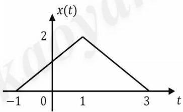
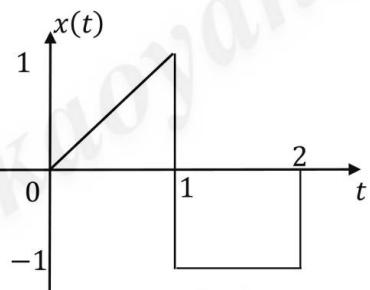
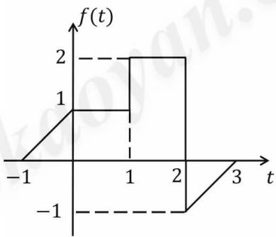
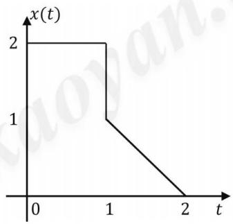
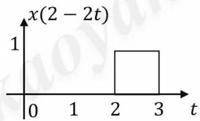
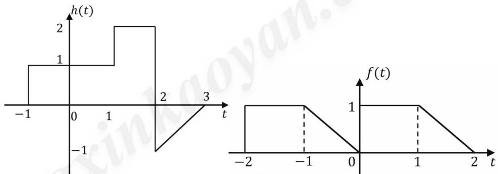

## 第1节 课后作业

1、【2024年复旦大学2.3】已知 $x(t)$ 图像如下，画出 $x(t-1)$ 的奇偶分量图像。

官网：tongxinkaoyan.com

梦马班作业

2、【2024 重庆邮电大学 2】连续信号 $x(t)$ 的时域图如下图所示，画出该信号偶分量和奇分量的时域波形图。

官网：tongxinkaoyan.com

B站up: 信号与系统\_谷哥

公众号：通信考研小马哥

3、【2024 成都信息工程大学 2.1】已知 $f(t)$ 图像如图所示, 画出 $f(2 - \frac{t}{3})$ 的图像。

官网：tongxinkaoyan.com

梦马班作业

4、【2024 上海师范大学 3.1】信号 $x(t)$ 如图所示, 画出 $x\left(4 - \frac{t}{2}\right)$ 的图像。

官网：tongxinkaoyan.com

梦马班作业

5、【2024 湖北工业大学 3】已知 $x(2 - 2t)$ 如图所示，画出 $x(t)$ 的图像并写出其表达式。

官网：tongxinkaoyan.com

梦马班作业

B站up: 信号与系统\_谷哥

6、【2024 上海电力大学 1.1】已知 $h(t)$ 和 $f(t)$ 如下图所示，求 $h(t)f(-t)$ 的波形。

官网：tongxinkaoyan.com

6

梦马班作业