## 第1节 课后作业

1、【2024年复旦大学2.3】已知 $x(t)$ 图像如下，画出 $x(t-1)$ 的奇偶分量图像。

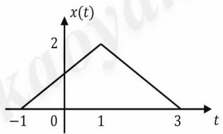

解: $x(t) \xrightarrow{\text{右移} 1} x(t-1) = x(t)$

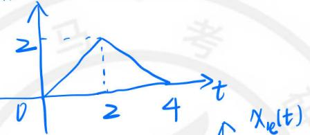

偶分量 $x_{1e}(t)=\frac{x_{1}(t)+x_{1}(-t)}{2}$

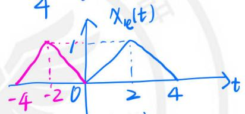

奇分量 $x_{10}(t)=\frac{x_{1}(t)-x_{1}(-t)}{2}$

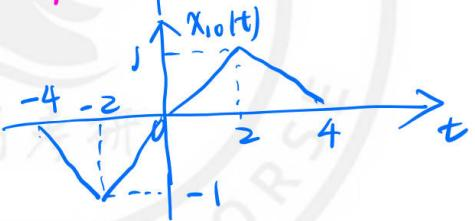

官网：tongxinkaoyan.com

梦马班作业

2、【2024 重庆邮电大学 2】连续信号 $x(t)$ 的时域图如下图所示，画出该信号偶分量和奇分量的时域波形图。

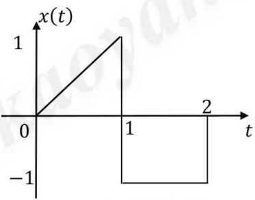

解: 偶分量 $x_{e}(t)=\frac{x(t)+x(-t)}{2}$

奇分量

$$
x _ {0} (t) = \frac {(x | t) - x (- t)}{2}
$$

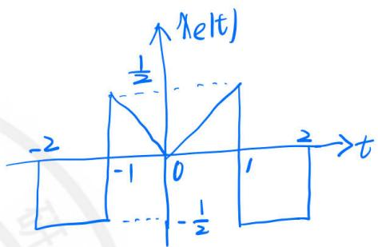

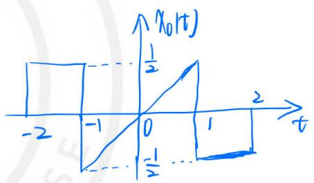

官网：tongxinkaoyan.com

梦马班作业

3、【2024 成都信息工程大学 2.1】已知 $f(t)$ 图像如图所示, 画出 $f(2 - \frac{t}{3})$ 的图像。

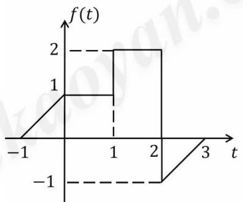

解: $f(t) \xrightarrow{\text{左移2}} f(t+2) \xrightarrow{\text{反转}} f(-t+2) \xrightarrow{\text{扩3倍}} f(2-\frac{t}{3})$

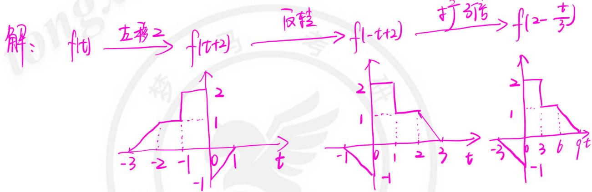

其它参考： $f(t) \xrightarrow{\text{反转}} f(-t) \xrightarrow{\text{右2}} f[-\frac{1}{3}(t-2)] \xrightarrow{\text{扩大3}} f(-\frac{1}{3}+2)$

$f(t) \xrightarrow{f^2} f(\frac{t}{3}) \xrightarrow{\text{左6}} f[\frac{1}{3}(t+6)] = f(\frac{t}{3}+2)$

官网：tongxinkaoyan.com

梦马班作业

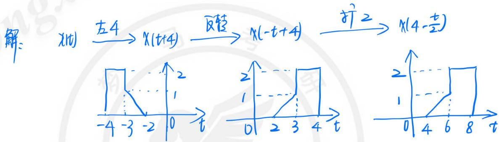

4、【2024 上海师范大学 3.1】信号 $x(t)$ 如图所示, 画出 $x \left(4 - \frac{t}{2}\right)$ 的图像。

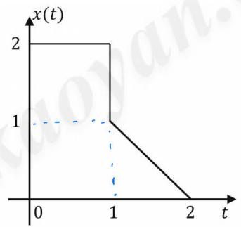

顺序不影响最终结果

官网：tongxinkaoyan.com

梦马班作业

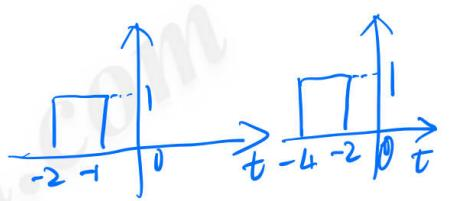

5、【2024 湖北工业大学 3】已知 $x(2 - 2t)$ 如图所示, 画出 $x(t)$ 的图像并写出其

表达式。 $x(t) = u(t+41 - u(t+2))$

暂不考察或 $x(t)$ =

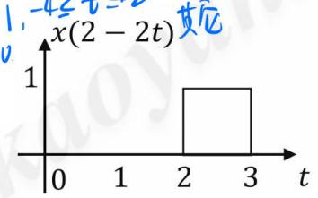

方正一：正向→逆向

$\Rightarrow$ 齿： $x(-2t+2)$

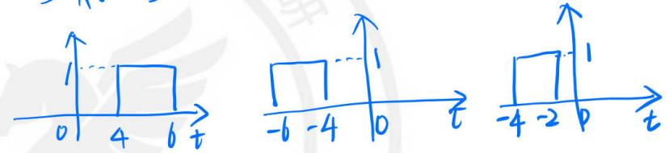

$\overrightarrow{方B_{1}} =: x(-2t+2) \rightarrow x(t)$ 针对t 各种变换后得 $(x(t))$

官网：tongxinkaoyan.com

梦马班作业

6、【2024 上海电力大学 1.1】已知 $h(t)$ 和 $f(t)$ 如下图所示，求 $h(t)f(-t)$ 的波形。

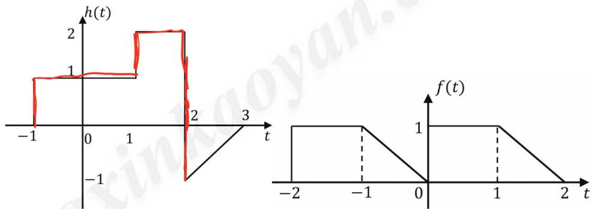

解: $f(t) \xrightarrow{\text{反转}} f(-t)$

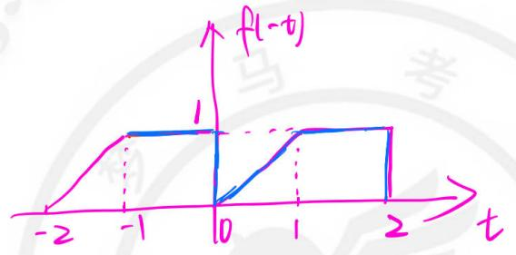

$h(t) \cdot f(-t)$ 时间二取交集 $(-1, 2)$ 幅值上相乘

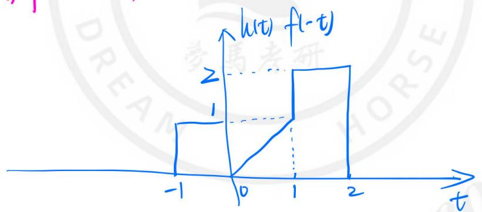

官网：tongxinkaoyan.com

梦马班作业