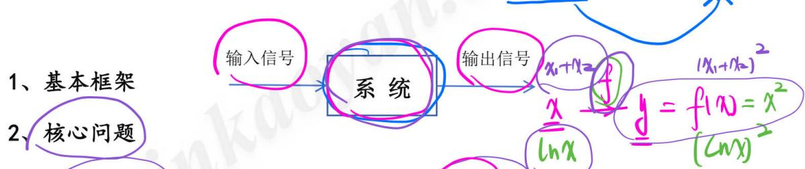

# 《信号与系统》课程框架（连续部分）

## 1、基本框架

2、核心问题

(1) 输入信号作用于系统，产生什么样的输出信号？

(2) 根据输入、输出信号, 能够反映系统具有哪些内在特性?

3、分析方法

(1) 时域分析法: ②

(2) 变换域法：③、④

## 4、核心要点——系统不同形式间的相互转换

①常见的信号与系统

②系统的时域分析与卷积

③连续系统的傅里叶变换

④连续系统的拉氏变换

⑤系统的信号流图和状态变量分析

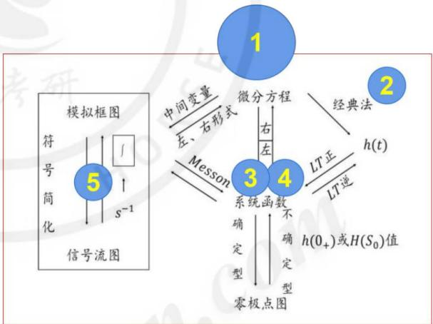

## 5、解题技巧

(1)表达式法

(2) 图解法

研究对象：(1)啥系统；(2)啥信号→有哪些信号，有哪些系统

学习目的：信号的一般表示和分类；常见信号性质和应用；系统分类与判断

B站up: 信号与系统\_谷哥

公众号：通信考研小马哥

## 目录

第一章 连续时间信号与统.... 1
专题1 连续信号的表示、分类与运算.... 3
考点1：连续信号的表示形式.... 3
考点2：连续信号的分类.... 3
考点3：信号运算.... 7
专题2 四种奇异信号.... 9
考点1：单位斜变信号.... 9
考点2：单位阶跃信号.... 9
考点3：单位冲激信号.... 11
考点4：冲激偶信号.... 13
专题3 四种奇异信号的图形关系扩展.... 15
考点1：四种奇异信号关系的图形化表示.... 15
考点2：四种奇异信号关系的图形化推广.... 15
考点3：信号微积分运算的应用.... 16
考点4：包含冲激信号的信号运算.... 17
专题4 连续系统的时域形式及其转换.... 21
考点1：连续系统的微分方程.... 21
考点2：连续系统的模拟框图.... 21
专题5 连续系统分类与判断.... 24
考点1：系统表示及作用分析.... 24
考点2：线性系统的判断.... 24
考点3：时不变系统的判断.... 25
考点4：因果系统.... 26
考点5：记忆系统和无记忆系统.... 26
考点6：稳定系统和不稳定系统.... 27
考点7：可逆系统和不可逆系统.... 27
专题6 线性时不变系统的判断与应用.... 29
考点1：简易表达式形式下LTIS的判断.... 29
考点2：微分方程形式下LTIS的判断.... 29
考点3：线性时不变系统的特性与应用.... 30

B站up: 信号与系统\_谷哥

专题 1 连续信号的表示、分类与运算

<table><tr><td>考点名称</td><td>具体内容</td><td>考研衔接点</td></tr><tr><td>考点1 连续信号的表示形式</td><td>信号表示形式</td><td>解题思想培养,贯穿全过程</td></tr><tr><td rowspan="5">考点2 信号的分类</td><td>连续信号与离散信号</td><td>两大系统的连接点</td></tr><tr><td>能量信号与功率信号</td><td>FT中帕萨瓦尔定理/周期信号功率</td></tr><tr><td>周期信号与非周期信号</td><td>周期信号傅里叶级数周期抽样(抽样定理)</td></tr><tr><td>偶信号与奇信号</td><td>FT性质的奇偶虚实性</td></tr><tr><td>直流信号与交流信号</td><td>周期信号傅里叶级数FT微分性质</td></tr><tr><td rowspan="3">考点3 信号运算</td><td>基本运算——相加、相乘</td><td rowspan="3">三者结合常见信号图形的辨识</td></tr><tr><td>基本运算——微分、积分</td></tr><tr><td>基于自变量运算——综合运算</td></tr></table>

专题 1 连续信号的表示、分类与运算（自检表）

<table><tr><td>考点名称</td><td>知识点内容</td><td>自检项</td></tr><tr><td rowspan="4">信号分类(分解)</td><td>能量信号与功率信号</td><td>☑定义法判断☑常规结论</td></tr><tr><td>周期信号与非周期信号</td><td>☑周期信号判断及周期求解 Sin2t+cos3t☑周期信号与非周期信号关系</td></tr><tr><td>偶信号与奇信号</td><td>☑定义法求解</td></tr><tr><td>直流信号与交流信号</td><td>☑直流信号的求解  $\frac{f(\infty)+f(\infty)}{2}$ </td></tr><tr><td>信号运算</td><td>信号相加信号相乘基于自变量的信号综合运算</td><td>☑相加、相乘画图与范围☑综合运算过程及结论 f1+t→b&gt;0 → f(-at±b) ☑综合运算的变形</td></tr></table>

官网：tongxi nkaoyan. com

$\left\{ \begin{array}{l} \text { 当 } f(-a t \pm b) \rightarrow f( t ) \\  \text { 中 } \rightarrow \text { 中 } f(-t+1) \rightarrow f(2 t+5) \\  \text { 因 } t \text { 因 } \Rightarrow \text { 关系梦马班讲义 } \end{array} \right.$

## 专题 1 连续信号的表示、分类与运算

考点1: 连续信号的表示形式 $\leftrightarrow$ 培养表达式与图形结合的解题意识

1、表达式法：

借助(区域)统一规律，例如： $f(t)=e^{-t}\sin t$

式与图形结合的解题意识
直体. 区域 分段 $y = f(x) = \frac{1}{2}$

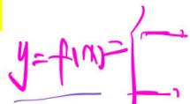

2、图形法：

直观、形象，易观察变化趋势和规律等

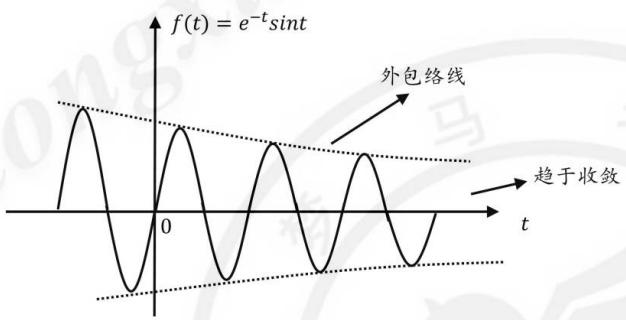

eq: $f(t) \rightarrow f(t-1)$ 右移一个单位

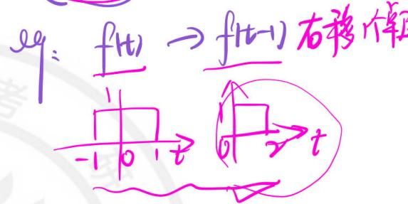

## 考点2: 连续信号的分类

1、连续时间信号和离散时间信号

(1)连续时间信号的离散化过程: $f(t)=cost,t\to t=nT_{s},f(t)\to f(nT_{s})\to f(n)$

甘露的采样

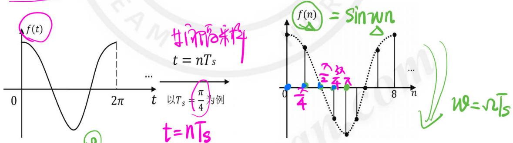

$$
\frac {y = f (t) = \sin \frac {\sqrt {y}}{\Delta t}}{\Omega = 1} \xrightarrow {t = n T _ {S}} f (t) \Rightarrow f (n T _ {S}) = f (n) = \sin^ {n} n T _ {S}
$$

(2)数字角频率 $\omega$ 与模拟角频率 $\Omega$ 的关系: $\omega = \Omega {T}_{s}$

例 1: 已知正弦信号 $x(t) = \cos 15 t$ , 取样间隔 $T_{s} = 0.1 \pi$ , 求 $x(n)$ 。

$$
\begin{array}{r l} {x (t)} & {\stackrel {t = \sqrt {1 5}} {\longrightarrow} x (n \sqrt {1 5}) = x (n) = \cos 1 5 \cdot n \sqrt {1 5} = \cos 1 5 \cdot 0. 1 \pi n} \\ & {\qquad \qquad \qquad \qquad \qquad \qquad \qquad \qquad \qquad \qquad \qquad \qquad \qquad \qquad \qquad \qquad \qquad \qquad \qquad \qquad \qquad \qquad \qquad \qquad \qquad \qquad \qquad \qquad \qquad \qquad \qquad \qquad \qquad \qquad \mathrm{and}} \\ & {\qquad \qquad \qquad \qquad \qquad \qquad \qquad \qquad \qquad \qquad \qquad \qquad \qquad \qquad \qquad \qquad \qquad \mathrm{and}} \\ & {\qquad \qquad \qquad \qquad \qquad \qquad \qquad \qquad \qquad \qquad \qquad \mathrm{and}} \\ & {\qquad \qquad \qquad \qquad \qquad \qquad \qquad \qquad \mathrm{and}} \\ & {\qquad \qquad \qquad \qquad \qquad \qquad \mathrm{and}} \\ & {\qquad \qquad \qquad \mathrm{and}} \\ & {\qquad \qquad \qquad \mathrm{and}} \\ & {\qquad \qquad \mathrm{and}} \\ & {\qquad \mathrm{and}} \\ & {\qquad \mathrm{and}} \\ & {\qquad \mathrm{and}} \\ & {\qquad \mathrm{and}} \\ & {\qquad \mathrm{and}} \\ & {\qquad \mathrm{and}} \\ & {\qquad \mathrm{and}} \\ & {\qquad \mathrm{and}} \\ & {\qquad \mathrm{and}} \\ & {\qquad \mathrm{and}} \\ & {= c o s 1. 5 \pi n} \\ & \end{array}
$$

2、能量信号与功率信号

(1)时域定义：

能量: $E=\lim_{T\to\infty}\int_{-T}^{T}|f(t)|^{2}dt$ ，功率: $P=\lim_{T\to\infty}\frac{1}{2T}\int_{-T}^{T}|f(t)|^{2}dt$

(2)时域定义判断法：

$E=\begin{cases}有限值 \Rightarrow P=0 \Rightarrow 能量信号 \\ \infty \Rightarrow P=\begin{cases}有限值 \Rightarrow 功率信号 \\ \infty \Rightarrow 非能量非功率信号\end{cases}\end{cases}$

$$
\begin{array}{r l} {P _ {2}} & {= \lim _ {T \to \infty} \frac {E _ {2}}{2 T}} \\ & {= \lim _ {T \to \infty} \frac {T - \frac {3}{1 0}}{2 T} = \frac {1}{2}} \end{array}
$$

例2: 确定信号 $x_{1}(t)=e^{-2|t|}$ 和 $x_{2}(t)=(1-e^{-5t}), t\geq0$ 是功率信号还是能量信号

$$
= \lim _ {T \to \infty} \int_ {0} ^ {T} (1 - 2 e ^ {- 5 t} + e ^ {- 1 0 t}) d t = \lim _ {T \to \infty} \left[ t + \frac {2}{5} e ^ {- 5 t} - \frac {1}{1 0} e ^ {- 1 0 t} \right] _ {0} ^ {T}
$$

$$
\lim _ {t \to 1 0 ^ {-}} [ T + \frac {2}{5} e ^ {- 5 t} (\frac {1}{1 0} e ^ {- 1 0 t} ] - (0 + \frac {2}{5} - \frac {1}{1 0})
$$

①幅值无界一定为非能量非功率信号;例如无界的周期信号( $\delta_T(t)$ )和无界的非周期信号 $\delta(t)$ 、 $e^{-t}$ 等 $=\lim _{t \to \infty} t - \frac{3}{10} = \infty$

②有界周期信号一定为功率信号，能量信号一定是非周期信号；

③持续时间有限的有界信号为能量信号；例如矩形信号；

④持续时间无限的有界信号, 幅值收敛为 0 的信号为能量信号, 幅值收敛为某一非 0 常数的信号为功率信号见图 (b) 典型信号: 直流信号和阶跃信号;

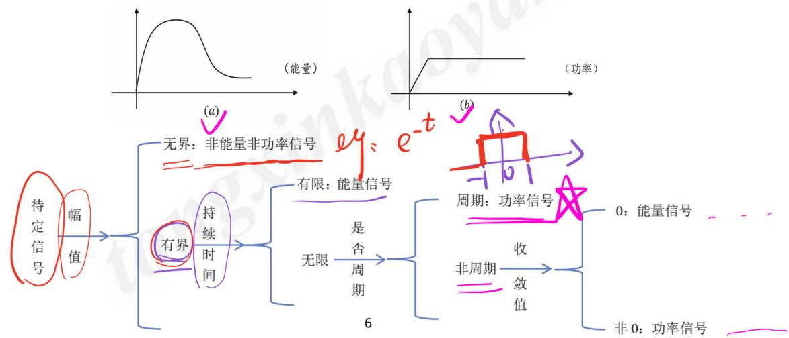  
官网：tongxi nkaoyan.com

B站up: 信号与系统\_谷哥

公众号：通信考研小马哥

3、周期信号与非周期信号

(1)周期信号定义: 周而复始, 无始无终 $f(t) = f(t \pm nT), n = 0, \pm 1, \pm 2, \cdots$

(2)常见周期信号的判断：

(2)常见周期信号的判断：
①单个三角信号的周期： $\sin2t\Rightarrow T=\frac{2\pi}{w}=\pi(s)$

$A\cos(\omega_{0}t+\varphi)$ 或 $A\sin(\omega_{0}t+\varphi)\Rightarrow$ 周期 $T=\frac{2\pi}{\omega_{0}}$

②多三角信号相加(和信号)的周期:

和信号为周期信号的判断方法: 每个子信号均为周期信号, 且各子信号周期存在最小公倍数, 则和信号为周期信号, 周期为该最小公倍数, 否则为非周期信号。

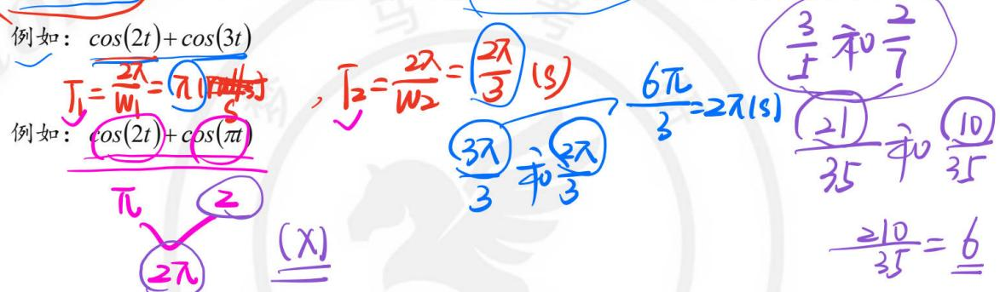

③单个复指数信号的周期：

$$
e ^ {\pm j \theta} = \cos \theta \pm j \sin \theta , T = 2 \pi
$$

例 3:

$$
= a > 1 0 t + j \sin 1 0 t
$$

$$
\frac {\pi}{5} (s)
$$

$$
[ 5 \sin (8 t) ] ^ {2} = 2 [ \sin^ {2} (8 t) = 2 5 \frac {1 - \cos (1 0 t)}{2} = \frac {2 5}{2} - \frac {2 5}{2} \cos (1 0 t)
$$

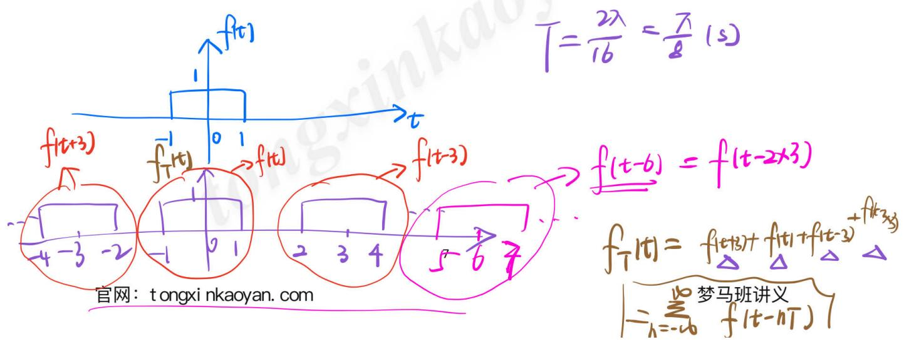

B站up: 信号与系统\_谷哥

公众号：通信考研小马哥

④观察法：周期信号与非周期信号的关系：

一般周期信号

关系： $f_{n}(t)$ 是由 $f_{0}(t)$ 以 $T$ 为同期延拓而来

$$
f _ {T} (t) = \sum_ {n = - \infty} ^ {\infty} f _ {0} (t - n T), n = 0, \pm 1, \pm 2, \dots
$$

开始
有始周期认不认没？

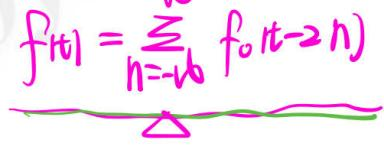

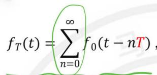

$$
\sum_ {n = 0} ^ {\infty} f _ {0} (t - 2 \pi)
$$

$\sum_{n=-1}^{\infty}(-1)^{n}f_{0}(t-2\pi)$ 正负交替信号

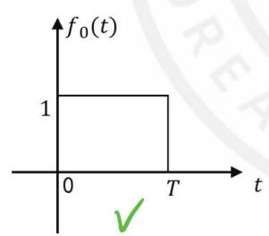

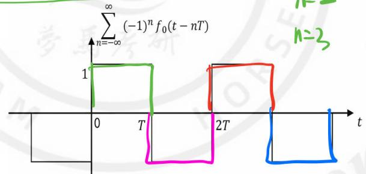

相较于 $\sum_{n = -\infty}^{\infty}f_0(t - nT)$ ， $\sum_{n = -\infty}^{\infty}(-1)^{n}f_{0}(t - nT)$ 使图形正、负交替，故周期从

$T$ 变为 $2 T$ 。

$$
\sum_ {n = - \infty} ^ {\infty} (- 1) ^ {n} f _ {0} (t - n T)
$$

【新增】

$$
\sum_ {n = - \infty} ^ {\infty} (- 1) ^ {n} [ u (t - n T) - u (t - n T - T) ]
$$

B站up: 信号与系统\_谷哥

公众号：通信考研小马哥

3、信号分解: 偶(even)信号 ${f}_{e}\left( t\right)$ 、奇(odd)信号 ${f}_{o}\left( t\right)$

<table><tr><td>信号</td><td>波形</td></tr><tr><td> $f(t) = f_e(t) + f_o(t)$ [IMAGE]</td><td>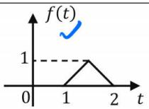 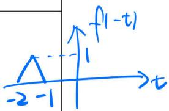</td></tr><tr><td>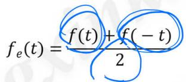</td><td>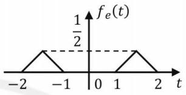</td></tr><tr><td> $f_o(t) = \frac{f(t) - f(-t)}{2}$ </td><td>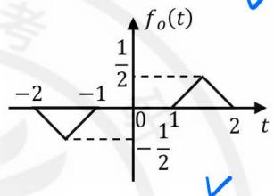</td></tr></table>

例4: 求 $f(t) = e^{jt}$ 的偶信号和奇信号?

$$
f _ {e} (t) = \frac {f (t) + f (- t)}{2} = \frac {e ^ {j t} + e ^ {- j t}}{2 \sqrt {}} = \cos t
$$

$$
f _ {0} (t) = \frac {f (t) - f (- t)}{2} = \frac {e ^ {j \tau} - e ^ {- j \tau}}{2} = (j \sin t)
$$

B站up: 信号与系统\_谷哥

公众号：通信考研小马哥

5、直流(direct-current, DC)分量与交流(alternating-current, AC)分量设原信号为 $f(t)$ ，分解为直流分量 $f_{D}$ 与交流分量 $f_{A}(t)$ ，表示为

$$
f (t) = f _ {D} + f _ {A} (t)
$$

直流分量的求解：直流分量=信号的平均值，是一个与时间无关的常数

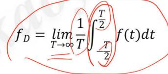

①如果原信号是非周期信号， $f(t)$ 存在 $f(-\infty)$ 和 $f(\infty)$ 且中间瞬态过程可忽略，

可用公式求直流 $f_{D}$

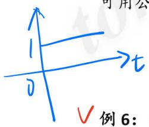

$$
f _ {D} = \frac {f (\infty) + f (- \infty)}{2}
$$

例 6: 求下图所示信号的直流分量。

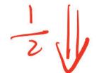

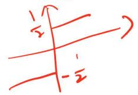

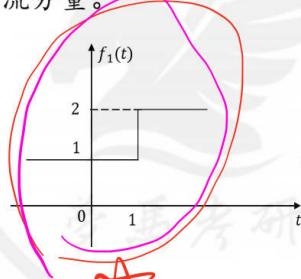

$\Rightarrow$ 直不为1

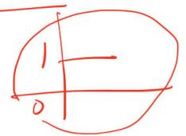

②如果原信号是周期信号,上式则可以省去取极限的过程,而且积分限可以取任

意一个周期，即

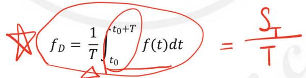

例 5: 求下图所示信号的直流分量。

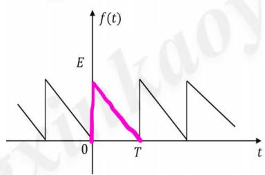

$$
f _ {D} = \frac {S _ {T}}{T} = \frac {1}{T} \cdot \frac {1}{2} \cdot T \times E = \frac {E}{2}
$$

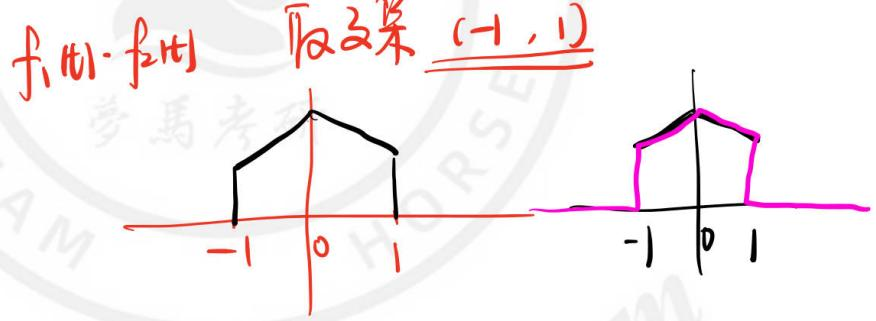

B站up: 信号与系统\_谷哥

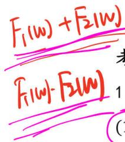

考点3: (信号运算)

1、信号时域运算

(1)信号相加减：相同时间t所对应的函数值相加减

(2)信号相乘: 相同时间 $t$ 所对应的函数值相乘

(3)信号微分、积分：详见第一章专题3考点3

公众号：通信考研小马哥

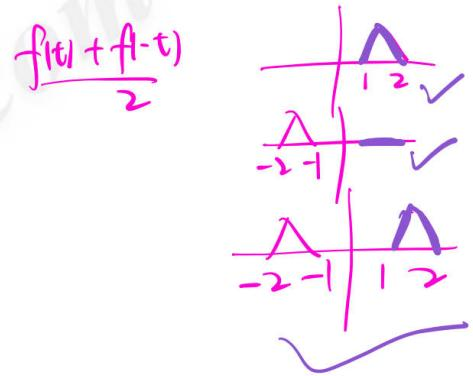

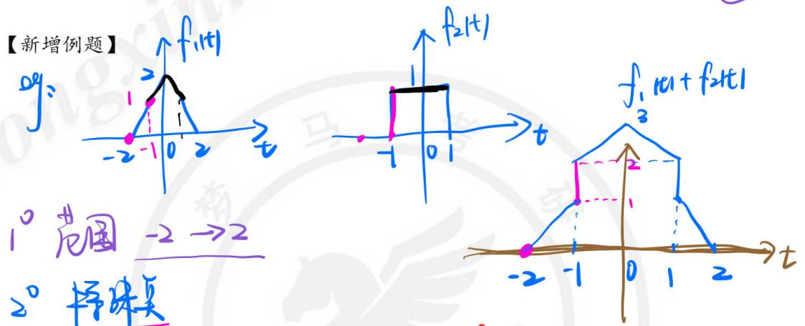

1° 范围 -2 → 2

2° 桂球矣

$f_{1}(t)-f_{2}(t)$ 取文集 $(-1,1)$

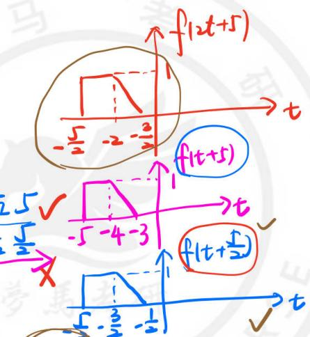

B站up: 信号与系统\_谷哥

2、基于自变量的信号运算

1° 规律：

移位 $f(t) \rightarrow f(-t)$ 右移 1

反转 $f(t) \rightarrow f(-t)$ 度变项 $f(t) \rightarrow \frac{f(\frac{t}{2})}{f(2t-5)}$ 或 $f(2t)$

$f(t) \xrightarrow{左\sqrt{5}} f(t+1) \xrightarrow{右\sqrt{2}} f(2t+1)$

$\Rightarrow f(t) \xrightarrow{t_0 > 0} f(t \pm t_0)$ 左 + 右一 $\Rightarrow f(t) \to f(-t) \xrightarrow{\text{沿纵轴}} f(t_1) \xrightarrow{a_2^0} f(a_t)$ $\Rightarrow \left\{ \begin{array}{l} u < a < 1 \\ a > 1 \end{array} \right.$ 扩展

$2^{\circ}$ 度量根 $f(t) \rightarrow f(2t+5)$

公众号：通信考研小马哥

$$
\begin{array}{l l} {t} & {2 t + 5} \\ {0} & {0 \Rightarrow t = - \frac {5}{2}} \\ {1} & {1 \Rightarrow t = - 2} \\ {2} & {2 \Rightarrow t = - \frac {3}{2}} \end{array}
$$

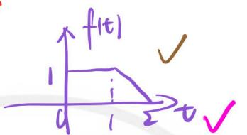

移位
赋废变换

1° 先移后见

先 $\overline{0}$ 后二

$$
\sqrt {f [ \frac {2 \times t}{2} + 5 ]}
$$

又度变换 $f(2t+t)$

$f[t] = \left( t + \frac{t}{2} \right)$

(1)平移 $f(t) \xrightarrow{t_{0}>0} f(t \pm t_{0})$ ，“左+右-” $t_{0}$ 个单位，不影响纵向函数值

(2)翻转(反褶) $f(t)\rightarrow f(-t)$ ，沿纵轴左右翻，不影响纵向函数值

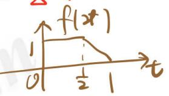

(3)尺度变换 $f(t)\xrightarrow{a>0}f(at)$ 0<a<1 扩展，a>1压缩，不影响纵向函数值

(4)综合运算 $f(t)$ $\xrightarrow{a,b>0}$ $f(-at\pm b)$ $f(1)\rightarrow f(-2t+3)$

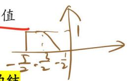

【梦马班点拨】一切变换只针对于t；结论：不同的运算次序，不影响最终的结果。

果。

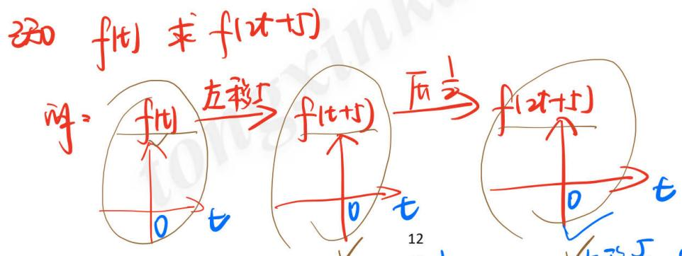

官网：tongxi nkaoyan. com

$f(t) \xrightarrow{12} f(\overline{x}) \xrightarrow{右移\frac{\sqrt{5}}{3}} f[\overline{2}(t+\frac{\sqrt{5}}{2})]=f(2x+5)$ 梦马班讲义

B站up: 信号与系统\_谷哥

公众号：通信考研小马哥

例 7: 已知 $f(t)$ 信号波形如图所示，试画出 $f(1-2t)$ 的波形。

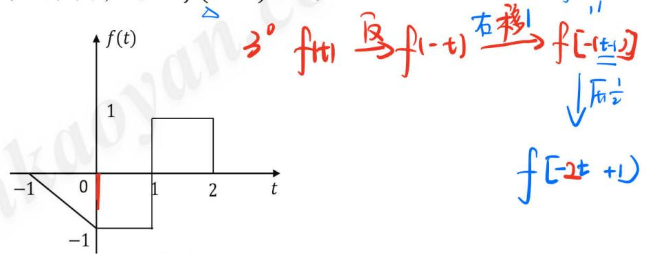

$1^{0}$ 移 反 R

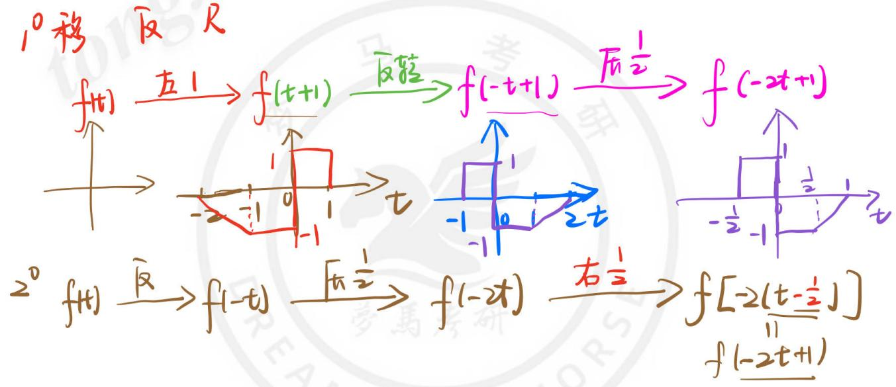

例8: 已知 $f\left( t\right)$ 波形如图所示,试画出 $y\left( t\right)  = {2f}\left( {-\frac{1}{3},t + \frac{2}{3}}\right)$ 的波形。

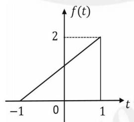

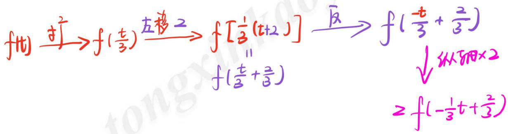

官网：tongxi nkaoyan. com

梦马班讲义

例 9: 根据图中 $f(-3 + 2t)$ 的波形, 画出 $f(t)$ 的波形。

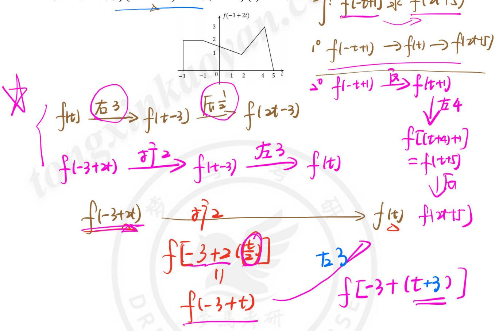

例 10: 利用 $x(t)$ 表示 $y(t)$ , $x(t)$ 与 $y(t)$ 如下图所示。

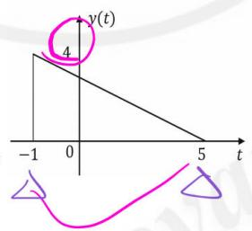

$$
= x (- \frac {t}{3} + \frac {2}{3})
$$

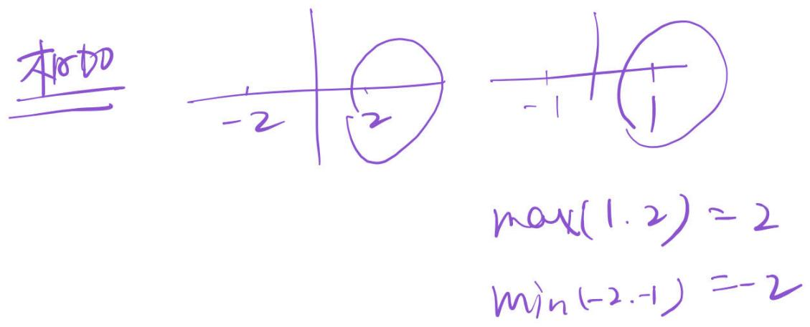

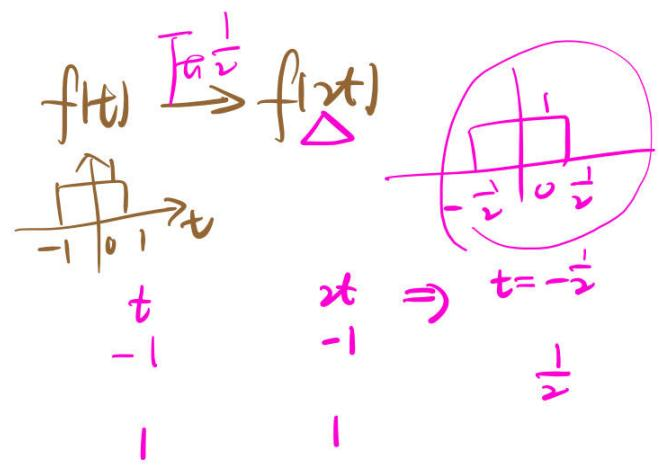

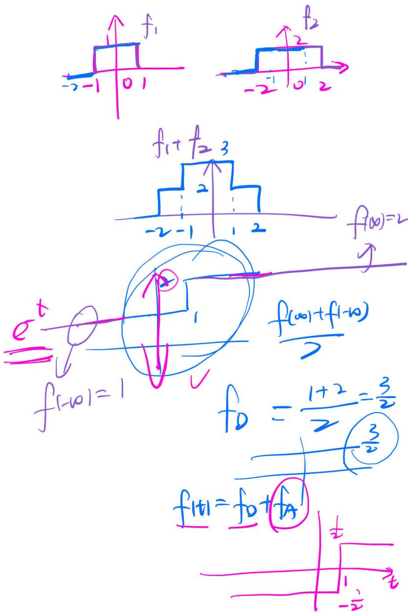

免费讲义Q群：1095841878

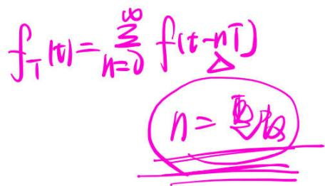