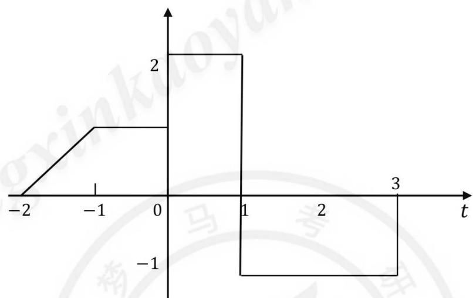

B站up: 信号与系统\_谷哥

公众号：通信考研小马哥

## 第2节课后作业

1、【2024年华侨大学1.1】计算 $\int_{-\infty}^{+\infty} (sin\pi x + 1)\delta(x - 1)dx$

公众号：通信考研小马哥

梦马班作业

2、【2024年武汉工程大学2.2】 $f(t)=e^{-t}\delta(t)$ ，其导数 $\frac{df(t)}{dt}$ 为\_\_\_\_，积分 $\int_{-\infty}^{t}f(\tau)d\tau$ 为\_\_\_\_

梦马班作业

B站up: 信号与系统\_谷哥

公众号：通信考研小马哥

3、【2024年宁波大学1】计算

(1) $\int_{-\infty}^{\infty} \sin \left(\frac{\pi}{6} t\right) \delta \left(\frac{t}{3} + 1\right) dt$

(2) $\int_{-\infty}^{\infty}\cos \left(\frac{\pi}{6} t\right)\delta '(t - 1)dt$

公众号：通信考研小马哥

梦马班作业

B站up: 信号与系统\_谷哥

公众号：通信考研小马哥

4、【2024年重庆大学2】填空题

(1) $u\left( t\right)$ 的奇分量 $=$ \_\_\_\_.

(2) $\delta(sint)=$ \_\_\_\_

(3) $\int_{-\infty}^{\infty} e^{-j\omega t} \delta'(t) dt =$

公众号：通信考研小马哥

梦马班作业

B站up: 信号与系统\_谷哥

公众号：通信考研小马哥

5、【2024年湖北工业大学1】已知 $x(4+2t)=\delta(t)+e^{-2t-4}$ ，求：（关注通信考研小马哥，通信考研不迷路）

(1) $x(t)$ ;

(2) 求 $\int_{0}^{\infty} x(t) dt$ 。

梦马班作业

B站up: 信号与系统\_谷哥

公众号：通信考研小马哥

6、【2024年长春理工大学1.2】已知 $y(t)$ 如下图，画出 $y'(t)$ 和 $y\left(\frac{1}{2}t-1\right)$ （关注通信考研小马哥，通信考研不迷路）

  
夢馬考研