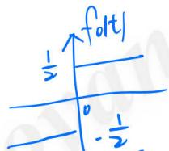
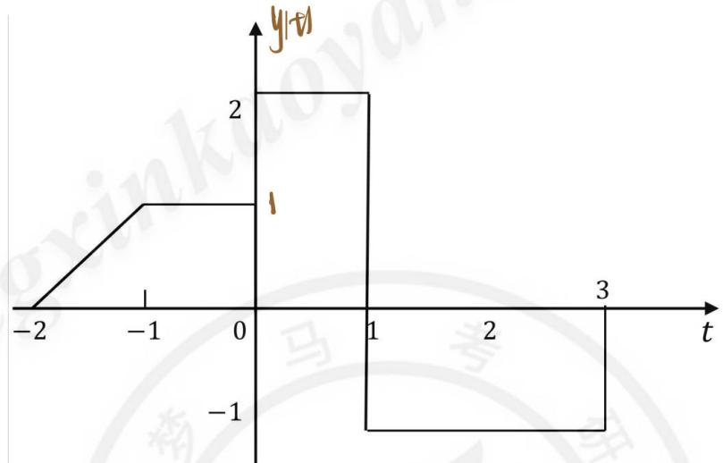
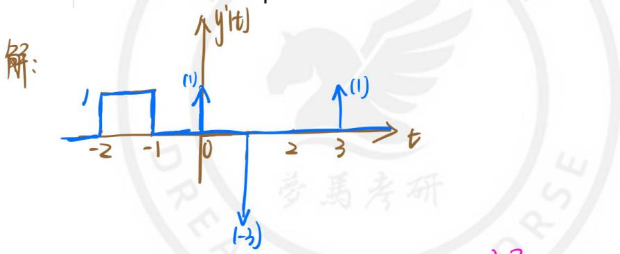
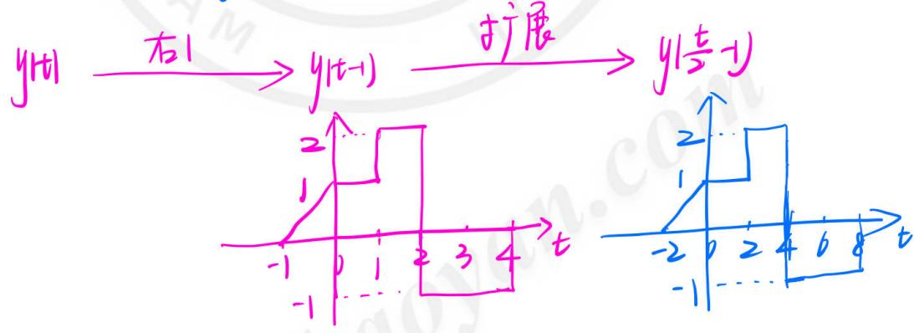

B站up: 信号与系统\_谷哥

公众号：通信考研小马哥

## 第2节 课后作业

1、【2024年华侨大学1.1】计算 $\int_{-\infty}^{+\infty} (\sin \pi x + 1) \delta(x - 1) dx$

解:

$$
\begin{array}{r l} {\mathrm{原式}} & {= [ \sin \pi x + 1 ] _ {x = 1}} \\ & {= \sin \pi + 1} \\ & {= 1} \end{array}
$$

夢馬考研

公众号：通信考研小马哥

梦马班作业

B站up: 信号与系统\_谷哥

2、【2024年武汉工程大学2.2】 $f(t)=e^{-t}\delta(t)$ ，其导数 $\frac{df(t)}{dt}$ 为\_\_\_\_，积分 $\int_{-\infty}^{t}f(\tau)d\tau$ 为\_\_\_\_。

解: $f(t) = e^{-t} \delta (t) = \delta (t)$

故 $\frac{d f(t)}{dt} = \delta'(t)$

$$
\int_ {- \infty} ^ {t} f (\tau) d \tau = \int_ {- \infty} ^ {t} \sqrt {\tau} d \tau = u (t)
$$

梦马班作业

3、【2024年宁波大学1】计算

(1) $\int_{-\infty}^{\infty} \sin \left(\frac{\pi}{6} t\right) \delta \left(\frac{t}{3} + 1\right) dt$

(2) $\int_{-\infty}^{\infty}\cos \left(\frac{\pi}{6} t\right)\delta '(t - 1)dt$

解: (1) $\sqrt{\left(\frac{t}{3}+1\right)} = 3\sqrt{(t+3)}$

$$
\begin{array}{r l} {\mathrm{故原式}} & {= \int_ {- \infty} ^ {\infty} \sin (\frac {\pi}{6} t) \cdot 3 (\sqrt {t + 3}) d t} \\ & {= 3 \cdot \sin [ \frac {\pi}{6} \cdot (- 3) ]} \\ & {= 3 \sin (- \frac {\pi}{2})} \\ & {= - 3} \end{array}
$$

$$
\begin{array}{r l} {\mathrm{原式}} & {= - \left[ \cos (\frac {\pi}{6} t) \right] _ {t = 1} ^ {\prime}} \\ & {= - \left[ - \frac {\pi}{6} \sin (\frac {\pi}{6} t) \right] _ {t = 1}} \\ & {= \frac {\pi}{6} \sin \frac {\pi}{6}} \\ & {= \frac {\pi}{1 2}} \end{array}
$$

公众号：通信考研小马哥

梦马班作业

B站up: 信号与系统\_谷哥

公众号：通信考研小马哥

4、【2024年重庆大学2】填空题

(1) $u\left( t\right)$ 的奇分量 $=$ \_\_\_\_.

(2) $\delta(sint) =$

(3) $\int_{-\infty}^{\infty} e^{-j\omega t} \delta'(t) dt =$

解：(1) $f_{0}|t|=\frac{u|t|-u|-t|}{2}$ 从同称为有 $\frac{1}{2}\sin u|t|$

(2) $\sin t = 0$ 的根为 $t = k\pi$ , $k = 0, \pm1, \pm2 \cdots$

$$
(\sin t) ^ {\prime} = \cos t
$$

$$
\begin{array}{r l} {\mathrm{原式}} & {= \sum \frac {1}{| \cos k \pi |} \delta (t - k \pi)} \\ & {= \sum \delta (t - k \pi), k = 0, \pm 1, \pm 2 \dots} \\ & {= \dots + \delta (t + \pi) + \delta (t) + \delta (t - \pi) + \delta (t - 2 \pi) + \dots} \end{array}
$$

(3) 原式 = $-\left[e^{-j\omega t}\right]_{t=0}^{1}$ = $-\left[-j\omega e^{-j\omega t}\right]_{t=0}$ = jW

公众号：通信考研小马哥

B站up: 信号与系统\_谷哥

公众号：通信考研小马哥

5、【2024年湖北工业大学1】已知 $x(4+2t)=\delta(t)+e^{-2t-4}$ ，求：（关注通信考研小马哥，通信考研不迷路）

(1) $x(t)$ ;

(2) 求 $\int_{0}^{\infty} x(t) dt$ 。

解：(1) 法一：数学强

令 \( a = 4 + {2t} \) ,则 \( t = \( \frac{a - 4}{2} \)

$$
x (a) = \sqrt {(\frac {a - 4}{2})} + e ^ {- a}
$$

即 $x(t) = \delta(\frac{t}{2} - 2) + e^{-t}$

第三：运算视角

$$
\begin{array}{r l} {x (4 + x t)} & {\xrightarrow {t \to \frac {t}{2}} x (4 + 2 \cdot \frac {t}{2})} \\ & {\longrightarrow = x (4 + t)} \\ & {\stackrel {1 1} {\delta (\frac {t}{2}) + e ^ {- t - 4}}} \\ & {= 2 \delta (t) + e ^ {- t - 4}} \end{array} \quad \begin{array}{r l} {t \to t - 4} & {= x [ 4 + (t - 4 ]} \\ & {= x (t)} \\ & {\downarrow} \\ & {\longrightarrow 2 \delta (t - 4) e ^ {- t}} \end{array}
$$

$$
x (t) = 2 \sqrt {(t - 4)} + e ^ {- t}
$$

$$
\begin{array}{r l} {(2)} & {\int_ {0} ^ {\infty} x (t) d t = 2 \int_ {0} ^ {\infty} \delta (t - 4) d t + \int_ {0} ^ {\infty} e ^ {- t} d t} \\ & {\qquad = 2 + [ - e ^ {- t} ] _ {0} ^ {\infty}} \\ & {\qquad = 2 + [ 0 + 1 ]} \\ & {\qquad = 3} \end{array}
$$

公众号：通信考研小马哥

梦马班作业

B站up: 信号与系统\_谷哥

6、【2024年长春理工大学1.2】已知 $y(t)$ 如下图，画出 $y'(t)$ 和 $y(\frac{1}{2}t-1)$ （关注

通信考研小马哥，通信考研不迷路）

  
解：

公众号：通信考研小马哥

梦马班作业