对象

## 目录

一段f(t)

表式
↓
10形
常见信号

1 章 连续时间信号与系统.... 1
专题1 连续信号的表示、分类与运算.... 3
考点1：连续信号的表示形式.... 3
考点2：连续信号的分类.... 3
考点3：信号运算.... 7
专题2 四种奇异信号（表达式视图）.... 9
考点1：单位斜变信号.... 9
考点2：单位阶跃信号.... 9
考点3：单位冲激信号.... 11
考点4：冲激偶信号.... 13
专题3 四种奇异信号的图形关系扩展.... 15
考点1：四种奇异信号关系的图形化表示.... 15
考点2：四种奇异信号关系的图形化推广.... 15
考点3：信号微积分运算的应用.... 16
考点4：包含冲激信号的信号运算.... 17
专题4 连续系统的时域形式及其转换.... 21
考点1：连续系统的微分方程.... 21
考点2：连续系统的模拟框图.... 21
专题5 连续系统分类与判断.... 24
考点1：系统表示及作用分析.... 24
考点2：线性系统的判断.... 24
考点3：时不变系统的判断.... 25
考点4：因果系统.... 26
考点5：记忆系统和无记忆系统.... 26
考点6：稳定系统和不稳定系统.... 27
考点7：可逆系统和不可逆系统.... 27
专题6 线性时不变系统的判断与应用.... 29
考点1：简易表达式形式下LTIS的判断.... 29
考点2：微分方程形式下LTIS的判断.... 29
考点3：线性时不变系统的特性与应用.... 30

(本2节)学习目标:

(1) 基础：定义和式

(1) 基础：使 $\bigtriangleup  {k = 1}$ 主要影響 (2) 理解：使 $k$ 与它们各自的长

下一次(3) 拓展：面积拓展

附：【四种奇异信号关系及性质证明】 【详见一点通 P15-18】

① $u(t)$ 与 $\delta(t)$ 微积分关系 $\left\{\begin{aligned}\frac{du(t)}{dt}&=\delta(t)\\u(t)&=\int_{-\infty}^{t}\delta(\tau)d\tau\end{aligned}\right.$

证明：

已知 $u(t)=\begin{cases}1,&t>0\\0,&t<0\end{cases}$

而 \(\delta (t)\) 的积分为 \(\int\_{-\infty}^{t}\delta (\tau)d\tau = \left\{ \begin{array}{ll}1, & t > 0[t > 0\) 时上下限内包含 \(\tau = 0\) 的点]\\ 0, & t < 0[t < 0\) 时上下限不包含 \(\tau = 0\) 的点] \end{array} \right.\)

综上所述

$$
u (t) = \int_ {- \infty} ^ {t} \delta (\tau) d \tau
$$

扩展: $u^{\prime} (t - 1) = \delta (t - 1)$ , 即

$$
\int_ {- \infty} ^ {t} \delta (\tau - 1) d t = u (t - 1)
$$

② $\delta(t)$ 尺度性质 $\delta(at)=\frac{1}{|a|}\delta(t)$

证明：

$$
\int_ {- \infty} ^ {\infty} \delta (a t) d t
$$

当a>0时，令m=at，

$$
\text {原式} = \int_ {- \infty} ^ {\infty} \delta (m) d \frac {m}{a} = \int_ {- \infty} ^ {\infty} \frac {1}{a} \delta (t) d t \Longrightarrow \delta (a t) = \frac {1}{a} \delta (t)
$$

当a<0时，令m=at，

$$
\text {原式} = \int_ {- \infty} ^ {- \infty} \delta (m) d \frac {m}{a} = \int_ {- \infty} ^ {\infty} - \frac {1}{a} \delta (t) d t \Longrightarrow \delta (a t) = - \frac {1}{a} \delta (t)
$$

综上所述， $\delta(at)=\frac{1}{|a|}\delta(t)$ 。

③ $\delta^{\prime}(at) = \frac{1}{|a|}\cdot \frac{1}{a}\delta^{\prime}(t)$

证明：

$$
\int_ {- \infty} ^ {\infty} \delta^ {\prime} (a t) f (t) d t = \frac {1}{| a |} \int_ {- \infty} ^ {\infty} \delta^ {\prime} (x) f \left(\frac {x}{a}\right) d x = \frac {1}{| a |} \int_ {- \infty} ^ {\infty} \delta^ {\prime} (x) f \left(\frac {x}{a}\right) d x
$$

B站up: 信号与系统\_谷哥

公众号：通信考研小马哥

$$
\begin{array}{c} = \frac {1}{| a |} \int_ {- \infty} ^ {\infty} f \left(\frac {t}{a}\right) d \delta (t) = \frac {1}{| a |} \left[ f \left(\frac {t}{a}\right) \delta (t) \Big | _ {- \infty} ^ {\infty} - \int_ {- \infty} ^ {\infty} \delta (t) d f \left(\frac {t}{a}\right) \right] \\ = \frac {1}{| a |} \left[ 0 - \int_ {- \infty} ^ {\infty} \delta (t) f ^ {\prime} \left(\frac {t}{a}\right) \cdot \frac {1}{a} d t \right] = - \frac {1}{| a |} \cdot \frac {1}{a} f ^ {\prime} (0) = \frac {1}{| a |} \cdot \frac {1}{a} \cdot \int_ {- \infty} ^ {\infty} \delta^ {\prime} (t) f (t) d t \\ \Rightarrow \delta^ {\prime} (a t) = \frac {1}{| a |} \cdot \frac {1}{a} \cdot \delta^ {\prime} (t) \end{array}
$$

解释 $\frac{1}{|a|}$ ，令 $at = x$ ， $dt = \frac{1}{a} dx$

当 $a > 0$ 时， $\int_{-\infty}^{\infty}\delta '(at)f(t)dt = \frac{1}{a}\int_{-\infty}^{\infty}\delta '(x)f\left(\frac{x}{a}\right)dx$

当 $a < 0$ 时， $\int_{-\infty}^{\infty}\delta '(at)f(t)dt = \frac{1}{a}\int_{\infty}^{-\infty}\delta '(x)f\left(\frac{x}{a}\right)dx = -\frac{1}{a}\int_{-\infty}^{\infty}\delta '(x)f\left(\frac{x}{a}\right)dx$

综上所述， $\int_{-\infty}^{\infty}\delta '(at)f(t)dt = \frac{1}{|a|}\int_{-\infty}^{\infty}\delta '(x)f\left(\frac{x}{a}\right)dx$

④ $\delta^{(n)}(at) = \frac{1}{|a|} \cdot \frac{1}{a^n} \delta^{(n)}(t)$ （为③式的高阶性质推导）

⑤ $\delta^{\prime}(at\pm b) = \frac{1}{|a|}\cdot \frac{1}{a}\cdot \delta^{\prime}\left(t\pm \frac{b}{a}\right)$

证明：

$$
\int_ {- \infty} ^ {\infty} \delta^ {\prime} (a t \pm b) f (t) d t
$$

令 $at \pm b = x$ ，则 $dt = \frac{1}{a} dx$

$a > 0$ 时， $\int_{-\infty}^{\infty}\delta '(at\pm b)f(t)dt = \frac{1}{a}\int_{-\infty}^{\infty}\delta '(x)f\left(\frac{x\mp b}{a}\right)dx$

$a < 0$ 时， $\int_{-\infty}^{\infty}\delta'(at\pm b)f(t)dt = \frac{1}{a}\int_{-\infty}^{\infty}\delta'(x)f\left(\frac{x\mp b}{a}\right)dx = -\frac{1}{a}\int_{-\infty}^{\infty}\delta'(x)f\left(\frac{x\mp b}{a}\right)dx$

则

$$
\begin{array}{r l} \int_ {- \infty} ^ {\infty} \delta^ {\prime} (a t \pm b) f (t) d t & = \frac {1}{| a |} \int_ {+ \infty} ^ {- \infty} \delta^ {\prime} (x) f \left(\frac {x \mp b}{a}\right) d x = \frac {1}{| a |} \int_ {- \infty} ^ {\infty} f \left(\frac {x \mp b}{a}\right) d \delta (x) \\ & = \frac {1}{| a |} \left[ f \left(\frac {t \mp b}{a}\right) \delta (t) \Bigg | _ {- \infty} ^ {\infty} - \int_ {- \infty} ^ {\infty} \delta (t) d f \left(\frac {t \mp b}{a}\right) \right] \\ & = \frac {1}{| a |} \left[ 0 - \frac {1}{a} \int_ {- \infty} ^ {\infty} \delta (t) \cdot f ^ {\prime} \left(\frac {t \mp b}{a}\right) d t \right] \\ & = - \frac {1}{| a |} \cdot \frac {1}{a} \cdot f ^ {\prime} \left(\frac {\mp b}{a}\right) = \frac {1}{| a |} \cdot \frac {1}{a} \cdot \int_ {- \infty} ^ {\infty} \delta^ {\prime} \left(t \pm \frac {b}{a}\right) f (t) d t \\ & \Rightarrow \delta^ {\prime} (a t \pm b) = \frac {1}{| a |} \cdot \frac {1}{a} \delta^ {\prime} \left(t \pm \frac {b}{a}\right) \end{array}
$$

$$
\mathrm{广} \Rightarrow \delta^ {(n)} (a t \pm b) = {\frac {1}{| a |}} \cdot {\frac {1}{a ^ {n}}} \delta^ {(n)} \left(t \pm {\frac {b}{a}}\right)
$$

3

官网：tongxi nkaoyan. com

梦马班讲义

⑥ $\delta(t)$ 的万能公式

$$
\delta [ \boldsymbol {f} (\boldsymbol {t}) ] = \sum_ {i} \frac {\mathbf {1}}{\left| \boldsymbol {f} ^ {\prime} (\boldsymbol {t} _ {i}) \right|} \delta (\boldsymbol {t} - \boldsymbol {t} _ {i})
$$

证明：

设 $f(t)$ 有n个互不相等的实根 $t_{i}$ ， $(i=1,2,3,\ldots,n)$ ，则在任一单根 $t_{i}$ 附近足够小的邻域内， $f(t)$ 可展开为泰勒级数

$$
f (t) = f (t _ {i}) + f ^ {\prime} (t _ {i}) (t - t _ {i}) + \frac {1}{2} f ^ {\prime \prime} (t _ {i}) (t - t _ {i}) ^ {2} + \dots
$$

$$
\delta [ f (t) ] = \delta \big [ f ^ {\prime} (t _ {i}) (t - t _ {i}) \big ] = \frac {1}{\left| f ^ {\prime} (t _ {i}) \right|} \delta (t - t _ {i})
$$

$\approx f'(t_i)(t - t_i)$ [考虑到 $f(t_i) = 0$ 和忽略高次项]

官网：tongxi nkaoyan. com

梦马班讲义

①斜边

$u\left( {-t}\right)$

专题2 四种奇异信号

信号本身或其微、积分信号存在不连续点，则称该信号为奇异信号。常见四种奇

异信号有单位斜变信号、单位阶跃信号、单位冲激信号和冲激偶信号，其中单位

冲激信号和单位阶跃信号贯穿整本教材，尤为重要。

考点1: 单位斜变信号

1、定义

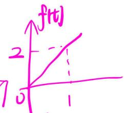

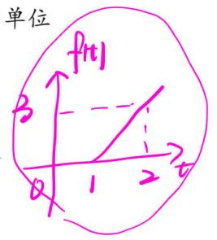

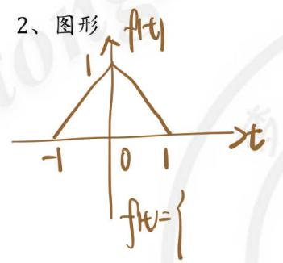

$$
f (t) = \left\{ \begin{array}{l l} t, & t \geq 0 \\ 0, & t <   0 \end{array} \right.
$$

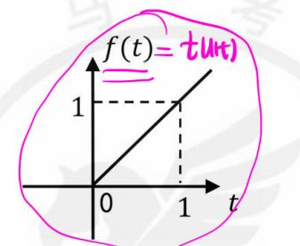  
不f(t)

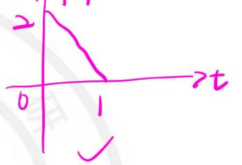

3、应用——图形斜边的表示

$$
f (t) = 2 t [ u (t) - u (t - 1) ]
$$

$$
+ [ - 2 t + 4 ] [ u (t - 1) - u (t - 2) ]
$$

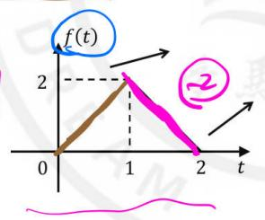  
0\~1范围内：2t  
1\~2范围内： $-2t + 4$

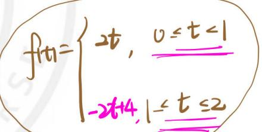

考点2: 单位阶跃信号 $[u|t], \varepsilon|t]$

1、基本定义

$$
u (t) = \left\{ \begin{array}{l l} 1, & t > 0 \\ 0, & t <   0 \end{array} \right.
$$

$1^{0} t=0$ 的值不等式

t=0.51 故容

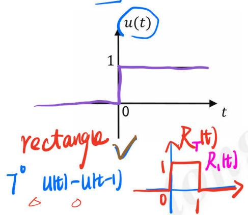

$2^{0}t=0$ 处有假设

$\therefore$ 填度量为1

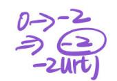  
rectangle

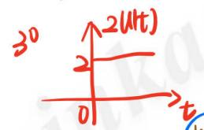  
t=0 处 几度

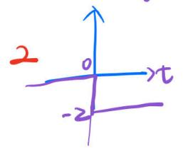  
eq: $R_2|t|$  
4°移位

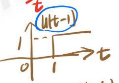  
5°反转

  
6° 腋变换 5

$$
u (t) \stackrel {a > 0} {\rightarrow} u (a t)
$$

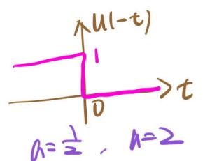  
官网：tongxi nkaoyan. com

$$
u (a t) = u (t)
$$

$G_{TT}(t)$

$$
G _ {2} (t)
$$

梦马班讲义

$$
3 G _ {2} (t)
$$

免费讲义Q群: 1095841878

B站up: 信号与系统\_谷哥

  
2、性质及应用

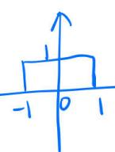

某点之前或之后

2）反转

范围段

存在范围

3) 移位

1）尺度 $u(t)\xrightarrow{a > 0}u(at)\Rightarrow u(at) = u(t)$

$$
f (t) \cdot u
$$

应用：确定范围→范围内画 f(t) 的图

信号相乘 $f_{1}(t) \cdot f_{2}(t)$

(1) 取单边

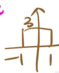

$$
u (t) \rightarrow u (- t)
$$

公众号：通信考研小马哥

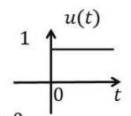

5）信号相减：相同 $t$ 值对应的函数值相减

矩形(rectangle)信号

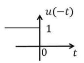

$$
R _ {T} (t) = u (t) - u (t - T)
$$

4）综合 $u(-at \pm b), a > 0, b > 0$

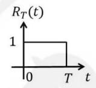

(2) 取段 (加宽)

$$
\begin{array}{c}u (t - t _ {0}), t _ {0} > 0\\\hline 1\\\hline 0 \quad t _ {0} \rightarrow t\end{array}
$$

解：令 $-at \pm b > 0$ ，解出 $t$ 的范围，即该范围是 $u(-at \pm b)$ 不为0的范围

$$
f (t) \cdot [ u - u ]
$$

$$
G _ {T} (t) = u (t + \frac {T}{2}) - u (t - \frac {T}{2})
$$

门(gate)信号: 左右对称的矩形信号

$$
f (t) [ u (t) - u (t - 1) ]
$$

需U有意义的段

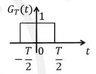

$$
\begin{array}{l} - x > 1 \\ t <   - \frac {1}{2} \end{array}
$$

$$
2 t + 1 > 0
$$

$$
- 2 t - 1 > 0
$$

$$
t > - \frac {1}{2}
$$

$$
(1) x _ {1} (t) = u (2 - t);
$$

例 11: 画出以下信号的图形。

$$
f (t) u (2 t + 1)
$$

$$
f (t) u (- 2 t - 1)
$$

$$
(2) x _ {2} (t) = t u (t - 2) - 2 u (t);
$$

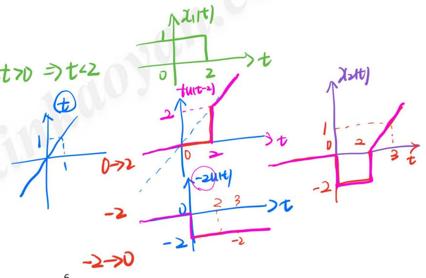  
梦马班讲义

官网：tongxi nkaoyan.com

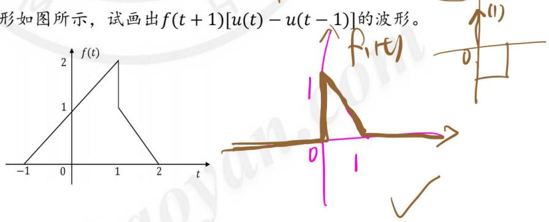

B站up: 信号与系统\_谷哥

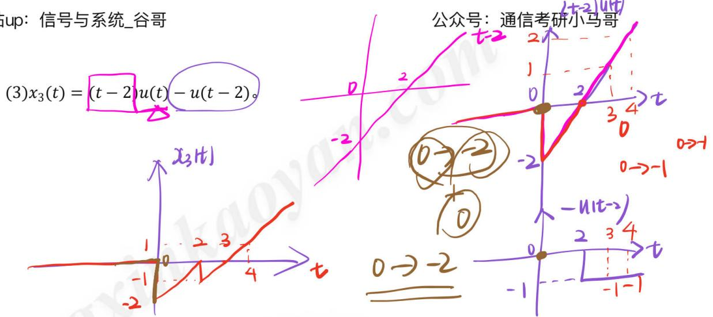

例 12: 已知信号 $f_{1}(t)$ 的波形如图所示, 求 $y_{1}(t)=f_{1}(t+1)u(-t)$ 的波形。

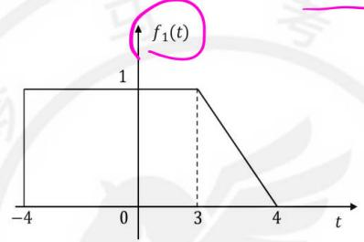

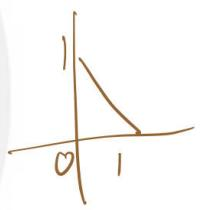

例 13: 已知信号 $f\left( t\right)$ 的波形如图所示,试画出 $f\left( {t + 1}\right) \left\lbrack  {u\left( t\right)  - u\left( {t - 1}\right) }\right\rbrack$ 的波形。

官网：tongxi nkaoyan. com

梦马班讲义

$$
S = \tau \cdot \frac {1}{\tau} = 1
$$

1、基本定义与演变

(1)定义：

①极限定义：

t≠0处 幅直均为0

$$
S = \int_ {- \infty} ^ {\infty} \delta (t) d t = 1
$$

②狄拉克定义：

2、性质

(1)抽样性

$$
f (t) \delta (t) = f (0) \delta (t)
$$

$$
f (t) \delta (t - t _ {0}) = f (t _ {0}) \delta (t - t _ {0})
$$

$$
\int_ {- 2} ^ {- 1} f (t) d t = ? ⓞ
$$

$$
\int_ {- \infty} ^ {\infty} f (t) \delta (t) d t = f (0)
$$

$$
\int_ {- \infty} ^ {\infty} f (t) \delta (t - t _ {0}) d t = f (t _ {0})
$$

【梦马班点拨】注意上下限必须包含 $\delta$ 项括号内整体等于0的点，不然积分为0

$$
\begin{array}{r l} {\mathrm{例如:}} & {\int_ {- \infty} ^ {\infty} \left[ t ^ {2} + \sin \left(\frac {\pi t}{4}\right) \right] \delta (t + 2) d t = \left[ t ^ {2} + \sin (\frac {\pi t}{4}) \right] _ {t = - 2} = (- 2) ^ {2} + \sin (- \frac {\pi}{2}) = 3} \\ & {\int_ {1} ^ {\infty} \left[ t ^ {2} + \sin \left(\frac {\pi t}{4}\right) \right] \delta (t + 2) d t = 0} \end{array}
$$

8

官网：tongxi nkaoyan. com

梦马班讲义

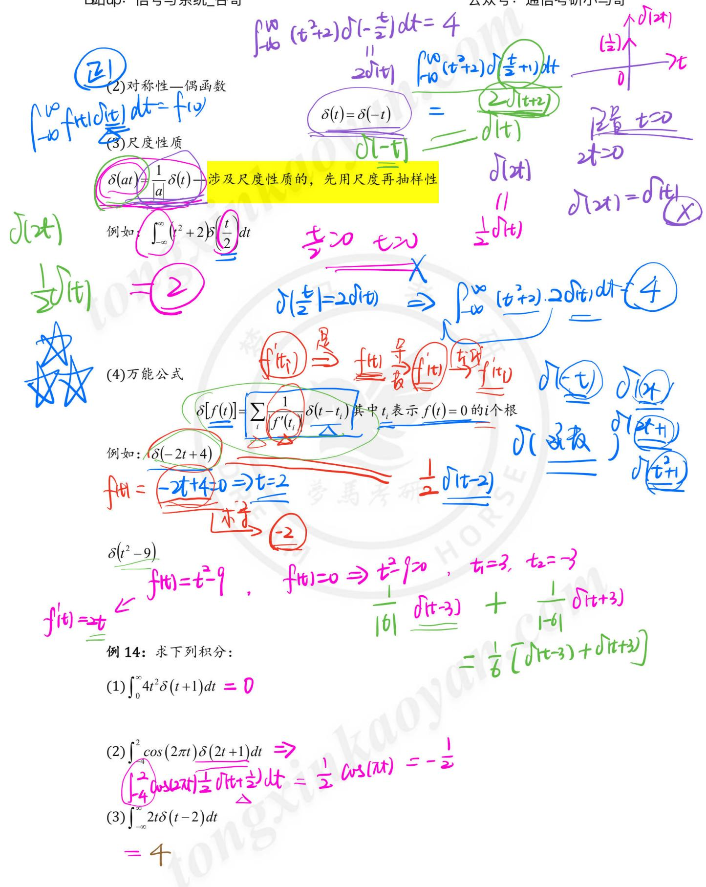

B站up: 信号与系统\_谷哥

公众号：通信考研小马哥

例14: 求下列积分:

9

官网：tongxi nkaoyan. com

梦马班讲义

B站up: 信号与系统\_谷哥

公众号：通信考研小马哥

$\partial(t)$ $\partial(t-tw)$

$$
(4) \int_ {- \infty} ^ {\infty} (4 - t ^ {2}) \delta (t + 3) d t = 4 - 9 = - 5
$$

$\delta(t)$

$$
(5) \int_ {- 3} ^ {6} (4 - t ^ {2}) \delta (t + 4) d t = 0
$$

$$
\int_ {- \infty} ^ {\infty} f (t) d (t - t _ {0}) d t
$$

$\frac{1}{2}x - 1 > 0$

$$
f _ {1} ^ {(2)} = \delta (x - 2)
$$

$$
\text {   令   } f (t) = \delta (x - t) \Rightarrow \int_ {- \infty} ^ {\infty} \delta (t - 2) f (t) d t
$$

$$
\int_ {- 3} ^ {6} (6 - t ^ {2}) \left[ \delta (t + 4) + 2 \delta (2 t + 4) \right] d t \quad \int_ {- 3} ^ {6} (6 - t ^ {2}) = \frac {1}{2} \sqrt {(t + 2)} d t = 6. 4 = 2
$$

$$
\int_ {- \infty} ^ {\infty} d (t) d t = 1
$$

$$
u (t) = \left\{ \begin{array}{l l} 1, & t > 0 \\ 0, & t <   0 \end{array} \right.
$$

叶均求积分

性质（5）——与 u(t) 的关系

$$
\leq \int_ {- \infty} ^ {t} \delta (\tau) d \tau = \left\{ \begin{array}{l l} 1, & t > 0 \\ 0, & t <   0 \end{array} \right.
$$

$$
\left\{ \begin{array}{l} u (t) = \int_ {- \infty} ^ {t} \delta (\tau) d \tau \\ u (t) = \sqrt [ 3 ]{(t)} \end{array} \right.
$$

$$
u (t - 2) = \int_ {- \infty} ^ {t} \frac {\delta (\tau - 2) d \tau}{\tau - 2 = a}
$$

$$
\begin{array}{r l} {(8) \int_ {- \infty} ^ {t} \delta (2 t - 1) d t} & \\ & {= \int_ {- u _ {0}} ^ {t} \frac {1}{2} \mathrm{d} (t - \frac {1}{2}) d t} \\ & {= \frac {1}{2} u (t - \frac {1}{2})} \end{array}
$$

$$
u (t - 2) = \int_ {- \infty} ^ {t - 2} d (a) d a
$$

$$
(9) \int_ {- \infty} ^ {t} [ \delta (t + 2) - \delta (t - 2) ] d t = u | t + 2 | - u | t - 2)
$$

$f(t)$ $\delta(2t+4)$

【梦马班点拨】含冲激信号的计算解题技巧：
万能公式→抽样性
{
相乘形式：注意结果含有冲激项
积分形式
{
积分上下限均为数(包含无穷)：结果为数
积分限存在t项：结果为函数
自本检

B站up: 信号与系统\_谷哥

公众号：通信考研小马哥

考点4: 冲激偶信号

[1] 冲激偶信号的图形

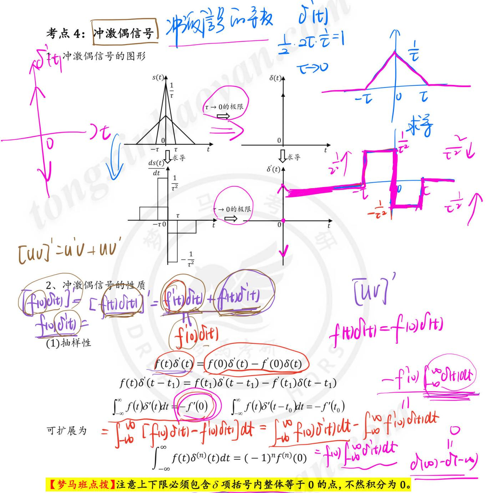

可扩展为

【梦马班点拨】注意上下限必须包含 $\delta$ 项括号内整体等于0的点，不然积分为0。

例：

$$
\begin{array}{r l} {\int_ {- \infty} ^ {\infty} (t ^ {3} + 2 t ^ {2} - 2 t + 1) \delta^ {\prime} (t - 1) d t =} & {- [ t ^ {3} + 2 t ^ {2} - 2 t + 1 ] ^ {\prime} / t = 1} \\ & {= - [ 3 t ^ {2} + 4 t - 2) ] / t = 1 = - [ 3 + p - 2)} \\ & {= - 5} \end{array}
$$

官网：tongxi nkaoyan. com

梦马班讲义

B站up: 信号与系统\_谷哥

公众号：通信考研小马哥

(2)对称性—奇函数

(3)尺度变换

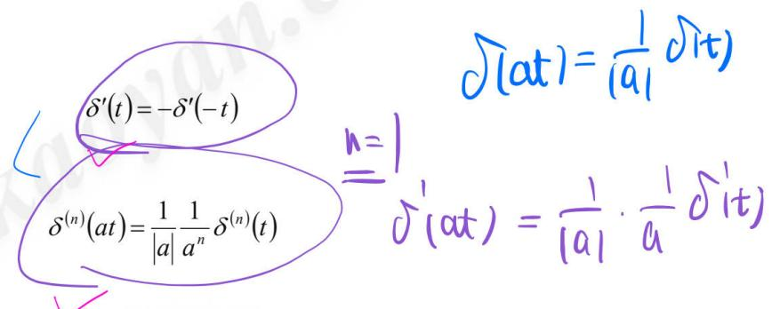

例 15: 求积分 $\int_{-2}^{2}\left[(t-3)\delta(2t+2)+8\cos(\pi t)\delta'(t-0.5)\right]dt$

(4) 综合运算

$$
\delta^ {\prime} (a t \pm b) = \frac {1}{| a |} \cdot \frac {1}{a} \cdot \delta^ {\prime} \left(t \pm \frac {b}{a}\right)
$$

$$
\delta^ {\prime} (2 t + 1)
$$

$$
\frac {1}{2} \cdot \frac {1}{2} \delta (t + \frac {1}{2})
$$

$$
\begin{array}{l} \delta_ {1 t 1} = \int_ {- v b} ^ {t} \delta_ {1 t 1} d \tau \\ \underline {{\underline {{\delta_ {1} (t)}}}} \end{array}
$$

(5)积分性质

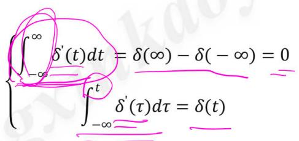

考点 5 四种奇异信号的关系

单位斜度信号

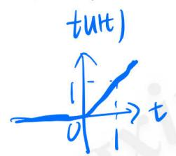

单位班之天官号

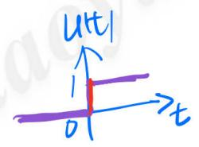

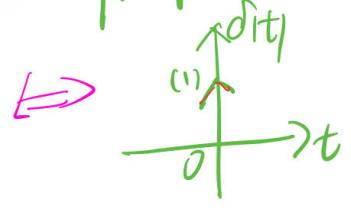

$$
u ^ {\prime} (t) = \delta (t)
$$

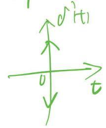

$$
u (t) = \int_ {- \infty} ^ {t} \delta (\tau) d \tau)
$$

位贝求导

解3：分导跳.跳手冲

B站up: 信号与系统\_谷哥

第2节 四种奇异信号（表达式视角）自检表

<table><tr><td>知识点名称</td><td>具体考察点</td></tr><tr><td>单位斜边信号tu(k)</td><td>□定义及图形</td></tr><tr><td>★单位阶跃信号u(t)</td><td>□定义、变形及对应图形□应用:取单边f(u+c)取段f(u-c)突破口:( )so</td></tr><tr><td>★单位冲激信号∫(t)</td><td>□定义、变形及对应图形□万能公式□解题流程及注意事项</td></tr><tr><td>冲激偶信号</td><td>□定义、变形及对应图形□万能公式□解题流程及注意事项</td></tr><tr><td>四种奇异信号的关系</td><td>□表达式及图形关系表示______</td></tr></table>

$f(t/t=2)$ 梦马班讲义

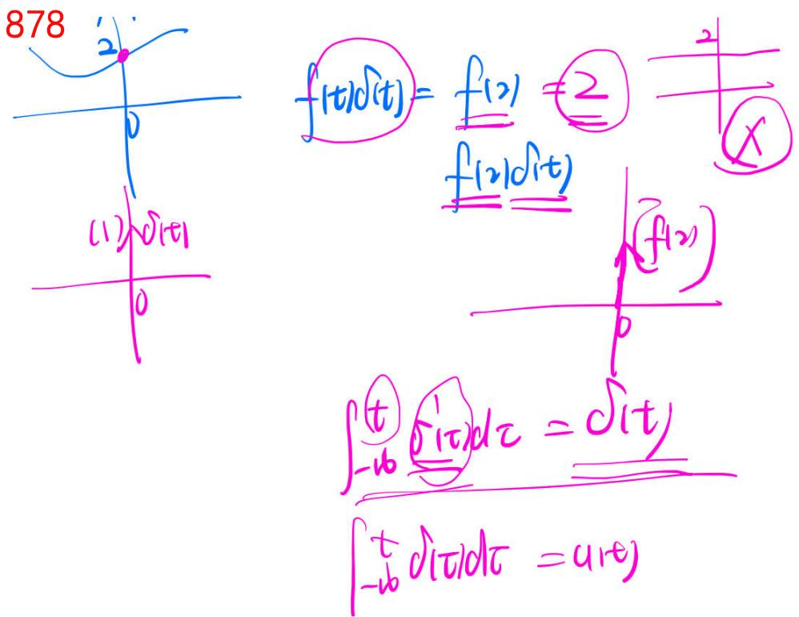

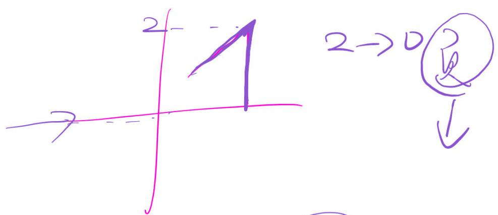

$\delta(t)$ 的寻找定义 $\delta'(t)$

$\delta |t|$ = $\int_{-10}^{t}\delta |\tau x|\tau$

$$
\begin{array}{r l} & {\frac {f (t) \delta^ {\prime} (t) = f (0) \delta^ {\prime} (t) - f ^ {\prime} (0) \delta^ {\prime} (t)}{\int_ {- \infty} ^ {\infty} f (t) \delta^ {\prime} (t) d t}} \\ & {= \int_ {- \infty} ^ {\infty} [ f (0) \delta^ {\prime} (t) - f ^ {\prime} (0) \delta^ {\prime} (t) ] d t} \\ & {= \int_ {- \infty} ^ {\infty} f (0) \delta^ {\prime} (t) d t - \int_ {- \infty} ^ {\infty} f ^ {\prime} (0) \delta^ {\prime} (t) d t} \\ & {= 0 \quad \delta (0) - \delta (- 0) = - f ^ {\prime} (0) \frac {f _ {- 0} ^ {\infty} \delta^ {\prime} (t) d t}{1},} \\ & {\mathrm{if} t | \delta (t) \mathrm{不等}} \end{array}
$$

免费讲义Q群：1095841878

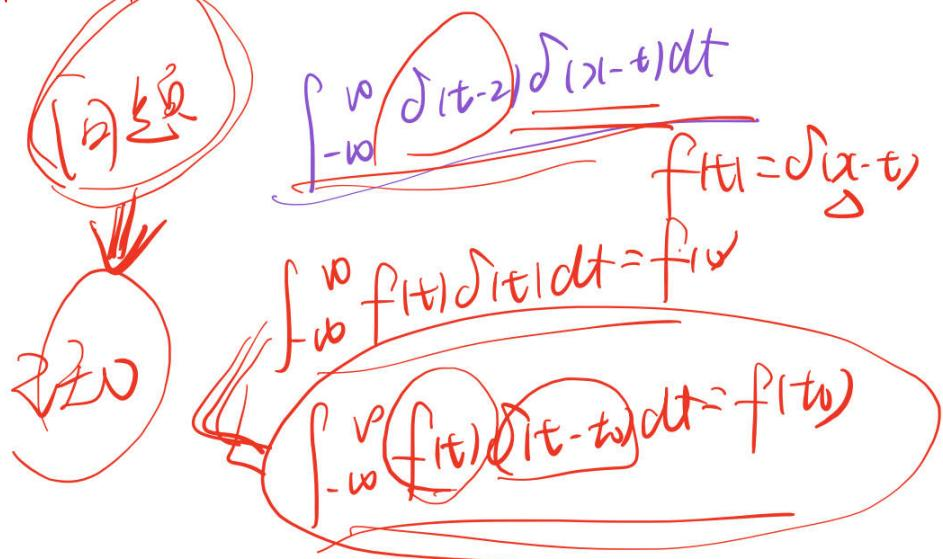

$u(t) = \int_{-b}^{t} \delta(\tau) d\tau$

$$
\frac {1}{2} \rho (t + \frac {1}{2}) = \frac {1}{2} u (t + \frac {1}{2})
$$

$\int_{-\infty}^{t}\delta(2E+1)d\tau$

$$
\frac {1}{2} \int_ {- \infty} ^ {2 t + 1} \delta (a) d a = \frac {1}{2} u (2 t + 1) = \frac {1}{2} u (t + \frac {1}{2})
$$

免费讲义Q群：1095841878

$$
\begin{array}{r l} {7 8} & {\frac {\frac {t}{2}}{- \frac {1}{2}} + \int_ {- \infty} ^ {+ \infty} t > - \frac {1}{2}} \\ & {\quad \int_ {- \infty} ^ {\infty} (t ^ {2} + 4) d t d t =} \\ & {\quad \int_ {- \infty} ^ {\infty} f (t | d t) d t = f (0)} \\ & {= \int_ {- \infty} ^ {\infty} f (0) d t d t} \\ & {= f (0) \frac {f _ {1 0} ^ {\infty} d t d t}{1}, = f (0)} \end{array}
$$