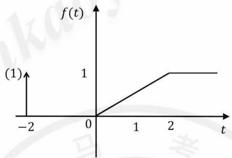
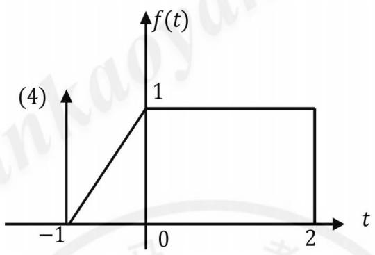
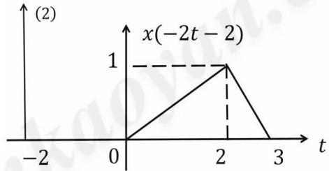
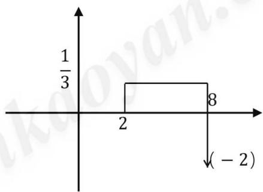

## 第 3 节 课后作业

1、【2024年南京大学2.1】已知 $f(t)$ 如图所示（关注通信考研小马哥，通信考研不迷路）

(1) 画出 $f(2 - 2t)$ 图像;

官网：tongxinkaoyan.com

梦马班作业

B站up: 信号与系统\_谷哥

公众号：通信考研小马哥

2、【2024年沈阳航空航天大学1.2】 $f(t)$ 如下图，画出 $f(2t-2)$ 的图，并求 $\frac{df(t)}{dt}$ 表达式。

官网：tongxinkaoyan.com

B站up: 信号与系统\_谷哥

公众号：通信考研小马哥

3、【2024年国防科技大学3.1.1】已知 $x(-2t-2)$ 图像如下。

(1) 画出 $x(t)$ ;

官网：tongxinkaoyan.com

梦马班作业

B站up: 信号与系统\_谷哥

公众号：通信考研小马哥

4、【2024年湖北大学2】已知 $\frac{d}{dt} f\left(\frac{1}{2} t - 1\right)$ 如下图所示，画出 $f(t)$ 的波形图

官网：tongxinkaoyan.com

梦马班作业