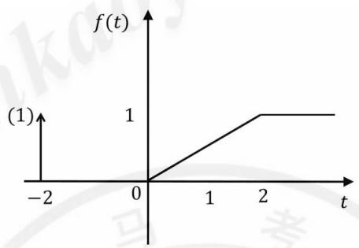
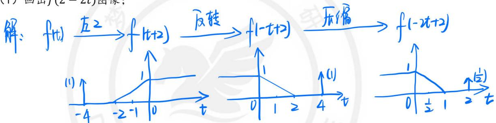
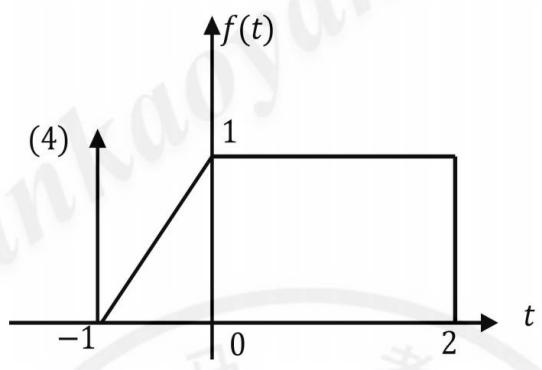
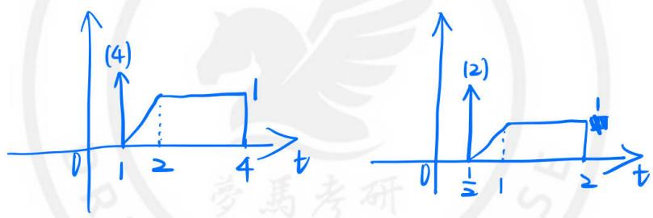
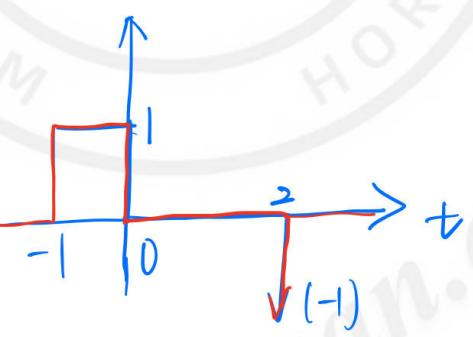
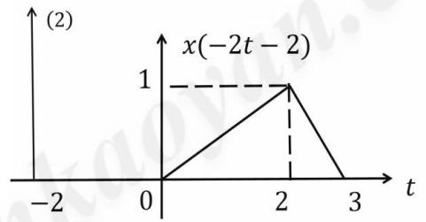
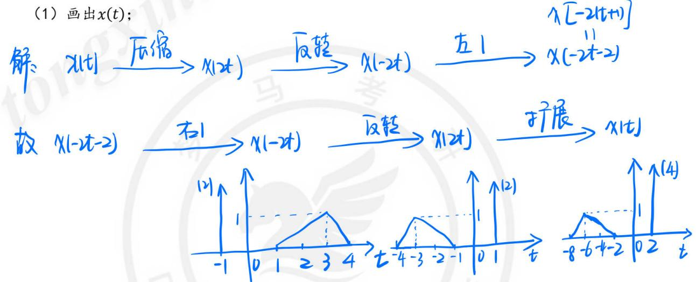
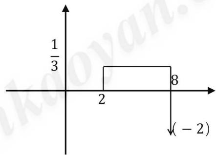
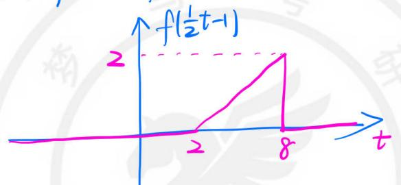
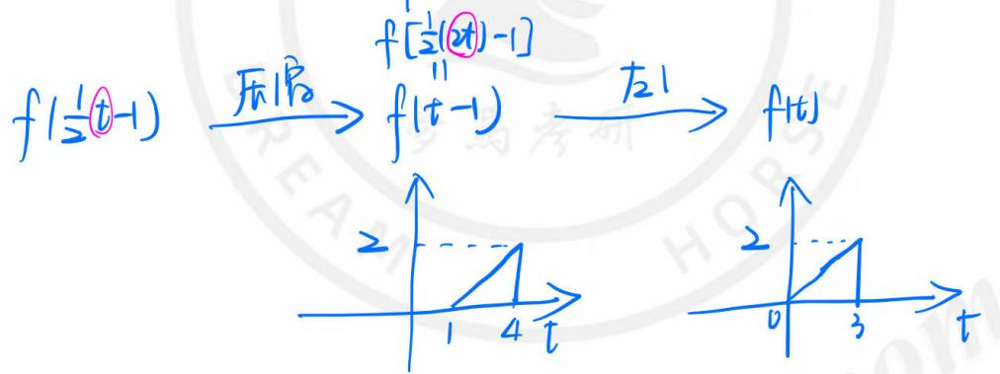

B站up: 信号与系统\_谷哥

公众号：通信考研小马哥

## 第3节 课后作业

1、【2024年南京大学2.1】已知 $f(t)$ 如图所示（关注通信考研小马哥，通信考研不迷路）

(1) 画出 $f(2-2t)$ 图像;

官网：tongxi nkaoyan. com

梦马班作业

2、【2024年沈阳航空航天大学1.2】 $f(t)$ 如下图，画出 $f(2t-2)$ 的图，并求 $\frac{df(t)}{dt}$ 表达式。

解: $f(t) \xrightarrow{\text{右2}} f(t-2) \xrightarrow{\text{压缩}} f(2t-2)$

$f(t)$ 中除 $40f(t-1)$ 外求导为

$$
\mathrm{故} \frac {d f (t)}{d t} = 4 \delta^ {\prime} (t + 1) - \delta (t - 2) + u (t + 1) - u (t)
$$

官网：tongxi nkaoyan. com

梦马班作业

3、【2024年国防科技大学3.1.1】已知 $x(-2t-2)$ 图像如下。

(1) 画出 $x(t)$ ;

易有同学想. $x(-x-2)$ 表式直接证明 it. 参考如下：

①把多余的一2去掉 则 $x(-2t-2) \rightarrow x(-2t+2-2) = x[-2(t-1)-2]$ 说明右1去掉-2

② 把 $x(2t)$ 中负号去掉 则 $x(-2t) \rightarrow x(2t) = x[-2(-t)]$ 反转

③把 $x(x)$ 中2去掉 则 $x(x)$ $\longrightarrow$ $x(2 \cdot \frac{t}{2}) = x(t)$

官网：tongxi nkaoyan. com

$t \rightarrow \frac{t}{2}$ 扩2

梦马班作业

4、【2024年湖北大学2】已知 $\frac{d}{dt} f\left(\frac{1}{2} t - 1\right)$ 如下图所示，画出 $f(t)$ 的波形图

解: $\frac{d}{dt} f(\frac{1}{2}t-1)$ 的原信号 $f(\frac{1}{2}t-1)$ 因形如下:

官网：tongxi nkaoyan. com

梦马班作业