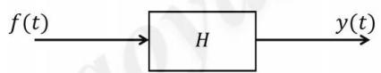
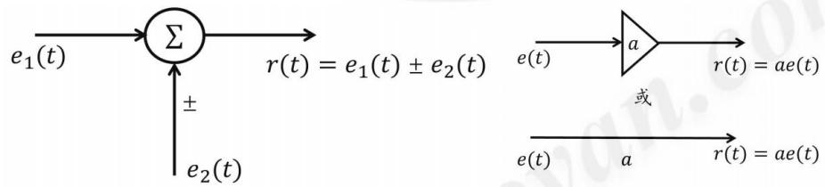
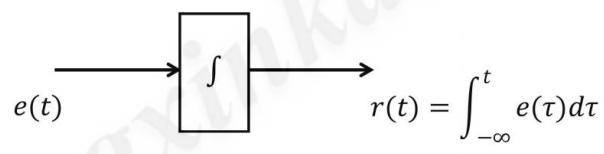
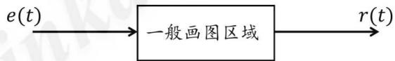
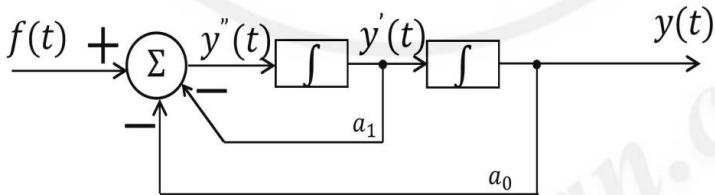
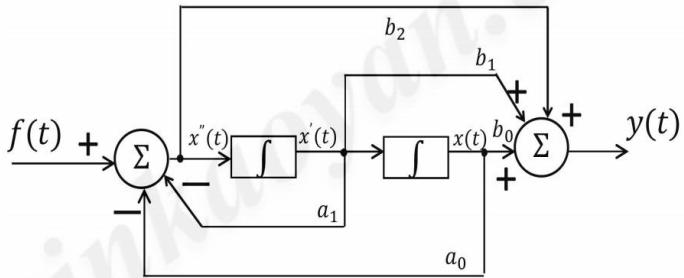
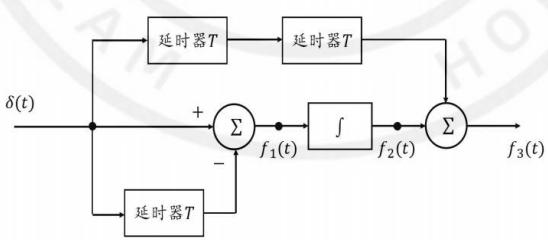

## 目录【回顾知识点与题型】

第1章 连续时间信号与系统.... 1  
专题1 连续信号的表示、分类与运算.... 3  
考点1：连续信号的表示形式.... 3  
考点2：连续信号的分类.... 3  
考点3：信号运算.... 7  
专题2 四种奇异信号.... 9  
考点1：单位斜变信号.... 9  
考点2：单位阶跃信号.... 9  
考点3：单位冲激信号.... 11  
考点4：冲激偶信号.... 13  
专题3 四种奇异信号的图形关系扩展.... 15  
考点1：四种奇异信号关系的图形化表示.... 15  
考点2：四种奇异信号关系的图形化推广.... 15  
考点3：信号微积分运算的应用.... 16  
考点4：包含冲激信号的信号运算.... 17  
专题4 连续系统的时域形式及其转换.... 21  
考点1：连续系统的微分方程.... 21  
考点2：连续系统的模拟框图.... 21  
专题5 连续系统分类与判断.... 24  
考点1：系统表示及作用分析.... 24  
考点2：线性系统的判断.... 24  
考点3：时不变系统的判断.... 25  
考点4：因果系统.... 26  
考点5：记忆系统和无记忆系统.... 26  
考点6：稳定系统和不稳定系统.... 27  
考点7：可逆系统和不可逆系统.... 27  
专题6 线性时不变系统的判断与应用.... 29  
考点1：简易表达式形式下LTIS的判断.... 29  
考点2：微分方程形式下LTIS的判断.... 29  
考点3：线性时不变系统的特性与应用.... 30

## 专题 4 连续系统的时域形式及其转换

1、简易框图：考察函数式表示形式和系统作用(映射关系)

$$
y (t) = H [ f (t) ]
$$

$y(t)$ 为响应， $f(t)$ 为激励，H为系统作用，类似于函数的因变量的变量和映射法则。

2、微分方程: 电路系统 $\rightarrow$ 电路系统的输入输出关系 (KCL/KVL等)

3、模拟框图：由加法器、倍乘器和积分器三种基础器件组成的系统框图

## 考点1：连续系统的微分方程

1、微分方程的标准形式—常系数线性微分方程

$$
y ^ {\prime \prime} (t) + 2 y ^ {\prime} (t) + y (t) = f ^ {\prime} (t) + 2 f (t)
$$

方程左边：响应及响应各阶导数的线性组合且响应最高阶导数项系数为 1

方程右边: 激励及激励各阶导数的线性组合

2、方程阶数：响应的最高阶导数项的阶数

## 考点2：连续系统的模拟框图

1、模拟框图的基本器件：倍乘器、加法器和积分器

(a)相加  
  
(b)倍乘

  
(c)积分

B站up: 信号与系统\_谷哥

公众号：通信考研小马哥

2、连续系统的模拟框图表示微分方程

(1)方程右端不含有激励导数项

①画图原则：图形最左侧【整体输入】为激励，最右侧【整体输出】为响应，即中间区域为画图区域，类似于黑盒子

②画图流程:

微分方程标准形式(已知)→响应最高导数项=多项式之和的形式→围绕加法器设定输入和输出【时刻谨遵原则：左输入，右输出】

例21：已知系统的微分方程为 $\frac{d}{dt} r(t) + a_0r(t) = b_0e(t)$ ，试画出其模拟框图。

例 22: 已知系统微分方程为 $\frac{d^{2}}{dt^{2}} r(t) + a_{1} \frac{d}{dt} r(t) + a_{0} r(t) = b_{0} e(t)$ , 试画出其模拟框图。

官网：tongxinkaoyan.com

梦马班讲义

B站up: 信号与系统\_谷哥

公众号：通信考研小马哥

## (2)方程右端含有激励导数项

取中间变量 $\rightarrow$ 使中间变量与输入满足方程左端形式【 $e(t) =$ 】 $\rightarrow$ 则中间变量与输出满足右端形式【 $r(t) =$ 】

例23：已知系统微分方程为 $\frac{d}{dt} r(t) + a_0r(t) = b_1\frac{d}{dt} e(t)$ ，试画出其模拟框图。

例 24: 已知系统微分方程为 $\frac{d}{dt}r(t) + a_{0}r(t) = b_{0}e(t) + b_{1}\frac{d}{dt}e(t)$ ，试画出其模拟框图。

官网：tongxinkaoyan.com

梦马班讲义

例 25: 已知系统微分方程为 $\frac{d^{2}}{dt^{2}}r(t) + a_{1}\frac{d}{dt}r(t) + a_{0}r(t) = b_{0}e(t) + b_{1}\frac{d}{dt}e(t)$ ，试画出其模拟框图。

## 3、用微分方程表示模拟框图

选择最右侧(箭头方向)的输出为中间变量或系统输出, 然后根据加法器列写方程, 消除中间变量进而得到最终方程。

例 26: 某连续系统的框图如图所示, 写出该系统的微分方程。

B站up: 信号与系统\_谷哥

公众号：通信考研小马哥

例 27: 某连续系统的框图如图所示, 写出该系统的微分方程。

4、框图(非模拟框图)形式下系统表示与应用

例 28: 有系统如图所示, 画出 $f_{1}(t)$ , $f_{2}(t)$ 和 $f_{3}(t)$ 的图形, 并注明坐标值。

