## 目录【回顾知识点与题型】

信号

系统

1 章 连续时间信号与系统.... 1
专题1 连续信号的表示、分类与运算.... 3
考点1：连续信号的表示形式.... a:0 : h>0 ... 3
考点2：连续信号的分类.... 3
考点3：信号运算.... f(t) → f(-at±h) ... 7
专题2 四种奇异信号.... 9
考点1：单位斜变信号.... t(u:t)
考点2：单位阶跃信号.... u(t)
考点3：单位冲激信号.... d(t) ... 流程... 自检 ... 11
考点4：冲激偶信号.... d(t) ... 13
专题3 四种奇异信号的图形关系扩展.... 15
考点1：四种奇异信号关系的图形化表示.... 15
考点2：四种奇异信号关系的图形化推广.... 15
考点3：信号微积分运算的应用.... 16
考点4：包含冲激信号的信号运算.... 17
专题4 连续系统的时域形式及其转换.... 21
考点1：连续系统的微分方程.... 21
考点2：连续系统的模拟框图.... 21
专题5 连续系统分类与判断.... 24
考点1：系统表示及作用分析.... 24
考点2：线性系统的判断.... 24
考点3：时不变系统的判断.... 25
考点4：因果系统.... 26
考点5：记忆系统和无记忆系统.... 26
考点6：稳定系统和不稳定系统.... 27
考点7：可逆系统和不可逆系统.... 27
专题6 线性时不变系统的判断与应用.... 29
考点1：简易表达式形式下LTIS的判断.... 29
考点2：微分方程形式下LTIS的判断.... 29
考点3：线性时不变系统的特性与应用.... 30

# 专题 3 四种奇异信号的图形关系扩展

## 考点1：四种奇异信号关系的图形化表示

1、微积分关系及图形解释

单位斜变信号 $tu(t)$ 单位阶跃信号 $u(t)$ 单位冲激信号 $\delta (t)$ 冲激偶信号 $\delta '(t)$

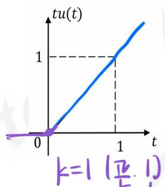

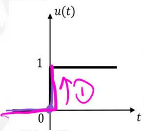  
依次求导

2、重点关系解读：

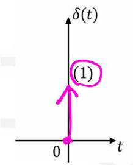

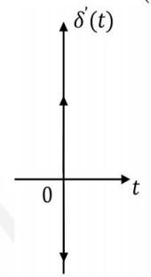

(1)图形化理解：斜导跳，跳导冲

(2) 斜边求导：斜率值包含了跳跃方向与跳变量 ⇒ 斜边

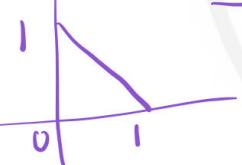

(3)阶跃跳变量求导转化为冲激强度，跳变方向表示了冲激信号的方向和强度的

正负值

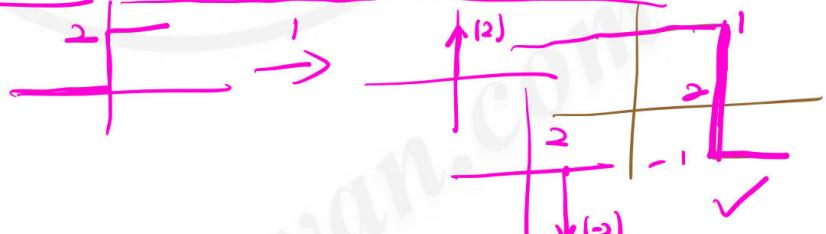

例 16: 已知 $x(t)=1-|t|$ , $-1 \leq t \leq 1$ , 请画出 $x(t)$ , $x'(t)$ , $x''(t)$ 。

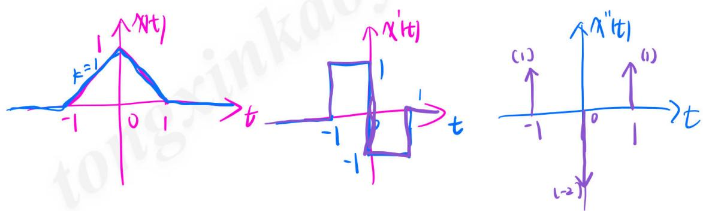

例 17: 已知信号 $f(t)$ 的波形如图所示, 试画出 $f'(t)$ 。

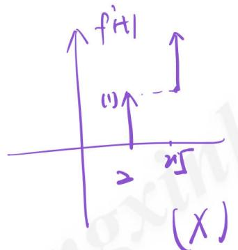

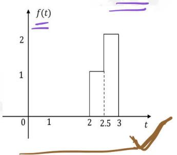

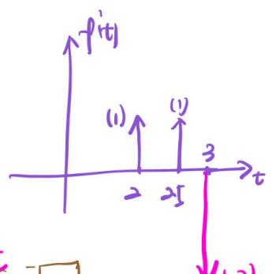

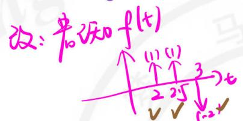

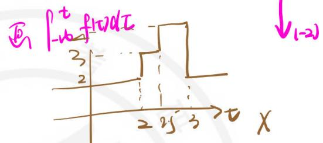

考点2: 信号微积分运算的应用【由上述内容更方便理解微积分运算】

1、微分运算：使图形的边缘轮廓突出

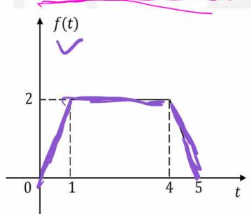

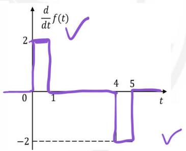

2、积分运算：削弱信号中混入的毛刺(噪声)的影响

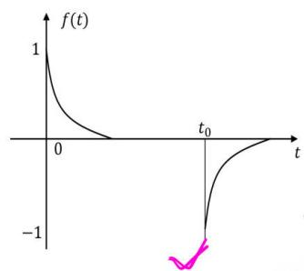

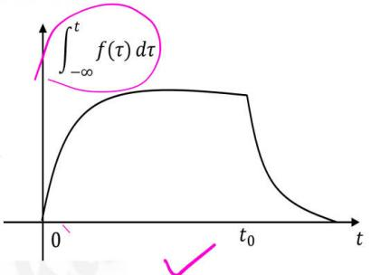

【例题】重新回看斜变与阶跃的微分关系和例 17

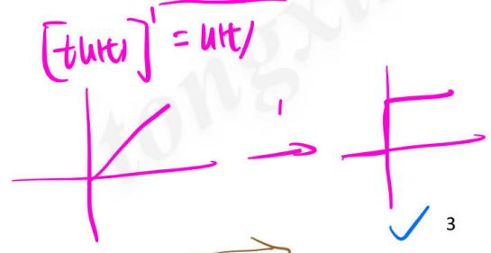

官网：tongxi nkaoyan. com

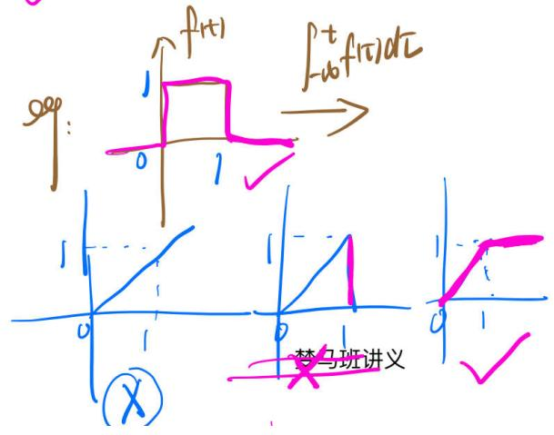

B站up: 信号与系统\_谷哥

公众号：通信考研小马哥

考点3：四种奇异信号关系的图形化推广

3、三角形信号的微分

4、梯形的微分与分解

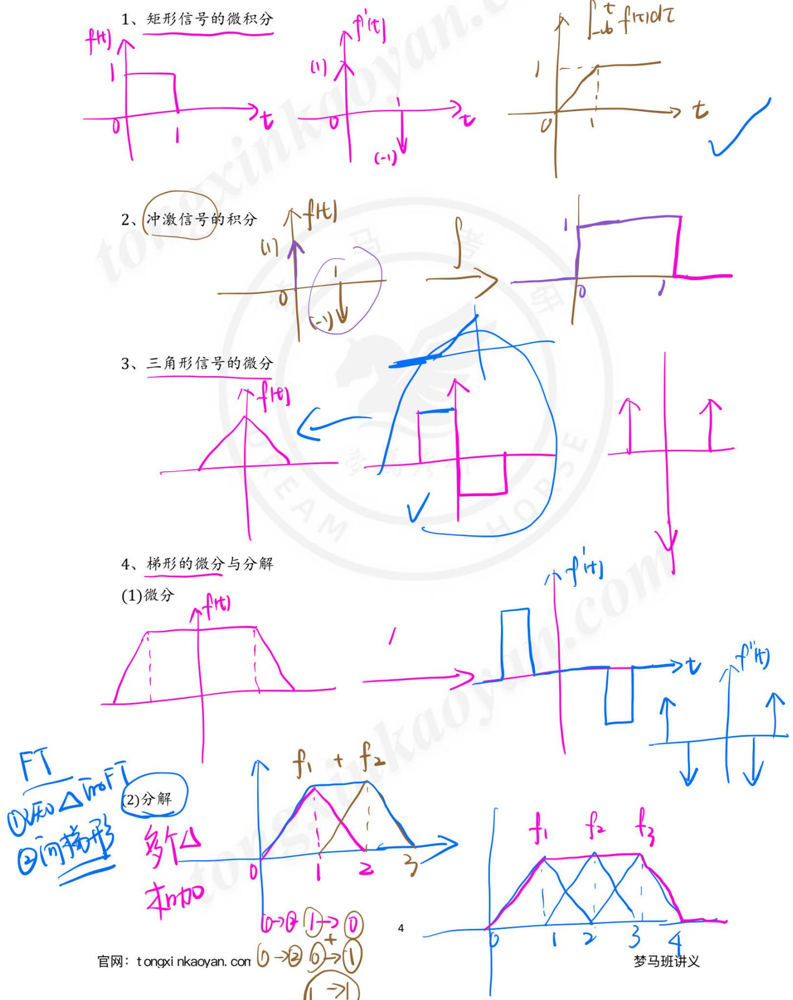

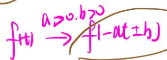

考点4: 信号综合运算的拓展

(1) 信号运算+微积分运算

① $f(t) \rightarrow \int_{-b}^{t} f(\pi) d\tau$

② 求 $f'(-at \pm b)$

$$
[ f (- a t \pm b) ] ^ {\prime} = \frac {d f (- a t \pm b)}{d t} = f ^ {\prime} (- a t \pm b) (- a).
$$

涉及数学问题: $\frac{df(-2t+1)}{dt}$ 和 $f'(-2t+1)$ 的关系

$x \rightarrow  f\left( n\right)$

$$
f (x) = \frac {d f (x)}{d x}
$$

$$
[ f (u) ] ^ {\prime} = \frac {d f (u)}{d u} \cdot \frac {d u}{a x}
$$

$$
\xrightarrow {f (t)} f (2 t + 1) \xrightarrow {\mathrm{导}} [ f (2 t + 1) ] ^ {\prime} = f ^ {\prime} (2 t + 1) \cdot 2
$$

例 18: 已知信号 $f\left( {2 - t}\right)$ 的波形如图所示,绘出 ${f}^{\prime }\left( {{2t} + 1}\right)$ 的波形。

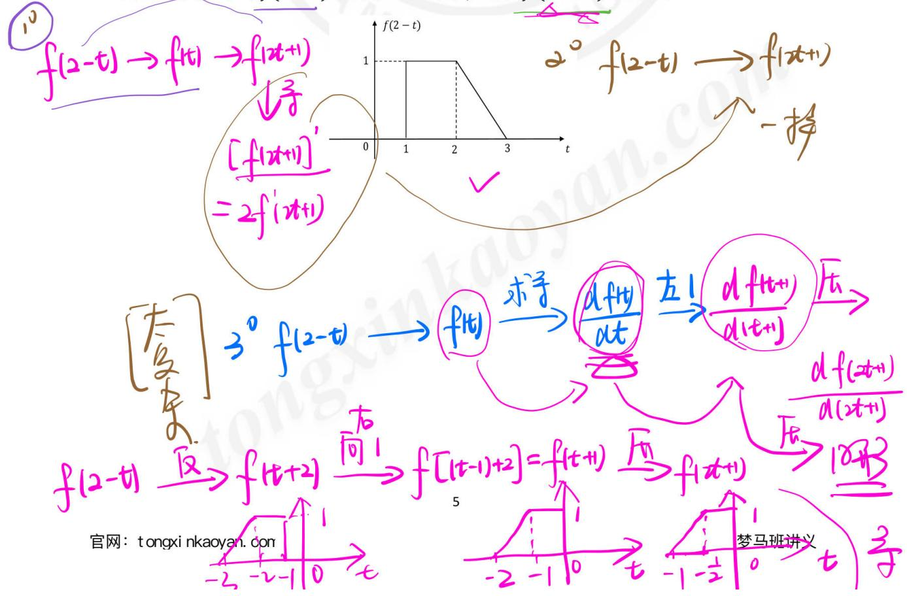

(2) 信号运算+图形含有冲激信号

涉及知识点：

1) 信号综合运算的基本知识

①原则：一切变换只针对于自变量

②结论：运算次序不同，不影响最终结果

③疑惑：运算次序如何选择？

$f(t) \rightarrow f(t-1)$ $f(\Delta t) \stackrel{\text{整位}}{\longrightarrow}$

先积分 ① $f(u) \stackrel{\text{逆}}{\rightarrow} f(t)$

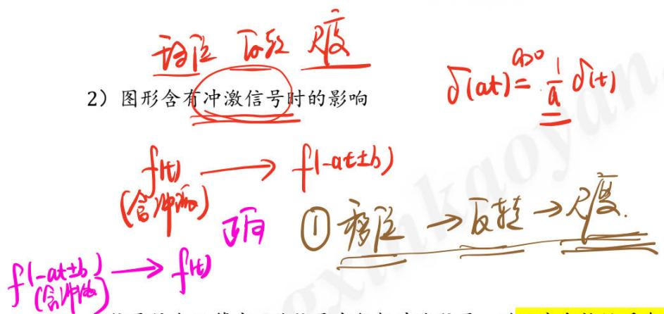

在信号综合运算中, 若信号中包括冲激信号, 则尺度变换性质会影响冲激信号的强度, 建议尺度运算放最后, 其他运算规律一律不变。

B站up: 信号与系统\_谷哥

例 19: 已知 $f(t)$ 波形如图所示，试画出 $f\left(-\frac{1}{2}t-2\right)$ 的波形。

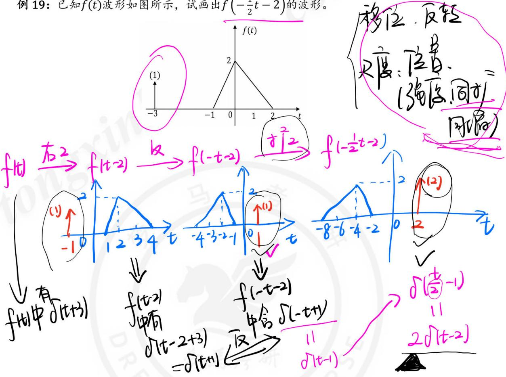

B站up: 信号与系统\_谷哥

例 20: 已知 $f(5 - 2t)$ 的波形如图所示，求 $f(t)$ 的波形。

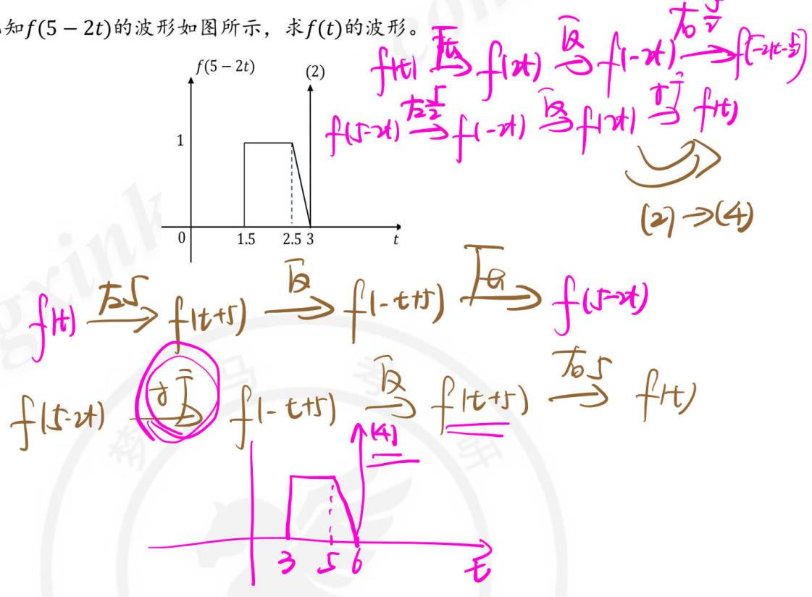

## 信号知识自检表（前三节）

<table><tr><td>知识点名称</td><td>考试点内容</td></tr><tr><td>四种奇异信号</td><td>□阶跃信号的应用→取单边、加窗(取段)fuu□冲激(偶)信号的性质→流程、自检思路←性质公式□四种奇异信号的关系及图形化拓展与FT综合重大</td></tr><tr><td>信号运算</td><td>□信号基本运算原则与结论□信号微积分运算□信号含有冲激信号时的综合运□题型1°f(h)→f(-αt±h)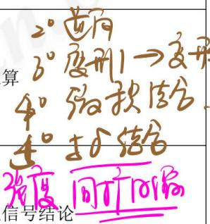</td></tr><tr><td>信号分解(理解第一,记忆第二)</td><td>□周期与非周期→周期判断□能量与功率信号→判断与常见□奇信号与偶信号□直流与交流(不会独立考试,在傅里叶级数中超重要)</td></tr></table>

$f(-at+b)$ $\times$ $\frac{10}{at}d[f(-at+b)]$ $\downarrow$ $f(-at+b)\Rightarrow\|$ 直接求导 $\downarrow20[f(-at+b)]$ $\uparrow$ $\downarrow$ $f'(-at+b)$

免费讲义Q群：1095841878

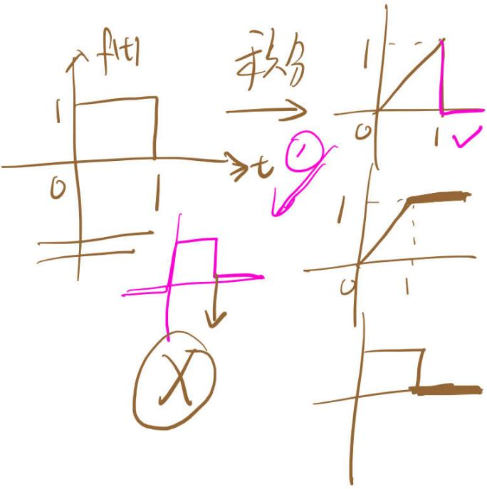