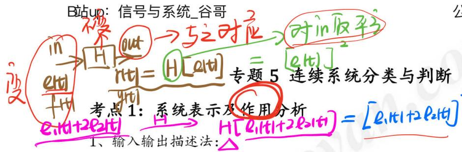
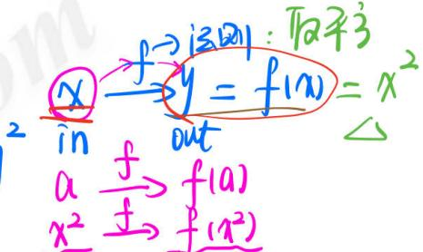
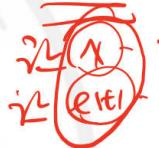
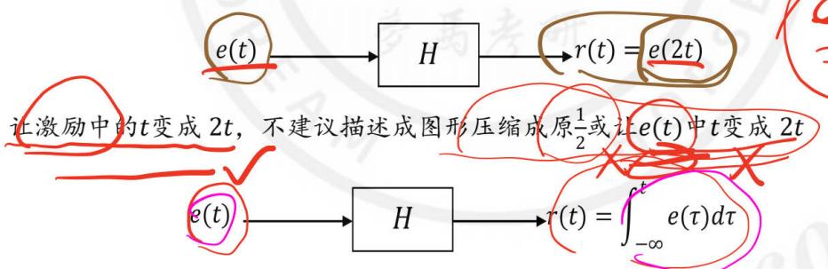
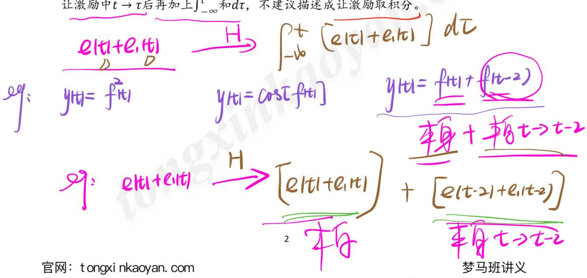
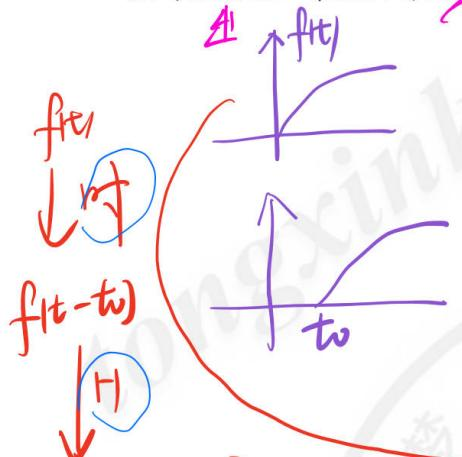
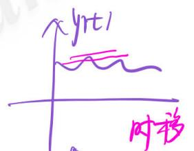
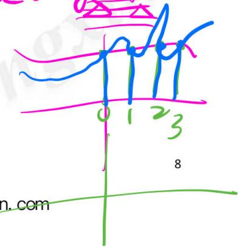

免费讲义Q群：1095841878

B站up: 信号与系统\_谷哥

公众号：通信考研小马哥

## 目录【回顾知识点与题型】

第1章 连续时间信号与系统.... 1
专题1 连续信号的表示、分类与运算.... 3
考点1：连续信号的表示形式.... 3
考点2：连续信号的分类.... 3
考点3：信号运算.... 7
专题2 四种奇异信号.... 9
考点1：单位斜变信号.... 9
考点2：单位阶跃信号.... 9
考点3：单位冲激信号.... 11
考点4：冲激偶信号.... 13
专题3 四种奇异信号的图形关系扩展.... 15
考点1：四种奇异信号关系的图形化表示.... 15
考点2：四种奇异信号关系的图形化推广.... 15
考点3：信号微积分运算的应用.... 16
考点4：包含冲激信号的信号运算.... 17
专题4 连续系统的时域形式及其转换.... 21
考点1：连续系统的微分方程.... 21
考点2：连续系统的模拟框图.... 21
专题5 连续系统分类与判断.... 24
考点1：系统表示及作用分析.... 24
考点2：线性系统的判断.... 24
考点3：时不变系统的判断.... 25
考点4：因果系统.... 26
考点5：记忆系统和无记忆系统.... 26
考点6：稳定系统和不稳定系统.... 27
考点7：可逆系统和不可逆系统.... 27
专题6 线性时不变系统的判断与应用.... 29
考点1：简易表达式形式下LTIS的判断.... 29
考点2：微分方程形式下LTIS的判断.... 29
考点3：线性时不变系统的特性与应用.... 30输入输出描述法着眼于系统激励与响应之间的关系,并不关心系统内部变量的情况。对于在通信系统中大量遇到的单输入—单输出系统,应用这种方法较方便。

2、状态变量分析法：

状态变量分析法不仅可以给出系统的响应，还可提供系统内部各变量的情况，也便于多输入—多输出系统的分析。在近代控制系统的理论研究中，广泛采用状态变量分析法。

3、系统作用：视系统为黑盒子，根据给定的输入输出关系表达式，直白化描述。经过系统的前后变化，请使用固定造句形式：让激励……

例如：

简易表达

让激励中 $t\to\tau$ 后再加上 $\int_{-\infty}^{t}$ 和 $d\tau$ ，不建议描述成让激励取积分。

$$
e _ {1} (t) + e _ {1} (t - 2) + e _ {1} (t) + e _ {1} (t - 2)
$$

B站up: 信号与系统\_谷哥

公众号：通信考研小马哥

考点2: 线性系统的判断

1、定义—同时满足叠加性和均匀性(齐次性)的系统称之为线性系统。

$\frac{1}{b} f(t) \xrightarrow{H} y(t)$

2、判断方法：先线性后系统 $H[a_{1}e_{1}(t)+a_{2}e_{2}(t)]=$ 先系统后线性 $a_{1}r_{1}(t)+a_{2}r_{2}(t)$

平方 $\Rightarrow$ 非线使

中括号内就是激励，让其按照系统作用变化

$$
\frac {(a + b) ^ {2} \neq a ^ {2} + b ^ {2}}{}
$$

<table><tr><td>题目</td><td> $r(t)=e^{2}(t)$ </td></tr><tr><td>系统作用:让激励。。。。。</td><td>让激励 取平方</td></tr><tr><td>先线性后系统 $H[a_{1}e_{1}(t)+a_{2}e_{2}(t)]=$ </td><td> $[a_{1}e_{1}|t|+a_{2}e_{2}|t|]^{2}$ </td></tr><tr><td>先系统后线性 $a_{1}r_{1}(t)+a_{2}r_{2}(t)=$ </td><td> $a_{1}e_{1}^{2}|t|+a_{2}e_{2}^{2}|t|$  ②</td></tr><tr><td>综上所述,定结论</td><td>1≠② 非线性</td></tr></table>

非纯性

$$
\cos [ ]
$$

$$
\vert a + b \vert \neq \vert a \vert + \vert b \vert
$$

$\sin (a + b) \neq \sin a + \sin b$

十常双

$\log(a+b)\neq\log a+(a+b)$ 梦马班讲义

B站up: 信号与系统\_谷哥

公众号：通信考研小马哥

考点3: 时不变系统的判断

1、定义—对于时不变系统，系统参数本身不会随着时间而改变。因此，系统响

应与激励接入系统的时刻无关。

统响 $f(t)$ 与 $y(t)$ $\downarrow$ 时 $y(t-t_0)$

H[f(t-tw)]

$$
\begin{array}{r l} {H [ f (t - t _ {2}) ]} & {= y (t - t _ {2})} \\ & {= \mathrm{时不变}} \\ & {\neq \mathrm{时变}} \end{array}
$$

$H[f(t-t_{0})] = y(t-t_{0})$

<table><tr><td> $r(t) = \cos[e(t)]$ </td><td> $r(t) = e(t) \cdot \cos t$ </td></tr><tr><td>让输入取余弦</td><td>让输入来  $\cos t$ </td></tr><tr><td></td><td></td></tr><tr><td></td><td></td></tr><tr><td> $H[e(t-t_0)] = \cos[e(t-t_0)]$ </td><td> $H[e(t-t_0)] = e(t-t_0) \cdot \cos t$  1</td></tr><tr><td> $r(t-t_0) = \cos[e(t-t_0)]$ </td><td> $r(t-t_0) = e(t-t_0) \cdot \cos[t-t_0]$  2</td></tr><tr><td>1=2 时不变</td><td>1≠2 时不变</td></tr></table>

时没

官网：tongxi nkaoyan.com

输入之外有 $t\sqrt{8}$ 在

9: $n(t) = e(t) u(t)$ 梦马班讲义 $e(t - t_{0}) \cdot u(t)$

免费讲义Q群：1095841878 输入中T而有非I示数

B站up: 信号与系统\_谷哥

公众号：通信考研小马哥

例 29: 试判断 $r(t) = \int_{-\infty}^{t} e(\tau) d\tau$ 的线性和时不变性？

$$
\begin{array}{r l} {H [ a _ {1} e _ {1} (t) + a _ {2} e _ {2} (t) ]} & {= \int_ {- t _ {0}} ^ {t} [ a _ {1} e _ {1} (t) + a _ {2} e _ {2} (t) ] d t \quad ①} \\ {a _ {1} r _ {1} (t) + a _ {2} r _ {2} (t)} & {= a _ {1} \int_ {- t _ {0}} ^ {t} e _ {1} (t) d t + a _ {2} \int_ {- t _ {0}} ^ {t} e _ {2} (t) d t \quad ②} \\ {H [ e (t - t _ {0}) ]} & {= \int_ {- t _ {0}} ^ {t} e (t - t _ {0}) \frac {d t}{\sqrt [ 4 ]{t - t _ {0}}} \quad ③} \\ {\underline {{r (t - t _ {0})}}} & {= \int_ {- t _ {0}} ^ {t - t _ {0}} e (t) d t \quad ④} \\ {\textcircled {1} = ② \mathrm{线化}} & {\textcircled {4} = ⑤ = ③ \quad \int_ {- t _ {0}} ^ {t - t _ {0}} e (a) d a \quad ⑤} \end{array}
$$

例 30: 试判断 $r\left( t\right)  = {\int }_{-\infty }^{5t}e\left( \tau \right) {d\tau }$ 的线性和时不变性？

$$
\begin{array}{r l} {H [ e (t - t _ {0}) ]} & {= \int_ {- \infty} ^ {5 t} e (\tau - t _ {0}) d \tau \textcircled {1}} \\ {\underline {{r (t - t _ {0})}}} & {= \left. \int_ {- \infty} ^ {5 (t - t _ {0})} e (\tau) d \tau \textcircled {2} \right] a = \tau - t _ {0}} \\ & {\textcircled {2} \neq \textcircled {3} = \textcircled {1} \text {   时变   } \textcircled {3} \int_ {- \infty} ^ {5 t - t _ {0}} e (\tau) d \tau} \end{array}
$$

例 31: 试判断 $y\left( t\right)  = {2tx}\left( t\right)  + 2$ 的线性和时不变性？

$$
\frac {0 0}{+ 2 \mathrm{和} t}
$$

1. 线 0 ≠ p
1. 时不变 0 时变

$$
H [ a _ {1} x _ {1} (t) + a _ {2} x _ {2} (t) ] = 2 t [ a _ {1} x _ {1} (t) + a _ {2} x _ {2} (t) ] + 2   a _ {1} y _ {1} (t) + a _ {2} y _ {2} (t) = a _ {1} (2 t x _ {1} (t) + 2) + a _ {2} (2 t x _ {2} (t) + 2) \neq x _ {\mathrm{max}} \mathrm{耗} \quad \mathrm{梦马班讲义}
$$

官网：tongxi nkaoyan. com

B站up: 信号与系统\_谷哥

例32: 试判断 $y(t)=t+f(t)+f(t-2)$ 的线性和时不变性？

00和10

$$
H [ a _ {1} f _ {1 (t + 1)} + a _ {2} f _ {2 (t + 1)} ] = t + [ a _ {1} f _ {1 (t + 1)} + a _ {2} f _ {2 (t + 1)}) + [ a _ {1} f _ {1 (t - 2)} + a _ {2} f _ {2 (t - 2)}) ] \textcircled {1} \neq 0 \textcircled {2} ①   y _ {1 (t + 1)} + a _ {2} y _ {2 (t)} = a _ {1} [ t + f _ {1 (t + 1)} + f _ {1 (t - 2)} ] + a _ {2} [ t + f _ {2 (t + 1)} + f _ {2 (t - 2)})
$$

$$
\mathrm{时段} \quad H [ f (t - t _ {0}) ] = \frac {t + f (t - t _ {0})}{(t - t _ {0}) + f (t - t _ {0})} + f (t - t _ {0} - 2)
$$

1、定义：因果系统—(零状态)响应仅与当前时刻或之前时刻的输入有关，(零状态)响应不应出现在激励之前，即 $e(t)=0,t<t_{0}$ ，则 $r(t)=0,t<t_{0}$

2、判断方法：响应中t<激励括号内整体，若无解，为因果系统；若有解，为非因果。
例:如： $r(t)=e(t-1)$ $r(t)=e(t-1)$ $r(t)=e(t+1)$ $r(t)=e(1)$ 如果 $r(0)=e(1)$ $r(0)=e(0)$ $r(0)=e(0)$ $r(0)=e(1)$ $r(0)=e(0)$ $r(0)=e(1)$ $r(0)=e(0)$ $r(0)=e(1)$ $r(0)=e(0)$ $r(0)=e(1)$ $r(0)=e(0)$ $r(0)=e(1)$

非因果系统, 只需给出不满足条件或特例, 比如当 $t = 1$ 时, $r(1) = e(2)$ , 或当 $t > 0$ 时, 响应超前激励, 故为非因果系统。

B站up: 信号与系统\_谷哥

$R = \frac{y}{I}$ $c / _L$ $\Delta D$

## 考点 5: 记忆系统和无记忆系统

$$
i _ {c} | t | = L \frac {d u _ {c} | e}{d t}
$$

【梦马班点拨】注意微分方程描述的是系统的动态特性，如果是代数方程，在

判断因果和动态性时，需注意时刻问题。

$$
r (t) = e (t) \cdot \cos t
$$

242

(1) $y'(t) - 2ty(t) = x(t);$ (2) $y(t) = x(t) + 3;$ (3) $y(t) = 2(t+1)x(t);$ (4) $y'(t) + 2y(t) = x(t+5);$ (5) $y'(t+4) + 2y(t) = x(t+2);$ (6) $y(t) = x(t+2);$

y(t) = x(t+2) $\sqrt{2}$ $y(t) = x(t-2) \sqrt{2}$

考点6：稳定系统和不稳定系统

1、定义：有界输入，有界输出

恒值有限数 $\leq\infty$

2、判断方法：若 $|e(t)| \leq M$ 成立，则判断 $|r(t)|$ 是否为有限数（小于无穷大）

$$
r (t) = e (t - 1)
$$

$$
\frac {| e | t | \leq M}{2} \text { 则 } | n t | = \frac {| e | t - 1 |}{2} = | e | t | \leq M
$$

$$
\begin{array}{r l} {r _ {t t} = e | t | \cdot c o s t} \\ {\mathrm{for} | e | t | \leq M \mathrm{则} | r _ {t t} | =} & {\frac {| e | t | \cdot c o s t |}{| e | t | \leq M \cdot 1 = M}} \end{array}
$$

91: $r+t=t\cdot e(t)$ $\frac{R}{t}$ $|e(t)|\leq M$ 则 $r+t\approx$ $|t\cdot e(t)|\leq|t|\cdot|e(t)|$ t-20时 = ∞ 梦马班讲义

不极忌.

B站up: 信号与系统\_谷哥

小明→
小地→
小丁→ 公众号：通信考研小马哥

$$
y = f (x) = x ^ {2}
$$

考点7: 可逆系统和不可逆系统

1、定义：若不同激励对应不同的响应，则为可逆系统，若对应相同响应则为不可逆系统。

例： $r(t)=\frac{de(t)}{dt}$ 为不可逆系统

$r(t)=e(2t)$ 为可逆系统

$e(t) = 1 \quad .\;e(t) = 2$

求道新志

2、可逆系统的求解

由系统作用可知 $r\left( t\right)  = e\left( {2t}\right)$ 的逆系统为 $r\left( t\right)  = e\left( \frac{t}{2}\right)$

瓜点又

免费讲义Q群：1095841878