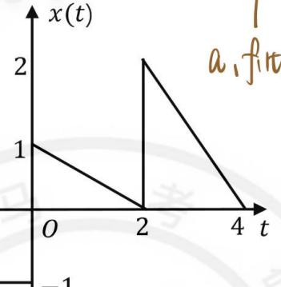
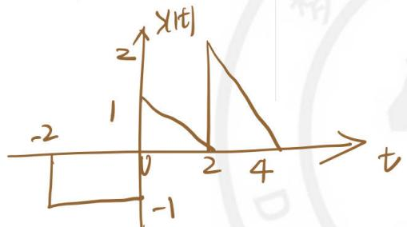
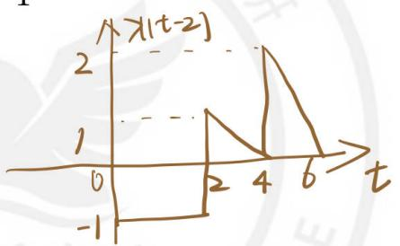
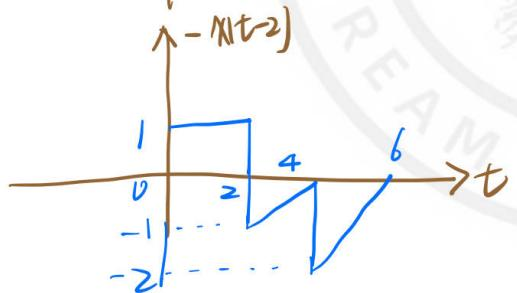
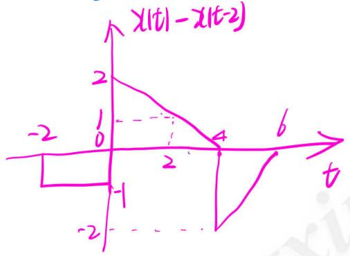
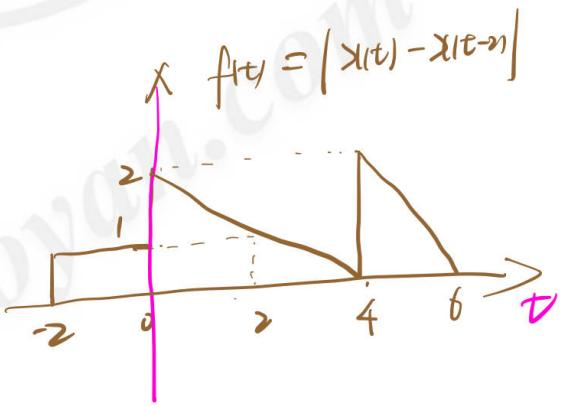

## 第5节 课后作业

1、【2024年河北工程大学2.8】判断系统 $r(t)=\frac{de(t)}{dt}$ 是否为线性的、时不变的、因果

解: 新作用: 让激励求导

$$
H [ a _ {1} e _ {1} (t) + a _ {2} e _ {2} (t) ] = \frac {d}{d t} [ a _ {1} e _ {1} (t) + a _ {2} e _ {2} (t) ]
$$

$$
a _ {1} r _ {1} | t | + a _ {2} r _ {2} | t) = a _ {1} \frac {d e _ {1} | t |}{d t} + a _ {2} \frac {d e _ {2} | t |}{d t} ②
$$

$$
H [ e | t - t _ {0} ] = \frac {d e | t - t _ {0})}{d t}
$$

$$
r (t - t _ {0}) = \frac {d e (t - t _ {0})}{d (t - t _ {0})} ⓐ
$$

① = ②，③ = ④ 我估时不变苏宁

$n_{tt}=\frac{d\theta t}{dt}$ 可见当前时刻的输出仅占当前时刻输入有余数因果系统

切勿用 $f'(x)=\lim_{\Delta x\to0}\frac{f(x+\Delta x)-f(x)}{\Delta x}$ 来求

$$
r (t) = \frac {d e (t)}{d t} = \lim _ {\Delta t \rightarrow 0} \frac {e (t + \Delta t) - e (t)}{\Delta t}
$$

信号不能考察成高故.

官网：tongxi nkaoyan. com

B站up: 信号与系统\_谷哥

公众号：通信考研小马哥

2、【2024年西安电子科技大学1.2】当 $y(t)=f(\frac{1}{2}t)$ 时,判断系统的线性、时变性、因果性、稳定性

解 系统作用：让激励中 $t \rightarrow  \frac{t}{2}$

$$
\begin{array}{r l} {H [ a _ {1} f _ {1} | t | + a _ {2} f _ {2} | t | ] =} & {a _ {1} f _ {1} (\frac {t}{2}) + a _ {2} \frac {f _ {1} (\frac {t}{2})}{2} ①} \\ {a _ {1} y _ {1} | t | + a _ {2} y _ {2} | t | =} & {a _ {1} f _ {1} (\frac {t}{2}) + a _ {2} f _ {2} (\frac {t}{2}) ②} \end{array}
$$

$$
\begin{array}{r l} {H [ f (t - t _ {0}) ]} & {= f (\frac {t}{2} - t _ {0}) \textcircled {3}} \\ {y (t - t _ {0})} & {= f (\frac {t - t _ {0}}{2}) \textcircled {4}} \end{array}
$$

① = ②，③ ≠ ④ 线性，时度余充
当 t = -1 时 $y(-1) = f(-\frac{1}{2})$ 说明存在响应超前激励
故非因果

$\frac{t}{10} |f(t)| \leq M$ 则 $|y(t)| = |f(\frac{t}{2})| = |f(t)| \leq M$ 故系统稳定

官网：tongxi nkaoyan. com

免费讲义Q群：1095841878

B站up: 信号与系统\_谷哥

公众号：通信考研小马哥

3、【2024年武汉科技大学1.3】已知系统输入 $x(t)$ 和输出 $y(t)$ 之间的关系 $y(t)=\int_{-\infty}^{t}x(\tau)d\tau+3$ ，下面正确的是（B）
A、线性 B、因果 C、稳定 D、以上都对

选择题 考察规律或典型案例

A: 线性 x ③

B: 回果 √

C 稳定 若 $x(t)=2$ 则 $f_{-b}^{t}x(t)d\tau=2t+c$

夢馬考研

官网：tongxi nkaoyan. com

梦马班作业

4、【2024年华东理工大学1.2】已知某系统的输入输出关系为

$$
y (t) = f (2 t) + f (t - 1)
$$

判断该系统是否是线性、时不变、因果、无记忆性、稳定系统。

反应作用: [让液后中 $t \rightarrow  {2t}$ ] + [让液后中 $t \rightarrow  {t - 1}$ ]

$$
\begin{array}{r l} {H [ a _ {1} f _ {1} (t) + a _ {2} f _ {2} (t) ]} & {= [ a _ {1} f _ {1} (t) + a _ {2} f _ {2} (t) ] + [ a _ {1} f _ {1} (t - 1) + a _ {2} f _ {2} (t - 1) ] \textcircled {1}} \\ {a _ {1} y _ {1} (t) + a _ {2} y _ {2} (t)} & {= a _ {1} [ f _ {1} (2 t) + f _ {1} (t - 1) ] + a _ {2} [ f _ {2} (2 t) + f _ {2} (t - 1) ] \textcircled {2}} \\ {H [ f (t - t _ {0}) ]} & {= f (2 t - t _ {0}) + f (t - 1 - t _ {0}) \textcircled {3}} \\ {y (t - t _ {0})} & {= f [ 2 (t - t _ {0}) ] + f (t - t _ {0} - 1) \textcircled {4}} \\ {\textcircled {1}} & {= \textcircled {2}, \textcircled {3} \neq \textcircled {4} \mathrm{故为线性,时变系统}} \end{array}
$$

令t=1 则 $y(1)=f(2)+f(0)$ 说明存在响应超前激励情况
故非因果
由于n响应与其它时刻输入有关，故记忆永远

若 $\vert f(t)\vert\leq M$ 则 $\vert y(t)\vert=\vert f(2t)+f(t-1)\vert\leq\vert f(2t)\vert+\vert f(t-1)\vert=2\vert f(t)\vert\leq2M$ 故余心稳定

梦马班作业

B站up: 信号与系统\_谷哥

5、【2024年沈阳工业大学1】已知系统为 $r(t)=\sin\left[e^{2}(t)+e(3-t)\right]$ ，证明并判断该系统的线性/非线性、时变/时不变、因果/非因果性质。（关注通信考研小马哥，通信考研不迷路）

解 $H[a_{1}e_{1}|t|+a_{2}e_{2}|t]=\sin\left\{[ae_{1}|t|+ae_{2}|t]^{2}+[ae_{1}(3-t)+ae_{2}(3-t)]\right\}$ ① $a_{1}r_{1}|t|+a_{2}r_{2}|t|=a_{1}\sin[e_{1}^{2}(t)+e_{1}(3-t)]+a_{2}\sin[e_{2}^{2}(t)+e_{2}(3-t)]$ ② $H[e(t-t))]=\sin[e(t-t)+e(3-t-t)]$ ③ $r(t-t)=\sin[e(t-t)+e(3-(t-t))]$ ④
①≠②，③≠④ 非线性. 时变系式
令 t<3-t 解 $t<\frac{3}{2}$ . 即取 t=1 时 $r(1)=\sin[e^{2}(1)+e(2)]$ 可见响应存在超前激励力故非曝

官网：tongxi nkaoyan. com

梦马班作业

6、【2024年武汉大学2】已知信号 $f(t)=|x(t)-x(t-2)|$ ，求：

(1) 判断 $f(t)$ 是否为线性的;

(2) 判断 $f(t)$ 是否为时不变的;

(3) $x(t)$ 如图所示, 画出 $f(t)$ 的图像。

12) $H[x(t-t_{0})]$ $=\left|x(t-t_{0})-x(t-2-t_{0})\right|$

$f\left( {t - {tw}}\right)  = 1x\left( {t - {tw}}\right)  - x\left( {t - {tw} - 2}\right)$ ④

③ = ④ 时不变，补充

$$
\begin{array}{r l} {(1) + [ a _ {1} x _ {1} (t) + a _ {2} x _ {2} (t) ]} & {\mathrm{(1)}} \\ {= \left[ [ a _ {1} x _ {1} (t) + a _ {2} x _ {2} (t) ] - [ a _ {1} x _ {1} (t - 2) + a _ {2} x _ {2} (t - 2) ] \right]} & {\mathrm{(1)}} \end{array}
$$

$$
\begin{array}{r l} {a _ {1} f _ {1} (t) + a _ {2} f _ {2} (t)} & {= a _ {1} | x _ {1} (t) - x _ {1} (t - 2) |} \\ & {\quad + a _ {2} | x _ {2} (t) - x _ {2} (t - 2) | ^ {2}} \end{array}
$$

官网：tongxi nkaoyan. con

梦马班作业