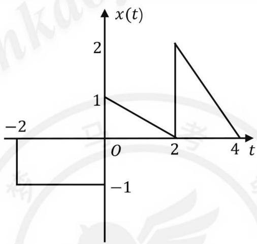

B站up: 信号与系统\_谷哥

公众号：通信考研小马哥

## 第5节 课后作业

1、【2024年河北工程大学2.8】判断系统 $r(t)=\frac{de(t)}{dt}$ 是否为线性的、时不变的、因果

官网：tongxinkaoyan.com

B站up: 信号与系统\_谷哥

公众号：通信考研小马哥

2、【2024年西安电子科技大学1.2】当 $y(t)=f(\frac{1}{2}t)$ 时,判断系统的线性、时变性、因果性、稳定性

官网：tongxinkaoyan.com

梦马班作业

B站up: 信号与系统\_谷哥

公众号：通信考研小马哥

3、【2024年武汉科技大学1.3】已知系统输入 $x(t)$ 和输出 $y(t)$ 之间的关系 $y(t) = \int_{-\infty}^{t} x(\tau) d\tau + 3$ ，下面正确的是（）
A、线性 B、因果 C、稳定 D、以上都对

官网：tongxinkaoyan.com

梦马班作业

B站up: 信号与系统\_谷哥

公众号：通信考研小马哥

4、【2024年华东理工大学1.2】已知某系统的输入输出关系为

$$
y (t) = f (2 t) + f (t - 1)
$$

判断该系统是否是线性、时不变、因果、无记忆性、稳定系统。

夢馬考研

官网：tongxinkaoyan.com

梦马班作业

5、【2024年沈阳工业大学1】已知系统为 $r(t)=\sin\left[e^{2}(t)+e(3-t)\right]$ ，证明并判断该系统的线性/非线性、时变/时不变、因果/非因果性质。（关注通信考研小马哥，通信考研不迷路）

官网：tongxinkaoyan.com

梦马班作业

B站up: 信号与系统\_谷哥

公众号：通信考研小马哥

6、【2024年武汉大学2】已知信号 $f(t)=|x(t)-x(t-2)|$ ，求：

(1) 判断 $f(t)$ 是否为线性的;

(2) 判断 $f(t)$ 是否为时不变的;

(3) $x(t)$ 如图所示, 画出 $f(t)$ 的图像。

  
夢馬考研

梦马班作业