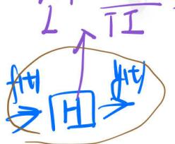

B站up: 信号与系统\_谷哥

公众号：通信考研小马哥

## 目录【回顾知识点与题型】

① 研究对象
∠IS
∠I系元

第1章 连续时间信号与系统.... 1
专题1 连续信号的表示、分类与运算.... 3
考点1：连续信号的表示形式.... 3
考点2：连续信号的分类.... 3
考点3：信号运算.... 7
专题2 四种奇异信号.... 9
考点1：单位斜变信号.... 9
考点2：单位阶跃信号.... 9
考点3：单位冲激信号.... 11
考点4：冲激偶信号.... 13
专题3 四种奇异信号的图形关系扩展.... 15
考点1：四种奇异信号关系的图形化表示.... 15
考点2：四种奇异信号关系的图形化推广.... 15
考点3：信号微积分运算的应用.... 16
考点4：包含冲激信号的信号运算.... 17
专题4 连续系统的时域形式及其转换.... 21
考点1：连续系统的微分方程.... 21
考点2：连续系统的模拟框图.... 21
专题5 连续系统分类与判断.... 24
考点1：系统表示及作用分析.... 24
考点2：线性系统的判断.... 24
考点3：时不变系统的判断.... 25
考点4：因果系统.... 26
考点5：记忆系统和无记忆系统.... 26
考点6：稳定系统和不稳定系统.... 27
考点7：可逆系统和不可逆系统.... 27
专题6 线性时不变系统的判断与应用.... 29
考点1：简易表达式形式下LTIS的判断.... 29
考点2：微分方程形式下LTIS的判断.... 29
考点3：线性时不变系统的特性与应用.... 30

B站up: 信号与系统\_谷哥

公众号：通信考研小马哥

## 专题6 线性时不变系统的判断与应用

考点1: 简易表达式形式下LTIS的判断

1、系统作用：根据给定的输入输出表达式，白话总结

2. 线性系统：先线性后系统 $H\left\lbrack  {{a}_{1}{e}_{1}\left( t\right)  + {a}_{2}{e}_{2}\left( t\right) }\right\rbrack   =$ 先系统后线性 ${a}_{1}{r}_{1}\left( t\right)  +$

$a_{2}r_{2}(t)$ 常见结论： $( )^{2}$ ，11. $\cos[7]$ $\sin^{2}$

十夜

3、时不变系统：先时移后系统 $H\left\lbrack  {e\left( {t - {t}_{0}}\right) }\right\rbrack   =$ 先系统后时移 $r\left( {t - {t}_{0}}\right)$

4、综上所述，给出系统判定结果

in外有t. in内t有非1字表

考点2: 微分方程形式下LTIS的判断

1、判断方法—反证法

$y_{(t)}=\left\{\begin{array}{l}f(t),\quad t>0\\0,\quad t<0\end{array}\right.$ $y_{(t)}=f(t)u(t)$

<table><tr><td>(1)假设为线性系统,即 $[a_1e_1(t)+a_2e_2(t)] \stackrel{H}{\leftrightarrow} [a_1r_1(t)+a_2r_2(t)]$ 成立,即将两者带入关系式中所有激励与响应表达式所在处; $=H[a_1e_1(t)+a_2e_2(t)]$ </td></tr><tr><td>(2)真实存在的关系:将关系式等号两边同时进行齐次性后再相加;</td></tr><tr><td>(3)(1)和(2)若相等,则假设成立,即该系统为线性系统,否则为非线性系统。</td></tr><tr><td>(4)假设为时不变系统,即 $e(t-t_0) \stackrel{H}{\leftrightarrow} r(t-t_0)$ 成立,即将两者带入关系式中所有激励与响应表达式所在处;</td></tr><tr><td>(5)真实存在的关系:将关系式等号两边所有的t变成t-t0;</td></tr><tr><td>(6)(4)和(5)若相等,则假设成立,即该系统为时不变系统,否则为时变系统。</td></tr></table>

例 34: 已知系统的输入 $x(t)$ 和输出 $y(t)$ 之间的关系为

$$
\frac {d y (t)}{d t} + a y ^ {2} (t) = b x (t)
$$

说明此系统是否为线性非时变记忆因果系统。 $a$ 和 $b$ 为常数。

说明此系统是否为线性非的变记忆因来系统。 $a$ 和 $b$ 为常数。
假设线性： $H[a, x_{1}|t| + a_{2}x_{2}|t] = a, y_{1}|t| + a_{2}y_{2}|t]$ 成立

真实关系：

$$
\frac {d y _ {2} (t)}{d t} + a y _ {2} ^ {2} (t) = b x _ {2} (t)
$$

官网：tongxinkaoyan.com $a_{1}$ ② + $a_{2}$ ③

梦马班讲义

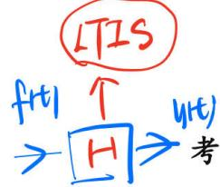

八成立

非线性

例 35: 已知 $f(t)$ 为系统的输入, $y(t)$ 为系统的输出, 试判断下列系统是否为线性、时不变系统。

$$
\frac {d y (t)}{d t} + a (t) y (t) = \frac {d f (t)}{d t}
$$

若 $a(t)$ 改为常数

设线性 $a_{1}f_{1}(t) + a_{2}f_{2}(t)\rightarrow a_{1}y_{1}(t) + a_{2}y_{2}(t)$ ,即

莫关系

$$
\left\{\begin{array}{l l}{\frac {d}{d t} [ a _ {1} y _ {1} (t) + a _ {2} y _ {2} (t) ] + a (t) [ a _ {1} y _ {1} (t) + a _ {2} y _ {2} (t) ] = \frac {d}{d t} [ a _ {1} f _ {1} (t) + a _ {2} f _ {2} (t) ]}&①\\{f _ {1} (t) \rightarrow y _ {1} (t)}&{2 p \quad \frac {d y _ {1} (t)}{d t} + a (t) y _ {1} (t) = \frac {d f _ {1} (t)}{d t}}\\&{\frac {d y _ {2} (t)}{d t} + a (t) y _ {2} (t) = \frac {d f _ {2} (t)}{d t}}\\&{③}\end{array}\right.
$$

$$
\begin{array}{r l} {a _ {1} \textcircled {2} + a _ {2} \textcircled {3} \mathrm{得}} & {a _ {1} [ \frac {d y _ {1 1 9}}{d t} + a _ {1 0 1 9, 1 0 1} ] + a _ {2} [ \frac {d y _ {2 1 9}}{d t} + a _ {1 0 1 9, y _ {2 1 9 3}} ]} \\ & {= a _ {1} \frac {d f _ {1 1 9}}{d t} + a _ {2} \frac {d f _ {2 1 9}}{d t}, \mathrm{才成立} \textcircled {4}} \end{array}
$$

## 考点3: 线性时不变系统的特性与应用

1、LTIS的线性性质—系统(零状态)响应与外加激励

对于线性系统而言，当系统外加激励发生线性变化时，其对应的(零状态)响应发生相同形式的变化。

例如：

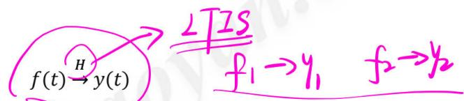

则

$$
2 f _ {1} (t) + 3 f _ {2} (t) \xrightarrow {H}?
$$

## 2、LTIS的时不变性质

对于时不变系统而言，当系统外加激励发生移位变化时，其对应的(零状态)响应发生相同移位变化。

例如：

则

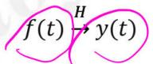

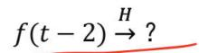

故答案应为 $y(t-2)$

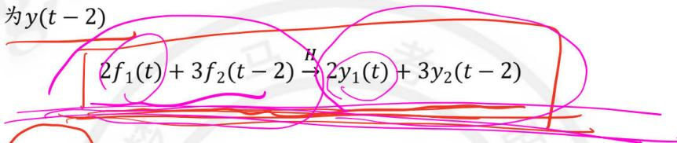

## 3、LTIS的微积分性质

对于LTI系统满足如下的微分特性:若系统在激励 $e(t)$ 作用下产生响应 $r(t)$ ，则当激励为 $\frac{de(t)}{dt}$ 时，响应为 $\frac{dr(t)}{dt}$ 。根据线性与时不变性容易证明此结论。

首先由时不变特性可知, 激励 $e\left( t\right)$ 对应输出 $r\left( t\right)$ , 则激励 $e\left( {t - {\Delta t}}\right)$ 产生响应 $r\left( {t -$ ${\Delta t}}\right)$ 。再由叠加性与均匀性可知,若激励为 $\frac{e\left( {t}\right)  - e\left( {t - {\Delta t}}\right) }{\Delta t}$ 则响应等于 $\frac{r\left( t\right)  - r\left( {t - {\Delta t}}\right) }{\Delta t}$ ,取 $t \rightarrow$ 0 的极限,得到导数关系。若激励为

则响应为

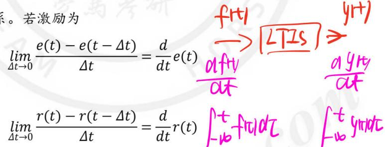

这表明，当系统的输入由原激励信号改为其导数时，输出也由原响应函数变成其导数。显然，此结论可扩展至高阶导数与积分。

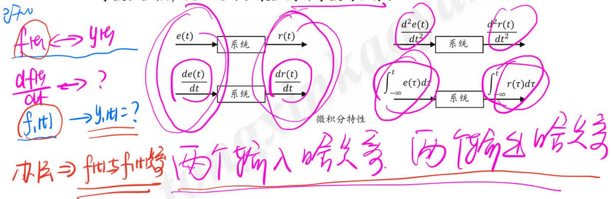

B站up: 信号与系统\_谷哥

公众号：通信考研小马哥

## 4、LTIS性质的考察

(1)给定输入之间的关系和某一响应，求解另外一个响应例 36: 有一线性时不变系统, 当激励 $e_1(t) = u(t)$ 时, 响应 $r_1(t) = e^{-\alpha t}u(t)$ , 试求当激励 $e_2(t) = \delta(t)$ 时, 响应 $r_2(t)$ 的表示式。(假定起始时刻系统无储能。)

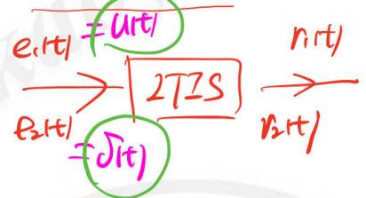

$$
\begin{array}{r l} {u (t)} & {= \sqrt [ 3 ]{(t)} \Rightarrow r _ {2} (t) = r _ {1} (t)} \\ & {[ e ^ {- \alpha t} u (t) ] ^ {\prime}} \\ & {= - \alpha e ^ {- \alpha t} u (t) + e ^ {- \alpha t} \sqrt [ 3 ]{(t)}} \end{array}
$$

(2)给出两个输入的图形和某一响应，求解另外一个响应——考察常见图形间的综合关系

例 37: 线性时不变系统对 $x_{1}(t)$ 的响应为 $y_{1}(t)$ , 如图所示。试确定并画出系统对题图中 $x_{2}(t)$ 的响应 $y_{2}(t)$ 的波形 (提示: 用 $x_{1}(t)$ 表示 $x_{2}(t)$ )。

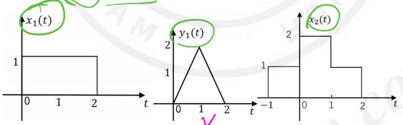

找关系： ${x}_{1}$ 与 ${x}_{2}$ 关系 ${x}_{2}\left( t\right)  = {x}_{1}\left( t\right)  + {x}_{1}\left( {t + 1}\right)$

$$
\Rightarrow y _ {2} (t) = y _ {1} (t) + y _ {1} (t + 1)
$$

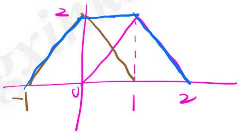  
5

官网：tongxi nkaoyan. com

梦马班讲义 战风
时不变
的积

免费讲义Q群：1095841878

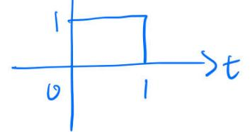

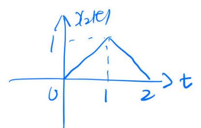

找关系 ${x}_{1}$ 与 ${x}_{2}$

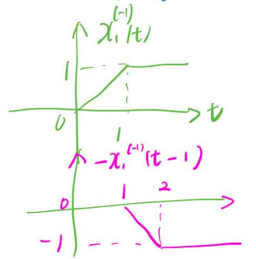

$$
x _ {1} (t) = x _ {1} ^ {(+)} (t) \overline {{0}} x _ {1} ^ {(- 1)} (t - 1)
$$

信号

1. $f(t) \stackrel{m}{\rightarrow} \frac{f(-at \pm h)}{b^{2}a^{2}}$ 2. 四种奇偶 $\Rightarrow u(t) \text{与} \delta(t) \cdot \delta'(t)$ 任项  
3. 图形与图形

豪逸

4 模拟框图
5 ∠T2S. 眼稳 可适. 跳忆.
6 ∠T2S的应用
二 我们不过
微积分 $^{1}$ 唱爱： (\*.\*\*)

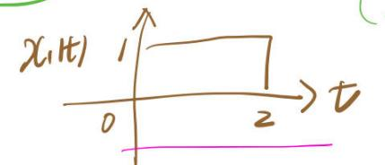

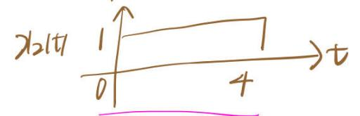

${y}_{2}$ 时 $=$

免费讲义Q群：1095841878

${x}_{2}\left| {t - 1}\right|  = {x}_{1}\left| {t - 1}\right|  + {x}_{1}\left| {t - 2}\right|$