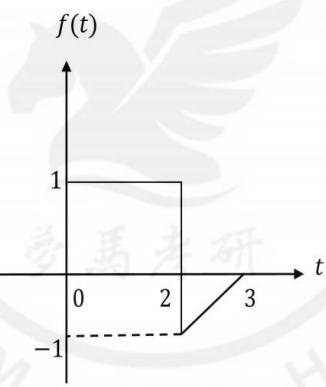
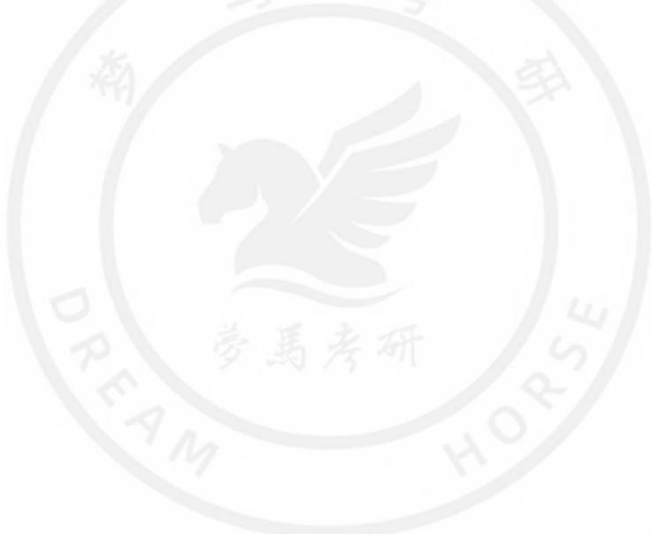
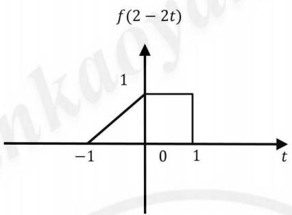
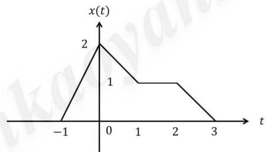
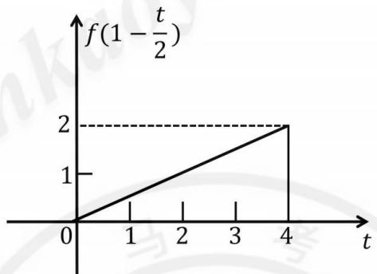
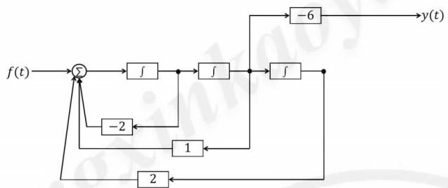
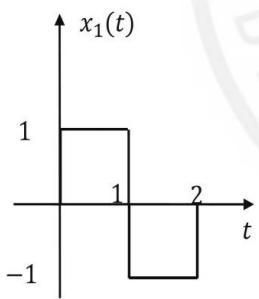
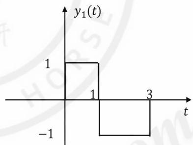
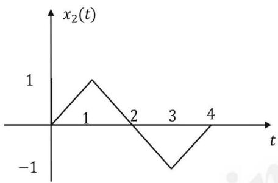

## 连续时间信号与系统 章节测试题

1、考试时间：2026年4月8日 18:00- 20:30;

2、提交截止时间：伯索云平台，20:35；直播时间 20:40

3、请自觉选择考试类型（闭卷、开卷）

## 一、周期求解题（可直接给出答案）

(5 分) 1、【2025 成都理工大学 826】

某信号 $f(t) = 2\sin (2t) + 3\cos (4t - 3)$ ，其周期为\_\_\_\_。

(5 分) 2、【2025 海南大学 888】

$f(t)$ 的周期为T， $f(2t)+f(t)$ 的周期为\_\_\_\_。

## 二、性质计算题（给出计算过程）

(5 分) 1、【2025 西北师范大学 844】

$$
\int_ {- 5} ^ {5} (t ^ {2} + 2 t + 1) \delta (t - 8) d t =
$$

(5 分) 2、【2025 西安邮电大学 824】

计算 $\int_{-5}^{1}cos\left(\frac{\pi\tau}{6}\right)\delta \left(\frac{\tau}{2} +1\right)d\tau =$

(5 分) 3、【2025 中国海洋大学 819】

计算 $\int_{-\infty}^{t}\delta (2\tau -1)d\tau$

官网：tongxinkaoyan.com

梦马班讲义

B站up: 信号与系统\_谷哥

公众号：通信考研小马哥

4、【2025 西安石油大学 810】

$$
(5 \text { 分 }) (1) f (t) = c o s \left[ \frac {\pi}{3} (t - 3) \right] \delta (t - 2)
$$

$$
(5 \text { 分 }) (2) f (t) = \int_ {- \infty} ^ {t} e ^ {- \tau} \delta (2 \tau) d \tau
$$

(5 分) 5、【2025 天津大学 815】

$\int_{-\infty}^{t}\delta (\tau)\cos (\omega_0\tau)d\tau =$

(5 分) 6、【2025 西安电子科技大学 821】

$\int_0^\infty \delta (t^2 -4)dt =$

(5 分) 7、【2025 中国传媒大学 823】

计算 $\int_{-2}^{2}(t^2 - 4t + 1)\left[\delta'(t - 3) + \delta(2t - 1)\right]dt$

官网：tongxinkaoyan.com

梦马班讲义

B站up: 信号与系统\_谷哥

公众号：通信考研小马哥

(5 分) 8、【2025 西北工业大学 827】

已知信号 $f(5-2t)=2\delta(t-3)$ ，求 $\int_{-\infty}^{+\infty}(t+3)f(t)dt=$ \_\_\_\_

## 三、信号运算题

(15 分) 1、【2025 西安石油大学 810】

已知信号 $f(t)$ 波形如图所示, 分别画出信号 $f(-2 t + 1)$ 、 $f'(t)$ 的波形

官网：tongxinkaoyan.com

梦马班讲义

B站up: 信号与系统\_谷哥

公众号：通信考研小马哥

(5 分) 2、【2025 石家庄铁道大学 894】

已知信号 $f(2-2t)$ 的波形如下图 2 所示，请画出信号 $f(t-1)$ 的波形。

  
图2

官网：tongxinkaoyan.com

梦马班讲义

B站up: 信号与系统\_谷哥

公众号：通信考研小马哥

(20 分) 3、【2025 杭州电子科技大学 843】

已知某连续时间信号 $x(t)$ 的波形如下图所示：

画出信号 $x_{1}(t) = \frac{dx(t - 1)}{dt} + x(2 - \frac{1}{2} t)$ 的波形。

官网：tongxinkaoyan.com

梦马班讲义

B站up: 信号与系统\_谷哥

公众号：通信考研小马哥

(15 分) 4、【2025 西安电子科技大学 821】

已知函数 $f\left(1-\frac{t}{2}\right)$ 的波形如题1图所示，请画出 $g(t)=f'(t)$ 和 $g(2t)$ 的波形。

  
夢馬考研

官网：tongxinkaoyan.com

梦马班讲义

B站up: 信号与系统\_谷哥

公众号：通信考研小马哥

## 四、系统框图题

(5 分) 1、【2025 武汉理工大学 855】

已知系统框图如下，求该连续系统的微分方程。

## 五、判断题

(10 分) 1、【2025 西安邮电大学 824】

已知输入 $f(t)$ 和输出 $y(t)$ 之间的关系为 $y(t)=t^{2}f(t)+e^{f(t)}$ ，判断该系统的线性，时变性，因果性，稳定性。

(10 分) 2、【2025 西南交通大学 824】

已知 $y(t)=-\pi f(\sin t)$ ，求该系统的线性和时变性

(15 分) 3、【2025 西南交通大学 824】

已知输入 $x_{1}(t)$ ，对应输出 $y_{1}(t)$ ，若输入 $x_{2}(t)$ ，求出对应输出 $y_{2}(t)$ 的波形图。

官网：tongxinkaoyan.com

梦马班讲义