## 连续时间信号与系统 章节测试题

## 一、周期求解题（可直接给出答案）

(5分)1、【2025成都理工大学826】

某信号 $f(t)=2\sin(2t)+3\cos(4t-3)$ ，其周期为 $\pi(s)$ 。[元单位扣2分]

解: ${T}_{1} = \frac{2\pi }{{w}_{1}} = \frac{2\pi }{2} = \pi$

最小公倍数为 $\pi$

$$
T _ {2} = \frac {2 \pi}{W _ {2}} = \frac {2 \pi}{4} = \frac {\pi}{2}
$$

(5分)2、【2025海南大学888】

(3)若 $f\left( t\right)  = 2$ ,【2023年7月1日 8:55】 $f\left( t\right)$ 的周期为 $T,\;f\left( {2t}\right)  + f\left( t\right)$ 的周期为 $T$ (不用写单位).

解：f由周期为T

最小公倍数为 $T$

则 $f(x)$ 时域压缩. 周期为 $\frac{T}{2}$

## 二、性质计算题（给出计算过程）

(5分)1、【2025西北师范大学844】

$$
\int_ {- 5} ^ {5} (t ^ {2} + 2 t + 1) \delta (t - 8) d t = 0
$$

8 不在 $(-5,5)$ 内

(5分)2、【2025西安邮电大学824】

计算 $\int_{-5}^{1}cos\left(\frac{\pi\tau}{6}\right)\delta \left(\frac{\tau}{2} +1\right)d\tau =$

解: $\frac{\pi}{2}+1=0 \Rightarrow \pi=-2$ 则 $\delta\left(\frac{\pi}{2}+1\right)=2\delta(\pi+2)$ 故原式 $=\int_{-5}^{1}\cos\left(\frac{\pi}{6}\pi\right)\cdot2\delta(\pi+2)d\pi=2\cos\left[\frac{\pi}{6}\times(-2)\right]=2\cos\left(-\frac{\pi}{3}\right)=1$

(5分)3、【2025中国海洋大学819】

计算 $\int_{-\infty}^{t}\delta(2\tau-1)d\tau$ 。

解： $2\tau-1=0 \Rightarrow \tau=\frac{1}{2}$ $\delta(2\tau-1)=\frac{1}{2}\delta(\tau-\frac{1}{2})$ 原式 $=\int_{-b}^{t}\frac{1}{2}\delta(\tau-\frac{1}{2})d\tau=\frac{1}{2}\int_{-b}^{t}\delta(\tau-\frac{1}{2})d\tau=\frac{1}{2}u(t-\frac{1}{2})$

官网：tongxinkaoyan.com

梦马班讲义

4、【2025 西安石油大学 810】

(5分)(1) $f(t)=cos\left[\frac{\pi}{3}(t-3)\right]\delta(t-2)$

解: $f(t)\sqrt{(t-t_{0})}=f(t_{0})\cdot\sqrt{(t-t_{0})}$

故原式 $= \cos \left\lbrack  {\frac{\pi }{3}\left( {2 - 3}\right) }\right\rbrack  \sqrt{1 - 2}$ $= \frac{1}{2}\sqrt{1 - 2}$

(5 分) 5、【2025 天津大学 815】

$\therefore \cos (\omega_{0} \tau) = \cos 0 \cdot \delta(\tau) = \sqrt{(\tau)}$

$$
\mathrm{故原式} = \int_ {- \infty} ^ {t} d (\tau) d \tau = u (t)
$$

(5分)6、【2025西安电子科技大学821】

$\int_0^\infty \delta (t^2 -4)dt =$

则： $t^{2}-4=0 \Rightarrow t^{2}=4 \Rightarrow t_{1}=2, t_{2}=-2$

$$
\begin{array}{r l} {\mathrm{则}} & {\delta (t ^ {2} - 4) = \frac {1}{4} [ \delta (t + 2) + \delta (t - 2) ]} \\ {\mathrm{故原式}} & {= \int_ {0} ^ {\infty} \frac {1}{4} [ \delta (t + 2) + \delta (t - 2) ] d t = \frac {1}{4} [ \int_ {0} ^ {\infty} \delta (t + 2) d t + \int_ {0} ^ {\infty} \delta (t - 2) d t ] = \frac {1}{4} [ 0 + 1 ]} \\ & {= \frac {1}{4}} \end{array}
$$

(5分)7、【2025 中国传媒大学823】

计算 $\int_{-2}^{2}(t^2 - 4t + 1)\left[\delta'(t - 3) + \delta(2t - 1)\right]dt$

解: $\sqrt{(2t-1)} = \frac{1}{2}\sqrt{(t-\frac{1}{2})}$

$$
\begin{array}{r l} {\mathrm{原式}} & {\int_ {- 2} ^ {2} (t ^ {2} - 4 t + 1) \underbrace {[ \sqrt [ 3 ]{(t - 3)} + \frac {1}{2} \sqrt [ 3 ]{(t - \frac {1}{2})} ] d t} _ {\mathrm{不在范围内}}} \\ & {= \int_ {- 2} ^ {2} (t ^ {2} - 4 t + 1) \cdot \frac {1}{2} \sqrt [ 3 ]{(t - \frac {1}{2})} d t} \\ & {= \frac {1}{2} (t ^ {2} - 4 t + 1) \bigg | _ {t = \frac {1}{2}}} \end{array}
$$

官网：tongxinkaovan.com $\div\left[\frac{1}{4}-2+1\right]=-\frac{3}{8}$

(5分)(2) $f(t)=\int_{-\infty}^{t}e^{-\tau}\delta(2\tau)d\tau$

解： $\delta(2\pi)=\frac{1}{2}\delta(\pi)$

$$
\begin{array}{r l} {\mathrm{原式}} & {= \int_ {- \infty} ^ {t} e ^ {- \tau} \frac {1}{2} \delta (\tau) d \tau} \\ & {= \frac {1}{2} \int_ {- \infty} ^ {t} e ^ {- \tau} \delta (\tau) d \tau \quad \mathrm{抽样性}} \\ & {= \frac {1}{2} \int_ {- \infty} ^ {t} \delta (\tau) d \tau = \frac {1}{2} (u t)} \end{array}
$$

梦马班讲义

(5分)8、【2025西北工业大学827】

已知信号 $f(5-2t)=2\delta(t-3)$ ，求 $\int_{-\infty}^{+\infty}(t+3)f(t)dt=$ \_\_\_\_

设：令 $5 - {2t} = a$ ,即 $t = \frac{5}{2} - \frac{a}{2}$

$$
\begin{array}{r l} {\mathrm{则} f (a)} & {= 2 \delta (\frac {5}{2} - \frac {a}{2} - 3)} \\ & {= 2 \delta (- \frac {1}{2} - \frac {a}{2})} \end{array}
$$

即 $f\left| t\right|  = {20}\sqrt{1 - \frac{1}{2} - \frac{t}{2}} = 4\sqrt{1 - t + 1}$ 故 $\int_{-\infty}^{\infty}(t+3)40(t+1)dt$ $= 4x(-1+3)$ $= 8$

三、信号运算题

(15分)1、【2025西安石油大学810】

已知信号 $f(t)$ 波形如图所示, 分别画出信号 $f(-2 t + 1)$ 、 $f'(t)$ 的波形

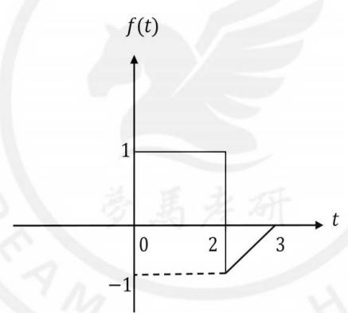

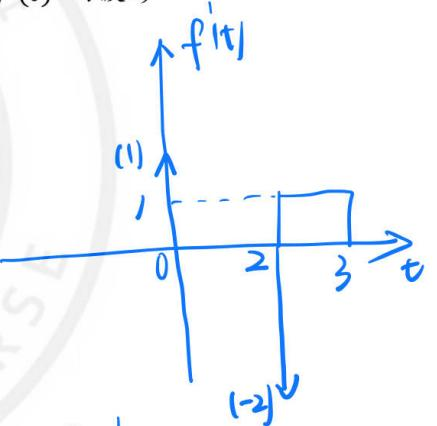

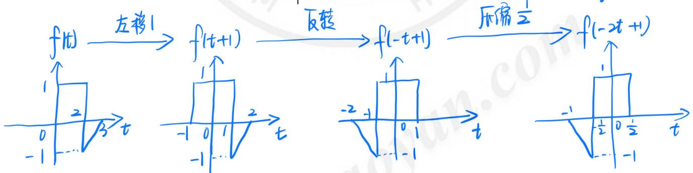

官网：tongxinkaoyan.com

梦马班讲义

(5分)2、【2025石家庄铁道大学894】

已知信号 $f(2 - 2t)$ 的波形如下图2所示，请画出信号 $f(t - 1)$ 的波形。

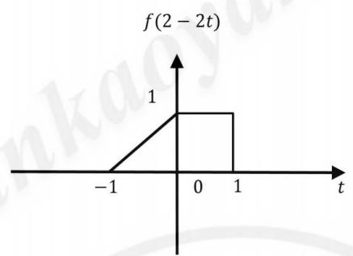  
图 2

的：

推荐方法：

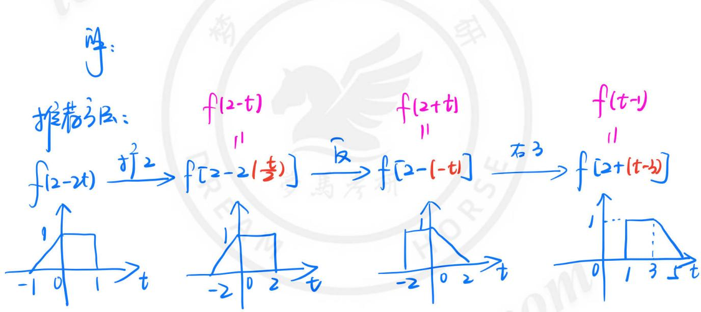

保险张：

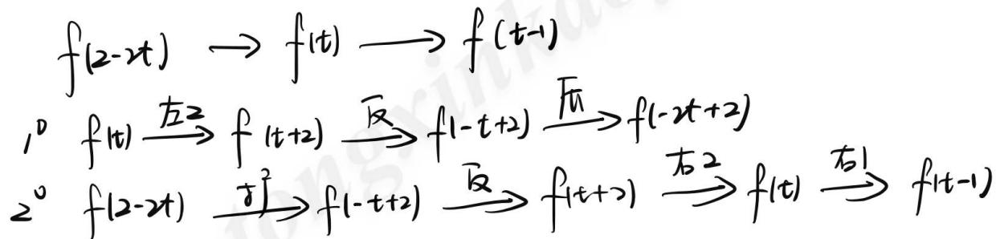

官网：tongxinkaoyan.com

梦马班讲义

(20分)3、【2025杭州电子科技大学843】

已知某连续时间信号 $x\left( t\right)$ 的波形如下图所示：

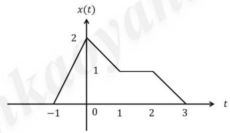

画出信号 $x_{1}(t) = \frac{dx(t - 1)}{dt} + x(2 - \frac{1}{2} t)$ 的波形。

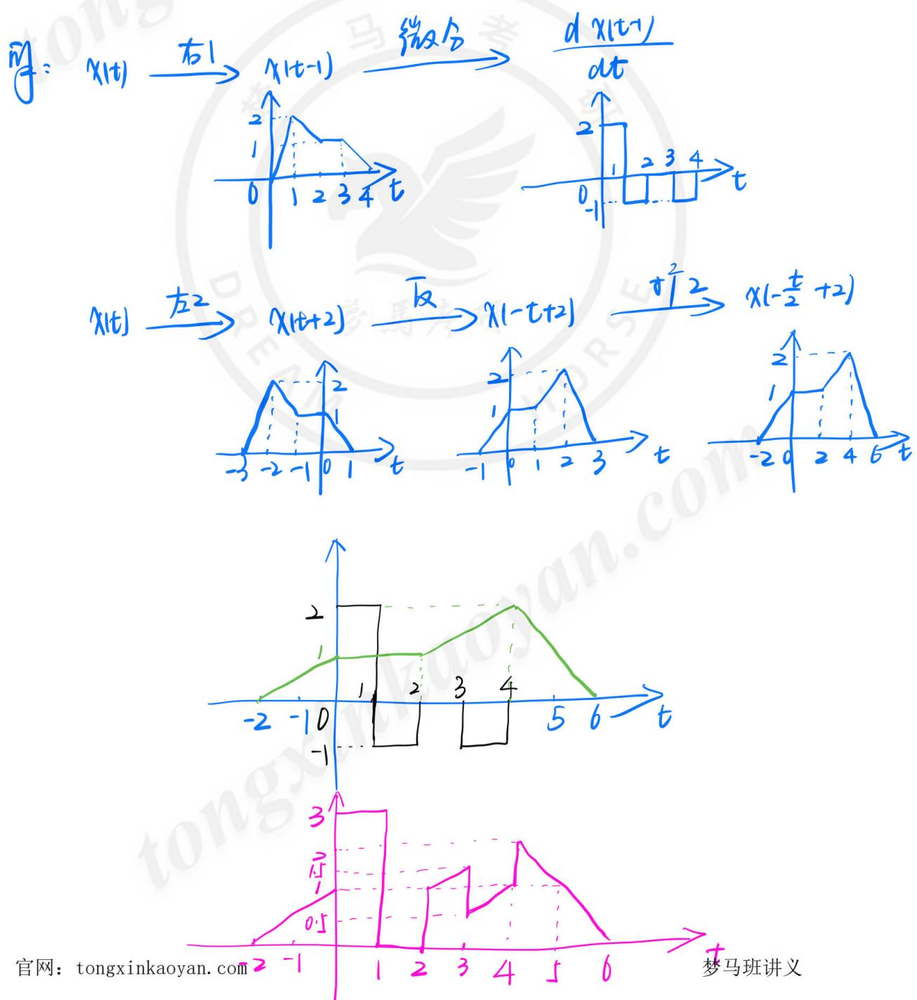

(15分)4、【2025西安电子科技大学821】

已知函数 $f\left(1-\frac{t}{2}\right)$ 的波形如题1图所示，请画出 $g(t)=f'(t)$ 和 $g(2t)$ 的波形。

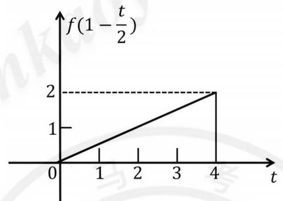

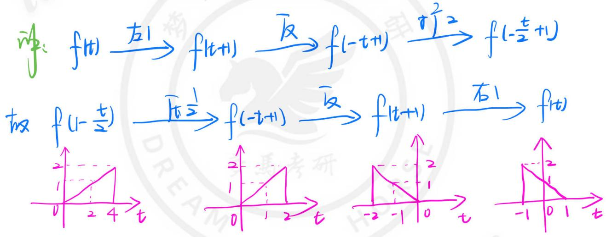

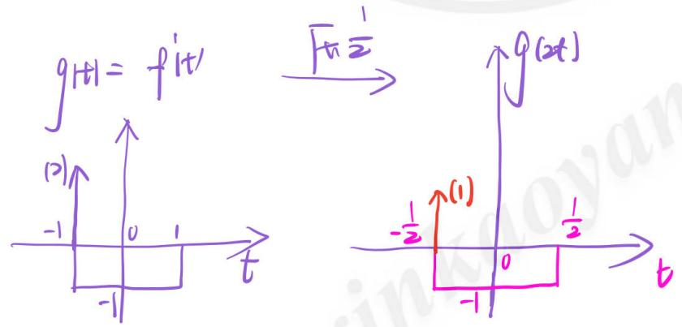

官网：tongxinkaoyan.com

梦马班讲义

四、系统框图题

(10分) 1、【2025武汉理工大学855】

已知系统框图如下，求该连续系统的微分方程。

注：取中简变量 $9(t)$ . 如因式

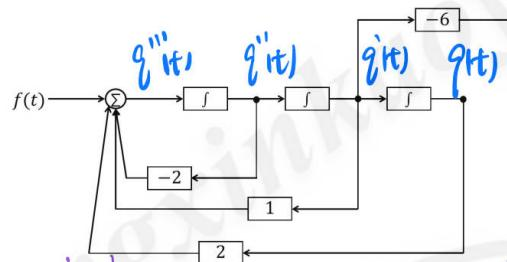

由切点知可得：

$$
q ^ {\prime \prime} (t) = f (t) - 2 q ^ {\prime \prime} (t) + g ^ {i} (t) + 2 q (t)
$$

或：不用中间度量

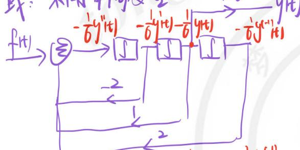

$$
y (t) = - 6 q ^ {\prime} (t) \tag {2}
$$

$$
- \frac {1}{6} y ^ {\prime \prime} (t) = f (t) + \frac {1}{3} y ^ {\prime} (t) - \frac {1}{6} y (t) - \frac {1}{3} y ^ {(1)} (t)
$$

① 满足右边形式. ② 满足右边形式. 可得

$$
y ^ {\prime \prime} (t) + 2 y ^ {\prime \prime} (t) - y (t) - 2 y (t) = - 6 f (t)
$$

$\Rightarrow y''(t)+2y''(t)-y'(t)-2y(t)=-6f'(t)$ 五、判断题

(10分) 1、【2025西安邮电大学824】

已知输入 $f(t)$ 和输出 $y(t)$ 之间的关系为 $y(t)=t^{2}f(t)+e^{f(t)}$ ，判断该系统的线性，时变性，因果性，稳定性。

解: 系元作用: 让输入求以 $t^{2}$ , 让输入取e括数, 然后和加.

$$
\begin{array}{r l} {H [ a _ {1} f _ {1} (t) + a _ {2} f _ {2} (t) ] =} & {t ^ {2} [ a _ {1} f _ {1} (t) + a _ {2} f _ {2} (t) ] + e ^ {[ a _ {1} f _ {1} (t) + a _ {2} f _ {2} (t) ]}} \\ {a _ {1} y _ {1} (t) + a _ {2} y _ {2} (t) =} & {a _ {1} [ t ^ {2} f _ {1} (t) + e ^ {f _ {1} (t)} ] + a _ {2} [ t ^ {2} f _ {2} (t) + e ^ {f _ {2} (t)} ] \textcircled {2}} \end{array}
$$

$$
H [ f (t - t _ {0}) ] = t ^ {2} f (t - t _ {0}) + e ^ {f (t - t _ {0})} ③
$$

$$
y (t - t _ {0}) = (t - t _ {0}) ^ {2} f (t - t _ {0}) + e
$$

①≠②，③≠④ 为非线性. 时变亲氏

由题: 可以 转入仅与当前时刻输入有关 故为因果单元
官网: tongxinkaoyan.com 梦马班讲义免费讲义Q群：1095841878
设 $\vert f(t)| \leq u$ . 则 $\vert y(t)| = \vert t^{2}f(t)| + e^{f(t)}| \leq \vert t^{2}f(t)| + \vert e^{f(t)}|$ B站up: 信号与系统\_谷哥
公众号: 通信考研小马哥
当t→∞时为一项→∞则不稳定单元

(10分)2、【2025西南交通大学824】

已知 $y(t)=-\pi f(\sin t)$ ，求该系统的线性和时变性

答: 系元作用: 运输人中 t → sint 后来以一元

①=②⇒线性共

$$
a _ {1} y _ {1} | t | + a _ {2} y _ {2} | t | = a _ {1} [ - \pi f _ {1} (\sin t) ] + a _ {2} [ - \pi f _ {2} (\sin t) ] ②
$$

$$
H [ f (t - t _ {0}) ] =
$$

$$
y (t - t _ {0}) = - \pi f [ \sin (t - t _ {0}) ] ④
$$

③≠④⇒时度亲氏

(15分) 3、【2025西南交通大学824】

已知输入 $x_{1}(t)$ ，对应输出 $y_{1}(t)$ ，若输入 $x_{2}(t)$ ，求出对应输出 $y_{2}(t)$ 的波形图。

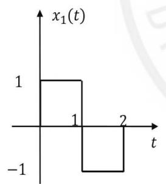

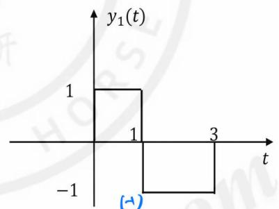

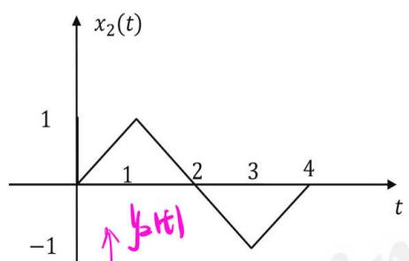  
的？  
$y_{2}(t)$ 过程

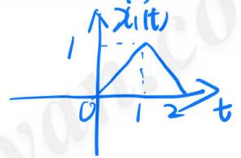

$$
\Rightarrow x _ {2} (t) = x _ {1} ^ {(- 1)} (t) - x _ {1} ^ {(- 1)} (t - 2)
$$

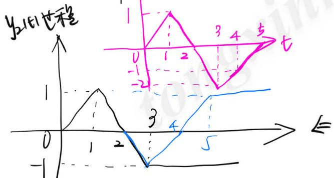  
官网：tongxinkaoyan.com

$$
\Rightarrow y _ {2} (t) = y _ {1} ^ {(- 1)} (t) - y _ {1} ^ {(- 1)} (t - 2)
$$

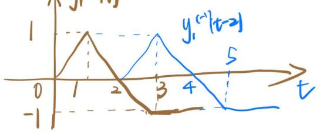  
梦马班讲义