## 连续时间信号与系统 章节测试题

sinwot => T

一、周期求解题（可直接给出答案）

$\frac{本加}{T_{1}T_{2}}$ 细方程数

(5分)1、【2025成都理工大学826】

某信号 $f(t)=2\sin(2t)+3\cos(4t-3)$ ，其周期为 $\pi(s)$ 。

解：

[元单位扣2分]

$$
T _ {1} = \frac {2 \pi}{w _ {1}} = \frac {2 \pi}{2} = \pi
$$

最小公倍数为π

$$
T _ {2} = \frac {2 \pi}{W _ {2}} = \frac {2 \pi}{4} = \frac {\pi}{2}
$$

(5分)2、【2025海南大学888】

$f\left( t\right)$ 的周期为 $T,\;f\left( {2t}\right)  + f\left( t\right)$ 的周期为

(不用写单位)

解：f由周期为T

最小公倍数为 $T$

则 $f(x)$ 时域压缩. 周期为 $\frac{T}{2}$

## 二、性质计算题（给出计算过程）

结果对满分. 结果错无过程分

(5分)1、【2025西北师范大学844】

$$
\int_ {- 5} ^ {5} (t ^ {2} + 2 t + 1) \delta (t - 8) d t = 0
$$

8 不在 $(-5,5)$ 内$\Rightarrow  \delta$ 项 $\Rightarrow  \left\{  {\begin{array}{l} \text{不在 } \sigma  \\  \text{在} \Rightarrow  \text{求} \end{array}\;0}\right.$

3的公式→相似性

上下证 $\Rightarrow$ 反

武名

(5分)2、【2025西安邮电大学824】

上下含t ⇒ 蛇板

计算 $\int_{-5}^{1}\cos\left(\frac{\pi\tau}{6}\right)\delta\left(\frac{\tau}{2}+1\right)d\tau=$

解: $\frac{\tau}{2}+1=0 \Rightarrow \tau=-2$

$$
| \delta | \frac {\tau}{2} + 1) = 2 \sqrt {(\tau + 2)}
$$

$$
\begin{array}{r l} {\delta \vert_ {\frac {\pi}{2} + 1}} & {= 2 \delta (\tau + 2)} \\ {\mathrm{原式}} & {= \int_ {- 5} ^ {1} \cos (\frac {\pi}{6} \tau) \cdot 2 \delta (\tau + 2) d \tau = 2 \cos [ \frac {\pi}{6} \times (- 2) ] = 2 \cos (- \frac {\pi}{3}) = 1} \end{array}
$$

(5分)3、【2025中国海洋大学819】

计算 $\int_{-\infty}^{t}\delta(2\tau-1)d\tau$ 。

解：

$$
2 \tau - 1 = 0 \Rightarrow \tau = \frac {1}{2}
$$

$$
\begin{array}{r l} {\delta (2 \tau - 1)} & {= \frac {1}{2} \delta (\tau - \frac {1}{2})} \\ {\mathrm{原式}} & {= \int_ {- b} ^ {t} \frac {1}{2} \delta (\tau - \frac {1}{2}) d \tau = \frac {1}{2} \int_ {- b} ^ {t} \delta (\tau - \frac {1}{2}) d \tau = \frac {1}{2} u (t - \frac {1}{2})} \end{array}
$$

4、【2025 西安石油大学 810】

(5分)(1) $f(t)=cos\left[\frac{\pi}{3}(t-3)\right]\delta(t-2)$

解: $f(t)\sqrt{(t-t_{0})} = f(t_{0})\cdot\sqrt{(t-t_{0})}$

$$
\begin{array}{r l} {\mathrm{原式}} & {= \cos [ \frac {\pi}{3} (2 - 3) ] \sqrt {1 - 2}} \\ & {= \frac {1}{2} \sqrt {1 - 2})} \end{array}
$$

(5分)5、【2025天津大学815】

$$
\int_ {- \infty} ^ {t} \delta (\tau) \cos (\omega_ {0} \tau) d \tau =
$$

$$
\delta (\tau) \cos (w _ {0} \tau) = \cos 0 \cdot \delta (\tau) = \delta (\tau)
$$

$$
\mathrm{故原式} = \int_ {- \infty} ^ {t} d (\tau) d \tau = u (t)
$$

(5分)6、【2025西安电子科技大学821】

$\int_{0}^{\infty}\delta(t^{2}-4)dt=$

$M_{2}: t^{2}-4=0 \Rightarrow t^{2}=4 \Rightarrow t_{1}=2, t_{2}=-2$

$$
\mathrm{则} \delta (t ^ {2} - 4) = \frac {1}{4} [ \delta (t + 2) + \delta (t - 2) ]   \mathrm{故原式} = \int_ {0} ^ {\infty} \frac {1}{4} [ \delta (t + 2) + \delta (t - 2) ] d t = \frac {1}{4} [ \int_ {0} ^ {\infty} \delta (t + 2) d t + \int_ {0} ^ {\infty} \delta (t - 2) d t ] = \frac {1}{4} [ 0 + 1 ]   = \frac {1}{4}
$$

计算 $\int_{-2}^{2}(t^{2}-4t+1)\left[\delta'(t-3)+\delta(2t-1)\right]dt$

(5分)(2) $f(t)=\int_{-\infty}^{t}e^{-\tau}\delta(2\tau)d\tau$

解: $\sqrt{(2t-1)} = \frac{1}{2}\sqrt{(t-\frac{1}{2})}$

$$
\begin{array}{r l} {\mathrm{原式}} & {\int_ {- 2} ^ {2} (t ^ {2} - 4 t + 1) \underbrace {[ \sqrt [ 3 ]{(t - 3)} + \frac {1}{2} \sqrt [ 3 ]{(t - \frac {1}{2})} ] d t} _ {\mathrm{不在范围内}}} \\ & {= \int_ {- 2} ^ {2} (t ^ {2} - 4 t + 1) \cdot \frac {1}{2} \sqrt [ 3 ]{(t - \frac {1}{2})} d t} \\ & {= \frac {1}{2} (t ^ {2} - 4 t + 1) / t = \frac {1}{2}} \\ & {= \frac {1}{2} [ \frac {1}{4} - 2 + 1 ] = - \frac {3}{8}} \end{array}
$$

解： $\sqrt{2\pi}=\frac{1}{2}\sqrt{1\pi}$

$$
\begin{array}{r l} {\mathrm{原式}} & {= \int_ {- \infty} ^ {t} e ^ {- \tau} \frac {1}{2} \delta (\tau) d \tau} \\ & {= \frac {1}{2} \int_ {- \infty} ^ {t} e ^ {- \tau} \delta (\tau) d \tau} \\ & {= \frac {1}{2} \int_ {- \infty} ^ {t} \delta (\tau) d \tau = \frac {1}{2} (1 + t)} \end{array}
$$

义Q群: 1095841878 $\overrightarrow{图形} \left\{ \begin{array}{l} f(t) \xrightarrow{左\uparrow} f(t+5) \xrightarrow{反} f(-t+5) \xrightarrow{|π|} f(5-π) \\ f(5-π) \xrightarrow{正} f(-t+5) \xrightarrow{反} f(t+5) \xrightarrow{|π|} f(t) \\ 2\sqrt{7(t-3)} \quad 4\sqrt{7(t-6)} \quad 4\sqrt{7(t+6)} \quad 4\sqrt{7(t-5+6)} = 4\sqrt{7(t+1)} \end{array} \right.$ (5分) 8、【2025 西北工业大学 827】

已知信号 $f\left( {5 - {2t}}\right)  = {2\delta }\left( {t - 3}\right)$ ,求 ${\int }_{-\infty }^{+\infty }\left( {t + 3}\right) f\left( t\right) {dt} =$ \_\_\_\_.

设：令 $5 - {2t} = a$ ,即 $t = \frac{5}{2} - \frac{a}{2}$

$$
\begin{array}{r l} {\mathrm{则} f (a)} & {= 2 \delta (\frac {5}{2} - \frac {9}{2} - 3)} \\ & {= 2 \delta (- \frac {1}{2} - \frac {9}{2})} \end{array}
$$

故 $\int_{-\infty}^{\infty}(t+3)40\sqrt{t+1}dt$ $= 4\times(-1+3)$ = 8

$$
\mathrm{即} f (t) = 2 \sqrt {(- \frac {1}{2} - \frac {t}{2})} = 4 \sqrt {(t + 1)}
$$

## 三、信号运算题

(15分)1.【2025西安石油大学810】

已知信号 $f(t)$ 波形如图所示, 分别画出信号 $f(-2t + 1)$ 、 $f'(t)$ 的波形

②凯辛冲

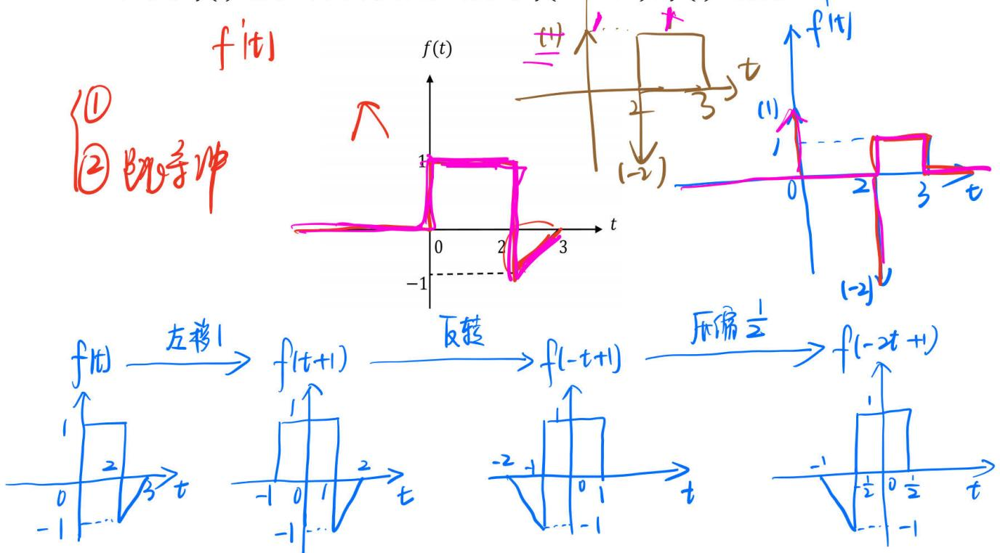

信号运算 3步骤 ×3 = 9分
微分 6分

(5分)2、【2025石家庄铁道大学894】

已知信号 $f\left( {2 - {2t}}\right)$ 的波形如下图 2 所示,请画出信号 $f\left( {t - 1}\right)$ 的波形。

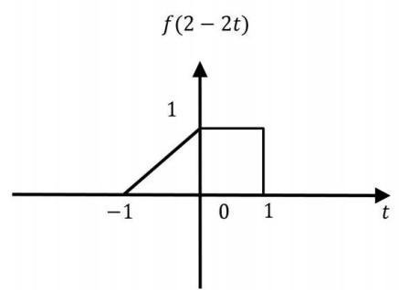  
图2

结果对5分
结果错适当过程分
(不超过2分)

if:

推荐方法：

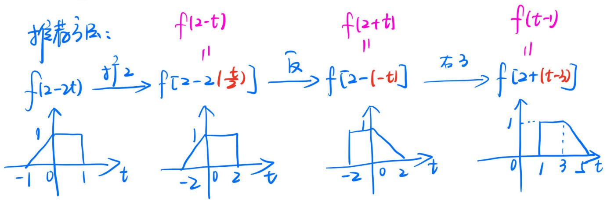

保险张：

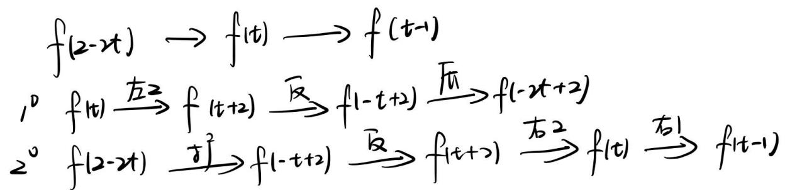

(20分)3、【2025杭州电子科技大学843】

已知某连续时间信号 $x\left( t\right)$ 的波形如下图所示：

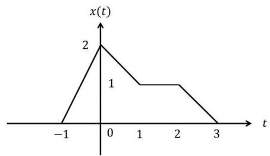

画出信号 $x_{1}(t) = \frac{dx(t - 1)}{dt} + x(2 - \frac{1}{2} t)$ 的波形。

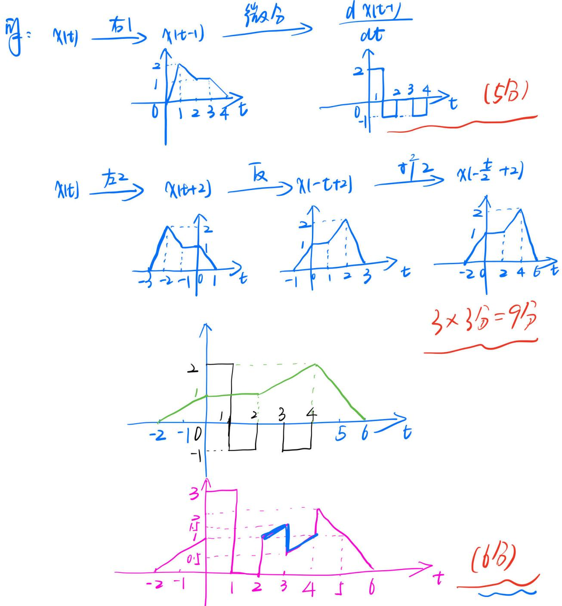

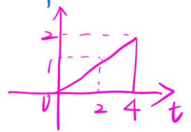

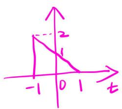

(15分)4、【2025西安电子科技大学821】

已知函数 $f\left(1-\frac{t}{2}\right)$ 的波形如题1图所示，请画出 $g(t)=f'(t)$ 和 $g(2t)$ 的波形。

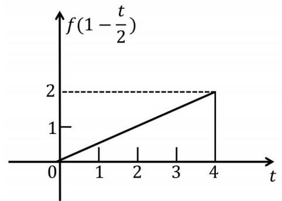

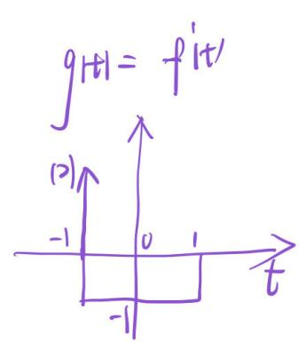  
(3分)

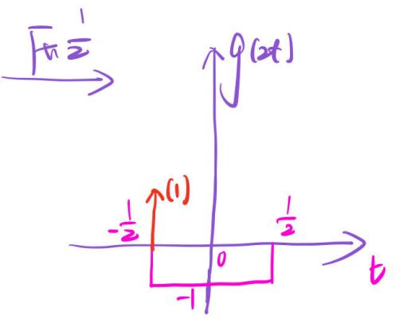  
(3分)  
(3×3=9B)

# 结果对10分. 结果错为5分.不超过5分

四、系统框图题

(10分)1、【2025武汉理工大学855】

已知系统框图如下，求该连续系统的微分方程。

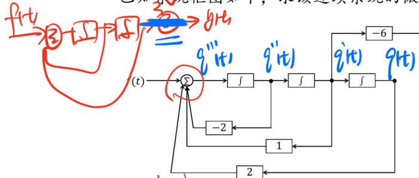

注：取中向度量 $9(t)$ . 如因文

或：不用中向度量

由切点知可得：

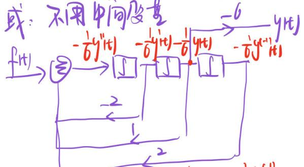

$$
- \frac {1}{6} y ^ {\prime \prime} (t) = f (t) + \frac {1}{3} y ^ {\prime} (t) - \frac {1}{6} y (t) - \frac {1}{3} y ^ {(- 1)} (t)
$$

$$
q ^ {\prime \prime} (t) = f (t) - 2 q ^ {\prime \prime} (t) + g ^ {i} (t) + 2 q (t)
$$

$\Rightarrow y''(t)+2y''(t)-y'(t)-2y(t)=-6f'(t)$ 五、判断题

$$
\Rightarrow q ^ {\prime \prime} (t) + 2 q ^ {\prime} (t) - q ^ {\prime} (t) - 2 q (t) = f (t) ⓛ
$$

$$
y (t) = - 6 q ^ {\prime} (t) \tag {2}
$$

① 满足右边形式. ② 满足右边形式. 可得

$$
y ^ {\prime \prime} (t) + 2 y ^ {\prime \prime} (t) - y ^ {\prime} (t) - 2 y (t) = - 6 f ^ {\prime} (t)
$$

(10分)1、【2025西安邮电大学824】

已知输入 $f(t)$ 和输出 $y(t)$ 之间的关系为 $y(t) = t^{2}f(t) + e^{f(t)}$ ，判断该系统的线性，时变性，因果性，稳定性。

解: 系元作用: 让输入求以 $t^{2}$ , 让输入取e括数, 然后和加.

$$
\begin{array}{r l} {H [ a _ {1} f _ {1} (t) + a _ {2} f _ {2} (t) ] =} & {t ^ {2} [ a _ {1} f _ {1} (t) + a _ {2} f _ {2} (t) ] + e ^ {[ a _ {1} f _ {1} (t) + a _ {2} f _ {2} (t) ]}} \\ {a _ {1} y _ {1} (t) + a _ {2} y _ {2} (t) =} & {a _ {1} [ t ^ {2} f _ {1} (t) + e ^ {f _ {1} (t)} ] + a _ {2} [ t ^ {2} f _ {2} (t) + e ^ {f _ {2} (t)} ] \textcircled {2}} \end{array}
$$

$$
H [ f (t - t _ {0}) ] = t ^ {2} f (t - t _ {0}) + e ^ {f (t - t _ {0})}
$$

$$
y (t - t _ {0}) = (t - t _ {0}) ^ {2} f (t - t _ {0}) + e
$$

①≠θ，③≠④ 为非线性. 时变亲氏

由定义可知: 转丝仅与当前时刻输入后关, 故为因果亲元免费讲义Q群：1095841878
设 $|f(t)| \leq u$ 。则 $|y(t)| = |t^2 f(t)| + e^{f(t)}| \leq |t^2 f(t)| + |e^{f(t)}|$ 当 $t \to \infty$ 叶另一项 $\to \infty$ 则不一定是氘元

(10分)2、【2025西南交通大学824】
已知y(t)=-πf(sin t)，求该系统的线性和时变性答: 系元作用: 运输入中 t → $\sin t$ 后来以一元

①=②⇒线性方程

$$
a _ {1} y _ {1} (t) + a _ {2} y _ {2} (t) = a _ {1} [ - \pi f _ {1} (\sin t) ] + a _ {2} [ - \pi f _ {2} (\sin t) ] ②
$$

$$
H [ f (t - t _ {0}) ] = - \pi f (\sin t - t _ {0}) ③
$$

$y(t-t_{0}) = -\pi f[\sin(t-t_{0})]$ ④

③ + ④ ⇒ 时度亲元

$$
- \pi f (\frac {\sin t}{x} - t _ {0})
$$

(15分)3、【2025西南交通大学824】

已知输入 $x_{1}(t)$ ，对应输出 $y_{1}(t)$ ，若输入 $x_{2}(t)$ ，求出对应输出 $y_{2}(t)$ 的波形图。

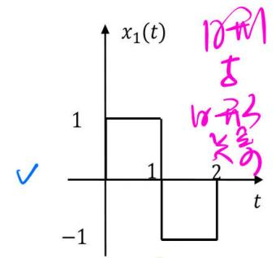

110 矩形 → 斜棱

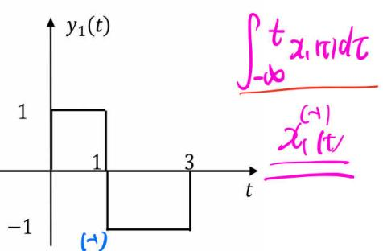

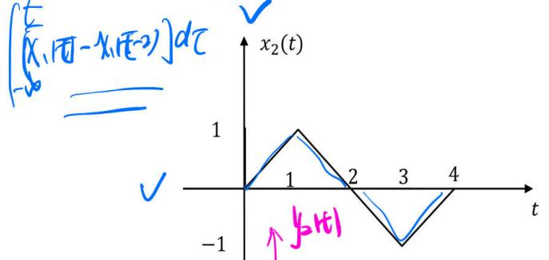  
的？

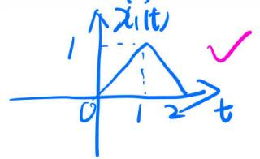

$$
\Rightarrow x _ {2} (t) = x _ {1} ^ {(- 1)} (t) - x _ {1} ^ {(- 1)} (t - 2)
$$

$y_{2}(t)$ 过程

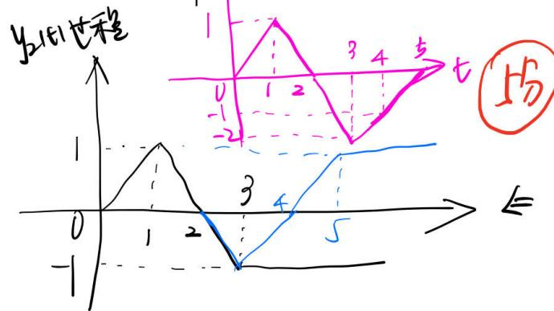

$$
\Rightarrow y _ {2} (t) = y _ {1} ^ {(- 1)} (t) - y _ {1} ^ {(- 1)} (t - 2)
$$

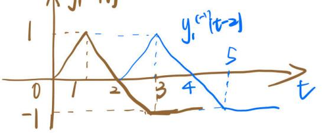

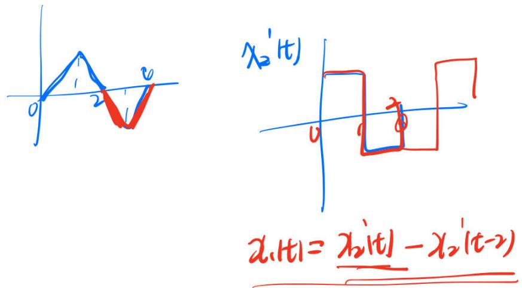

$y_{\{t\}} = e^{t}f(t)$ 微积分关系

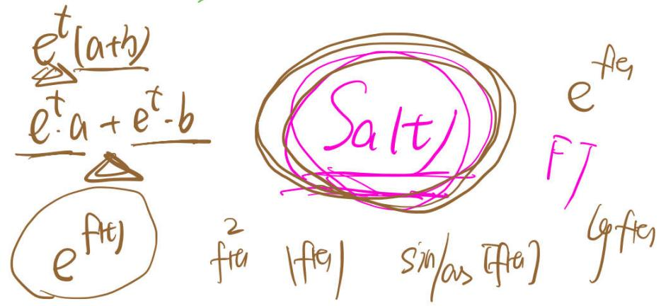