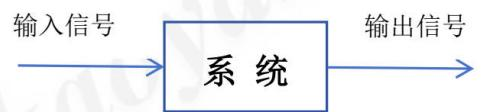
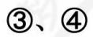
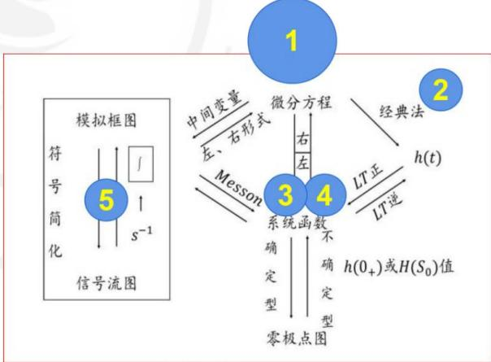

# 《信号与系统》课程框架（连续部分）

## 1、基本框架

输入信号

系统

2、核心问题

(1) 输入信号作用于系统, 产生什么样的输出信号?

(2) 根据输入、输出信号, 能够反映系统具有哪些内在特性?

## 3、分析方法

(1) 时域分析法: ②

(2) 变换域法: ③、④

## 4、核心要点——系统不同形式间的相互转换

①常见的信号与系统

②系统的时域分析与卷积

③连续系统的傅里叶变换

④连续系统的拉氏变换

⑤系统的信号流图和状态变量分析

## 5、解题技巧

(1) 表达式法

(2) 图解法

## 6、研究对象

(1) 信号——连续信号； (2) 系统 $\rightarrow$ LTIS

(3) 核心问题的反映:

(4) 时域分析法:

利用时域分析法来求解系统响应，并判断系统内在特性

## 第2章 连续时间系统的时域分析

第2章 连续时间系统的时域分析....1
专题1 连续系统的经典法分析....3
考点1：连续系统的齐次解求解....3
考点2：连续系统的特解求解....4
考点3：连续系统的经典法求解流程....5
考点4：自由响应与强迫响应的特点与辨识....6
考点5：暂(瞬)态响应与稳态响应....6
专题2 0\_到0+状态的跳变....7
考点1：0\_到0+状态....7
考点2：冲激函数匹配法....8
专题3 连续系统的双零法分析....10
考点1：系统双零法分解....10
考点2：零输入响应的求解....10
考点3：零状态响应的求解....11
考点4：完全响应分解及其关联....11
专题4 LTIS下双零法的应用与求解....14
考点1：边界条件对双零法的影响....14
考点2：线性时不变系统的补充认识....14
考点3：LTIS双零法视角下响应求解....15
专题5 冲激响应与阶跃响应....17
考点1：冲激响应的求解....17
考点2：特殊情况下冲激函数匹配法的应用....17
考点3：阶跃响应的求解....18
考点4：h(t)与g(t)求解总结....19
考点5：h(t)系统表示与应用....19
专题6 卷积性质及其系统表示....21
考点1：卷积定义及其隐含特性....21
考点2：卷积应用与系统表示....21
考点3：卷积的代数性质(LTIS系统下可用)...21
考点4：卷积的表达式求解法——借助于u(t)缩小积分限...22
专题7 卷积求解....25
考点1：卷积求解：性质法....25
考点2：卷积的微积分性质....26
考点3：卷积微积分图解法...27

# 专题 1 连续系统的经典法分析

情景引入：RLC 电路（系统）的输出与外加输入和自身状态有关求系统的输出：

## 1、微分方程形式

设系统的激励信号为 $e(t)$ ，响应为 $r(t)$ ，它的数学模型可利用一高阶微分方程表示

$$
\begin{array}{c} {C _ {0} \frac {d ^ {n} r (t)}{d t ^ {n}} + C _ {1} \frac {d ^ {n - 1} r (t)}{d t ^ {n - 1}} + \dots + C _ {n - 1} \frac {d r (t)}{d t} + C _ {n} r (t)} \\ {= E _ {0} \frac {d ^ {m} e (t)}{d t ^ {m}} + E _ {1} \frac {d ^ {m - 1} e (t)}{d t ^ {m - 1}} + \dots + E _ {m - 1} \frac {d e (t)}{d t} + E _ {m} e (t)} \end{array}
$$

一般情况下， $C_{0}=1$

2、微分方程解形式: 完全解 $r(t) =$ 齐次解 $r_{h}(t) +$ 特解 $r_{p}(t)$

(1) 一般常规方程:

(2) 齐次方程:

## 3、响应分解与响应区间

(1)完全解(完全响应)=齐次解(自由响应)+特解(强迫响应)

(2)响应区间：

一般研究的是因果系统，当输入信号从0时刻加入时，输出响应时间为0及以后时刻，故响应区间为 $[0, \infty)$ 或 $t \geq 0$

## 考点1：连续系统的齐次解求解

1、（根据方程左边形式）列写特征方程，并因式分解；

2、求特征根；

3、根据特征根形式列写齐次解形式(含待定系数)。

官网：tongxinkaoyan.com

<table><tr><td colspan="2">不同特征根所对应的齐次解</td></tr><tr><td>特征根 $\lambda$ </td><td>齐次解</td></tr><tr><td>单实根</td><td> $e^{\lambda t}$ </td></tr><tr><td>r重实根</td><td> $(C_{r-1}t^{r-1} + C_{r-2}t^{r-2} + ... + C_1t + C_0)e^{\lambda t}$ </td></tr><tr><td>一对共轭复根 $\lambda_{1,2} = \alpha \pm j\beta$ </td><td> $e^{\alpha t}[Ccos(\beta t) + Dsin(\beta t)]$ 或 $Acos(\beta t - \theta)$ 其中 $Ae^{j\theta} = C + Dj$ </td></tr><tr><td>r重共轭复根</td><td> $[A_{r-1}t^{r-1}cos(\beta t + \theta_{r-1}) + A_{r-2}t^{r-2}cos(\beta t + \theta_{r-2}) + ... + A_0cos(\beta t + \theta_0)]e^{\alpha t}$ </td></tr></table>

例 1: 求系统 $y''(t) + 3y'(t) + 2y(t) = f'(t) + 3f(t)$ 的齐次解

例 2: 求系统 $y''(t) + 2y'(t) + y(t) = f'(t) + 3f(t)$ 的齐次解

例3：求微分方程 $\frac{d^3}{dt^3} r(t) + 7\frac{d^2}{dt^2} r(t) + 16\frac{d}{dt} r(t) + 12r(t) = e(t)$ 的齐次解。

## 考点2：连续系统的特解求解

1、将激励带入方程右端，化简得自由项【易错点：含冲激时记得抽样性】

2、根据 $t>0$ 时自由项形式选特解形式(含待定系数)

3、将选定的特解带入方程左端

4、方程左右两端系数平衡，求待定系数

5、得特解的最终结果

<table><tr><td colspan="2">与几种典型激励函数对应的特解</td></tr><tr><td>t&gt;0时自由项形式</td><td>响应函数r(t)的特解</td></tr><tr><td>E(常数)</td><td>B</td></tr><tr><td>tp</td><td> $B_1t^p + B_2t^{p-1} + \cdots + B_pt + B_{p+1}$ (所有特征根均不等于0)</td></tr><tr><td>eat</td><td>Beat(α不等于特征根)</td></tr><tr><td>cos(ωt)</td><td rowspan="2"> $B_1cos(\omega t) + B_2sin(\omega t)$ (所有特征根均不等于±jω)</td></tr><tr><td>sin(ωt)</td></tr><tr><td>tpeatcos(ωt)</td><td rowspan="2"> $(B_1t^p + \cdots + B_pt + B_{p+1})e^{at}cos(\omega t)$  $+ (D_1t^p + \cdots + D_pt + D_{p+1})e^{at}sin(\omega t)$ </td></tr><tr><td>tpeatsin(ωt)</td></tr><tr><td colspan="2">注:(1)表中B、D是待定系数。(2)若t&gt;0时自由项形式为几种形式的组合,则特解也为其相应的组合,那可视为几种激励分别作用于系统产生的响应之和。(3)若表中所列特解与齐次解重复,如激励函数e(t)=eat,齐次解也为eat,则其特解为 $B_0te^{at}$ 。若特征根为二重根,即齐次解呈现 $te^{at}$ 形式时,则特解为 $B_0t^2e^{at}$ ,高阶依此类推。</td></tr></table>

例 4: 描述某LTI系统的微分方程为

$$
y ^ {\prime \prime} (t) + 5 y ^ {\prime} (t) + 6 y (t) = f (t)
$$

求输入 $f(t)=2e^{-t}u(t)$ 时的特解。

官网：tongxinkaoyan.com

【新增】——例4修改

描述某LTI系统的微分方程为

$$
y ^ {\prime \prime} (t) + 5 y ^ {\prime} (t) + 6 y (t) = f (t) + 4 f (t)
$$

求输入 $f(t)=2e^{-t}u(t)$ 时的特解。

描述某LTI系统的微分方程为

$$
y ^ {\prime \prime} (t) + 5 y ^ {\prime} (t) + 6 y (t) = f (t) + f (t)
$$

求输入 $f(t)=e^{-2t}u(t)$ 时的特解。

描述某LTI系统的微分方程为

$$
y ^ {\prime \prime} (t) + 5 y ^ {\prime} (t) + 6 y (t) = f (t) + f (t)
$$

求输入 $f(t)=2e^{-t}u(t)$ 时的特解。

例 5: 描述某LTI系统的微分方程为

$$
y ^ {\prime \prime} (t) + 2 y ^ {\prime} (t) + y (t) = f ^ {\prime \prime} (t) + 2 f (t)
$$

输入为 $f(t)=\delta(t)$ ，求特解。

【新增——例 5 修改】例 5：描述某LTI系统的微分方程为

$$
y ^ {\prime \prime} (t) + 2 y ^ {\prime} (t) + y (t) = f ^ {\prime \prime} (t) + 2 f (t)
$$

输入为 $f(t) = \mathrm{u}(t)$ ，求特解。

官网：tongxinkaoyan.com

梦马班讲义

例6： $y''(t) + 2y'(t) + 3y(t) = f'(t) + f(t)$ ，若 $f(t) = t^2$ ，求特解

考点3：连续系统的经典法求解流程

官网：tongxinkaoyan.com

梦马班讲义

[课上测试题——对经典法求解35代的考察]

例 7: 给定系统微分方程

$$
\frac {d ^ {2}}{d t ^ {2}} r (t) + 3 \frac {d}{d t} r (t) + 2 r (t) = \frac {d}{d t} e (t) + 3 e (t)
$$

若激励信号和起始状态为

$$
e (t) = u (t), r (0) = 1, r ^ {\prime} (0) = 2
$$

试求它的完全响应，并指出其自由响应、强迫响应。

【新增，根据25年成都信息工程大学改变】

已知一 LTIS 的微分方程 $y''(t)+5y'(t)+6y(t)=2f'(t)+f(t)$ ，且已知输入 $f(t)=e^{-t}u(t)$ ， $y(0)=1, y'(0)=1$ ，求系统完全响应。

官网：tongxinkaoyan.com

## 考点4：自由响应与强迫响应的特点与辨识

1、LTI系统的数学模型——常系数线性微分方程的全解由齐次解和特解组成；

2、齐次解的函数形式仅仅依赖于系统本身的特性，而与激励 $f(t)$ 的函数形式无关，称为系统的自由响应或固有响应。特征方程的根称为系统的“固有频率”，它决定了系统自由响应的形式；齐次解的系数是与激励有关的。

例如 $y''(t)+5y'(t)+6y(t)=f(t)$ ，求输入 $f(t)=2e^{-t}u(t)$ 和 $f(t)=\delta(t)$ 各自的自由响应时，不管 $f(t)$ 具体形式，其自由响应形式均为 $r_{h}(t)=Ae^{-2t}+Be^{-3t}$

3、特解的形式由激励信号确定，称为强迫响应。

$$
y ^ {\prime \prime} (t) + 5 y ^ {\prime} (t) + 6 y (t) = f (t)
$$

(1) $f(t)=2e^{-t}u(t)$ ; 经过5步后得解为 $e^{-t}u(t)$

(2) $f(t)=u(t)$ ; 经过5步后得解为 $\frac{1}{6}$

(3) $f(t)=e^{-2t}u(t)$ 经过5步后得解为 $te^{-2t}u(t)$

官网：tongxinkaoyan.com

4、已知微分方程，则完全响应、特解、激励知其一，可推其他形式。

完全响应 $\Rightarrow$ 自由响应, 强迫响应, 激励形式

微分方程⊕

特解 $\Rightarrow$ 自由响应形式, 激励形式

激励 $\Rightarrow$ 自由响应形式, 特解, 完全响应形式

## 【新增思考题——（根据题干自己设问题并得结论）】

## 2025年大连海事大学806

二、已知某线性时不变系统的微分方程为：

$$
y ^ {\prime \prime} (t) + a _ {1} y ^ {\prime} (t) + a _ {0} y (t) = x ^ {\prime \prime} (t) + 3 x ^ {\prime} (t) + 2 x (t)
$$

当激励 $x(t) = (1 + e^{-t})u(t)$ 时，全响应 $y(t) = [4e^{-2t} - \frac{4}{3} e^{-3t} + \frac{1}{3}]u(t)$ ，试求：

## 考点5: 暂(瞬)态响应与稳态响应

1、定义：在完全响应中，随着 t 的增大而逐渐消失的部分，称为暂(瞬)态响应；剩余部分为稳态响应。

2、分解前提：对于稳定系统，且输入是阶跃信号或有始周期信号才这样分解。

由考点4中3可知， $y''(t)+5y'(t)+6y(t)=f(t)$ ，若 $f(t)=2e^{-t}u(t)$ ，则 $y(t)=Ae^{-2t}+Be^{-3t}+e^{-t}u(t)$ ，可见 $y(t)$ 全为暂态，说明输入为 $2e^{-t}u(t)$ ，不需要这种分解，因此某一项为0。

而 $f(t)=u(t)$ 时， $y(t)=Ae^{-2t}+Be^{-3t}+\frac{1}{6}$ ，则 $\frac{1}{6}$ 为稳态， $Ae^{-2t}+Be^{-3t}$ 为暂态。