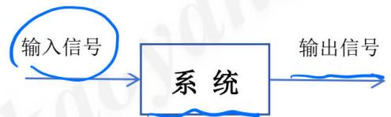
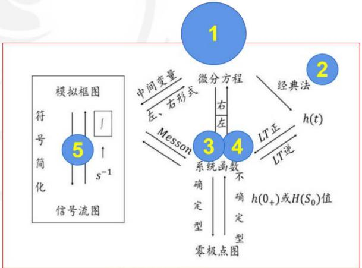
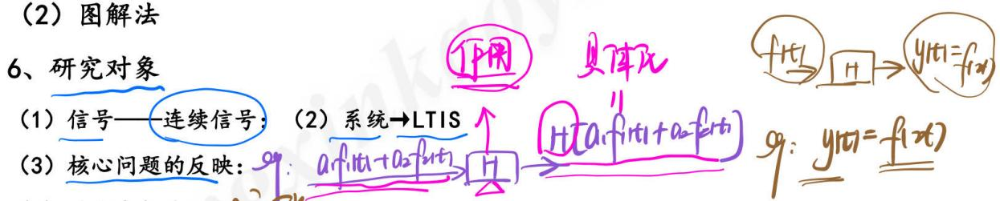
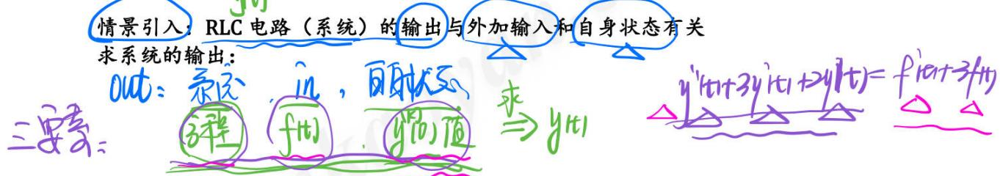
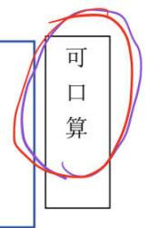
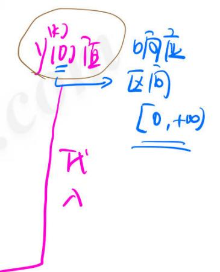
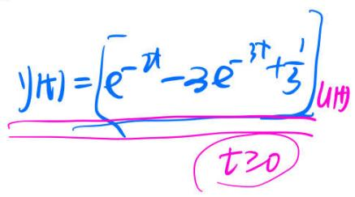
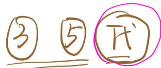

# 《信号与系统》课程框架（连续部分）

1、基本框架

系统

2、核心问题

(1) 输入信号作用于系统，产生什么样的输出信号？

(2) 根据输入、输出信号, 能够反映系统具有哪些内在特性?

3、分析方法

(1) 时域分析法:

(2) 变换域法:

## 4、核心要点——系统不同形式间的相互转换

①常见的信号与系统

②系统的时域分析与卷积

③连续系统的傅里叶变换

④连续系统的拉氏变换

⑤系统的信号流图和状态变量分析

5、解题技巧

(1) 表达式法

(2) 图解法

6、研究对象

(4) 时域分析法: 证明：

利用时域分析法来求解系统响应，并判断系统内在特性

官网：tongxi nkaoyan. con

梦马班讲义

## 第2章 连续时间系统的时域分析

第2章 连续时间系统的时域分析....1
专题1 连续系统的经典法分析....3
考点1：连续系统的齐次解求解....3
考点2：连续系统的特解求解....4
考点3：连续系统的经典法求解流程....5
考点4：自由响应与强迫响应的特点与辨识....6
考点5：暂(瞬)态响应与稳态响应....6
专题2 0\_到0+状态的跳变....7
考点1：0\_到0+状态....7
考点2：冲激函数匹配法....8
专题3 连续系统的双零法分析....10
考点1：系统双零法分解....10
考点2：零输入响应的求解....10
考点3：零状态响应的求解....11
考点4：完全响应分解及其关联....11
专题4 LTIS下双零法的应用与求解....14
考点1：边界条件对双零法的影响....14
考点2：线性时不变系统的补充认识....14
考点3：LTIS双零法视角下响应求解....15
专题5 冲激响应与阶跃响应....17
考点1：冲激响应的求解....17
考点2：特殊情况下冲激函数匹配法的应用....17
考点3：阶跃响应的求解....18
考点4：h(t)与g(t)求解总结....19
考点5：h(t)系统表示与应用....19
专题6 卷积性质及其系统表示....21
考点1：卷积定义及其隐含特性....21
考点2：卷积应用与系统表示....21
考点3：卷积的代数性质(LTIS系统下可用)...21
考点4：卷积的表达式求解法——借助于u(t)缩小积分限...22
专题7 卷积求解....25
考点1：卷积求解：性质法....25
考点2：卷积的微积分性质....26
考点3：卷积微积分图解法....27

## 专题 1 连续系统的经典法分析

## 1、微分方程形式

设系统的激励信号为 $e(t)$ ，响应为 $r(t)$ ，它的数学模型可利用一高阶微分方程表示

$$
\begin{array}{r l} & {C _ {0} \frac {d ^ {n} r (t)}{d t ^ {n}} + C _ {1} \frac {d ^ {n - 1} r (t)}{d t ^ {n - 1}} + \dots + C _ {n - 1} \frac {d r (t)}{d t} + C _ {n} r (t)} \\ & {= E _ {0} \frac {d ^ {m} e (t)}{d t ^ {m}} + E _ {1} \frac {d ^ {m - 1} e (t)}{d t ^ {m - 1}} + \dots + E _ {m - 1} \frac {d e (t)}{d t} + E _ {m} e (t)} \end{array}
$$

一般情况下, ${C}_{0} = 1$

2、微分方程解形式：完全解 $r\left( t\right)  =$ 齐次解 ${r}_{h}\left( t\right)  +$ 特解 ${r}_{p}\left( t\right)$

(1)一般常规方程: 有out⇒右边≠0⇒令x=齐x+标准(2) 齐次方程: $\left\{\begin{array}{l}\text { 无 in } \Rightarrow \text { 合并 } = \text { 齐次理 } \\ \text { 有 out } \Rightarrow \text { 在也 } = 0 \Rightarrow \text { 齐次理 }\end{array}\right.$ (齐次方程)

3、响应分解与响应区间

(1)完全解(完全响应)=齐次解(自由响应)+特解(强迫响应)

(2)响应区间:

一般研究的是因果系统，当输入信号从0时刻加入时，输出响应时间为0及以后时刻，故响应区间为 $[0,\infty)$ 或 $t\geq0$

## 考点1：连续系统的齐次解求解

1、(根据方程左边形式)列写特征方程, 并因式分解;

2、求特征根;

3、根据特征根形式列写齐次解形式(含待定系数)。

官网：tongxi nkaoyan. con

<table><tr><td colspan="2">不同特征根所对应的齐次解</td></tr><tr><td>特征根λ</td><td>齐次解</td></tr><tr><td>单实根α</td><td> $e^{\lambda t}$   $e^{dt}$ </td></tr><tr><td>r重实根r=2</td><td> $(C_{r-1}t^{r-1} + C_{r-2}t^{r-2} + \ldots + C_1t + C_0)e^{\lambda t}$ </td></tr><tr><td>一对共轭复根 $\lambda_{1,2} = \alpha \pm j\beta$ </td><td> $e^{\alpha t}[Ccos(\beta t) + Dsin(\beta t)]$ 或 $Acos(\beta t - \theta)$ 其中 $Ae^{j\theta} = C + Dj$ </td></tr><tr><td>r重共轭复根</td><td> $[A_{r-1}t^{r-1}cos(\beta t + \theta_{r-1}) + A_{r-2}t^{r-2}cos(\beta t + \theta_{r-2}) + \ldots + A_0cos(\beta t + \theta_0)]e^{\alpha t}$ </td></tr></table>

例 1: 求系统 $y''(t) + 3y'(t) + 2y(t) = f'(t) + 3f(t)$ 的齐次解

$$
\alpha^ {2} + 3 \alpha + 2 = (\alpha + 1) (\alpha + 2) = 0
$$

$$
\begin{array}{r l}{\alpha_ {1}}&{\rightarrow e ^ {\alpha t}}\\{\alpha_ {2}}&{\rightarrow e ^ {\alpha t}}\end{array}
$$

$$
y _ {h} (t) = C _ {1} e ^ {\alpha_ {1} t} + C _ {2} e ^ {\alpha_ {2} t} = C _ {1} e ^ {- t} + C _ {2} e ^ {- 2 t}
$$

例2: 求系统 $y''(t) + 2y'(t) + y(t) = f'(t) + 3f(t)$ 的齐次解 $\alpha^{2} + 2\alpha + 1 = (\alpha + 1)^{2} = 0$ $\alpha_{1} = \alpha_{2} = -1$ (= 章根) $y_{n}(t) = (C_{1}t + C_{0})e^{-t}$

例3：求微分方程 $\frac{d^{3}}{dt^{3}}r(t)+7\frac{d^{2}}{dt^{2}}r(t)+16\frac{d}{dt}r(t)+12r(t)=e(t)$ 的齐次解。 $\alpha^{3}+7\alpha^{2}+16\alpha+12=(\alpha+2)^{2}(\alpha+3)=0$ $\alpha_{1}=\alpha_{2}=-2$ (矛盾) $\alpha_{3}=-3$ (单根) $y_{h}(t)=\left(C_{1}t+C_{0}\right)e^{-2t}+C_{2}e^{-3t}$

考点2: 连续系统的特解求解 $y_{D}(t)$

右边 $f(t) + f(t)$

1、将激励带入方程右端，化简得自由项【易错点：含冲激时记得抽样性】

2、根据 $t > 0$ 时自由项形式选特解形式(含待定系数)

3、将选定的特解带入方程左端

4、方程左右两端系数平衡，求待定系数

5、得特解的最终结果

官网：tongxi nkaoyan. con

梦马班讲义

<table><tr><td colspan="2">与几种典型激励函数对应的特解</td></tr><tr><td>t&gt;0时自由项形式</td><td>响应函数 $r(t)$ 的特解</td></tr><tr><td>E(常数)</td><td>B</td></tr><tr><td>tpP=2</td><td> $B_1t^p + B_2t^{p-1} + \cdots + B_pt + B_{p+1}$ (所有特征根均不等于0) $B_1t^2 + B_2t + B_3$ </td></tr><tr><td>eat</td><td>Beat(α不等于特征根)</td></tr><tr><td>cos(ωt)</td><td rowspan="2"> $B_1cos(\omega t) + B_2sin(\omega t)$ (所有特征根均不等于 $\pm j\omega$ )</td></tr><tr><td>sin(ωt)</td></tr><tr><td>tpeatcos(ωt)</td><td rowspan="2"> $(B_1t^p + \cdots + B_pt + B_{p+1})e^{at}\cos(\omega t)$  $+ (D_1t^p + \cdots + D_pt + D_{p+1})e^{at}\sin(\omega t)$ </td></tr><tr><td>tpeatsin(ωt)</td></tr><tr><td colspan="2">注:(1)表中B、D是待定系数。(2)若t&gt;0时自由项形式为几种形式的组合,则特解也为其相应的组合,那可视为几种激励分别作用于系统产生的响应之和。 $e^{-at}$  (3)若表中所列特解与齐次解重复,如激励函数 $e(t) = e^{at}$ ,齐次解也为 $e^{at}$ ,则其特解为 $B_0te^{at}$ 。若特征根为二重根,即齐次解呈现 $te^{at}$ 形式时,则特解为 $B_0t^2e^{at}$ ,高阶依此类推。例4:描述某LTI系统的微分方程为 $x^2 + 6 = (x+2)(x+3) = 0 \Rightarrow x_1 = -2x_3 = -3$ 求输入 $f(t) = 2e^{-t}u(t)$ 时的特解。1 $f(t) = 2e^{-t}u(t)$ 的项2t&gt;0时的项为 $2e^{-t}$ ,这样 $y_p(t) = Be^{-t}$  (图形式5形式)3 $Be^{-t} - 5Be^{-t} + 6Be^{-t} = 2e^{-t}$ 4 $2B = 2 \Rightarrow B = 1$ 5 $y_p(t) = e^{-t}$  (图式5形式)tongxinkaoyan.com 梦马班讲义</td></tr></table>

【新增】——例4修改

描述某LTI系统的微分方程为

$$
y ^ {\prime \prime} (t) + 5 y ^ {\prime} (t) + 6 y (t) = f (t) + 4 f (t)
$$

求输入 $f(t)=2e^{-t}u(t)$ 时的特解。
① $f'(t)+4f(t)=\left[-2e^{-t}u(t)+2e^{-t}f(t)\right]+4\cdot2e^{-t}u(t)=6e^{-t}u(t)+2d(f,t)$

② t>0 时的顺为 $b{e}^{-t} \Rightarrow  {y}_{p}\left( t\right)  = B{e}^{-t}$

③ $\overline{Be}^{-t}-5Be^{-t}+6Be^{-t}=6e^{-t}$

④ 2B=6⇒B=3

⑤ $y_{D}(t)=3e^{-t}$ u|t|

描述某LTI系统的微分方程为

[与特征根重交]

$$
y ^ {\prime \prime} (t) + 5 y ^ {\prime} (t) + 6 y (t) = f (t) + f (t)
$$

求输入 $f\left( t\right)  = {e}^{-{2t}}u\left( t\right)$ 时的特解。 (1) ${f}^{\prime }\left( t\right)  + f\left( t\right)  =  - 2{e}^{-{2t}}u\left( t\right)  + {e}^{-{2t}}\sqrt{t}\left( t\right)  + {e}^{-{2t}}u\left( t\right)  =  - {e}^{-{2t}}\sqrt{t}\left( t\right)$

(2) t>0 时 ${AB}$ 时 $- {e}^{-{xt}} \Rightarrow  {4p}\left( t\right)  = {Bt}{e}^{-{xt}}$

$$
(- 4 + 4 t) B e ^ {- x} + 5 B (1 - x) e ^ {- x} + 6 B t e ^ {- x} = - e ^ {- x}
$$

$$
- 4 B + 5 B = - 1 \Rightarrow B = - 1
$$

$$
⑤ y _ {p (t)} = - t e ^ {- x} u (t)
$$

$$
\begin{array}{r l} {y _ {t + 1}} & {= B t e ^ {- x t}} \\ {y _ {t + 1}} & {= B [ e ^ {- 2 x t} - 2 t e ^ {- x t} ]} \\ & {= B (1 - x t) e ^ {- x t}} \end{array}
$$

描述某LTI系统的微分方程为

$$
y ^ {\prime \prime} (t) + 5 y ^ {\prime} (t) + 6 y (t) = f (\acute {t}) + f (t)
$$

$$
y ^ {\prime \prime} (t) = - 2 B e ^ {- x t} + B (1 - x t) (- 2 e ^ {- x t})
$$

求输入 $f(t)=2e^{-t}u(t)$ 时的特解。

$$
+ 2 e ^ {- t} \delta (t) + 2 e ^ {- t} u (t) = 2 \delta (t)
$$

② t>0 时的两负 = 0 ⇒ 选y轴t = B

$$
\begin{array}{r l} & = - 2 B e ^ {- 2 t} \\ & \quad - 2 B e ^ {- 2 t} + 4 B t e ^ {- 2 t} \\ & = (- 4 + 4 t) B e ^ {- 2 t} \end{array}
$$

$$
0 + 0 + 6 B = 0 \Rightarrow
$$

$$
B = 0
$$

$$
y _ {0} \Rightarrow y _ {p} (t) = 0
$$

例5：描述某LTI系统的微分方程为

$$
y ^ {\prime \prime} (t) + 2 y ^ {\prime} (t) + y (t) = f ^ {\prime \prime} (t) + 2 f (t)
$$

输入为 $f(t) = \delta (t)$ ，求特解。

② t>0 时的项=0 $\Rightarrow y_{p}(t)=0$

【新增——例 5 修改】例 5：描述某LTI系统的微分方程为

$$
y ^ {\prime \prime} (t) + 2 y ^ {\prime} (t) + y (t) = f ^ {\prime \prime} (t) + 2 f (t)
$$

输入为 $f\left( t\right)  = \mathrm{u}\left( t\right)$ ,求特解。

$$
f ^ {\prime \prime} (t) + 2 f (t) = 0 (t) + 2 u (t)
$$

$$
0 + 0 + B = 2
$$

官网：tongxi nkaoyan. con

梦马班讲义

例6: $y''(t) + 2y'(t) + 3y(t) = f'(t) + f(t)$ , 若 $f(t) = t^2$ , 求特解

① $f'(t) + f(t) = 2t + t^{2}$ 的项

② $y_{p}(t)=B_{1}t^{2}+B_{2}t+B_{3}$ ③ $2B_{1}+2[2B_{1}t+B_{2}]+3[B_{1}t^{2}+B_{2}t+B_{3}]=t^{2}+2t$

$$
Ⓦ \left\{ \begin{array}{l l} {3 B _ {1} = 1} \\ {4 B _ {1} + 3 B _ {2} = 2} \\ {2 B _ {1} + 2 B _ {2} + 3 B _ {3} = 0} \end{array} \right.
$$

$$
\Rightarrow \left\{ \begin{array}{l l} B _ {1} = \frac {1}{3} \\ B _ {2} = \frac {2}{9} \\ B _ {3} = - \frac {1 0}{2 7} \end{array} \right.
$$

⑤ $y_{p}(t) = \left( \frac{1}{3} t^{2} + \frac{2}{9} t - \frac{10}{27} \right) u(t)$

考点3：连续系统的经典法求解流程

①三等考

② 3.5π

③ 响应区间 u(t)

④ 向电向应: $(e^{-x}-3e^{-3t})$ u(t)
强弱向应: $\frac{1}{3}$ u(t)

官网：tongxi nkaoyan. con

梦马班讲义

免费讲义Q群：1095841878
重点：求完如何应犯罪记规程：35代

$\therefore$ 单根 $- 1 \Rightarrow  B{e}^{-t}$

${1}^{ \circ  }$ ③ $\Rightarrow  \left\{  {\begin{array}{l} \text{ 年相 } - 1 \\  \text{ 二方根 } - 1 \end{array} \Rightarrow  {\left( {B}_{1}t + {B}_{2}\right) }{\mathrm{e}}^{-t}\right.$

常数 $\Rightarrow$ B [f(t) ≠ (u/t) 适成]

$e^{\alpha t}$ (α不是将记根) ⇒ $Be^{\alpha t}$

特纪根

$e^{2t}$ [α = 将根(π)] ⇒ B·t $e^{2t}$

$3^{0}$ 3.5代[响应区间 t≥0的值]

$4^{\circ}$ [最短5条] a(t)

[课上测试题——对经典法求解35代的考察]

例 7: 给定系统微分方程

$$
\frac {d ^ {2}}{d t ^ {2}} r (t) + 3 \frac {d}{d t} r (t) + 2 r (t) = \frac {d}{d t} e (t) + 3 e (t)
$$

若激励信号和起始状态为

y => r.

$$
e (t) = u (t), r (0) = 1, r ^ {\prime} (0) = 2
$$

试求它的完全响应，并指出其自由响应、强迫响应。

mp=

$$
\alpha^ {2} + 3 \alpha + 2 = (\alpha + 1) (\alpha + 2) = 0
$$

$$
\alpha_ {1} = - 1, \alpha_ {2} = - 2
$$

$$
\begin{array}{r l} {\therefore y (t)} & {= y _ {n} (t) + y _ {p} (t)} \\ & {= A _ {1} e ^ {- t} + A _ {2} e ^ {- x t} + \frac {3}{2}} \end{array}
$$

$$
y _ {h} (t) = A _ {1} e ^ {- t} + A _ {2} e ^ {- 2 t}
$$

$$
e ^ {i t} + 3 e ^ {i t} = \delta^ {i t} + 3 u ^ {i t}
$$

$$
y (0) = A _ {1} + A _ {2} + \frac {3}{2} = 1
$$

$$
0 + 0 + 2 B = 3
$$

$$
\begin{array}{r l} {y ^ {\prime} (0)} & {= - A _ {1} - 2 A _ {2} = 2} \\ {\Rightarrow A _ {1}} & {= 1 \quad A _ {2} = - \frac {3}{2}} \end{array}
$$

$$
B = \frac {3}{2}
$$

$$
y _ {p} (t) = \frac {3}{2}
$$

【新增，根据25年成都信息工程大学改】$\Rightarrow$ 完全向量 $y(t)=\left(e^{-t-2}e^{-x-t+2}\right)(u(t))$ 自由向量 $y_{n}(t)=\left(e^{-t}-\frac{3}{2}e^{-x}\right)(u(t))$ 中向量 $y_{n}(t)=\frac{3}{2}(u(t))$

已知一 LTIS 的微分方程 $y''(t) + 5y'(t) + 6y(t) = 2f'(t) + f(t)$ ，且已知输入

$f(t)=e^{-t}u(t),\quad y(0)=1,y'(0)=1$ ，求系统完全响应。 $\alpha^{2}+5\alpha+6=(\alpha+2)(\alpha+3)=0$ $\alpha_{1}=-2,\quad\alpha_{2}=-3$ $y_{n}(t)=A_{1}e^{-2t}+A_{2}e^{-3t}$ $2f'(t)+f(t)=2[-e^{-t}u(t)+e^{-t}\delta(t)]+e^{-t}u(t)=-e^{-t}u(t)+2\delta(t)$ 后项
t>0时的项为 $-e^{-t}\Rightarrow y_{p}(t)=Be^{-t}$ B-5B+6B=-1
2B=-1⇒B=- $\frac{1}{2}$ $y_{p}(t)=-\frac{1}{2}e^{-t}$ $y(t)=y_{n}(t)+y_{p}(t)=A_{1}e^{-2t}+A_{2}e^{-3t}-\frac{1}{2}e^{-t}$ $y(0)=A_{1}+A_{2}-\frac{1}{2}=1$ $y'(0)=-2A_{1}-3A_{2}+\frac{1}{2}=1$ $\Rightarrow$ $A_{1}=5$ $A_{2}=-\frac{7}{2}$ $y(t)=(5e^{-2t}-\frac{7}{2}e^{-3t}-\frac{1}{2}e^{-t})u(t)$

官网：tongxi nkaoyan. con

梦马班讲义

## 考点4: 自由响应与强迫响应的特点与辨识

1、LTI系统的数学模型——常系数线性微分方程的全解由齐次解和特解组成；

## LTS

2、齐次解的函数形式仅仅依赖于系统本身的特性，而与激励 $f(t)$ 的函数形式无关，称为系统的自由响应或固有响应。特征方程的根称为系统的“固有频率”，它决定了系统自由响应的形式；齐次解的系数是与激励有关的。

例如 $y''(t)+5y'(t)+6y(t)=f(t)$ ，求输入 $f(t)=2e^{-t}u(t)$ 和 $f(t)=\delta(t)$ 各自的自由响应时，不管 $f(t)$ 具体形式，其自由响应形式均为 $r_{h}(t)=Ae^{-2t}+Be^{-3t}$

3、特解的形式由激励信号确定，称为强迫响应。

$$
y ^ {\prime \prime} (t) + 5 y ^ {\prime} (t) + 6 y (t) = f (t)
$$

(1) $f(t)=2e^{-t}u(t)$ ; 经过5步后得解为 $e^{-t}u(t)$

(2) $f(t)=u(t)$ ; 经过5步后得解为 $\frac{1}{6}(n-t)$

(3) $f\left( t\right)  = {e}^{-{2t}}u\left( t\right)$ 经过 5 步后得解为 $t{e}^{-{2t}}u\left( t\right)$

$$
y _ {1 t} = (2 e ^ {- 2 t} - 3 e ^ {- 3 t} + t e ^ {2 t}) (u t)
$$

-2 和 -3 排除根， $\therefore$ $\angle 2 = \frac{1}{2}$ 有 $e^{-\frac{a}{2}}u(e)$

1°方程,输入 $\Rightarrow$ ③自明不应开试,⑤标号结果

-2 二重根. in-加式 $e^{-3t}$ (1+)

2°方程, 特型 $\Rightarrow$ 国际响应开立式, 输入开立式

$3^{\circ}$ 方程、定金响应 $\Rightarrow$ 自由. 涟通. 转入形式

$$
\left| C _ {1} t + C _ {2} \right] e ^ {- x}
$$

-2 = 重根 -3 单根 将谁=0

官网：tongxi nkaoyan. con

4、已知微分方程，则完全响应、特解、激励知其一，可推其他形式。

(完全响应 $\Rightarrow$ 自由响应, 强迫响应, 激励形式

微分方程⊕

特解 $\Rightarrow$ 自由响应形式, 激励形式

激励 $\Rightarrow$ 自由响应形式, 特解, 完全响应形式

$$
[ 1 + e ^ {- t}) u (t) \Rightarrow B _ {1} + B _ {2} e ^ {- t}
$$

【新增思考题——（根据题干自己设问题并得结论）】

$$
u (t) \rightarrow B _ {1}
$$

## 2025年大连海事大学806

$$
e ^ {- t} u (t) \rightarrow B e ^ {- t}
$$

二、已知某线性时不变系统的微分方程为：

$$
y ^ {\prime \prime} (t) + a _ {1} y ^ {\prime} (t) + a _ {0} y (t) = x ^ {\prime \prime} (t) + 3 x ^ {\prime} (t) + 2 x (t)
$$

当激励 $x(t)=(1+e^{-t})u(t)$ 时，全响应 $y(t)=[4e^{-2t}-\frac{4}{3}e^{-3t}+\frac{1}{3}]u(t)$ ，试求：

二阶程 $\Rightarrow$ 二得代想 $\Rightarrow$ 据导： $\frac{1}{3}$ (vt)

$$
\mathrm{齐平}: (4 e ^ {- 2 t} - \frac {4}{3} e ^ {- 3 t}) u (t) \checkmark
$$

$$
(\alpha + 2) (\alpha + 3) = (\alpha^ {2} + 5 \alpha + 6) = 0
$$

y(4) 响化区间值

电路 自身状态(起始状态)

插入作用之前

初始状态也≥0

官网：tongxi nkaoyan. con

## 考点5: 暂(瞬)态响应与稳态响应

1、定义: 在完全响应中, 随着 $t$ 的增大而逐渐消失的部分, 称为暂(瞬)态响应;剩余部分为稳态响应。

2、分解前提：对于稳定系统，且输入是阶跃信号或有始周期信号才这样分解。

由考点4中3可知， $y''(t)+5y'(t)+6y(t)=f(t)$ ，若 $f(t)=2e^{-t}u(t)$ ，则 $y(t)=Ae^{-2t}+Be^{-3t}+e^{-t}u(t)$ ，可见 $y(t)$ 全为暂态，说明输入为 $2e^{-t}u(t)$ ，不需要这种分解，因此某一项为0。

而 $f(t)=u(t)$ 时， $y(t)=Ae^{-2t}+Be^{-3t}+\frac{1}{6}$ ，则 $\frac{1}{6}$ 为稳态， $Ae^{-2t}+Be^{-3t}$ 为暂态。

$t \rightarrow \infty$ 时 $y$ 中消失为0 $\Rightarrow$ 跟点, $A{e}^{-{2t}} + B{e}^{-{3t}}$

涉及 $u(t)$ 与 $\delta(t)$ 扣样性

$$
\begin{array}{r l} & y _ {1 t + 2 y _ {1} t} ^ {\prime} = A + e ^ {- \frac {\alpha (\alpha + 2) - 0}{\alpha^ {2} + 2 \alpha}} \\ & y _ {n t + 2 y _ {1} t} ^ {\prime} = e ^ {- x} \\ & f _ {1 t} = C 1 + e ^ {- 3 x} / n r e g B _ {1} + B _ {2} e ^ {- x} \\ & \Rightarrow y _ {p t} = B _ {1} + B _ {2} e ^ {- 3 x} \end{array}
$$

官网：tongxi nkaoyan. con

梦马班讲义