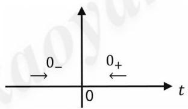
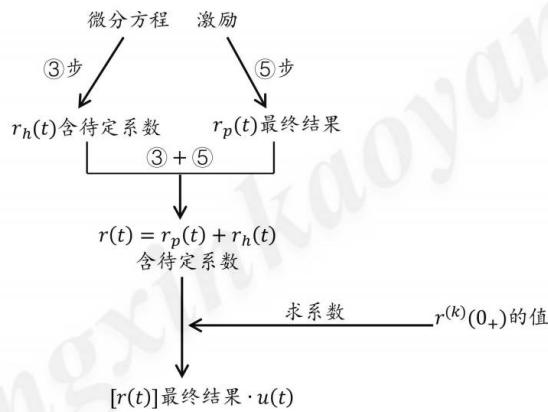
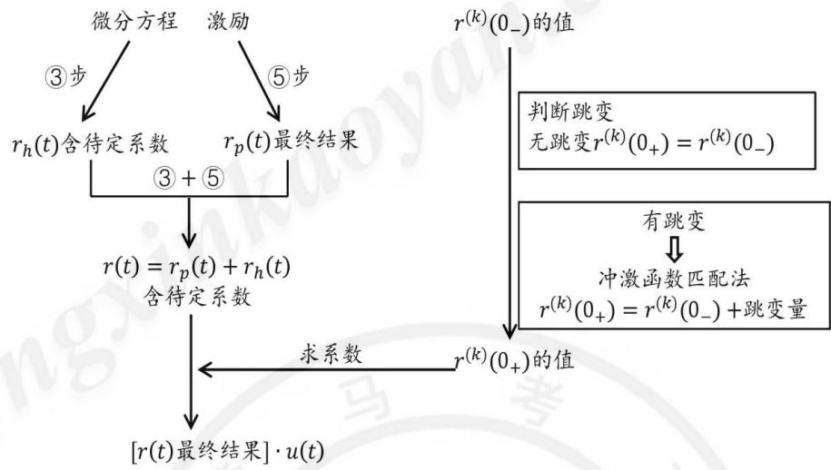

B站up: 信号与系统\_谷哥

公众号：通信考研小马哥

# 连续时间系统的时域分析——经典法

1、经典法流程

【2024年河北科技大学】-上课时临时出题

夢馬考研

2、对带入值的理解

(1) 响应区间:

(2) 个数:

官网：tongxinkaoyan.com

梦马班讲义

## 专题 2 0\_到0\_+状态的跳变

考点 1: $0_{-}$ 到 $0_{+}$ 状态

## 1、定义及物理意义

由于激励信号的作用, 响应 $r(t)$ 及其各阶导数有可能在 $t = 0$ 时刻发生跳变, 为区分跳变前后的状态, 以 $0_{-}$ 表示激励接入之前的瞬时, 以 $0_{+}$ 表示激励接入以后的瞬时。与此对应, 给出 $0_{-}$ 时刻和 $0_{+}$ 时刻的两组状态, 即

$$
r ^ {(k)} (0 _ {-}) = \left[ r (0 _ {-}), \frac {d r (0 _ {-})}{d t}, \dots , \frac {d ^ {n - 1} r (0 _ {-})}{d t ^ {n - 1}} \right]
$$

称这组状态为“0\_状态”或“起始状态”。它包含了为计算未来响应所需要的过去全部信息。另一组状态是

$$
r ^ {(k)} (0 _ {+}) = \left[ r (0 _ {+}), \frac {d r (0 _ {+})}{d t}, \dots , \frac {d ^ {n - 1} r (0 _ {+})}{d t ^ {n - 1}} \right]
$$

这组状态被称为“0+状态”或“初始状态”，也可称为“导出的起始状态”。

## 2、响应区间

用时域经典法求得微分方程的响应具体限于 $0_{+}<t<\infty$ 的时间范围。根据 $0_{+}$ 状态的数据求得完全响应中的待定系数。

3、连续时间系统经典法求解系统响应的完整流程：

学习目标: (1) 跳不? (2) 跳多少?

官网：tongxinkaoyan.com

梦马班讲义

4、 $0_{-}$ 到 $0_{+}$ 状态跳变的图形化解释

用 $\Delta u(t)$ 表示跳变，前面的系数表示跳变量。

(1)若 $r(t)$ 表达式中包含了 $2\Delta u(t)$ ，说明 $r(t)$ 从 $0_{-}$ 到 $0_{+}$ 有2个跳变量，即 $r(0_{+}) = r(0_{-}) + 2$ ;

(2) 若 $r'(t)$ 表达式中包含了 $-2\Delta u(t)$ ，说明 $r'(t)$ 从 $0_{-}$ 到 $0_{+}$ 有 -2 个跳变量，即 $r'(0_{+}) = r'(0_{-}) - 2$ 。

(3)若 $r(t)$ 中包含 $t\Delta u(t)$ ，则说明 $0_{-}$ 和 $0_{+}$ 连续，即 $r(0_{+})=r(0_{-})$ 。

目标: 已知 $r^{(k)} (0_{-})$ 求 $r^{(k)} (0_{+})$ 时, 关注各自表达式中 $\Delta u(t)$ 前的系数

【新增】对冲激函数匹配的分析过程

$$
\frac {d}{d t} r (t) + 3 r (t) = 2 \delta (t)
$$

官网：tongxinkaoyan.com

梦马班讲义

B站up: 信号与系统\_谷哥

公众号：通信考研小马哥

## 考点 2: 冲激函数匹配法

1、 $0_{-}$ 到 $0_{+}$ 发生跳变的判断方法：将激励带入到方程右端，化简得自由项，若自由项中包含 $\delta(t)$ 或 $\delta(t)$ 的各阶导数，则 $0_{-}$ 到 $0_{+}$ 发生跳变。

否则未发生跳变，即 $0_{-}$ 状态的值等于 $0_{+}$ 状态的值。

例8：已知 $\frac{d}{dt} r(t) + 2r(t) = e(t), r(0_{-}) = 1, e(t) = u(t)$ ，求 $r(0_{+})$ 。

例9：已知 $\frac{d}{dt} r(t) + 3r(t) = 2\frac{d}{dt} e(t), r(0_{-}) = 1, e(t) = u(t)$ ，求 $r(0_{+})$ 。

例 10: $r'(t) + 3r(t) = 2e'(t)$ , $e(t) = u(t)$ , $r(0_{-}) = 1$ , 求 $r(0_{+})$ 。

【梦马班点拨】将 $r'(t)$ 和 $r(t)$ 代入方程的目的在于提醒勿忘方程中系数的影响，

实际只关注求解项所在表达式中 $\Delta u(t)$ 前系数即可。

官网：tongxinkaoyan.com

梦马班讲义

B站up: 信号与系统\_谷哥

公众号：通信考研小马哥

2、冲激函数匹配法列写—自由项中 $\delta(t)$ 最高阶包含在响应最高阶中

①列写响应最高阶导数项方程，列到出现 $\Delta u(t)$ 为止；

②对①式依次求积分，出现 $\Delta u(t)$ 为止；

③纵向列写到响应原型为止。

例 11: $r'(t) + 3r(t) = 3\delta'(t)$ , $r(0_{-}) = 2$ , $r(0_{+}) = ?$

【推导过程】

【书写过程】

例 12: 描述某LTI系统的微分方程为

$$
y ^ {\prime \prime} (t) + 2 y ^ {\prime} (t) + y (t) = f ^ {\prime \prime} (t) + 2 f (t)
$$

已知 $y(0_{-})=1,\quad y'(0_{-})=-1,\quad f(t)=u(t),\quad$ 求 $y(0_{+})$ 和 $y'(0_{+})$ 。

官网：tongxinkaoyan.com

梦马班讲义

B站up: 信号与系统\_谷哥

公众号：通信考研小马哥

## 【梦马班点拨】0\_到0\_+跳变的补充说明

$$
r ^ {(n)} (0 _ {-}) \xrightarrow {k \text {组} , n = 0 , 1 \cdots , k - 1} r ^ {(n)} (0 _ {+})
$$

(1) $0_{-}$ 到 $0_{+}$ 发生跳变, 不代表 $k$ 组处处跳变, 但至少有一组有跳变

(2)重点关注 $\Delta u(t)$ 前系数，表示所在表达式中 $0_{-}$ 到 $0_{+}$ 的跳变量，注意平衡时微分方程系数

例 13: 已知 $r(0_{-}) = 1$ , $r'(0_{-}) = 2$ , $e(t) = u(t)$ , 求以下四个方程的 $0_{+}$ 值。

$$
① \frac {d}{d t} r (t) + 2 r (t) = e (t), \text {求} r (0 _ {+})
$$

$$
② \frac {d}{d t} r (t) + 3 r (t) = 2 \frac {d}{d t} e (t), \text {求} r (0 _ {+})
$$

$$
③ \frac {d ^ {2}}{d t ^ {2}} r (t) + \frac {d}{d t} r (t) + r (t) = \frac {d}{d t} e (t) + e (t), \text {求} r (0 _ {+}) \text {和} r ^ {\prime} (0 _ {+})
$$

$$
④ \frac {d}{d t} r (t) + 2 r (t) = \frac {d ^ {2}}{d t ^ {2}} e (t) + 3 \frac {d}{d t} e (t) + 3 e (t), \text {求} r (0 _ {+}) 。
$$

官网：tongxinkaoyan.com

梦马班讲义

B站up: 信号与系统\_谷哥

公众号：通信考研小马哥

4、连续系统经典法求解流程(完整版)

  
例 14: 给定系统微分方程

$$
\frac {d ^ {2}}{d t ^ {2}} r (t) + 3 \frac {d}{d t} r (t) + 2 r (t) = \frac {d}{d t} e (t) + 4 e (t)
$$

若激励信号和起始状态为 $e(t)=e^{-3t}u(t),r(0_{-})=1,r'(0_{-})=2$ ，求系统完全响应。

官网：tongxinkaoyan.com