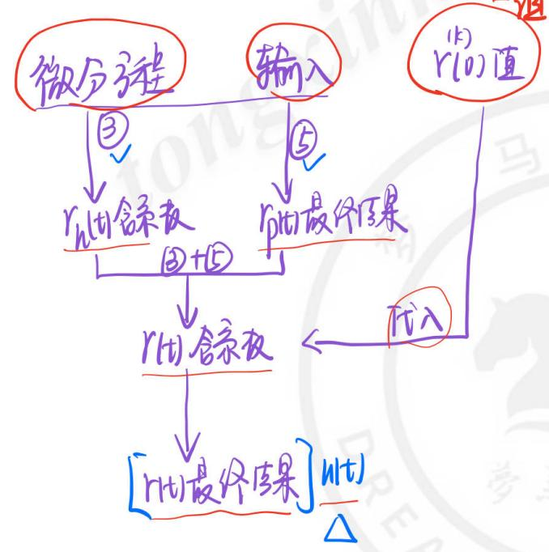
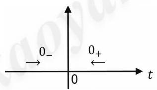
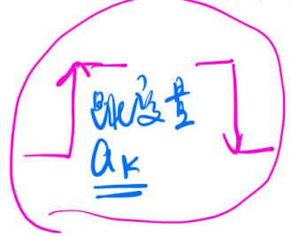
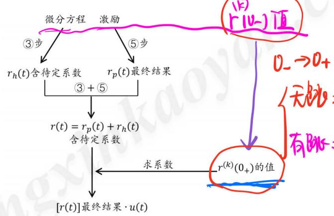
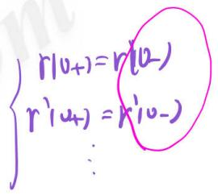
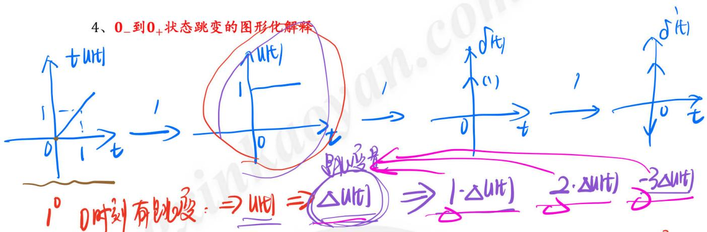
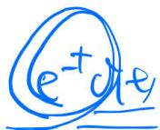
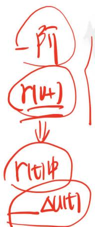
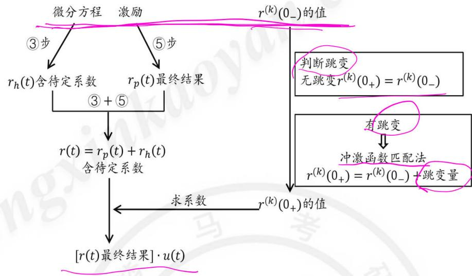

# 连续时间系统的时域分析——经典法

1、经典法流程

【2024年河北科技大学】-上课时临时出题

$r_{h}(t)$ 含余数 $r_{p}(t)$ 最终结果
③ + ⑤

答：

$\left[ r(t) \text{最终结果} \right] \frac{n(t)}{\Delta}$

$$
9: r ^ {\prime} | t | + 3 r ^ {\prime} | t | + 2 n | t | = e ^ {i} | t | + 3 e (t)
$$

$$
\frac {1}{2} e (t) = e ^ {- t} u (t), r (0) = 1, r (0) = 2
$$

求定知响应 r(t)

$$
r _ {h (t)} = A _ {1} e _ {\Delta} ^ {- t} + A _ {2} e ^ {- 2 t}
$$

$$
\begin{array}{r l} {e ^ {\prime} (t) + 3 e (t)} & {= [ e ^ {- t} u (t) ] ^ {\prime} + 3 e ^ {- t} u (t)} \\ & {= - e ^ {- t} u (t) + e ^ {- t} d (t) + 3 e ^ {- t} u (t)} \\ & {= 2 e ^ {- t} u (t) + d (t)} \end{array}
$$

$$
t > 0 \text {   or   } 2 e _ {\Delta} ^ {- t} \Rightarrow r _ {p (t + 1)} = B t e ^ {- t}
$$

$$
= [ e ^ {- t} - t e ^ {- t} ] _ {t = 0}
$$

$$
\Rightarrow r _ {p | t |} = 2 t e ^ {- t}
$$

$$
n \pi = A _ {1} e ^ {- t} + A _ {2} e ^ {- \pi} + 2 t e ^ {- t}
$$

$$
n (0) = A _ {1} + A _ {2} = 1
$$

2、对带入值的理解

$$
r _ {(0)} = - A _ {1} - 2 A _ {2} + 2 = 2
$$

(1) 响应区间: $[0, +\infty), t \geq 0$

$$
A _ {1} = 2, A _ {2} = - 1
$$

(2) 个数: 厂几个值 = 阶权 = 未知余项
若一阶 ⇒ 一个余项 ⇒ r(10)
二阶 ⇒ 一个余项 ⇒ r(10) 和 r'(10)

官网：tongxi nkaoyan. com

梦马班讲义

## 专题 2 0\_到0\_+状态的跳变

u(t)

考点 1: $0_{-}$ 到 $0_{+}$ 状态

信号在0时刻加λ

0- : 加入3前的瞬时

${D}_{ + } : {DA}\lambda$ 之后的n等时

$n$ 向应区间： $[D_{+}, +\infty)$

## 1、定义及物理意义

由于激励信号的作用, 响应 $r\left( t\right)$ 及其各阶导数有可能在 $t = 0$ 时刻发生跳变, 为区分跳变前后的状态, 以 ${0}_{ - }$ 表示激励接入之前的瞬时, 以 ${0}_{ + }$ 表示激励接入以后的瞬时。与此对应, 给出 ${0}_{ - }$ 时刻和 ${0}_{ + }$ 时刻的两组状态, 即

$$
r ^ {(k)} (0 _ {-}) = \left[ r (0 _ {-}), \frac {d r (0 _ {-})}{d t}, \dots , \frac {d ^ {n - 1} r (0 _ {-})}{d t ^ {n - 1}} \right]
$$

称这组状态为“0\_状态”或“起始状态”。它包含了为计算未来响应所需要的过去全部信息。另一组状态是

$$
r ^ {(k)} (0 _ {+}) = \left[ r (0 _ {+}), \frac {d r (0 _ {+})}{d t}, \dots , \frac {d ^ {n - 1} r (0 _ {+})}{d t ^ {n - 1}} \right]
$$

这组状态被称为“0+状态”或“初始状态”，也可称为“导出的起始状态”。

## 2、响应区间

用时域经典法求得微分方程的响应具体限于 $0_{+}<t<\infty$ 的时间范围。根据 $0_{+}$ 状态的数据求得完全响应中的待定系数。

3、连续时间系统经典法求解系统响应的完整流程：

天地： $r^{k_{1}}(0_{+}) = r^{k_{1}(0_{-})}$

有 $B$ 长： $r^{(1)}(u) = r^{(k)}(u) + a_k$

学习目标：（1）跳不？

$$
\begin{array}{l} {r (u _ {+}) = r (u _ {-}) + a _ {0}} \\ {r ^ {\prime} (u _ {+}) = r ^ {\prime} (u _ {-}) + a _ {1}} \\ {\mathrm{求明}} \end{array}
$$

一阶程 $\Rightarrow$ 一条数 $\Rightarrow r(0+)$ 值 $= r(0-)$ 值 $+a_{0}$

官网：tongxi nkaoyan. com

B站up: 信号与系统\_谷哥

公众号：通信考研小马哥

4、 $0_{-}$ 到 $0_{+}$ 状态跳变的图形化解释

$2^{0}t(u(t))$ 在 $t=0$ 时连续的 $\frac{1}{r_{0}}r(t)=t\Delta u(t)$ $\Rightarrow$ 说明在0时刻无二次变量(也可 $r(u+1)=r(u-1)$ )

用 $\Delta u(t)$ 表示跳变，前面的系数表示跳变量。

二所
↓ $n(u_{+})$ 和 $vi(q)$ //    //    r(i) $n(u_{-})$ #

$$
2 \Delta u (t),
$$

$$
\mathrm{即} r (0 _ {+}) =
$$

(2)若 ${r}^{\prime }\left( t\right)$ 表达式中包含了 $- 2\Delta u\left( t\right)$ ,说明 ${r}^{\prime }\left( t\right)$ 从 ${0}_{ - }$ 到 ${0}_{ + }$ 有 -2 个跳变量,即 ${r}^{\prime }\left( {0}_{ + }\right)  = {r}^{\prime }\left( {0}_{ - }\right)  - 2$ 。

(3)若 $r\left( t\right)$ 中包含 $t{\Delta u}\left( t\right)$ ,则说明 ${0}_{ - }$ 和 ${0}_{ + }$ 连续,即 $r\left( {0}_{ + }\right)  = r\left( {0}_{ - }\right)$ 。

中各自有多个 $\triangle nht$ 和 $\dot{n}ht$

目标: 已知 $r^{(k)}(0_{-})$ 求 $r^{(k)}(0_{+})$ 时, 关注各自表达式中 $\Delta u(t)$ 前的系数

$r^{(t)}$ 表式中各 $\Delta u(t)$ 的幂 $\Rightarrow$

【新增】对冲激函数匹配的分析过程

$\frac{d}{dt} r(t) + 3r(t) = 2\delta(t)$

$1^{\circ} r^{i}t$ 中含 $d^{i}t$

$\Rightarrow r(t)$ 中含有 $\Delta u(t)$ $\Rightarrow r(u_{+}) = r(u_{-}) + \text{跳度量}$

官网：tongxi nkaoyan. com左边也是 $2\sqrt{it}$ 向 rìt) 还是 rìt) 中有 $\delta^{it}$ $2^{0}rìt$ 中含 $\delta^{it}$ $\Rightarrow rìt$ 中含 $\delta^{it}$ $\Rightarrow rìt$ 中有 $rìt)$ 与之和消 $\Rightarrow rìt$ 中有 $\delta^{it}$ 梦马班讲义

B站up: 信号与系统\_谷哥

公众号：通信考研小马哥

考点 2: 冲激函数匹配法

1、 $0_{-}$ 到 $0_{+}$ 发生跳变的判断方法：将激励带入到方程右端，化简得自由项，若自由项中包含 $\delta(t)$ 或 $\delta(t)$ 的各阶导数，则 $0_{-}$ 到 $0_{+}$ 发生跳变。

否则未发生跳变, 即 $0 _ { \text {状态} }$ 的值等于 $0 _ { + }$ 状态的值。

例8: 已知 $\frac{d}{dt} r(t) + 2r(t) = e(t)$ , $r(0_{-}) = 1$ , $e(t) = u(t)$ , 求 $r(0_{+})$ 。

自由项为 $u(t) \Rightarrow$ 无弧度 $\Rightarrow n(u) = n(u-1) = 1$

例9: 已知 $\frac{d}{dt}r(t)+3r(t)=2\frac{d}{dt}e(t), r(0_{-})=1, e(t)=u(t)$ ，求 $r(0_{+})$ 。 $r(t+3n-t)=20^{(t)}$

$2{e}^{i\left( t\right) } = 2\left( {\sqrt{i}\left( t\right) }\right)$ 的项 $\Rightarrow$ 有弧线

$$
r (t) + 3 n (t) = 2 \sqrt {n (t)}
$$

$$
a = 2 \Leftrightarrow r (t) = a (\sqrt {t}) + b \Delta u (t)
$$

例10: $r'(t) + 3r(t) = 2e'(t), e(t) = e(t), r(0_+) = 1$ , 求 $r(0_+)$ 。

$$
r (t) = a \Delta u (t)
$$

$$
2 e ^ {i t} = 2 \sqrt {i t}
$$

$$
\Rightarrow r (u _ {+}) = r (u) + a = 3
$$

$\Rightarrow  r(t) \text{中有} 2 + \delta(t)$

$$
r (u +) = r (u -) - 6 = - 5
$$

$\Rightarrow  {r|t}$ 中有 $2\sqrt{r|t}$

$$
r (t) + 3 r (t) = 2 \sqrt {r (t)}
$$

$\Rightarrow  {3n} + 1 + 2 = 3$

$$
r ^ {\prime} (t) = a \omega^ {\prime} (t) + b \omega^ {\prime} (t) + c \Delta u (t) \Rightarrow a = 2
$$

$\Rightarrow r(t)$ 中有 $-6\sqrt{r(t)}$

$$
r (t) = a \sqrt {a (t)} + b \Delta (w t) \Rightarrow b + 3 a = 0 \Rightarrow b = - 6
$$

$\Rightarrow n(t)$ 中有 $-6\Delta n(t)$

$$
\Rightarrow n (a) = n (0 - 1) + b = 1 - 6 = - 5
$$

【梦马班点拨】将 $r'(t)$ 和 $r(t)$ 代入方程的目的在于提醒勿忘方程中系数的影响，

梦马班讲义

2、冲激函数匹配法列写—自由项中 $\delta(t)$ 最高阶包含在响应最高阶中

①列写响应最高阶导数项方程，列到出现 $\Delta u(t)$ 为止；

②对①式依次求积分，出现 $\Delta u(t)$ 为止；

③纵向列写到响应原型为止。

例 11: $r'(t) + 3r(t) = 3\delta'(t)$ , $r(0_{-}) = 2$ , $r(0_{+}) = ?$

【推导过程】

【书写过程】

例 12: 描述某LTI系统的微分方程为

$$
\begin{array}{r l} & {y ^ {\prime \prime} (t) + 2 y ^ {\prime} (t) + y (t) = f ^ {\prime \prime} (t) + 2 f (t)} \\ & {\mathrm{已知} y (0 _ {-}) = 1, y ^ {\prime} (0 _ {-}) = - 1, f (t) = u (t), \mathrm{求} y (0 _ {+}) \mathrm{和} y ^ {\prime} (0 _ {+}).} \\ & {y ^ {\prime \prime} (t) + 2 y ^ {\prime} (t) + y (t) = 0 ^ {\prime} (t) + 2 u (t)} \\ & {\left\{ \begin{array}{l l} {y ^ {\prime \prime} (t) = a d ^ {\prime} (t) + b d (t) + c \Delta u (t)} & {\Rightarrow a = 1} \\ {y (t) = a d (t) + b \Delta u (t)} & {\Rightarrow b + 2 a = 0 \Rightarrow b = - 2} \\ {y (t) = a \Delta u (t)} \end{array} \right.} \\ & {y (u _ {+}) = y (u _ {-}) + a = 1 + 1 = 2} \\ & {y ^ {\prime} (u _ {+}) = y ^ {\prime} (u _ {-}) + b = - 1 - 2 = - 3} \\ {\mathrm{网:longxinkaoyan.com}} \end{array}
$$

梦马班讲义

B站up: 信号与系统\_谷哥

公众号：通信考研小马哥

$$
r (0 +) = r (2) + a _ {0} \dots
$$

【梦马班点拨】0\_到0\_+跳变的补充说明

$$
r (u _ {+}) = r (u _ {-}) + a _ {1} \dots
$$

$$
r ^ {(n)} (0 _ {-}) \xrightarrow {k \text {组} , n = 0 , 1 \cdots , k - 1} r ^ {(n)} (0 _ {+})
$$

$$
r ^ {\prime} (0 +) = r ^ {\prime} (0 -) + a _ {2} \dots
$$

$(1)0_{-}$ 到 $0_{+}$ 发生跳变，不代表k组处处跳变，但至少有一组有跳变

(2)重点关注 $\Delta u(t)$ 前系数，表示所在表达式中 $0_{-}$ 到 $0_{+}$ 的跳变量，注意平衡时微分方程系数

例 13: 已知 $r(0_{-}) = 1$ , $r'(0_{-}) = 2$ , $e(t) = u(t)$ ，求以下四个方程的 $0_{+}$ 值。

① $\frac{d}{dt}r(t)+2r(t)=e(t)$ ，求 $r(0_{+})$

$u(t)$ 无不变 $\Rightarrow r(u_{+}) = r(u_{-}) = 1$

$$
② \frac {d}{d t} r (t) + 3 r (t) = 2 \frac {d}{d t} e (t), \text {求} r (0 _ {+})
$$

$$
r (t) + 3 r (t) = 2 \sqrt {r (t)}
$$

$$
r (t) = a \sqrt {t} + b \Delta u (t) \Rightarrow a = 2
$$

$$
r (t) = a \Delta u (t) \Rightarrow r (u _ {+}) = r (u) + a = 3
$$

$$
③ \frac {d ^ {2}}{d t ^ {2}} r (t) + \frac {d}{d t} r (t) + r (t) = \frac {d}{d t} e (t) + e (t), \text {求} r (0 _ {+}) \text {和} r ^ {\prime} (0 _ {+})
$$

$$
r ^ {\prime} (t) + r ^ {\prime} (t) + r (t) = \delta (t) + u (t)
$$

$$
r ^ {\prime \prime} (t) = a \sqrt {r (t)} + b \Delta u (t) \Rightarrow a = 1
$$

$$
r ^ {\prime} (t) = a \Delta u (t) \Rightarrow r ^ {\prime} (u + 1) = r ^ {\prime} (v - 1) + a = 3
$$

$$
r (t) = a t \Delta u (t) \Rightarrow r (v _ {+}) = r (v _ {-}) = 1
$$

$$
④ \frac {d}{d t} r (t) + 2 r (t) = \frac {d ^ {2}}{d t ^ {2}} e (t) + 3 \frac {d}{d t} e (t) + 3 e (t), \text {求} r (0 _ {+}) 。
$$

$$
r (t) + 2 r (t) = 0 ^ {1} (t) + 3 \delta (t) + 3 u (t)
$$

$$
r ^ {\prime} (t) = a \delta^ {\prime} (t) + b \delta (t) + C \Delta u (t) \Rightarrow a = 1, b + 2 a = 3 \Rightarrow b = 1
$$

$$
r (t) = a \delta (t) + b \Delta u (t) \Rightarrow r (u _ {+}) = r (u _ {-}) + b \Rightarrow r (u _ {+}) = 2
$$

$[ \_\_\_\_ ] + 2 [ \_\_\_\_ ] = \_\_\_\_$

官网：tongxi nkaoyan. com

梦马班讲义

B站up: 信号与系统\_谷哥

4、连续系统经典法求解流程(完整版) 35 时代

例 14: 给定系统微分方程

$$
\frac {d ^ {2}}{d t ^ {2}} r (t) + 3 \frac {d}{d t} r (t) + 2 r (t) = \frac {d}{d t} e (t) + 4 e (t)
$$

若激励信号和起始状态为 $e(t)=e^{-3t}u(t),r(0_{-})=1,r'(0_{-})=2$ ，求系统完全响应。

$$
\alpha^ {2} + 3 \alpha + 2 = (\alpha + 1) (\alpha + 2) = 0
$$

$$
\alpha_ {1} = - 1, \alpha_ {2} = - 2
$$

$$
r _ {h} (t) = A _ {1} e ^ {- t} + A _ {2} e ^ {- 2 t}
$$

$$
e ^ {\prime} (t) + 4 e (t) = - 2 e ^ {- 3 t} u (t) + e ^ {- 3 t} \sqrt [ 3 ]{(t)} + 4 e ^ {- 3 t} u (t) = e ^ {- 3 t} u (t) + d ^ {2} (t)
$$

t>0 时的项为 $e^{-3t} \Rightarrow r_p(t) = B e^{-3t}$

$$
n (t) = A _ {1} e ^ {- t} + A _ {2} e ^ {- 2 t} + \frac {1}{3} e ^ {- 3 t}
$$

自由项中含 $\delta(t) \Rightarrow u$ 到 $t$ 有逃变

$$
r ^ {\prime} (t) = a d (t) + b \Delta u (t) \Rightarrow a = 1
$$

$$
r ^ {\prime} (t) = a \Delta u (t) \Rightarrow r ^ {\prime} (u) = r ^ {\prime} (0 -) + a = 2 + 1 = 3
$$

$$
\lim _ {y \to 1} t = a t \Delta u (t) \Rightarrow r (u + 1) = r (0 - 2) = 1
$$

梦马班讲义

$$
\begin{array}{r l} {r (u _ {+})} & {= A _ {1} + A _ {2} + \frac {1}{2} = 1} \\ {r ^ {\prime} (u)} & {= - A _ {1} - 2 A _ {2} - \frac {3}{2} = 3} \\ {\Rightarrow r (t)} & {= \left(\frac {\pi}{2} e ^ {- t} - 5 e ^ {- 2 t} + \frac {1}{2} e ^ {- 3 t}\right) u (t)} \end{array}
$$

考研内容：

1° 经典法：35 驚代 $0_{-} \rightarrow 0_{+}$ 驚度

$$
2 ^ {\circ} \frac {r _ {(u -)} ^ {(k)} \mathrm{值}}{\left\{ \begin{array}{l l} r _ {(u +)} ^ {(k)} & \mathrm{道} r _ {(u -)} ^ {(k)} \mathrm{值} \\ \textcircled {?} & \end{array} \right.}
$$

微分方程 $r^{i}(t) = \delta^{i}(t)$ $r^{i}(t)$ 中含有 $\delta^{i}(t)$ ↓ 积分 $r^{i}(t)$ 中 $\Delta u|e|$

$$
r (t) + 3 n (t) = \delta^ {\prime \prime} (t)
$$

?页 die

$$
\begin{array}{r l} {r (t)} & {= a \delta^ {\prime} (t) + b \delta^ {\prime} (t) + c \delta (t) + d (\Delta u (t)) \Rightarrow a = 1} \\ {r (t)} & {= a \delta^ {\prime} (t) + b \delta (t) + c (\Delta u (t)) \Rightarrow n (u) = n (u) + c} \\ & {= b + 3 a = 0 \Rightarrow b = - 3} \\ & {c + 3 b = 0 \Rightarrow c = 9} \end{array}
$$