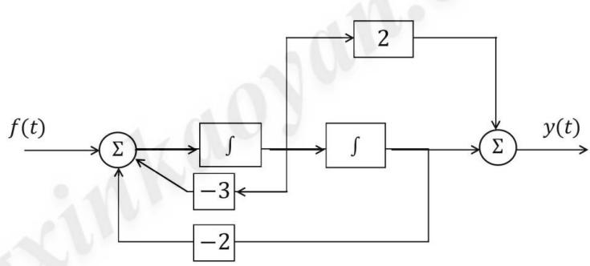

B站up: 信号与系统\_谷哥

## 第8节课后作业

1、【2024 湖北工业大学 8】已知 $y''(t) + 5y'(t) + 6y(t) = 2x'(t) + x(t), \quad x(t) = e^{-t}u(t), \quad y(0_{-}) = y'(0_{-}) = 1$ ，求系统的全响应 $y(t)$ 。

B站up: 信号与系统\_谷哥

公众号：通信考研小马哥

2、【2024重庆大学3】LTI系统中微分方程为： $y''(t)+5y'(t)+6y(t)=2x'(t)+3x(t)$ ， $y(0^{-})=2$ ， $y'(0^{-})=1$ ，输入信号 $x(t)=u(t)$ ，请用时域分析法求：系统的自由响应和强迫响应。

3、【2024 华侨大学 5】某因果LTI系统框图如下

(1) 系统的微分方程;

(2) 若初始状态为 $y(0^-) = 1, y'(0^-) = 1$ , 当输入 $f(t) = 2e^{-3t}u(t)$ 时, 求系统的全响应 $y(t)$ 。

夢馬考研

B站up: 信号与系统\_谷哥

4、【2024 上海师范大学 6】已知因果LTI系统描述输入和输出关系的微分方程为：

$$
r ^ {\prime \prime} (t) + 3 r ^ {\prime} (t) + r (t) = e ^ {\prime} (t) + 3 e (t)
$$

激励 $e(t)=e^{-3t}u(t),r(0_{-})=1,r^{\prime}(0_{-})=2$ ，求初值 $r(0_{+})$ 、 $r^{\prime}(0_{+})$ 。

夢馬考研

官网：www.tongxinkaoyan.com