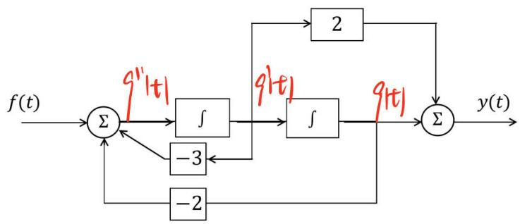

B站up: 信号与系统\_谷哥

## 第8节课后作业

1、已知 $y''(t)+5y'(t)+6y(t)=2x'(t)+x(t)$ ， $x(t)=e^{-t}u(t)$ ， $y(0_{-})=$

$y'(0_{-})=1$ ，求系统的全响应 $y(t)$ 。

$$
\alpha^ {2} + 5 \alpha + 6 = (\alpha + 2) (\alpha + 3) = 0
$$

$$
2 x ^ {\prime} (t) + x (t) = 2 \left[ - e ^ {- t} (u (t) + d (t)) \right] + e ^ {- t} (u (t)) = - e ^ {t} (u (t) + 2 d (t))
$$

$$
\alpha_ {1} = - 2, \quad \alpha_ {2} = - 3
$$

$t > 0$ 时自由项 $=  - {e}^{ - t}$ ,故选 ${y}_{p}\left( t\right)  = C{e}^{-t}$

$$
y _ {h} (t) = A e ^ {- 2 t} + B e ^ {- 3 t}
$$

$$
\begin{array}{r l} {C e ^ {- t} - 5 C e ^ {- t} + 6 C e ^ {- t}} & {= - e ^ {- t}} \\ {2 C = - 1 \Rightarrow C = - \frac {1}{2}} \end{array}
$$

$$
y _ {p} | t | = - \frac {1}{2} e ^ {- t}
$$

$$
y _ {| t |} = y _ {n} | t | + y _ {p} | t | = A e ^ {- x t} + B e ^ {- 3 t} - \frac {1}{2} e ^ {- t}
$$

$$
y ^ {\prime} (t) + 5 y ^ {\prime} (t) + 6 y (t) = - e ^ {- t} u (t) + 2 d (t)
$$

$$
\begin{array}{r l} {y ^ {\prime} (t)} & {= a d (t) + b \Delta u (t) \Rightarrow a = 2} \\ {y ^ {\prime} (t)} & {= a \Delta u (t) \Rightarrow y ^ {\prime} (0 + 1) = y ^ {\prime} (0 - 1) + a = 3} \\ {y ^ {\prime} (t)} & {= a d (\Delta u (t) \Rightarrow y (0 + 1) = y (0 - 1) = 1} \end{array}
$$

$$
\left\{ \begin{array}{l} y (0 + 1) = A + B - \frac {1}{2} = 1 \\ y ^ {\prime} (0 + 1) = - 2 A - 3 B + \frac {1}{2} = 3 \end{array} \right. \Rightarrow \left\{ \begin{array}{l} A = 7 \\ B = - \frac {1 1}{2} \end{array} \right.
$$

$$
y _ {| t |} = (7 e ^ {- 2 t} - \frac {1 1}{2} e ^ {- 3 t} - \frac {1}{2} e ^ {- t}) u (t)
$$

2、LTI系统中微分方程为： $y''(t) + 5y'(t) + 6y(t) = 2x'(t) + 3x(t)$ ， $y(0^-) = 2$ ， $y'(0^-) = 1$ ，输入信号 $x(t) = u(t)$ ，请用时域分析法求：系统的自由响应和强迫响应。

$$
\alpha^ {2} + 5 \alpha + 6 = (\alpha + 2) (\alpha + 3) = 0
$$

$$
2 x (t) + 3 x (t) = 2 \sqrt {1 - t} + 3 u (t)
$$

$$
\alpha_ {1} = - 2, \quad \alpha_ {2} = - 3
$$

$$
y _ {n} (t) = A e ^ {- 2 t} + B e ^ {- 3 t}
$$

切时的项 $= 3 \Rightarrow  {y}_{p + 1} = c$

$$
0 + 0 + 6 c = 3
$$

$$
c = \frac {1}{2}
$$

$$
y _ {p} | t | = \frac {1}{2}
$$

$$
y | t | = y _ {h} | t | + y _ {p} | t | = A e ^ {- 2 t} + B e ^ {- 3 t} + \frac {1}{2}
$$

$$
y ^ {\prime \prime} | t | + 5 y ^ {\prime} | t | + 6 y | t | = 2 0 (t) + 3 u (t)
$$

$$
y ^ {\prime \prime} (t) = a d (t) + b \Delta (1 + t) \Rightarrow a = 2
$$

$$
y ^ {\prime} | t | = a \Delta u (t) \Rightarrow y ^ {\prime} (0 + 1) = y ^ {\prime} (0 - 1) + a = 3
$$

$$
y (t) = a t \Delta u (t) \Rightarrow y (0 + 1) = y (0 - 1) = 2
$$

$$
\left\{ \begin{array}{l} y (u + 1) = A + B + \frac {1}{2} = 2 \\ y (0 + 1) = - 2 A - 3 B = 3 \end{array} \right. \Rightarrow \left\{ \begin{array}{l} A = \frac {1 5}{2} \\ B = - 6 \end{array} \right.
$$

$$
y (t) = \left(\frac {1 5}{2} e ^ {- 2 t} - 6 e ^ {- 3 t} + \frac {1}{2}\right) u (t)
$$

自由向应为 $\left(\frac{15}{2}e^{-2t}-6e^{-3t}\right)uHt$

强矩响应为 $\frac{1}{2}u(t)$

26梦马班讲义

3、某因果LTI系统框图如下

(1) 系统的微分方程;

(2) 若初始状态为 $y(0^-) = 1, y'(0^-) = 1$ , 当输入 $f(t) = 2e^{-3t}u(t)$ 时, 求系统的全响应 $y(t)$ 。

解：(1) 设中间变量 $q(1)$ ，如同文

$$
\begin{array}{r l} {\mathrm{则} 9 ^ {\prime \prime} | t |} & {= f | t | - 3 9 ^ {\prime} | t | - 2 9 | t | \Rightarrow f | t | = 9 ^ {\prime \prime} | t | + 3 9 ^ {\prime} | t | + 2 9 | t |} \\ {y | t |} & {= 9 | t | + 2 9 ^ {\prime} | t |} \end{array}
$$

故系交微分方程为 $y^{i|t|} + 3y^{i|t|} + 2y^{i|t|} = 2f^{i|t|} + f^{i|t|}$

$$
\begin{array}{l} {(2) \alpha^ {2} + 3 \alpha + 2 = (\alpha + 1) (\alpha + 2) = 0} \\ {\alpha_ {1} = - 1, \quad \alpha_ {2} = - 2} \end{array}
$$

$$
\begin{array}{r l} {2 f (t) + f (t)} & {= 2 \left[ - 6 e ^ {- 3 t} u (t) + 2 c (\sqrt {t}) \right] + 2 e ^ {- 3 t} u (t)} \\ & {= - 1 0 e ^ {- 3 t} u (t) + 4 \sqrt {t}} \end{array}
$$

$$
y _ {h} | t | = A e ^ {- t} + B e ^ {- 2 t}
$$

t>0 时自由项 = -10e^{-3t} \Rightarrow y\_p(t) = ce^{-3t}

$$
\begin{array}{r l} {9 c e ^ {- 3 t} - 9 c e ^ {- 3 t} + 2 c e ^ {- 3 t}} & {= - 1 0 e ^ {- 3 t}} \\ {2 c = - 1 0 \Rightarrow c = - 5} \end{array}
$$

$$
y _ {p} (t) = - 5 e ^ {- 3 t}
$$

$$
y _ {| t |} = y _ {h} (t) + y _ {p} (t) = A e ^ {- t} + B e ^ {- 2 t} - 5 e ^ {- 3 t}
$$

$$
y ^ {\prime \prime} (t) = a d (t) + b \Delta u (t) \Rightarrow a = 4
$$

$$
y | t | = a \Delta u | t | \Rightarrow y | v + 1 = y | v - 1 + a = 5
$$

$$
\begin{array}{r l} {y (0 +)} & {= A + B - 5 = 1} \\ {y (2 +)} & {= - A - 2 B + 1 5 = 5} \end{array} \Rightarrow \begin{array}{r l} {A} & {= 2} \\ {B} & {= 4} \end{array}
$$

官网：www.tongkinhkaoyan.com $y_{1}+t=ad\left(\Delta n+t\right)\Rightarrow y_{10+1}=y_{10-1}=1$

$$
\Rightarrow y \vert + 1 = (2 e ^ {- t} + 4 e ^ {- 2 t} - 5 e ^ {- 3 t}) \vert \vert t \vert
$$

4、已知因果LTI系统描述输入和输出关系的微分方程为：

$$
r ^ {\prime \prime} (t) + 3 r ^ {\prime} (t) + r (t) = e ^ {\prime} (t) + 3 e (t)
$$

激励 $e(t)=e^{-3t}u(t),r(0_{-})=1,r^{\prime}(0_{-})=2$ ，求初值 $r(0_{+})$ 、 $r^{\prime}(0_{+})$ 。

$$
\begin{array}{r l} {e ^ {\prime} (t) + 3 e (t)} & {= [ e ^ {- 3 t} u (t) ] ^ {\prime} + 3 e ^ {- 3 t} u (t)} \\ & {= - 3 e ^ {- 3 t} u (t) + e ^ {- 3 t} \delta (t) + 3 e ^ {- 3 t} u (t)} \\ & {= \delta (t)} \end{array}
$$

$$
\left\{ \begin{array}{l} {r ^ {\prime \prime} (t) + 3 r ^ {\prime} (t) + r (t) = \sqrt {t}} \\ {r ^ {\prime \prime} (t) = a \delta (t) + b \Delta u (t)} \Rightarrow a = 1 \\ {r ^ {\prime} (t) = a \Delta u (t)} \Rightarrow r ^ {\prime} (0 + 1) = r ^ {\prime} (2) + a = 3 \\ {r ^ {\prime} (t) = a t (\Delta u (t)) \Rightarrow r (2 t) = r (0 - 1) = 1} \end{array} \right.
$$