## 连续系统经典法求解流程(完整版)

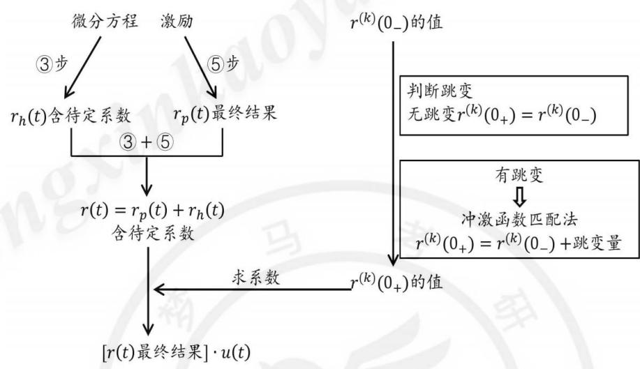

(1) 齐次解形式的 3 步骤; (单实根、重实根)

(2) 特解结果的 5 步骤; (e 指数形式时, 与特征根是否相同的问题)

(3) 跳变的判断及冲激函数匹配法的列写; 【易错点: 方程系数】

## 课前练习（该课程会用到）

[同例 16: ]描述某LTI系统的微分方程为

$$
\frac {d ^ {2} r (t)}{d t ^ {2}} + 3 \frac {d r (t)}{d t} + 2 r (t) = 2 \frac {d e (t)}{d t} + 6 e (t)
$$

已知， $r(0_{-})=2,\ r^{\prime}(0_{-})=0,\ e(t)=u(t)$ 利用经典法求解系统完全响应。

$$
r _ {n} (t) = A _ {1} e ^ {- t} + A _ {2} e ^ {- x t}
$$

②(1t) + 6(1t) more

$$
r _ {p (t)} = 3
$$

$$
r (t) = A _ {1} e ^ {- t} + A _ {2} e ^ {- t} + 3
$$

$$
r ^ {\prime \prime} (t) = a d (t) + b \Delta u (t) \Rightarrow a = 2
$$

$$
r ^ {\prime} (t) = a \Delta u (r) \Rightarrow r ^ {\prime} (4) = r ^ {\prime} (4) + a
$$

$$
n (0 + 1) = A _ {1} + A _ {2} + 3 = 2
$$

$$
n + 1 = a b \Delta u (t) \Rightarrow n (u _ {+}) = n (v _ {-}) = 2
$$

$$
r (u +) = - A _ {1} - 2 A _ {2} = 2
$$

官网：tongxi nkaoyan. com

$$
A _ {1} = 0. \quad A _ {2} = - 1
$$

$$
\Rightarrow r (t) = (- e ^ {- x} + 3) u (t)
$$

B站up: 信号与系统\_谷哥

公众号：通信考研小马哥

考研知识点:

(1) 经典法求解系统完全响应 $\rightarrow 3$ 、5、跳、代

(2) 求 $0_{+}$ 值:

(3) 求 0\_值:

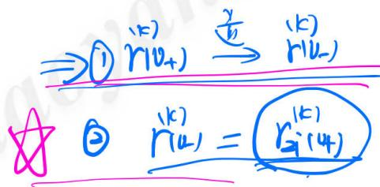

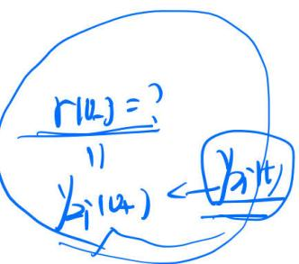

## 经典法的拓展理解:

(1) 非齐次方程的求解——全解=齐次部分+特解部分

(2)特殊情况一:如果没有特解部分→3

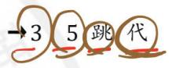

$\left\{  {1,\frac{3}{2},t =  - 1}\right\}$

(3) 特殊情况二: 经典法流程的拓展理解

非齐二次程 → 3.5 做初代

(4)特殊情况三,求谁用谁的 $0 +$ 值

从MP开始 stroke

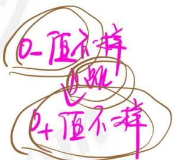

官网：tongxi nkaoyan. com

梦马班讲义

## 专题 3 连续系统的双零法分析

学习目标：【先将电路背景，在引出学习目标】

(1) 双零法的求解 $b_{i}$ 和 $b_{s}$

(2) 完全响应的分解与关联

考点1：系统双零法分解

1、电路背景:

电路的输出不仅与电路的输入有关，还与电路中储能元件中的储能有关。

2、基本定义：

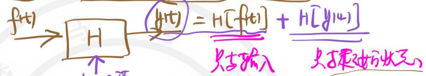

零输入(zero - input)响应: 没有外加激励信号的作用, 只由起始状态(起始时刻系统储能)所产生的响应, 用下角标zi表示。

零状态(zero - state)响应: 不考虑起始时刻系统储能的作用(起始状态等于零),

由系统外加激励信号所产生的响应，用下角标 $ZS$ 表示。

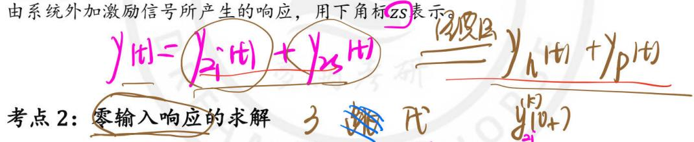

考点2: 零输入响应的求解 3 跳代 $y_{2}(0+)$

1、零输入响应满足的方程：齐次方程(与激励无关, 故方程右边为 0)⇒齐次解

2、零输入响应求解流程图
三、实验

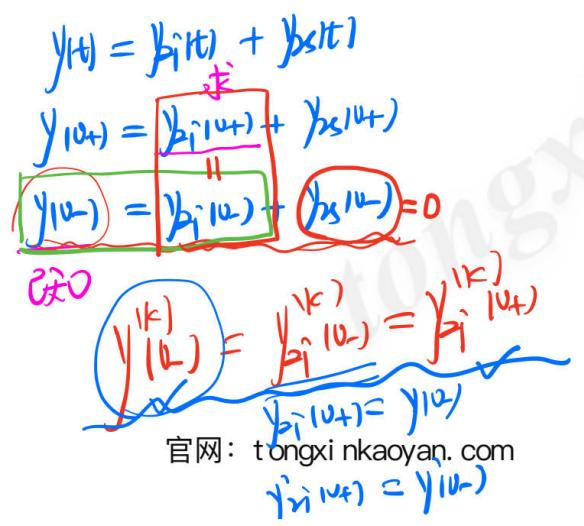

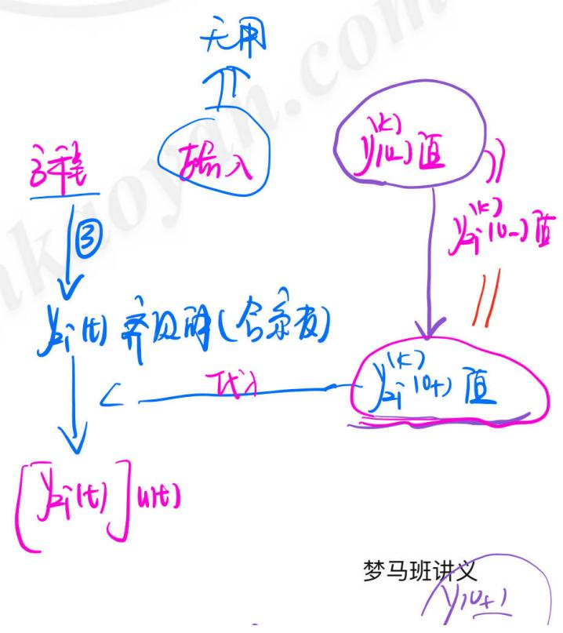

3、 $r_{zi}^{(k)}(0_{+})$ 的求解说明

(1) $r_{zi}(t)$ 与激励无关，说明 $r_{zi}(t)$ 的0-到0+无跳变，即 $r_{zi}^{(k)}(0_+) = r_{zi}^{(k)}(0_-)$

(2) 完全响应 $r(t)$ =零状态响应 $r_{zs}(t)$ +零输入响应 $r_{zi}(t)$

$$
r ^ {(k)} (0 _ {-}) = r _ {z s} ^ {(k)} (0 _ {-}) + r _ {z i} ^ {(k)} (0 _ {-})
$$

而

$$
r _ {z s} ^ {(k)} (0 _ {-}) = 0
$$

故

$$
r _ {z i} ^ {(k)} (0 _ {+}) = r _ {z i} ^ {(k)} (0 _ {-}) = r ^ {(k)} (0 _ {-})
$$

(3)求 $r_{zi}(t)$ 齐次解形式中待定系数用 $r^{(k)}(0_{-})$ 或 $r_{zi}^{(k)}(0_{+})$ 或 $r_{zi}^{(k)}(0_{-})$

例 15: 描述某LTI系统的微分方程为

$$
\frac {d ^ {2} r (t)}{d t ^ {2}} + 3 \frac {d r (t)}{d t} + 2 r (t) = 2 \frac {d e (t)}{d t} + 6 e (t)
$$

$$
3 \pi t ^ {\prime}
$$

已知 $r(0_{-})=2$ ， $r'(0_{-})=0$ ， $e(t)=u(t)$ ，求该系统的零输入响应。

$$
B _ {1} (t) = A _ {1} e ^ {- t} + A _ {2} e ^ {- 2 t}
$$

$$
r _ {2 i} (4) = n (2) = A _ {1} + A _ {2} = 2
$$

$$
r _ {2 1} ^ {\prime} (u _ {+}) = r _ {0 -} ^ {\prime}) = - A _ {1} - 2 A _ {2} = 0
$$

$$
A _ {1} = 4, A _ {2} = - 2
$$

$$
\therefore x _ {2} | t | = (4 e ^ {- t} - 2 e ^ {- t}) u (t)
$$

梦马班讲义

考点3：零状态响应的求解

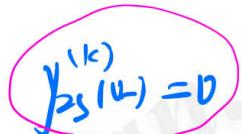

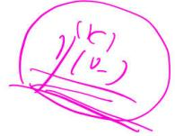

与输入有关

1、零状态响应满足的方程：非齐次方程⇒齐次解+特解 35 鲘代

y(k) 值

2、零状态响应的求解流程

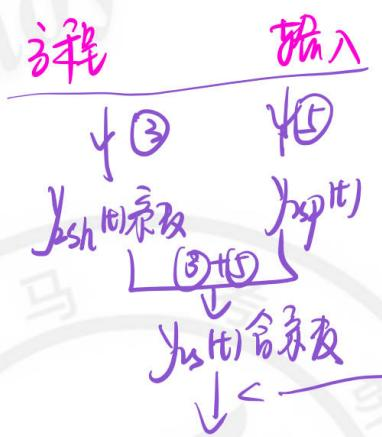

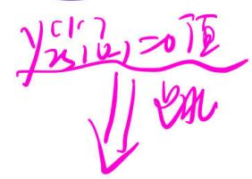

$y_{2s}(a+)$ 值

例 16: 描述某LTI系统的微分方程为

$$
\frac {d ^ {2} r (t)}{d t ^ {2}} + 3 \frac {d r (t)}{d t} + 2 r (t) = 2 \frac {d e (t)}{d t} + 6 e (t)
$$

已知， $r(0_{-})=2,\quad r'(0_{-})=0,\quad e(t)=u(t)$ ，求该系统的零状态响应。

$$
r _ {2 s} ^ {(k)} (2) = 0
$$

$$
\begin{array}{r l} & {r _ {x 1} ^ {\prime \prime} (t) + 3 r _ {x 1} ^ {\prime} (t) + 2 r _ {x 1} (t) = 2 \delta_ {1} (t) + 6 u (t) \mathrm{且} r _ {x 1} (t) = 0} \\ & {\quad r _ {x 1} (t) = A _ {3} e ^ {- t} + A _ {4} e ^ {- x} + 3} \\ & {\left\{ \begin{array}{l l} {r _ {x 1} ^ {\prime \prime} (t)} & {= a \delta_ {1} (t) + b \Delta u (t)} \\ {\frac {r _ {x 1} ^ {\prime}}{r _ {x 1} (t)}} & {= a \Delta u (t)} \\ {r _ {x 1} (t)} & {= a + \Delta u (t)} \end{array} \right. \Rightarrow a = 2} \\ & {\quad r _ {x 1} (t) = a \Delta u (t) \Rightarrow r _ {x 1} ^ {\prime} (u _ {4}) = r _ {x 1} ^ {\prime} (u _ {2}) + a = 0 + 2} \\ & {\quad r _ {x 1} (t)} \\ & {\quad r _ {x 1} (u _ {4}) = A _ {3} + A _ {4} + 3 = 0} \\ & {\quad r _ {x y} ^ {\prime} (u _ {4}) = - A _ {3} - 2 A _ {4} = 2} \\ & {\quad A _ {3} = - 4} \\ & {\quad A _ {4} = 1} \\ & {\Rightarrow r _ {x y} (t) = (- 4 e ^ {- t} + e ^ {- x} + 3) u (t)} \end{array}
$$

官网：tongxi nkaoyan. com

梦马班讲义

[同例 16: ] 描述某LTI系统的微分方程为

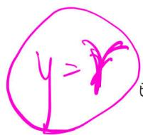

$$
\frac {d ^ {2} r (t)}{d t ^ {2}} + 3 \frac {d r (t)}{d t} + 2 r (t) = 2 \frac {d e (t)}{d t} + 6 e (t)
$$

已知， $r(0_{-})=2,\quad r'(0_{-})=0,\quad e(t)=u(t)$ ，用时域双零法求系统完全响应。

$\{2; (t)\}$

$$
y _ {i} (t) = A _ {1} e ^ {- t} + A _ {2} e ^ {- 2 t}
$$

$$
y _ {2} (u) = A _ {1} + A _ {2} = 2
$$

$$
y _ {2 i} (0 +) = y (0 -) = - A _ {1} - 2 A _ {2} = 0
$$

${y}_{x}\left( t\right)  : {y}_{x}\left( t\right)  = {A}_{3}{e}^{-t} + {A}_{4}{e}^{-{2t}} + 3$

$$
y _ {| t |} = y _ {2 j} | t | + y _ {3 j} (t)
$$

官网：tongxi nkaoyan. com

梦马班讲义

B站up: 信号与系统\_谷哥

公众号：通信考研小马哥

## 考点 4: 完全响应分解及其关联

描述某 LTI 系统的微分方程为

$$
\frac {d ^ {2} r (t)}{d t ^ {2}} + 3 \frac {d r (t)}{d t} + 2 r (t) = 2 \frac {d e (t)}{d t} + 6 e (t)
$$

已知 $r(0_{-})=2,r'(0_{-})=0,e(t)=u(t)$ ，求该系统的完全响应。

由经典法③⑤跳代结果为：

特解为： $r_{p}(t)=3u(t)$

完全响应为: $r(t) = (-e^{-2t} + 3) u(t)$

自由响应为: $r_{h} (t) = r (t) - r_{p} (t) = - e^{- 2 t} u (t)$

由双零法得到的结果为:

## 关键记

零输入响应为: $r_{zi}(t) = (4e^{-t} - 2e^{-2t})u(t)$

特殊在y轴上面

零状态响应为: $r_{zs}(t) = (-4e^{-t} + e^{-2t} + 3)u(t)$

完全响应为： $r(t)=r_{zi}(t)+r_{zs}(t)=(-e^{-2t}+3)u(t)$

1、系统的完全响应 $r(t)$

(1)经典法: 完全响应(全解)=自由响应(齐次解)+强迫响应(特解)

$$
r (t) = r _ {h} (t) + r _ {p} (t)
$$

(2)双零法: 完全响应=零输入响应+零状态响应

$$
r (t) = r _ {z i} (t) + r _ {z s} (t)
$$

(3)完全响应=稳态响应+暂态响应(瞬态响应)(PS: 当 $t\to\infty$ 时趋于0的部分为暂

态，剩余为稳态)

(4)关系：

$r_p(t) = r_{2} \times p(t)$

$$
\begin{array}{r l} r (t) & = \boxed {r _ {h} (t)} + \boxed {r _ {p} (t)} \\ & = r _ {z i} (t) + \boxed {r _ {z s h} (t)} + r _ {z s p} (t) \end{array}
$$

$$
r _ {1} (t) + r _ {2 s h} (t) = r _ {h} (t)
$$

$^{10}$ 双层 $\Rightarrow$ $\frac{r_{2}}{r_{1}}$ $\frac{r_{3}}{r_{2}}$ $\frac{r_{4}}{r_{3}}$ $\frac{r}{r_{2}}$ 暂点

定理D：将的辨识

2° 只让你求偶响应：例如
官网：tongxinkaoyan.com

梦马班讲义

B站up: 信号与系统\_谷哥

公众号：通信考研小马哥

2、完全响应求解流程

①双零法 ${r}_{zi}\left( t\right)$ 和 ${r}_{zs}\left( t\right)$

② $r\left( t\right)  = {r}_{zi}\left( t\right)  + {r}_{zs}\left( t\right)$

③根据各关系指出其它响应

例 17: 求解系统完全响应, 并指出系统的自由响应, 强迫响应, 零输入响应、零状态响应、稳态响应和暂态响应。

$$
y ^ {\prime \prime} (t) + 4 y ^ {\prime} (t) + 3 y (t) = f (t), y (0 _ {-}) = y ^ {\prime} (0 _ {-}) = 1, f (t) = u (t)
$$

设： $y_{i}|t|$ =

$$
y _ {2 1} (t) = A _ {1} e ^ {- t} + A _ {2} e ^ {- 3 t}
$$

$$
y _ {1} (u + 1) = y (u) = A _ {1} + A _ {2} = 1
$$

$$
A _ {1} = 2
$$

$$
y _ {2 1} (u +) = y ^ {2} (u -) = - A _ {1} - 3 A _ {2} = 1
$$

$$
A _ {2} = - 1
$$

更抽入响应: $b_i|t| = (2e^{-t} - e^{-3t})u(t)$

$$
y _ {2 s} (t) = y _ {s} (t) = A _ {3} e ^ {- t} + A _ {4} e ^ {- 3 t} + \frac {1}{3}
$$

自由项中无小项

$$
y _ {3} (u _ {+}) = y _ {3} (u _ {-}) = A _ {3} + A _ {4} + \frac {1}{3} = 0 \Rightarrow
$$

$$
A _ {3} = - \frac {1}{2}
$$

天跳度

$$
y _ {2 s} (u _ {4}) = y _ {2 s} (u _ {-}) = - A _ {3} - 3 A _ {4} = 0
$$

$$
A _ {4} = \frac {1}{6}
$$

先状反向 $\overrightarrow{y}$ ： $y_{2s}(t)=(-\frac{1}{2}e^{-t}+\frac{1}{6}e^{-3t}+\frac{1}{3})u(t)$

变钥响应：y(t)=y\_{1}+y\_{2}=

后因响应

张近响应 $\frac{1}{3}u(t)$

致态响应： $\frac{1}{3}(u(t))$

朋友

官网：tongxi nkaoyan. com

梦马班讲义

B站up: 信号与系统\_谷哥

公众号：通信考研小马哥

例 18: 求解系统完全响应, 并指出系统的自由响应、强迫响应、零输入响应、零状态响应。

$$
y ^ {\prime \prime} (t) + 4 y ^ {\prime} (t) + 4 y (t) = f ^ {\prime} (t) + 3 f (t), y (0 _ {-}) = 1, y ^ {\prime} (0 _ {-}) = 2, f (t) = e ^ {- t} u (t)
$$

$y_{2i}(t)$ : $y_{2i}(t)=\frac{(A_{1}t+A_{2})e^{-2t}}{A_{2}=1}$ $y_{2i}(t+1)=y(0-1)=A_{2}=1$ $y_{2i}(t+1)=y(0-1)=A_{1}-2A_{2}=2$ $\Rightarrow A_{1}=4 \Rightarrow y_{2i}(t)=(4t+1)e^{-2t}u(t)$

$y_{2s}(t) = y_{2sh}(t) = (A_3t + A_4)e^{-2t}$ $f(t) + 3f(t) = -e^{-t}u(t) + e^{-t}\sqrt{t} + 3e^{-t}u(t) = 2e^{-t}u(t) + c\hat{u}$ $t > 0 \Rightarrow 2e^{-t} \Rightarrow y_{2p}(t) = B e^{-t}$ $B e^{-t} - 4B e^{-t} + 4B e^{-t} = 2e^{-t} \Rightarrow B = 2$ $\Rightarrow y_{2s}(t) = (A_3t + A_4)e^{-2t} + 2e^{-t}$ $y_3^{1'}(t) = a d^{1'}(t) + b \Delta u(1^{t}) \Rightarrow a = 1$ $y_3^{1'}(t) = a \Delta u(1^{t}) \Rightarrow y_3^{1'}(0,t) = y_3^{1'}(0-1)+a = 1$ $y_3^{1'}(t) = a t \Delta u(1^{t}) \Rightarrow y_3^{1'}(0,t) = y_3^{1'}(0-1)=0$ $\Rightarrow y_3(4) = A_s = A_f =$ 关联

$\frac{y_{t+1}}{y_{t+1}}=\frac{拡石各分量：双死法}{经典法}$ (关联) $\Rightarrow$ 辨改标明.

官网：tongxi nkaoyan. com

梦马班讲义

B站up: 信号与系统\_谷哥

公众号：通信考研小马哥

## 3、解形式下各响应的判断

(1)微分方程阶数和特征根特性的关系

(1)微分方程⇒阶数，特征根

$\Rightarrow  {r}^{k}\left( {4,1}\right)  \neq  k$

②阶数 $\Rightarrow$ 特征根个数 $\Rightarrow$ 待定系数个数 $\Rightarrow r^{(k)}(0_{-})$ 个数

(3)特征根特性: 单根 $\Rightarrow$ 单 $e$ 指数; 二重根 $\Rightarrow (At + B)e$ 指数;

(2)完全响应等于零输入响应+零状态响应，其中齐次部分可能相消，即某项系数为0，但不影响响应解形式的一般性； $y_{n}(t)=A_{1}e^{-t}+A_{2}e^{-2t}\cdots=$ (3)完全响应和零状态响应的一般解形式相同, 进而根据其一可结合强迫响应和特征根写出另外一个响应的一般解形式。

例如：若系统特征根为-1和-2，自由项为 $e^{-3t}$ 形式，则零输入解形式为 $A_{1}e^{-t}+A_{2}e^{-2t}$ ，零状态解形式为 $A_{3}e^{-t}+A_{4}e^{-2t}+Be^{-3t}$ 。完全响应解形式为 $A_{5}e^{-t}+A_{6}e^{-2t}+Be^{-3t}$ ，其中

$$
\left\{ \begin{array}{l} A _ {1} + A _ {3} = A _ {5} \\ A _ {2} + A _ {4} = A _ {6} \end{array} \right.
$$

这 6 个数 $A_{1} \sim A_{6}$ 均可能为 0，但不影响列解形式的一般形式。

例 19: 用时域分析法求解以下题目。

已知激励信号为 $e(t)=e^{-t}u(t)$ ，零状态响应为 $r(t)=\left(\frac{1}{2}e^{-t}-e^{-2t}+2e^{-3t}\right)u(t)$ ,

求 ${r}_{zi}\left( t\right)$ 和 $r\left( t\right)$ 。

$$
\text {   已知   } r (0 _ {-}) = 1, r ^ {\prime} (0 _ {-}) = 2;
$$

(2)若已知 $r\left( {0}_{ + }\right)  = 1,r^{\prime }\left( {0}_{ + }\right)  = 2$ 。

浮：

官网：tongxi nkaoyan. com

考研知识点总结:

$1^{0} \quad y(t) = y_{2}(t) + 3T^{2}$ $y_{2}(t) = y_{2}(t) = y_{2}(t)$

$y_{x}(t)$

35 equity $\rightarrow y_{20}(k) = 0$

$\alpha^{0}$ 切与解

y|t|：泛皮层

各分量：双等层

② $y_{(0+1)\text{值}}^{(c)} \Rightarrow \left\{\begin{array}{l} y_{(1)} = 3.5 \text{ 代} \\ \text { 各分量 } = y_{(1)} - y_{(2)} = y_{(i)} \text { [逆开式] } \\ \text { 手同 } \end{array}\right.$

30 $y^{(c)}$ 的值

若已知 $y^{(c)}$ 值 $\xrightarrow{此度} y^{(c)}$ 值

若已知 $y^{(c)}$ 值 $y_{i}^{(c)}$ (0+) = $y^{(c)}$ 值 $y_{i}^{(c)}$ (0-1)

9: $y^{i}(t) + y^{j}(t) = f^{i}(t)$ $f(x_{1}) = u(x_{1})$ . $y(x_{1}) = 1$ $y(x_{2}) = ?$

$y_{2i}(t) \Rightarrow y_{2y_{1}}^{(x)}|_{0+T}|$ $y_{10-1}^{(x)}T |$

$$
\begin{array}{r l} {\mathrm{eq:}} & {y ^ {\prime \prime} | t | + 3 y ^ {\prime} | t | + 2 y | t | = f (t) + 3 f (t), \mathrm{且} f (t) = u (t)} \\ & {y (t + 1) = 1, \quad y ^ {\prime} (0 + 1) = 1. \mathrm{求} y _ {2 i} \mathrm{和} y _ {2 s}. \quad y (t)} \\ & {y (t) = A _ {1} e ^ {- t} + A _ {2} e ^ {- 2 x} + \frac {3}{2}} \\ & {y _ {(0 + 1)} =} \\ & {y _ {(0 + 1)} =} \\ & {\Rightarrow y _ {3} | t | = A _ {3} e ^ {- t} + A _ {4} e ^ {- 2 x} + \frac {3}{2}} \\ & {\mathrm{即代} \Rightarrow A _ {3} \mathrm{和} A _ {4} \Rightarrow y _ {2 s}} \\ & {\Rightarrow y _ {2 i}} \end{array}
$$

习难: $\frac{LTIS}{y(t)=2f(t)+3}$ 非理性. 时不变. $\frac{\text{消零: } 3}{y(t)=2f(t)} \Rightarrow \text{常性}$ 若初方状态为0, $y(t)=1+[f(t)]$ $2^{T/2s}$

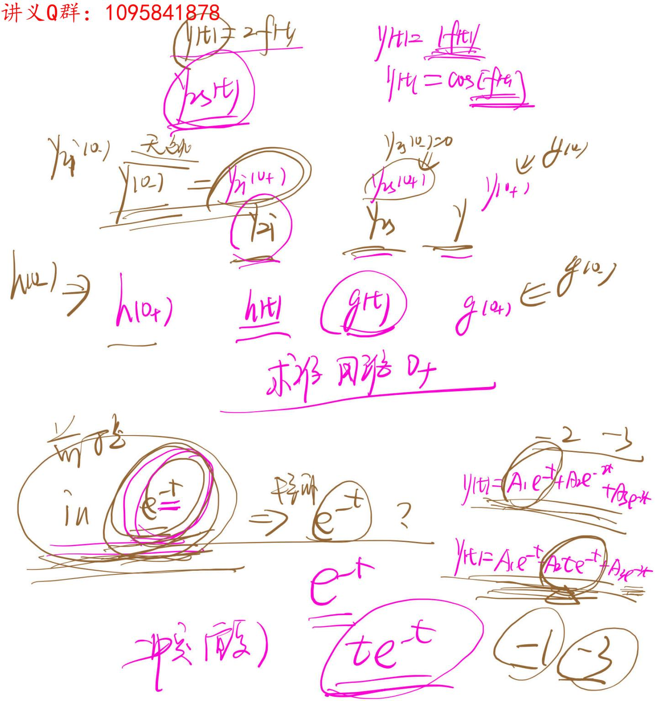

in $e^{-t}$ $\Rightarrow e^{-t}$ ? $y_{|t|=A_{1}e^{-t}+A_{2}e^{-x}+A_{3}e^{-x}}$ $y_{|t|=A_{1}e^{-t}A_{2}te^{-t}+A_{3}e^{-t}}$ $e^{-t}$ $te^{-t}$ -1-3

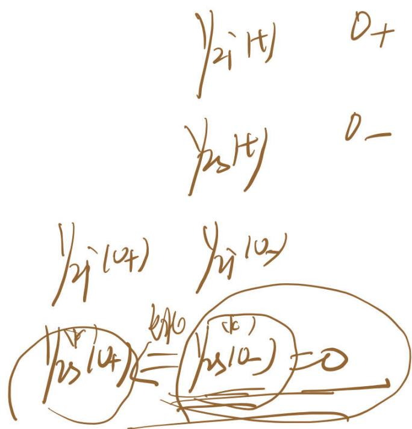