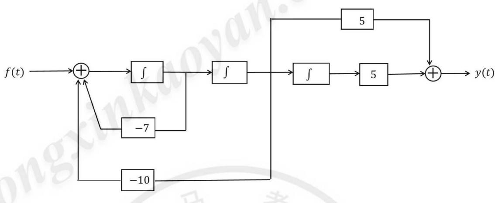

## 【第9节】课后作业

1、【2024 武汉工程大学 4.4】设系统输入信号为 $x(t)$ ，输出信号为 $y(t)$ ，因果LTI 系统的微分方程如下： $y''(t) + \frac{3}{2} y'(t) + \frac{1}{2} y(t) = 5x(t)$ ，已知 $y(0^-) = 1$ ， $y'(0^-) = 0$ ， $x(t) = e^{-3t}u(t)$ ，求：

(1) 求零输入响应 $y_{zi}(t)$ ;

(2) 求零状态响应 $y_{zs}(t)$ ;

(3) 求全响应 $y(t)$ 。

2、【2024 中山大学 7.2】已知连续时间因果系统

设初始 $y''(0_{-})=5,\quad y'(0_{-})=-1,\quad y(0_{-})=1$ ，输入为 $3e^{-t}u(t)$ ，求零输入响应 $y_{zi}(t)$ ，零状态响应 $y_{zs}(t)$ ，全响应 $y(t)$ 。

夢馬考研

B站up: 信号与系统\_谷哥

公众号：通信考研小马哥

3、【2024重庆大学6.2】已知某LTI系统, $y''(t)+5y'(t)+6y(t)=x''(t)+3x'(t)+$

$2x(t)$ ，已知 $x(t) = 3(1 + e^{-t})u(t)$ ，其中全响应 $y(t) = (4e^{-2t} + 3e^{-3t} + 1)u(t)$

求：求 $y(0^{-})$ ， $y'(0^{-})$ 。（请用时域方法求解）

