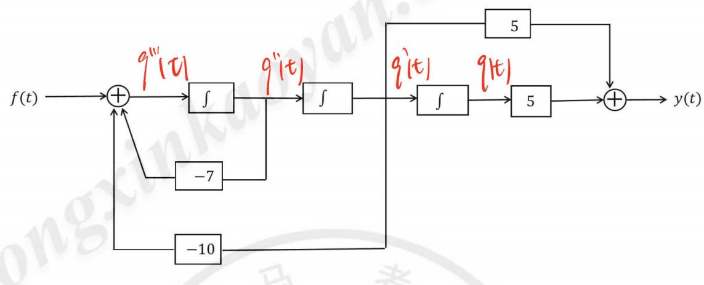

## 【第9节】课后作业

1、【2024 武汉工程大学 4.4】设系统输入信号为 $x(t)$ , 输出信号为 $y(t)$ , 因果LTI 系统的微分方程如下: $y''(t) + \frac{3}{2} y'(t) + \frac{1}{2} y(t) = 5x(t)$ , 已知 $y(0^-) = 1$ , $y'(0^-) =$

0, $x(t) = e^{-3t}u(t)$ , 求:

(1) 求零输入响应 $y_{zi}(t)$ ;

(2) 求零状态响应 $y_{zs}(t)$ ;

(3) 求全响应 $y(t)$ 。

解: $\alpha^{2}+\frac{3}{2}\alpha+\frac{1}{2}=(\alpha+1)(\alpha+\frac{1}{2})=0$ $\alpha_{1}=-1, \quad \alpha_{2}=-\frac{1}{2}$

(1) $y_{2i}|t| = Ae^{-t} + Be^{-\frac{1}{2}t}$ $y_{2i}(t+1) = y_{10-1} = A + B = 1$ $y_{2i}(t+1) = y_{10-1} = -A - \frac{1}{2}B = 0 \Rightarrow \begin{cases} A = -1 \\ B = 2 \end{cases}$ $\therefore y_{2i}(t) = (-e^{-t} + 2e^{-\frac{1}{2}t})u(t)$ (2) $y_{2sh}(t) = Ce^{-t} + De^{-\frac{1}{2}t}$ $5x(t) = 5e^{-3t}u(t)$ 自由项 $t > 0$ 时自由项 $= 5e^{-3t}$ ，故 $y_{2xp}(t) = Ee^{-3t}$ $9Ee^{-3t} - \frac{9}{2}Ee^{-3t} + \frac{9}{2}e^{-3t} = 5e^{-3t}$ E = 1 $y_{xp}(t) = e^{-3t}$ $y_{x}(t) = Ce^{-t} + De^{-\frac{1}{2}t} + e^{-3t}$ 自由项中无 $\delta(t)$ 或 $\delta(t)$ 参际项，故无初始化

即 $y_{x}(t+1) = y_{x}(t-1) = C + D + 1 = 0$ $y'_{x}(t+1) = y'_{x}(t-1) = -C - \frac{1}{2}D - 3 = 0$ $\Rightarrow C = -5, D = 4$ $\Rightarrow y_{x}(t) = (-5e^{-t} + 4e^{-\frac{1}{2}t} + e^{-3t})u(t)$

$$
\begin{array}{r l} {(3)} & {y | t | = y _ {2 i} | t | + y _ {x} | t |} \\ & {= (- 6 e ^ {- t} + 6 e ^ {- \frac {1}{2} t} + e ^ {- 3 t}) (u | t)} \end{array}
$$

官网：www.tongxinkaoyan.com

梦马班作业

B站up: 信号与系统\_谷哥

公众号：通信考研小马哥

2、【2024 中山大学 7.2】已知连续时间因果系统

设初始 $y''(0_{-})=5,\quad y'(0_{-})=-1,\quad y(0_{-})=1$ ，输入为 $3e^{-t}u(t)$ ，求零输入响应 $y_{zi}(t)$ ，零状态响应 $y_{zs}(t)$ ，全响应 $y(t)$ 。

解:设中间度量9(10),如图示

$$
\begin{array}{r l} {q ^ {\prime \prime} (t)} & {= f (t) - 7 q ^ {\prime \prime} (t) - 1 0 q ^ {\prime} (t) \Rightarrow f (t) = q ^ {\prime \prime} (t) + 7 q ^ {\prime \prime} (t) + 1 0 q ^ {\prime} (t)} \\ {y (t)} & {= 5 q (t) + 5 q ^ {\prime} (t)} \end{array}
$$

$\Rightarrow$ 微分方程为

$$
y ^ {\prime \prime} | t | + 7 y ^ {\prime \prime} | t | + 1 0 y | t | = 5 f | t | + 5 f | t |
$$

$$
\alpha^ {3} + 7 \alpha^ {2} + 1 0 \alpha = \alpha (\alpha^ {2} + 7 \alpha + 1 0) = \alpha (\alpha + 2) (\alpha + 5) = 0
$$

$$
\alpha_ {1} = 0, \alpha_ {2} = - 2, \alpha_ {3} = - 5
$$

$$
y _ {2 i} (t) = A _ {1} e ^ {0 t} + A _ {2} e ^ {- 2 t} + A _ {3} e ^ {- 5 t} = A _ {1} + A _ {2} e ^ {- 2 t} + A _ {3} e ^ {- 5 t}
$$

$$
y _ {2 1} (0 +) = y (0 -) = A _ {1} + A _ {2} + A _ {3} = 1
$$

$$
y _ {2 1} ^ {\prime} (v + 1) = y ^ {\prime} (v - 1) = - 2 A _ {2} - 5 A _ {3} = - 1
$$

$$
y _ {2 1} ^ {\prime \prime} (0 + 1) = y ^ {\prime \prime} (0) = 4 A _ {2} + 2 5 A _ {3} = 5
$$

$$
A _ {3} = \frac {1}{5}
$$

$$
y _ {i} (t) = (\frac {4}{5} + \frac {1}{5} e ^ {- 5 t}) u (t)
$$

官网：www.tongxinkaoyan.com

梦马班作业

$$
\begin{array}{r l} & {y _ {x h} (t) = B _ {1} + B _ {2} e ^ {- x t} + B _ {3} e ^ {- s t}} \\ & {5 f ^ {\prime} (t) + 5 f (t) = 5 [ - 3 e ^ {- t} u (t) + \sqrt [ 3 ]{t} ] + 1 5 e ^ {- t} u (t) = 1 5 \sqrt [ 3 ]{(t)}} \\ & {t > 0 \mathrm{时自由项} = 0 \Rightarrow \mathrm{元} y _ {x p} (t)} \\ & {y _ {x} (t) = B _ {1} + B _ {2} e ^ {- x t} + B _ {3} e ^ {- s t}} \\ & {\left\{ \begin{array}{l l} {y _ {x s} ^ {\prime \prime} (t) = a \delta (t) + b \Delta u (t)} & {\Rightarrow a = 1 5} \\ {y _ {x s} ^ {\prime \prime} (t) = a \Delta u (t)} & {\Rightarrow y _ {y s} ^ {\prime \prime} (0 +)} \\ {y _ {x s} ^ {\prime} (t) = a t \Delta u (t)} & {\Rightarrow y _ {v s} ^ {\prime} (0 +)} \end{array} \right. = y _ {v s} ^ {\prime} (0 -) = v} \end{array}
$$

和 $y_{x}(t)$ 在 t=0 处也连续 $y_{x}(2+) = y_{x}(2) = 0$

$$
y _ {B} (0 + 1) = B _ {1} + B _ {2} + B _ {3} = 0
$$

$$
y _ {x} (v + 1) = - 2 B _ {2} - 5 B _ {3} = 0
$$

$$
\begin{array}{l} {B _ {1} = \frac {3}{2}} \\ {B _ {2} = - \frac {5}{2}} \\ {B _ {3} = 1} \end{array}
$$

$$
y ^ {\prime} x (0 +) = 4 B _ {2} + 2 5 B _ {3} = 1 5
$$

$$
\therefore y _ {x} (t) = (\frac {3}{2} - \frac {5}{2} e ^ {- x t} + e ^ {- 3 t}) u (t)
$$

$$
y _ {| t |} = y _ {2 i} (t) + y _ {4 i} (t) = \left(\frac {2 3}{1 0} - \frac {5}{2} e ^ {- 2 t} + \frac {6}{5} e ^ {- 5 t}\right) u (t)
$$

B站up: 信号与系统\_谷哥

3、【2024重庆大学6.2】已知某LTI系统, $y''(t)+5y'(t)+6y(t)=x''(t)+3x'(t)+$

$2x(t)$ ，已知 $x(t) = 3(1 + e^{-t})u(t)$ ，其中全响应 $y(t) = (4e^{-2t} + 3e^{-3t} + 1)u(t)$

求：求 $y(0^{-})$ ， $y'(0^{-})$ 。（请用时域方法求解）

【解析】

由输入:

$$
x (t) = 3 \left(1 + e ^ {- t}\right) u (t)
$$

求一阶导：

$$
x ^ {\prime} (t) = 3 \delta (t) - 3 e ^ {- t} u (t) + 3 e ^ {- t} \cdot \delta (t) = 6 \delta (t) - 3 e ^ {- t} u (t)
$$

求二阶导：

$$
x ^ {\prime \prime} (t) = 6 \delta^ {\prime} (t) + 3 e ^ {- t} u (t) - 3 \delta (t) = 6 \delta^ {\prime} (t) + 3 e ^ {- t} u (t) - 3 \delta (t)
$$

则：

$$
\begin{array}{c} x ^ {\prime \prime} (t) + 3 x ^ {\prime} (t) + 2 x (t) = 6 \delta^ {\prime} (t) + 3 e ^ {- t} u (t) - 3 \delta (t) + 1 8 \delta (t) - 9 e ^ {- t t} u (t) + 6 (1 + e ^ {- t}) u (t) \\ = 6 \delta^ {\prime} (t) + 1 5 \delta (t) + 6 u (t) \end{array}
$$

设：

$$
\left\{ \begin{array}{c} y ^ {\prime} (t) = a \delta^ {\prime} (t) + b \delta (t) + c \Delta u (t) \\ y ^ {\prime} (t) = a \delta (t) + b \Delta u (t) \\ y (t) = a \Delta u (t) \end{array} \right.
$$

得到：

$$
\begin{array}{c} y ^ {\prime \prime} (t) + 5 y ^ {\prime} (t) + 6 y (t) = a \delta^ {\prime} (t) + b \delta (t) + c \Delta u (t) + 5 a \delta (t) + 5 b \Delta u (t) + 6 a \Delta u (t) \\ = 6 \delta^ {\prime} (t) + 1 5 \delta (t) + 6 u (t) \end{array}
$$

解得：

$$
\left\{ \begin{array}{c} a = 6 \\ b + 5 a = 1 5 \end{array} \right. \Rightarrow \left\{ \begin{array}{c} a = 6 \\ b = - 1 5 \end{array} \right.
$$

则：

$$
\left\{ \begin{array}{c} y (0 -) = y (0 +) - a = 8 - 6 = 2 \\ y ^ {\prime} (0 -) = y ^ {\prime} (0 +) - (- 1 5) = - 8 - 9 + 1 5 = - 2 \end{array} \right.
$$

梦马班作业

免费讲义Q群：1095841878