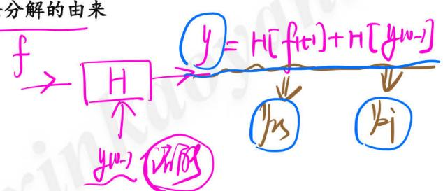

B站up: 信号与系统\_谷哥

公众号：通信考研小马哥

连续时间系统的双零法分析

(1) 经典法 $\rightarrow$ 非齐次方程的解形式为齐次解部分和特解部分;

y\_i 和 y\_2 式导

(2)双零法分解的由来

y(0)分明.关联

(3) 零输入响应求解流程

$$
\begin{array}{r l} {y _ {[ t ]}} & {= (x) + y _ {x ^ {\prime}}} \\ & {= H [ x _ {t} ] + H [ y _ {(x - 1)} ]} \\ & {- \mathrm{分为三}} \end{array}
$$

$$
\frac {3 \pi}{2}
$$

$$
y _ {2 1} ^ {(c)} (u _ {+}) = y _ {2 1} ^ {(c)} (u _ {-}) \mathrm{记好}
$$

(4) 零状态响应求解流程
3.1 时代

$$
y _ {x} ^ {(1)} (0 +) \stackrel {\mathrm{此}} {=} y _ {y} ^ {(k)} (u -) = 0
$$

二之间无量

$$
\begin{array}{r l} {\mathrm{eq:}} & {y (t) = f (t) y (0)} \\ & {= f (t) + y (0)} \\ & {y _ {x} \quad y _ {i}} \end{array}
$$

(5) 完全响应分解及关系

$$
\begin{array}{r l} {\mathrm{分解及关系}} & \\ {y _ {1 t 1}} & {= y _ {n} (t 1) + y _ {p} (t 1)} \\ & {= y _ {2 i} + y _ {2 n} (t 1) + y _ {2 p} (t 1)} \\ & {y _ {3}} \end{array}
$$

$$
y \vert t \vert = >? \text {   经理证   }
$$

各分量 $= 700$ 瓦/克

官网：tongxi nkaoyan. com

梦马班讲义

# 专题 4 LTIS下双零法的应用与求解

考点1: 边界条件对双零法的影响

(1)不同边界条件下双零法求解

$\left\{\begin{aligned}y^{(k)}(0_{-})&\Rightarrow y_{zi}(t)+\underline{y_{zs}}(t)=\underline{y(t)}\\ y^{(k)}(0_{+})&\Rightarrow\left\{\begin{aligned}y_{zs}(t)&\xrightarrow{解形式}y(t)\Rightarrow y_{zi}(t)=y(t)-y_{zs}(t)\\ y_{zi}(t)&含系数\Rightarrow y(t)=\underline{y_{zi}(t)含系数}+y_{zs}(t)\end{aligned}\right.\xrightarrow{y^{(k)}(0_{+})}y_{zi}(t)\Rightarrow y(t)\\\end{aligned}\right.$

(2)给0\_状态值，求解系统完全响应

例 20: 描述某LTI系统的微分方程为

$$
y ^ {\prime \prime} (t) + 3 y ^ {\prime} (t) + 2 y (t) = 2 f ^ {\prime} (t) + 6 f (t)
$$

$$
2 \sqrt {1 + 6 u (t)}
$$

本科如末项

已知 $y\left( {0}_{ - }\right)  = 2,{y}^{\prime }\left( {0}_{ - }\right)  = 1,f\left( t\right)  = u\left( t\right)$ ,求该系统的零输入响应、零状态响应和

全响应。

$$
y _ {i} (t) = A _ {1} e ^ {- t} + A _ {2} e ^ {- 2 t}
$$

$$
y _ {i} (u + 1) = y (u - 1) = A _ {1} + A _ {2} = 2
$$

$$
y _ {3} (t) = A _ {3} e ^ {- t} + A _ {4} e ^ {- 2 t} + 3
$$

$$
y _ {n} (0 + 1) = y _ {1} (0 - 1) = - A _ {1} - 2 A _ {2} = 1
$$

$$
y _ {x} ^ {\prime \prime} (t) = a d (t) + b u r e \Rightarrow a = 2
$$

$$
\Rightarrow A _ {1} = 5, A _ {2} = - 3
$$

$$
y _ {i s} ^ {\prime} (t) = a \Delta (1 + t) \Rightarrow y _ {i s} ^ {\prime} (0 + 1) = y _ {i s} ^ {\prime} (0 - 1) + a = 2
$$

$$
\Rightarrow y _ {2} (t) = \left[ 5 e ^ {- t} - 3 e ^ {- t} \right] u (t)
$$

$$
y _ {2 3} (t) = \cot \Delta (u (t)) \Rightarrow y _ {2 3} (u + 1) = y _ {3} (u) = 0
$$

(3) 给 ${0}_{ + }$ 状态值,求解系统完全响应:

例 21: 描述某LTI系统的微分方程为

$$
y ^ {\prime \prime} (t) + 3 y ^ {\prime} (t) + 2 y (t) = 2 f ^ {\prime} (t) + 6 f (t)
$$

若已知 $y(0_{+})=3$ , $y'(0_{+})=1$ , $f(t)=u(t)$ , 求该系统的零输入响应和零状态响

$$
\begin{array}{r l} {\mathrm{应。}} & {y (t) = A e ^ {- t} + B e ^ {- x t} + 3} \\ & {y (u +)} \\ & {y (u +)} \\ & {y _ {2 s}} \end{array}
$$

$$
\Rightarrow A \neq 0 B \Rightarrow y \text {   出   } 2 x = 0
$$

$$
y _ {1} + 1 - y _ {2} = y _ {2 i}
$$

官网：tongxi nkaoyan. com

梦马班讲义

[Signature]

线性
叶移
因果
成长

B站up: 信号与系统\_谷哥

x f y 公众号：通信考研小马哥

## 考点2: 线性时不变系统的补充认识

1、零状态响应与激励的简易表达式—十二字准则

2、微分方程LTIS判断—反证法

3、双零法视角下LTIS判断

(1)完全响应是零输入和零状态的线性组合，呈现可分解性；

$y(t)=f(x)$ x(0) $+\int_{0}^{t}f(x)dx$ 非线化

(2)仅与0\_状态相关的部分为零输入响应，其与0\_状态呈现线性；

(3)仅与激励相关的零状态响应与激励呈线性时不变。

例22: 某连续系统的全响应为 $y(t) = \lg f(0) + \int_{0}^{t} f(\tau) d\tau$ , 试判断线性时不变? $\Rightarrow$ 具有可分的性且 $y_{2i}(t) = \lg f(10)$ , $y_{2s}(t) = \int_{0}^{t} f(10) d\tau$

线性

$$
a _ {1} y _ {2 i, 1 (t)} + a _ {2} y _ {2 j _ {2} (t)} = a _ {1} \log f _ {(1 0)} + a _ {2} \log f _ {(1 0)}
$$

$$
H [ f (t - t _ {0}) ] = \int_ {0} ^ {t} f (t - t _ {0}) d t
$$

例23: 设系统的初始状态为 $x(0)$ , 激励为 $f(\cdot)$ , 各系统的全响应 $y(\cdot)$ 与激励和初始状态的关系如下, 试分析各系统是否是线性时不变的。

$$
y (t) = e ^ {- t} x (0) + \int_ {0} ^ {t} \sin x f (x) d x; \tag {1}
$$

$$
y _ {i} (t) = e ^ {- t} \lambda (1 0)
$$

$$
y (t) = \sin [ x (0) t ] + \int_ {0} ^ {t} f (x) d x
$$

$$
y _ {1} (t) = \sin [ x (1 0) t ]
$$

$$
y _ {x + 1} = \int_ {0} ^ {+} \sin x f (x) d x
$$

$$
y _ {\Delta} (t) = \int_ {0} ^ {t} f (x) d x
$$

$$
[ a _ {1} x _ {1 0}) + a _ {2} x _ {2 1 0}) ] t
$$

$$
a _ {1} \underline {{y _ {i , 1} (t)}} + a _ {2} \underline {{y _ {i , 2} (t)}} = a _ {1} \sin [ x _ {1 0} t ] + a _ {2} \sin [ x _ {2 0} t ]
$$

官网：tongxi nkaoyan. com

梦马班讲义

## 考点3: LTIS双零法视角下响应求解

原理：①零输入与初始状态呈线性关系 ②零状态与激励呈线性和时不变关系。

例24: 已知一线性时不变系统。在相同初始条件下, 当激励为 $e(t)$ 时, 其全响应为 $r_1(t) = [2e^{-3t} + \sin(2t)]u(t)$ ; 当激励为 $2e(t)$ 时, 其全响应为 $r_2(t) = [e^{-3t} + 2\sin(2t)]u(t)$ 。

$$
2 \sin (2 t) ] u (t) 。 \text {   求:   } + 2 0
$$

(1)初始条件不变，当激励为 $e(t-t_{0})$ 时的全响应 $r_{3}(t), t_{0}>0$ ;

(2)初始条件增大1倍，当激励为 $0.5e(t)$ 时的全响应 $r_{4}(t)$ 。

即：当输入为 $e(t)$ 时，令 $r_{1}(t)=r_{2}(t)+r_{3}(t)=[2e^{-3t}+\sin(2t)]u(t)$ 则相同初始条件输入为 $2e(t)$ 时， $|2(t)|=|6(t)|+2r_{3}(t)=[e^{-3t}+2\sin(2t)]u(t)$ ①②成立： $r_{3}(t)=[-e^{-3t}+\sin(2t)]u(t)$ $|6(t)|=3e^{-3t}u(t)$

(1) $B_{3}(t) = B_{1}(t) + B_{2}(t - t_{0}) = 3e^{-3t} u(t) + \left[ -e^{-3t(t - t_{0})} + \sin(2t(t - t_{0})) \right] u(t - t_{0})$ 例 25：某 LTI 连续系统，其初始状态一定，已知当激励为 $f(t)$ 时，其全响应为

$$
y _ {1} (t) = e ^ {- t} + \cos (\pi t), t \geq 0
$$

若初始状态不变，激励为 $2f(t)$ 时，其全响应为

$$
y _ {2} (t) = 2 \cos (\pi t), t \geq 0
$$

求初始状态不变而激励为 $3 f (t)$ 时, 系统的全响应。

求初始状
凑
线性.时不多

$$
y _ {1} (t) = y _ {2 i} + y _ {3 s}
$$

$$
y _ {2 1 + 1} = y _ {2 i} + 2 y _ {3}
$$

$$
y _ {3} + 1 = y _ {2 i} + 3 y _ {3} + 1
$$

$y_{2}$ 和 $y_{2}$ 求铁

$$
2 y _ {2 i} + b y _ {3} - y _ {2 i} - y _ {3}
$$

官网：tongxi nkaoyan. com

梦马班讲义

B站up: 信号与系统\_谷哥

例 26：某二阶 LTI 连续系统的初始状态为 $x_{1}(0)$ 和 $x_{2}(0)$ ，已知当 $x_{1}(0)=1, x_{2}(0)=0$ 时，其零输入响应为

$$
y _ {z i 1} (t) = e ^ {- t} + e ^ {- 2 t}, t \geq 0
$$

当 ${x}_{1}\left( 0\right)  = 0,{x}_{2}\left( 0\right)  = 1$ 时,其零输入响应为

$$
y _ {z i 2} (t) = e ^ {- t} - e ^ {- 2 t}, t \geq 0
$$

凑？

$$
x _ {1} (0) = 1, x _ {2} (0) = - 1
$$

$$
y (t) = 2 + e ^ {- t}, t \geq 0
$$

求当 ${x}_{1}\left( 0\right)  = 3,{x}_{2}\left( 0\right)  = 2$ ,输入为 ${2f}\left( t\right)$ 时的全响应。

①-② $\Rightarrow y_{2i1}(t)-y_{2i2}(t)$ 当 $x_{1}(0)=1, x_{2}(0)=-1$ 时的是 t 到

3 ① + 2 ② $x_{1}(0)=3, x_{2}(0)=0$ $x_{1}(0)=6, x_{2}(0)=2$ $x_{1}(0)=3, x_{2}(0)=2$ 代入 ③ 得 $f(t)$ 对应 $y_{2s}(t)=2+e^{-t}-2e^{-x}, t\geq0$ $3y_{2i1}^{(t)}+2y_{2i2}^{(t)}+2y_{2s}^{(t)}$

$$
\begin{array}{l}{\underline {{\angle T I S}}}\\{\left\{\begin{array}{l l}{\mathrm{③}}&{+ = \sqrt {- 2} \mathrm{则}}\\{\mathrm{过程}}&{\rightarrow \mathrm{反式层}}\\{\mathrm{双层}}&{1 3}\end{array}\right.}\end{array}
$$

官网：tongxi nkaoyan. com

梦马班讲义