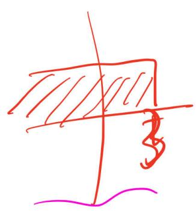
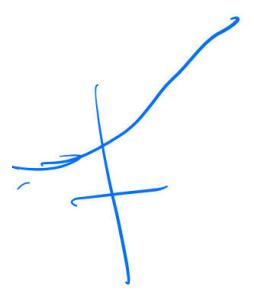

1. 经典段：3 工 2x 代 → 求的方差思路

原则：自由须牛或 ${d}^{n + 1} \Rightarrow  {缺}^{n}$ 及

$$
y ^ {\prime} | t | + 3 y ^ {\prime} | t | + 2 y ^ {\prime} | t | = \frac {\delta_ {t} ^ {\prime} (t) + 3 \delta_ {t} (t)}{2}
$$

y(t)包(a个d(t))

$$
y ^ {\prime} (t) = a \delta^ {\prime} (t) + b \delta^ {\prime} (t) + c \Delta (u t)
$$

$$
y ^ {\prime} (t) = a \delta (t) + b \Delta (t) \Rightarrow y ^ {\prime} (a + 1) = y ^ {\prime} (0 - 1) + b
$$

2-22 $\sqrt{14}$

只要走完状态后晴，该响应0\_值会为0

$\Rightarrow$ {2种新的响应} $\Rightarrow$ {关联的证明}
亲氏另外表达形式 $\Rightarrow$ 判断亲氏原理

A 干扰

$h(0-1) > 0$

B站up: 信号与系统\_谷哥

$$
\because t + 3 y ^ {\prime} + 1 + 2 y / t = f ^ {\prime} + 3 f + 1
$$

$\Leftrightarrow h^{(k)}(0+)$ 度 $\rightarrow$ 求 h(t)

方程 输入 $y_{(0,-1)}^{(k)}$ 值

专题5 冲激响应与阶跃响应

考点1: 冲激响应的求解

[h(t)表示系统]

1、定义

以单位冲激信号 $\delta(t)$ 作激励，系统产生的零状态响应称为“单位冲激响应”或简称

“冲激响应”，以 $h(t)$ 表示。

例 27: 已知某一LTI系统对激励 $e(t)$ 的零状态响应

非 常规方程.

$\frac{1}{2}$ 且 $= \frac{1}{2}$ 的性质

$$
r _ {z s} (t) = \int_ {t - 2} ^ {\infty} e ^ {t - \tau} e (\tau - 1) d \tau
$$

求该系统的单位冲激响应

$$
h (t) = \int_ {t - 2} ^ {\infty} e ^ {t - t} \delta (\tau - 1) d \tau
$$

$$
f (t) \delta (t - t _ {0}) = f (t _ {0}) \delta (t - t _ {0})
$$

的补贴

$$
\begin{array}{l} {- t + 1 \geq 0} \\ {- t \geq 3} \\ {t <   3} \end{array}
$$

$$
\frac {1 1 2 \sqrt {1 1 5}}{3} t <   3
$$

$$
\begin{array}{r l} & {= \int_ {t - 2} ^ {\infty} e ^ {t - 1} \delta (\pi - 1) d \tau} \\ & {= e ^ {t - 1} \int_ {t - 2} ^ {\infty} \frac {\delta (\pi - 1)}{\tau} d \tau = e ^ {t - 1} \frac {(u (\pi - 1))}{t - 2} \Bigg | _ {t - 2} ^ {\infty}} \\ & {\qquad = e ^ {t - 1} [ 1 - u (t - 3) ]} \end{array}
$$

2、经典法求解——微分方程表示系统

$$
= e ^ {t - 1} u (1 - t + 3)
$$

h(1)满包方程：

3跳代

$$
h (t) = A _ {1} e ^ {- t} + A _ {2} e ^ {- 2 t}
$$

$$
h ^ {\prime} (t) = a \sigma^ {\prime} (t) + b \sigma^ {\prime} (t) + c \Delta (u (t)) \Rightarrow a = 1, b + 3 a = 3 \Rightarrow b = 0
$$

$$
h ^ {\prime} (t) = a \delta (t) + b \Delta (m t) \Rightarrow h ^ {\prime} (a + 1) = h ^ {\prime} (0 - 1) + b = 0
$$

$$
\Rightarrow h (0 + 1) = A _ {1} + A _ {2} = 1
$$

$$
h (t) = a \Delta u (t) \Rightarrow h (u _ {+}) = h (u _ {-}) + a = 1
$$

$$
h (u + 1) = - A _ {1} - 2 A _ {2} = 0
$$

例28: 若激励为 $e(t)$ , 响应 $r(t)$ 的系统的微分方程由下式描述, 求系统的冲激响应 $h(t)$ 。 $\Rightarrow A_{1}=2, \quad A_{2}=-1$

$$
\frac {d r (t)}{d t} + 2 r (t) = 3 e (t)
$$

$$
\Rightarrow h (t) = (2 e ^ {- t} - e ^ {- 2 t}) / (1 1 t)
$$

$$
h (t) + 2 h (t) = 3 \sqrt {h (t)}
$$

$$
h (2 + 1) = A = 3
$$

$$
\frac {h (t) = A e ^ {- 2 t}}{h ^ {\prime} (t) = a d (t) + b \Delta h (t)} \Rightarrow a = 3 \Rightarrow h (t) = 3 e ^ {- 2 t} h (t)
$$

官网：tongxinkaoyan.com $\left\{\begin{array}{l} h(n)=n+1 \\ h(n)+1=a\Delta(n-n) \end{array}\right.\Rightarrow h(n+n)=h(n-1)+9=3$ 梦马班讲义易混 B站up: 信号与系统\_谷哥
冲级匹配式: 贝关注△U比前系数

考点2: 特殊情况下冲激函数匹配法的应用

例 29: 设 $h(t)$ 方程中, $h(t)$ 最高阶系数为 $n$ 阶, 激励 $\delta(t)$ 最高阶系数项为 $m$ 。

(1) $n > m$

$$
h ^ {\prime \prime} (t) + 3 h ^ {\prime} (t) + 2 h (t) = \delta^ {\prime} (t) + 3 \delta (t)
$$

$$
h _ {1 + 1} = A _ {1} e ^ {- t} + A _ {2} e ^ {- t}
$$

$$
h ^ {\prime} (t) = a d ^ {\prime} (t) + b d ^ {\prime} (t) + C \Delta h (t) \Rightarrow a = 1. b + 3 a = 3 \Rightarrow b = 0
$$

$$
h ^ {\prime} (t) = a d (t) + b \Delta u (t) \Rightarrow h ^ {\prime} (u _ {+}) = h ^ {\prime} (u _ {-}) + b = D
$$

$$
h (t) = a \Delta u (t + 1) \Rightarrow h (0 t) = h (0 - 1) + a = 1
$$

$$
y ^ {\prime} (t) + 3 y ^ {\prime} (t) + 2 y (t) = f ^ {\prime} (t) + 2 f (t) \Rightarrow h ^ {\prime \prime} (t) + 3 h ^ {\prime} (t) + 2 h (t) = \delta^ {\prime \prime} (t) + 2 \delta (t)
$$

$y^{\prime}(t+1)+3y^{\prime}(t)+2y(t)=f^{\prime}(t+1+2f(t))\Rightarrow$ $h(u+1)=A_{1}+A_{2}=-3$ $h^{\prime}(u+1)=-A_{1}-2A_{2}=9$ $\Rightarrow A_{1}=3,\quad A_{2}=-6$ $\Rightarrow h(t)=\left(3e^{-t}-6e^{-xt}\right)(u+t)+\delta(t)$ (3)n<m

$$
h _ {1 1} = A _ {1} e ^ {- t} + A _ {2} e ^ {- 2 t}
$$

$$
h ^ {\prime} (t) = a \delta^ {\prime} (t) + b \delta^ {\prime} (t) + c \delta^ {\prime} (t) + d \Delta w (t) \Rightarrow a = 1, b \neq 3 a = 0
$$

$$
\lambda^ {\prime} (t) = a \delta^ {\prime} (t) + b \delta^ {\prime} (t) + c \Delta h (t) \Rightarrow h ^ {\prime} (t + 1) = h ^ {\prime} (t - 1) + c = 9
$$

$$
h (t) = a \sqrt {h (t)} + b \Delta h (t) \Rightarrow h (1 0 t) = h (1 0 - 1) + b = - 3
$$

$$
h ^ {\prime \prime} (t) + 3 h ^ {\prime} (t) + 2 h (t) = \delta^ {\prime \prime \prime} (t) + 2 \delta (t)
$$

$$
\begin{array}{r l} {b + 3 a = 0} & {\Rightarrow b = - 3} \\ {c + 3 b + 2 a} & {= 0 \Rightarrow c - 9 + 2 \Rightarrow c = 7} \end{array}
$$

$$
h (t) = A _ {1} e ^ {- t} + A _ {2} e ^ {- 2 t}
$$

$$
h ^ {\prime \prime} (t) = a \sigma^ {\prime \prime} (t) + b \sigma^ {\prime \prime} (t) + c \sigma^ {\prime} (t) + d \sigma (t) + m \Delta u (t)
$$

$$
\begin{array}{r l} {h ^ {\prime \prime} (t)} & {= a \sigma^ {\prime} (t) + b \sigma^ {\prime} (t) + c \sigma (t) + d \sigma (t),} \\ {h ^ {\prime} (t)} & {= a \sigma^ {\prime} (t) + b \sigma^ {\prime} (t) + c \sigma (t) + d \Delta u (t) \Rightarrow h ^ {\prime} (a + 1) = h ^ {\prime} (a - 2) + d = - 1 3} \end{array}
$$

$$
h (t) = \cos^ {2} (t) + b \delta^ {\prime} (t) + c \Delta (u t) \Rightarrow h (u t) = h (u t) + c = 7
$$

$$
h (v _ {+}) = A _ {1} + A _ {2} = 7
$$

$$
h (a + 1) = - A _ {1} - 2 A _ {2} = - 1 3
$$

$$
\Rightarrow A _ {1} = 1, \quad A _ {2} = 6
$$

$$
\Rightarrow A _ {1} = 1, \quad A _ {2} = 0 \Rightarrow h (t) = (e ^ {- t} + 6 e ^ {- 2 t}) (n (t) + \delta (t) - 3 \delta (t))
$$

官网：tongxi nkaoyan. com

梦马班讲义

B站up: 信号与系统\_谷哥

公众号：通信考研小马哥

例 30: 已知某 LTI 系统, 若激励为 $e(t)$ , 响应 $r(t)$ 的系统的微分方程由下式描述, 求系统的冲激响应 $h(t)$ 。

$$
\frac {d r (t)}{d t} + 2 r (t) = \frac {d ^ {2} e (t)}{d t ^ {2}} + 3 \frac {d e (t)}{d t} + 3 e (t)
$$

写方程：

$$
\begin{array}{r l} & {h (t + 2 h (t) = \delta^ {\prime} (t) + 3 \delta^ {\prime} (t) + 3 \delta (t)) \mathrm{且} h (t ^ {2}) = 0} \\ & {h (t) = A e ^ {- 2 t}} \\ & {\left\{ \begin{array}{l l} {h ^ {\prime} (t) = a \delta^ {\prime} (t) + b \delta^ {\prime} (t)} & {+ C \delta (t) + d \Delta u (t)} \\ & {= b + 2 a - 3 \Rightarrow b = 1} \\ {h (t + 1) = a \delta^ {\prime} (t) + b \delta (t)} & {+ C \Delta u (t)} \\ & {= c + 2 b - 3 \Rightarrow c = 1} \end{array} \right.} \\ & {h (a + 1) = A = 1 \Rightarrow h (t + 1) = e ^ {- 2 t} u (t)} \\ & {+ \delta^ {\prime} (t) + \delta (t)} \end{array}
$$

$h_{1}|t|+2h_{1}|t)=\sqrt{h(t)}$ 线性 $h_{1}|t|$ 与 $h_{1}|t|$ 关系： $h_{1}|t|=Ae^{-2t}$ $h_{1}|t|=b\Delta u(t)=a=1$ $h_{1}|t)=a\Delta u(t)=b\Delta u(t)+a=1$ $h_{1}|t}=h_{1}|t|+3h_{1}|t)+3h_{1}|t)$ $\Rightarrow h_{1}(0+) = A = 1$ $\Rightarrow h_{1}|t| = e^{-2t}u(t)$ 【梦马班点拨】冲激函数匹配法与齐次法方法比较：

冲激函数匹配法：计算简单，解题的体系结构一致，但对于有默认冲激项时易忽视

齐次法：右边可始终保持 $\delta(t)$ 原型计算，不用考虑默认项，但线性时，需要计算各种微分。

官网：tongxi nkaoyan. com

梦马班讲义

B站up: 信号与系统\_谷哥

公众号：通信考研小马哥

## 考点3：阶跃响应的求解

## 1、定义

以单位阶跃信号 $u(t)$ 作激励 “阶跃响应”，以 $g(t)$ 表示。

9出也可表示系统

系统产生的零状态响应称为“单位阶跃响应”或简称 $g_{(0-1)}^{(k)} = 0$

2、阶跃响应的经典法求解

$9(n)$ 方程且 $in = (n+1), g'(2) = 0$

$\therefore {S}_{\Delta ACD} = {S}_{\Delta COD} + {S}_{\Delta BDO}$

g内

例 31: 描述某LTI系统的微分方程为

$$
\frac {d ^ {2} r (t)}{d t ^ {2}} + 5 \frac {d r (t)}{d t} + 6 r (t) = 3 \frac {d e (t)}{d t} + 2 e (t)
$$

$$
e H _ {1} = u H _ {1}
$$

试求其阶跃响应 $g(t)$ 。

试求其阶跃响应g(t)。
解: $g''(t) + 5g'(t) + 6g(t) = 30\sqrt{t+1} + 2u(t)$ 且 $g^{(k)}(t-1) = 0$ $g(t) = A_{1}e^{-2t} + A_{2}e^{-3t} + \frac{1}{3}$ $g''(t) = ad(t) + b\Delta u(t) \Rightarrow a = 3$ $g'(t) = a\Delta u(t) \Rightarrow g'(t+) = g'(t-1) + a = 3$ $g(t) = at\Delta u(t) \Rightarrow g(t+) = g(t-1) = 0$ $g(u+) = A_{1} + A_{2} + \frac{1}{3} = 0$ $g(u+) = -2A_{1} - 3A_{2} = 3$ $g(t) = (2e^{-t} - \frac{7}{3}e^{-3t} + \frac{1}{2})u(t)$ 官网: tongxi nkaoyan.com $A_{1} = 2$ $A_{2} = -\frac{7}{3}$ 梦马班讲义

B站up: 信号与系统\_谷哥

公众号：通信考研小马哥

例 32: 若激励为 $e(t)$ , 响应 $r(t)$ 的 LTI 系统的微分方程由下式描述, 求系统的阶跃响应 $g(t)$ 。

$eH_{1}=uH_{1}$

$1^{0}h(t)$ 和 $g(t)$

$$
\frac {d r (t)}{d t} + 2 r (t) = \frac {d ^ {2} e (t)}{d t ^ {2}} + 3 \frac {d e (t)}{d t} + 3 e (t)
$$

求解 和职责

$$
g ^ {\prime} (t + 1) + 2 g (t + 1) = \delta^ {\prime} (t + 1) + 3 \delta (t + 1) + 3 u (t + 1) \mathrm{且} g ^ {(k)} (0, 2) = 0
$$

$2^{0}h(t)$ 判断结论

$$
g (t) = A e ^ {- \pi} + \frac {3}{2}
$$

$$
\left(- \frac {1}{2} e ^ {- 2 t} + \frac {3}{2} + d (t)\right) (1 + t)
$$

$$
g ^ {\prime} (t) = a \delta^ {\prime} (t) + b \delta^ {\prime} (t) + c (\Delta (w t)) \Rightarrow a = 1, b + 2 a = 3
$$

$$
g (t) = a \delta (t) + b \Delta (u (t)) \Rightarrow g (u + 1) = g (u - 1 + b) = 1
$$

$$
g (u +) = A + \frac {3}{2} = 1 \Rightarrow A = - \frac {1}{2}
$$

3、LTIS下微积分求解法

$$
\Rightarrow g (t) = (- \frac {1}{2} e ^ {- i t} + \frac {3}{2}) n (t) + d (t)
$$

f(t)∠728
→H

由于单位阶跃函数 $u(t)$ 与单位冲激函数 $\delta(t)$ 的关系为

$y_{(t+1)} = H(E(t+1)) + y_{(t)}$

$$
\delta (t) = \frac {d u (t)}{d t}, u (t) = \int_ {- \infty} ^ {t} \delta (x) d x
$$

$U(t)$ $\sigma(t)$

$$
h (t) = \frac {d g (t)}{d t}, g (t) = \int_ {- \infty} ^ {t} h (x) d x
$$

$$
h (t) = 9 h
$$

$$
u ^ {\prime} (t) = o ^ {\prime} (t) \Rightarrow g ^ {\prime} (t) = h (t)
$$

h出 移号

例：若已知 $h\left( t\right)  = \left( {-{4e}^{-{2t}} + {7e}^{-{3t}}}\right) u\left( t\right)$

$$
g (t) = \int_ {- \infty} ^ {t} h (\tau) d \tau
$$

$$
\begin{array}{r l} & {\mathrm{若已知} h (t) = (- 4 e ^ {- 2 t} + 7 e ^ {- 3 t}) u (t)} \\ & {\therefore g (t) = \int_ {- \infty} ^ {t} h (\tau) d \tau = \int_ {- \infty} ^ {t} [ - 4 e ^ {- 2 \tau} + 7 e ^ {- 3 \tau} ] u (\tau) d \tau = \int_ {0} ^ {t} [ - 4 e ^ {- 2 \tau} + 7 e ^ {- 3 \tau} ] d \tau .} \\ & {= [ - 4 \int_ {0} ^ {t} e ^ {- 2 \tau} d \tau + 7 \int_ {0} ^ {t} e ^ {- 3 \tau} d \tau ] u (t) = [ - 4 \cdot \frac {e ^ {- 2 \tau}}{- 2} ] _ {0} ^ {t} + 7 \cdot \frac {e ^ {- 3 \tau}}{- 3} ] _ {0} ^ {t} ] u (t)} \\ & {= [ 2 (e ^ {- 2 t} - 1) - \frac {7}{3} (e ^ {- 3 t} - 1) ] u (t) = (2 e ^ {- 2 t} - \frac {7}{3} e ^ {- 3 t} + \frac {1}{3}) u (t).} \end{array}
$$

已知 $9(t)$ 求 $h(t)$

$$
\sqrt [ 3 ]{x _ {0} h (t)} \Rightarrow g (t) = \int_ {- b} ^ {t} h (t) d t
$$

$$
\Rightarrow h (t) = g ^ {\prime} (t) = - 2 e ^ {- x} u (t) + e ^ {- x} d (t) = - 2 e ^ {- x} u (t) + d (t)
$$

$$
\begin{array}{r l} {h (t)} & {= e ^ {- 2 \pi u (t)}} \\ {g (t)} & {= \int_ {- \infty} ^ {t} h (t) d t = \int_ {- \infty} ^ {t} e ^ {- 2 \pi u (t)} d t} \\ & {= \int_ {0} ^ {t} e ^ {- 2 \pi d t} \cdot u (t)} \end{array}
$$

公众号：通信考研小马哥

考点4: $h(t)$ 与 $g(t)$ 求解总结

→硬做

$h(t) \left\{ \begin{array}{l} \text { 非常规方程: 定义法 } \\ \text { 线性常系数微分方程 } \end{array} \right. \left\{ \begin{array}{l} \text { 经典法 } \\ \text { LT法 } \end{array} \right. \rightarrow h(t) \text { 有默认项 } \quad \text { 右 } \leqslant \text { 右 } \\ g(t) = \int_{-\infty}^{t} h(\tau) d\tau \text { [注意默认项] }$

例 33: 一因果性的LTI系统, 其输入、输出用下列微分一积分方程表示:

$$
\frac {d}{d t} r (t) + 5 r (t) = \int_ {- \infty} ^ {\infty} e (\tau) f (t - \tau) d \tau - e (t)
$$

其中 $f(t)=e^{-t}u(t)+3\delta(t)$ ，求该系统的单位冲激响应 $h(t)$ 。

$$
h ^ {(k)} (0) = 0
$$

$\int_{-10}^{10}\delta(t)f(t)dt=f(0)$

$$
= f (t) - \sqrt {t + 1} = e ^ {- \frac {t}{(1 + t) + 2 \sqrt {t + 1}}}
$$

$$
h (t) + 5 h (t) = e ^ {- \frac {t}{2} u (t) + 2 \sigma (t)}
$$

有格明

齐次部分 $h(H)=Ae^{-5t}$

$$
e ^ {- t} \Rightarrow B e ^ {- t}
$$

$$
- B e ^ {- t} + 5 B e ^ {- t} = e ^ {- t} \Rightarrow B = \frac {1}{4}
$$

$$
\begin{array}{r l} & {\Rightarrow h (t) = A e ^ {- 5 t} + \frac {1}{4} e ^ {- t}} \\ & {\quad h (t) = a \delta (t) + b \Delta (t) \Rightarrow a = 2} \\ & {\quad h (t) = a \Delta (t) \Rightarrow h (0 +) = h (0 -) + a = 2} \\ & {\quad h (0 +) = A + \frac {1}{4} = 2 \Rightarrow A = \frac {7}{4}} \\ & {\Rightarrow h (t) = (\frac {7}{4} e ^ {- 5 t} + \frac {1}{4} e ^ {- t}) (t)} \end{array}
$$

官网：tongxi nkaoyan. com

梦马班讲义

B站up: 信号与系统\_谷哥

考点 5: $h(t)$ 系统表示与应用

1、 $h(t)$ 可以表征系统

2、h(t)判断系统特性

(1)因果: $t < 0$ 时, $h(t) = 0$

(2) 稳定: $\int_{-\infty}^{\infty}|h(t)|dt<\infty$

公众号：通信考研小马哥

$2^{0}$ 充要层 $^{10}$ 互义层 $y_{4t}$ 与 $f_{4t}$ 的总长域 $h_{4t}$

例 34: 一LTI系统零状态响应 $y_{zs}(t)$ 与输入 $f(t)$ 关系为 $y_{zs}(t)=\int_{t-1}^{\infty}e^{2(t-\tau)}f(2-\tau)d\tau$ 。

(1)求 $h(t)$ ，判别是否为因果系统；

(2)该系统是否稳定?写出判别过程。

皮石后的拟解

$$
\begin{array}{r l} {\mathrm{解:(1)}} & {h (t + 1) = \int_ {t - 1} ^ {\infty} e ^ {2 (t - t)} \delta (2 - t) d t} \\ & {= \int_ {t - 1} ^ {\infty} e ^ {2 (t - t)} \sqrt {\tau^ {\mathrm{的公式}}}} \\ & {= \int_ {t - 1} ^ {\infty} e ^ {2 (t - 2)} \delta (\tau - 2) d \tau} \\ & {= e ^ {2 (t - 2)} \int_ {t - 1} ^ {\infty} \delta (\tau - 2) d \tau} \\ & {= e ^ {2 (t - 2)} \left. u (\tau - 2) \right| _ {t - 1} ^ {\infty}} \\ & {= e ^ {2 (t - 2)} [ 1 - u (\tau - 3) ]} \\ & {= e ^ {2 (t - 2)} u (- t + 3)} \\ & {\mathrm{在} t <   0 \mathrm{时} h (t + 1) \neq 0 \Rightarrow 2 D O \mathrm{果}} \\ & {= e ^ {- 4} \cdot \frac {1}{2} e ^ {2 t} / _ {- \infty} ^ {3}} \\ & {= e ^ {- 4} \cdot \frac {1}{2} [ e ^ {6} - 0 ]} \\ & {\mathrm{梦马班讲义}} \\ & {\mathrm{官网:tongxinkaoyan.com}} \end{array}
$$

被做(不管35比例)

一、非常规方程
常规方程：3 ð 90 ò [右 ≤ 右] 美大项
10 ÷ 90 美大项 [ ⊥ 很大于下限]

$$
2 ^ {0} g (t) = \int_ {- \infty} ^ {t} h (\pi x) \pi
$$

$30^{\circ}$ 时 $t<0$ 时 $h(t)>0$ 设 $\text{定} \int_{-\infty}^{\infty} |h(t)| \, dt < \infty$

$$
h (t) = e ^ {- 2 t} (u (t))
$$

$$
h (t) = e ^ {- 2 t} u (t - 1)
$$

$$
\int_ {- \infty} ^ {t} e ^ {- 2 \tau} u (\tau - 1) d \tau
$$

官网：tongxi nkaoyan.com

梦马班讲义