第2章 违续时间系统时域分析 (学习脉络)

1. 经典法

3.5. 如图 $\Rightarrow$ 的主程思路

2. $0_{-} \rightarrow 0_{+}$ 出度

定义 $\left\{\begin{array}{l}y_{i}:3 \text{代} \\ y_{2i}:3.5 \text{代} \end{array}\right.$ $y_{i}(x)(0)=0$

diture 穷状态范畴

$$
\begin{array}{r l} {h (t)} & {= 3 \mathrm{即式}} \\ {g (t)} & {= \int_ {- \infty} ^ {t} h (\tau) d \tau} \end{array}
$$

核心领
求响应
分析导性
h(t-1)

$y_{2i}(4)$ 愿 $-y_{2i}(0)$ $y_{2i}(4)$ c注意事项：

1° 求推用谁 0+ 值，由自己 0- 米距离

$2^{0}$ 冲激函数匹配公共关系 $(\Delta u_{1}+u_{2})$ 前系数法 (微度量)

方程表示求
用过程求响应
h由表示求
h由用象求响应

3° 涉及脉的响应均有可能包含(1)或各所引发

自前眼 $y_{23}$ it = $\delta$ it + ... $y_{23}$ it = $\delta$ it $y_{23}$ it = $\delta$ it

$$
y ^ {\prime} (t) + 3 y ^ {\prime} (t) + 2 y (t) = f ^ {\prime} (t) + 3 f (t)
$$

## 专题6 卷积性质及其系统表示

考点1: 卷积定义及衍生

信号 $f_{1}(t)$ 和 $f_{2}(t)$ ，卷积运算定义为 $f(t)=f_{1}(t)*f_{2}(t)=\int_{-\infty}^{\infty}f_{1}(\tau)f_{2}(t-\tau)d\tau$

(1)卷积过程的体现
具体
t → t
t → t-τ
对τ取 $f_{-∞}^{∞}$ 积分

对t取 $f_{-t0}^{\infty}$ 积分

例如： $f_{\bullet}(t)*\delta(t)=\int_{-\infty}^{\infty}f(t)-\delta(t-t)d\tau=\frac{f_{1}(t)}{f(t)}$ [卷3也直卷]

(2) 卷积一致性 $f(t)=f_{1}(t)\times f_{2}(t)=\int_{-\infty}^{+\infty}f_{1}(t)\cdot f_{2}(t-t)d\overline{t}$ 左右却是关于七函数

左右七贝具一致性

$f_{1}$ 次
横 $\angle$ ① $\frac{f_{1} \times f_{2} \text{求实数}}{d\lambda t=2 \text{时求} f(2)}$ (3) 卷积的逆向还原

找t
找t-t

$\int_{-\infty}^{\infty} f_{1}(\tau) f_{2}(2-\tau) d\tau$ 动

点

种情况

1) 辨识原信号:

2) 逆向还原:

$$
\begin{array}{r l} {f _ {1} (t) \times f _ {2} (t)} & {= \int_ {- \infty} ^ {\infty} f _ {1} (t) \cdot f _ {2} (t - t) d t} \\ & {\Rightarrow \int_ {- \infty} ^ {\infty} f _ {1} (t) \cdot f _ {2} (t - t) d t = f _ {1} (t) \times f _ {2} (t)} \\ & {\mathrm{求积分}} \end{array}
$$

国泰君安顾问
来华普洱时间

$$
\begin{array}{r l} {\mathrm{eg:}} & {\int_ {0} ^ {\infty} f _ {1} (t - 2) \cdot f _ {2} (t - t) d t} \\ & {= \int_ {- \infty} ^ {\infty} f _ {1} (t - 2) f _ {2} (t - t) \frac {u (t)}{t + t} d t} \\ & {= f _ {1} (t - 2) (u (t) \times f _ {2} (t))} \end{array}
$$

$$
\begin{array}{r l} {\mathrm{eq:}} & {\int_ {- \infty} ^ {\infty} f _ {1} (t - 2) f _ {2} (t - t) d t} \\ & {= \int_ {- \infty} ^ {\infty} f _ {1} (t - 2) f _ {2} (t - t) \frac {u (t - 1)}{\mathrm{令})} d t} \\ & {= f _ {1} (t - 2) u (t - 1) * f _ {2} (t)} \end{array}
$$

$$
\begin{array}{r l} {\mathrm{eg:}} & {\int_ {- \infty} ^ {\infty} f (\tau - 2) \cdot e ^ {\tau - t} u (t - \tau) d \tau} \\ & {= f (t - 2) * e ^ {- t} u (t)} \\ & {\int_ {- \infty} ^ {\infty} f (\tau - 2) e ^ {\tau - t} u (\tau) u (t - \tau) d \tau} \\ & {= f (t - 2) u (t) * e ^ {- t} u (t)} \\ & {\quad \mathrm{eg} _ {1}: e ^ {- x t} u (t) * u (t) = \int_ {- \infty} ^ {\infty} e ^ {- 2 \tau} u (\tau) \underbrace {u (t - \tau)} _ {\mathrm{梦马班讲义}} d \tau} \\ & {= [ \int_ {0} ^ {t} e ^ {- x \tau} d \tau ] u (t)} \end{array}
$$

免费讲义Q群：1095841878

$$
d \tau = \int_ {- \infty} ^ {\infty}
$$

$$
\frac {u (\tau - \mathrm{下限})}{\mathrm{补}} d \tau
$$

$$
d \tau = \int_ {- \infty} ^ {\infty}
$$

$$
\frac {u (\mathrm{上限} - \tau)}{\mathrm{补}} d \tau
$$

$$
\begin{array}{r l} {\underline {{y _ {2 s} (t)}} = f (t) * h (t)} & {\xlongequal {\frac {1 3}{1 0}} \int_ {- \infty} ^ {\infty} f (\pi) \cdot e ^ {t - \tau} u (t - \tau) d \tau} \\ & {\Rightarrow \underline {{h (t)}} = ? \quad e ^ {t} u (t)} \end{array}
$$

B站up: 信号与系统\_谷哥

考点2: 卷积应用与系统表示

(1)零状态响应的求解

$$
\begin{array}{c}\text {公众号：通信考研小马哥}\\\text {公式：}\\\text {通} [ f (t) ] = H [ f (t) ]\\\text {式} [ t ] \rightarrow \boxed {2 T I S}\\\text {式} [ t - t ] \rightarrow \boxed {h (t)}\\\text {式} [ t - t ] \rightarrow \boxed {h (t - t)}\end{array}
$$

系统零状态响应=激励与单位冲激响应之卷积，即

$$
y _ {2 s} (t) = f (t)
$$

\*h(t)

$$
\xrightarrow {f (t)} \boxed {h (t)} \xrightarrow {y (t)} = f (t) * h (t)
$$

证明过程:

$f(t) \times (-t) = f(t)$

$$
\begin{array}{r l} {y _ {\mathrm{s}} (t)} & {= H [ f (t) ] = H [ f (t) * \delta (t) ] = H [ \int_ {- \infty} ^ {\infty} f (\tau) \cdot \delta (t - \tau) d \tau ]} \\ & {= \int_ {- \infty} ^ {\infty} f (\tau) H [ \delta (t - \tau) ] d \tau} \\ & {= \int_ {1 0} ^ {\infty} f (\tau) \cdot h (t - \tau) d \tau} \\ & {= f (t) * h (t)} \end{array}
$$

(2)冲激响应的求解

例 39: 求以下两个系统的单位冲激响应

$$
y (t) = \int_ {t - 2} ^ {\infty} e ^ {t - \tau} f (\tau - 1) d \tau \tag {1}
$$

$$
y (t) = f (t) \times h (t) = \int_ {- \infty} ^ {\infty} e ^ {t - t} f (t - 1) u [ t - (t - 2) ] d t
$$

定义

$$
\begin{array}{r l} {\int_ {- \infty} ^ {\infty} f (t) h (t - t) d t} & {= \int_ {- b} ^ {\infty} f (t - 1) \cdot e ^ {t - t} u [ - (t - t) + 2 ] d t} \\ {\tau - 1 = a} & {= \int_ {- b} ^ {\infty} f (a) e ^ {t - a - 1} u [ - (t - a - 1) + 2 ] d t} \\ {\tau = a + 1} & {\Rightarrow h (t) = e ^ {t - 1} u (- t + 3)} \\ {(2) y (t) = \int_ {- \infty} ^ {t - 1} e ^ {\lambda - t} f (\lambda - 1) (t - \lambda) d \lambda} \end{array}
$$

$$
\begin{array}{r l} {h (t)} & {= \int_ {t - 2} ^ {\infty} e ^ {t - \tau} \delta (\tau - 1) d \tau} \\ & {= \int_ {t - 2} ^ {\infty} e ^ {t - 1} \delta (\tau - 1) d \tau} \\ & {= e ^ {t - 1} \int_ {t - 2} ^ {\infty} \frac {\delta (\tau - 1) d \tau}{\tau}} \\ & {= e ^ {t - 1} u (\tau - 1) / _ {t - 2} ^ {\infty}} \\ & {= e ^ {t - 1} [ 1 - u (t - 3) ]} \end{array}
$$

$$
\begin{array}{r l} & {= \int_ {- b} ^ {b} e ^ {\lambda - t} f (\lambda - 1) (t - \lambda) u (t - 1 - \lambda) d \lambda} \\ & {= f (t - 1) * t e ^ {- t} u (t - 1)} \\ & {\Rightarrow h (t) = (t - 1) e ^ {- (t - 1)} u (t - 2)} \\ & {\qquad \qquad \qquad \qquad \qquad \qquad \qquad \qquad \qquad \qquad \qquad \qquad \qquad \qquad \qquad \qquad \qquad \qquad \qquad \qquad \qquad \qquad \qquad \qquad \qquad \qquad \qquad \qquad \qquad \qquad \qquad \qquad \qquad \qquad \mathrm{t-t→t}} \end{array}
$$

$$
f (t - 1) * e ^ {t} u (- t + 2) = e ^ {t - 1} u (- t + 3)
$$

后速

$$
\begin{array}{r l} {f _ {1} (t) \times f _ {2} (t - t _ {0})} & \\ {= f _ {1} (t - t _ {0}) \times f _ {2} (t)} & \end{array}
$$

$$
\int_ {- \infty} ^ {\infty} e ^ {\tau - t} f (\tau - v) (t - \tau) u (t - 1 - \tau) d \tau
$$

$$
\mathrm{分家} \quad f (t - 1) e ^ {- t} t \cdot u (t - 1)
$$

梦马班讲义

## 考点3: 卷积的代数性质(LTIS系统下可用)

1、交换律

2、结合律与系统结构

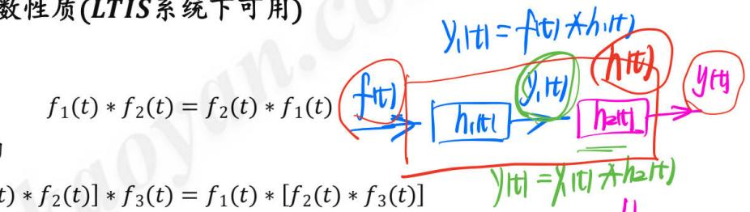

结合律用于系统分析, 相当于串联系统的冲激响应, 等于组成串联系统的各子系

统冲激响应的卷积，如图所示。

$y(t) = f^{-1}(t) \times h_1(t) \times h_2(t)$

$$
e (t) \longrightarrow \boxed {h _ {1} (t)} \longrightarrow \boxed {h _ {2} (t)} \longrightarrow r (t) = e (t) * [ h _ {1} (t) * h _ {2} (t) ]
$$

串联系统的 $h(t)=h_{1}(t)*h_{2}(t)$

3、分配律与系统结构

$$
f _ {1} (t) * [ f _ {2} (t) + f _ {3} (t) ] = f _ {1} (t) * f _ {2} (t) + f _ {1} (t) * f _ {3} (t)
$$

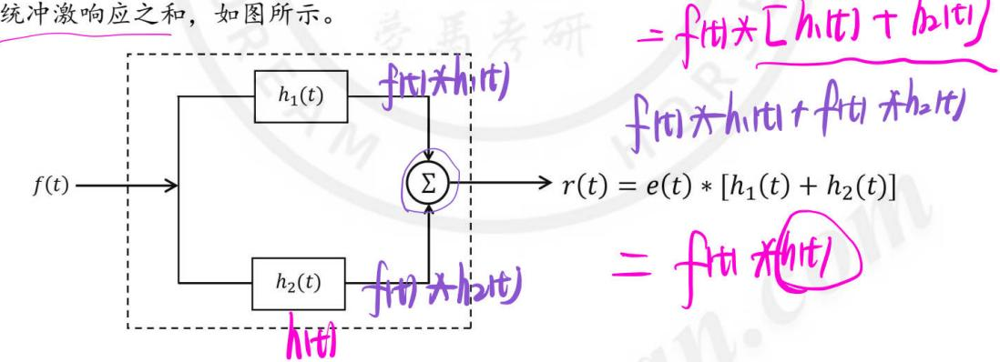

并联系统的 $h(t)=h_{1}(t)+h_{2}(t)$

【混连结构】

左右上下

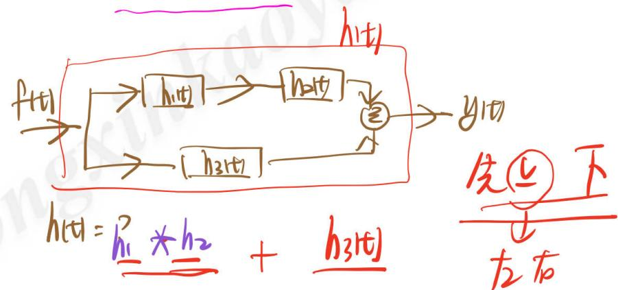

官网：tongxi nkaoyan. com

$$
h _ {1} + 1 = h _ {1} + 1 \times h _ {2} + 1 + h _ {3} + 1)
$$

梦马班讲义

B站up: 信号与系统\_谷哥

公众号：通信考研小马哥

$$
f _ {1} (t) * f _ {2} (t) = \int_ {- t _ {0}} ^ {t _ {0}} f _ {1} (t) f _ {2} (t - t _ {0}) d t
$$

考点4: 卷积的表达式求解法——借助于 $u\left( t\right)$ 缩小积分限

1、基于表达式法的卷积正向求解

例36：设 $f_{1}(t) = 3e^{-2t}u(t)$ ， $f_{2}(t) = 2u(t)$ ，求卷积积分 $f_{1}(t)*f_{2}(t)$ 。

默认t>0⇒u(t)

$$
\begin{array}{r l} {f _ {1} (t) \times f _ {2} (t)} & {= \int_ {- \infty} ^ {\infty} 3 e ^ {- 2 \tau} u (\tau) = 1. 2 u (t - \tau) d \tau} \\ & {= [ \int_ {0} ^ {t} 3 e ^ {- 2 \tau} \cdot 2 d \tau ] \cdot u (t)} \\ & {= 6 \cdot (- \frac {1}{2}) e ^ {- 2 \tau} / _ {0} ^ {t} \cdot u (t)} \\ & {= - 3 (e ^ {- x t} - 1) u (t) = 3 (1 - e ^ {- x t}) u (t)} \end{array}
$$

例37: 已知某线性时不变系统的冲激响应 $f(t)=u(t-1)$ ，利用卷积求系统对输入 $f(t)=e^{-3t}u(t)$ 的零状态响应 $y(t)$ 。 $f_{1}*f_{2}$

设： $f_{1}(t) \times f_{2}(t)$

已认证项 t-1 > 0

$$
\Rightarrow u (t - 1)
$$

$$
\begin{array}{r l} & {= \int_ {- \infty} ^ {\infty} e ^ {- 3 \tau} u (t) \cdot u (t - \tau - 1) d \tau} \\ & {= [ \int_ {0} ^ {t - 1} e ^ {- 3 \tau} d \tau ] u (t - 1)} \\ & {= - \frac {1}{3} e ^ {- 3 \tau} / _ {0} ^ {t - 1} u (t - 1) = - \frac {1}{3} [ e ^ {- t - 1} ] d \tau} \end{array}
$$

同时用 $t > 0$ $t - t - 1 > 0$ $\Rightarrow 0 < t < t - 1$

例 38: 求下列函数的卷积积分 $f_{1}(t) * f_{2}(t)$ 。

$$
f _ {1} (t) = t u (t), f _ {2} (t) = u (t) - u (t - 2)
$$

$$
\begin{array}{r l} {f _ {1} (t) * f _ {2} (t)} & {= \int_ {- \infty} ^ {\infty} \tau u (t) [ u (t - \tau) - u (t - \tau - 2) ] d \tau} \\ & {= \int_ {- \infty} ^ {\infty} \tau u (\tau) \cdot u (t - \tau) d \tau - \int_ {- \infty} ^ {\infty} \tau u (\tau) u (t - \tau - 2) d \tau} \\ & {= [ \int_ {0} ^ {t} \tau d \tau ] u (t)} \\ & {= [ \int_ {0} ^ {t ^ {2}} \tau d \tau ] u (t - 2)} \\ & {= \frac {t ^ {2}}{2} u (t) - \frac {| t - 2 | ^ {2}}{2} u (t - 2)} \end{array}
$$

官网：tongxi nkaoyan. com

梦马班讲义

B站up: 信号与系统\_谷哥

(3) $f_{1}$ 和 $f_{2}$ 图 $\Rightarrow f_{1} \times f_{2}$

考点5：卷积求解：图解法——借助于信号相乘运算

动

1、原理：两个信号的相乘

2、步骤

(1)更换自变量

$$
f _ {1} (t) \rightarrow f _ {1} (\tau), f _ {2} (t) \rightarrow f _ {2} (\tau)
$$

(2)反转移位

$$
f _ {2} (\tau) \xrightarrow {\text { 反转 }} f _ {2} (- \tau) \xrightarrow {\text { 移项 }} f _ {2} (t - \tau)
$$

(4)每种相交情况下的积分

$$
f _ {1} (\tau) \cdot f _ {2} (t - \tau)
$$

求3

(3)相乘，只关注时域有相交的情况

$$
\int_ {- \infty} ^ {\infty} f _ {1} (\tau) \cdot f _ {2} (t - \tau) d \tau
$$

例 40: 已知 $e(t)$ 和 $h(t)$ 图形，求 $e(t) * h(t)$ 。

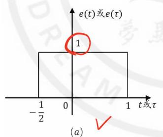

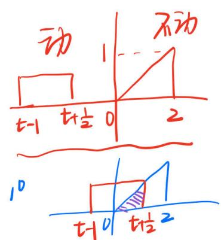

9:

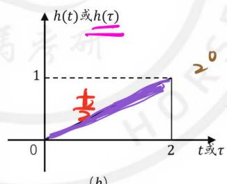

$t+\frac{1}{2}\geq0$ 且t-1<0

取之象 $\Rightarrow$ 长周密小

$$
\Rightarrow - \frac {1}{2} \leq t <   1
$$

$$
\begin{array}{r l} & {= \int_ {0} ^ {t + \frac {1}{2}} \frac {\tau}{2} \cdot 1 d \tau} \\ & {= \frac {t ^ {2}}{4} + \frac {t}{4} + \frac {1}{1 6}} \end{array}
$$

$\int_{- \infty} ^ { \infty } h ( t ) \cdot e ( t - t ) d t$ .

$$
f _ {2} (t - \tau)
$$

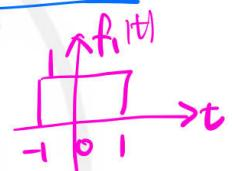

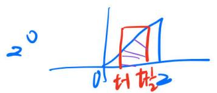

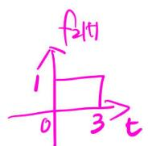

$$
\begin{array}{r l} {t + 3 0} & {t + \frac {1}{2} <   2} \\ {\Rightarrow 1 \leq t} & {<   \frac {3}{2}} \end{array}
$$

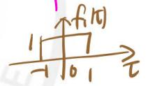

$$
\frac {1}{9} \sqrt {\frac {f _ {2} (t)}{3}} =
$$

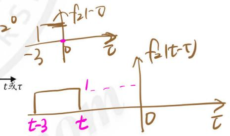

$$
\int_ {t - 1} ^ {t + \frac {1}{2}} \frac {\pi}{2} \cdot 1 d \pi = 4 ^ {3} t - \frac {3}{1 6}
$$

$$
\int_ {- \infty} ^ {\infty} h (\tau) e (\tau - \tau) d \tau =
$$

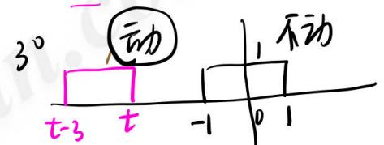

$$
t - 1 \leq 2, t + \frac {1}{2} \geq 2
$$

有几种特点情况

$$
1 ^ {0} t \leq t <   1
$$

$$
\frac {3}{2} \leq t \leq 3 ^ {5}
$$

公众号：通信考研小马哥

${f}_{1}\left( t\right)  * {f}_{2}\left( t\right)  =$

${f}_{1}\left( \pi \right) \;{f}_{2}\left( \pi \right)$

$$
2 ^ {0} \begin{array}{l} t \geq 1 \\ t - 3 <   - 1 \end{array}
$$

官网: $^{2}$ tongxi nkaoyan.com

$$
\int_ {- 1} ^ {t} | x | d \tau = t + 1
$$

$$
1 \leq t <   2 \int_ {- 1} ^ {1}
$$

$$
t - 3 - 1 \quad 0. 1 t
$$

$$
1 2 \frac {t}{2} \cdot 1 d t = - \frac {t ^ {2}}{4} + \frac {t}{2} + \frac {3}{4} - 1 \leq t - 3 \leq 1
$$

$$
1 \times 1 d \tau = 2
$$

梦马班讲义
-15301t

B站up: 信号与系统\_谷哥

$$
2 \le t \le 4
$$

B. 平台

$$
\begin{array}{r l} & {\mathrm{公众号:通信考研小马哥}} \\ & {\int_ {t - 3} ^ {1} 1 \times 1 d t = 1 - (t - 3)} \\ & {= 4 - t} \end{array}
$$

3、卷积点值的求解—求两信号卷积后在某一点的函数值：

$$
f (6) = \frac {f (t)}{t = 6} = \frac {f _ {1} (t) * f _ {2} (t)}{t = 6}
$$

$$
f _ {1} * f _ {2} = \left\{ \begin{array}{l l} t + 1, & - 1 \leq t <   1 \\ 2, & 1 \leq t <   2 \end{array} \right.
$$

【梦马班点拨】解题思路：左右均关于 $t$ 的函数,因此左右 $t$ 具有一致性,即 $- t,\;{2t} \leq  4$

$f(6)=\int_{-\infty}^{\infty}f_{1}(\tau)f_{2}(6-\tau)d\tau$ ，该积分等于 $f_{1}(\tau)$ 和 $f_{2}(6-\tau)$ 相乘后结果与横轴围成图形的面积。

例 41: $f_{1}(t)$ 、 $f_{2}(t)$ 波形如图所示，且 $f(t)=f_{1}(t)*f_{2}(t)$ ，求 $f(2)$ 。

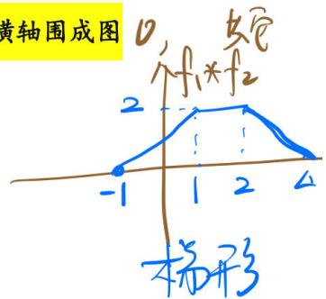

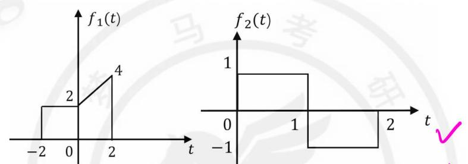

$f_{(t)} = f_{1}(t) \times f_{2}(t) = \int_{-10}^{10} f_{2}(t) \cdot f_{1}(t - t) d\tau$

$$
\Rightarrow f (2) = \int_ {- \infty} ^ {\infty} f _ {2} (\tau) \cdot f _ {1} (2 - \tau) d \tau
$$

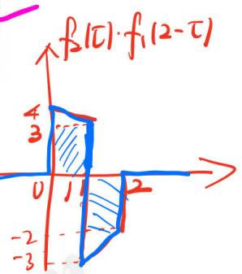

${f}_{1}\left( \tau \right)  \overset{右}{ \rightarrow  }{f}_{1}\left( {-\tau }\right)  \overset{右2}{ \rightarrow  }{f}_{1}\left( {2 - \tau }\right)$

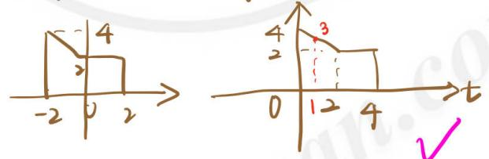

$$
S = (3 + 4) \times 1 \div 2
$$

$$
- (2 + 3) \times 1 \div 2
$$

$$
= \frac {7}{2} - \frac {5}{2} = 1
$$

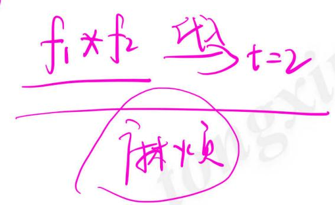

官网：tongxi nkaoyan.com

$$
\begin{array}{r l} {2 ^ {0}} & {f _ {| t |} = f _ {1} (t) * f _ {2} (t)} \\ {\Rightarrow f (2)} & {= f _ {1} (t) * f _ {2} (t) / t = 2} \\ & {= \underbrace {f _ {1} (2) * f _ {2} (2)} _ {\mathrm{梦马班讲义}} \times} \end{array}
$$

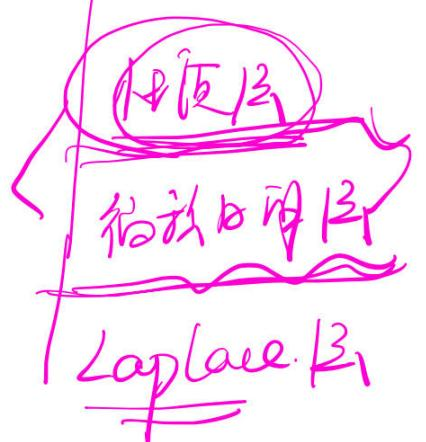

$\frac{E - R_{PE}}{L_{PE} - E}$ (1) 定义

卷积过程 $\Rightarrow$ 任意两倍多卷积 $\Rightarrow$ 具体

正原 $\Rightarrow$ 体积分

(2) 应用 $y_{x} = f^{(t)} - x h(t) \stackrel{h(t)}{=} 2$ 柜因

(3) 求得.

表式13 $\Rightarrow$ 借助于4

$f_{1}(t) \times f_{2}(t-1) = f_{1}(t-1) \times f_{2}(t)$ 周

周三

本交

$y(\pm f(t) \times \delta(t))$

$\frac{d^{2}t + h_{1}t}{h(t)}$ 问 $h(t) = ?$

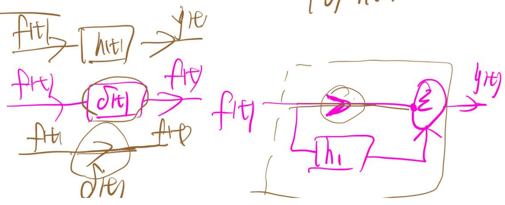

免费讲义Q群：1095841878

# 周三 参考 → 周日考试 (题目) 27 和 29 5.1 → 5.5 960 批题①②