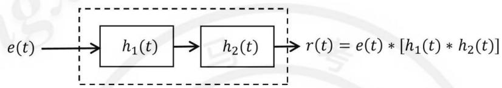
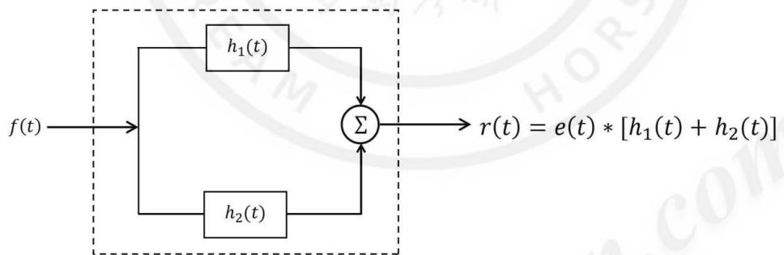
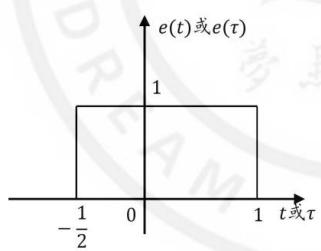
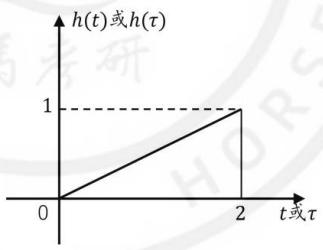
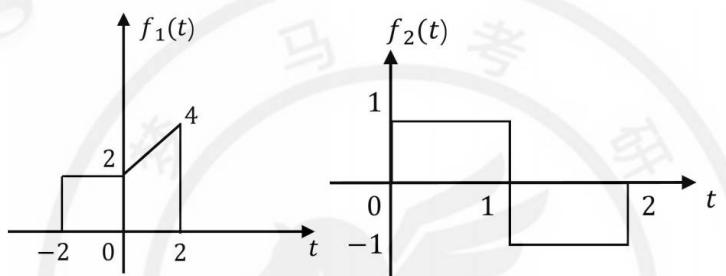

## 专题6 卷积性质及其系统表示

考点1: 卷积定义及衍生

信号 $f_{1}(t)$ 和 $f_{2}(t)$ ，卷积运算定义为 $f(t) = f_{1}(t)*f_{2}(t) = \int_{-\infty}^{\infty}f_{1}(\tau)f_{2}(t - \tau)d\tau$

(1)卷积过程的体现

例如： $f_{1}(t)*\delta(t)$

(2) 卷积一致性

(3) 卷积的逆向还原

1) 辨识原信号:

2) 逆向还原:

B站up: 信号与系统\_谷哥

公众号：通信考研小马哥

## 考点2：卷积应用与系统表示

(1)零状态响应的求解

系统零状态响应=激励与单位冲激响应之卷积，即

证明过程:

(2)冲激响应的求解

例 39: 求以下两个系统的单位冲激响应

(1) $y(t) = \int_{t - 2}^{\infty}e^{t - \tau}f(\tau -1)d\tau$

$$
y (t) = \int_ {- \infty} ^ {t - 1} e ^ {\lambda - t} f (\lambda - 1) (t - \lambda) d \lambda \tag {2}
$$

B站up: 信号与系统\_谷哥

公众号：通信考研小马哥

## 考点3: 卷积的代数性质(LTIS系统下可用)

## 1、交换律

$$
f _ {1} (t) * f _ {2} (t) = f _ {2} (t) * f _ {1} (t)
$$

## 2、结合律与系统结构

$$
[ f _ {1} (t) * f _ {2} (t) ] * f _ {3} (t) = f _ {1} (t) * [ f _ {2} (t) * f _ {3} (t) ]
$$

结合律用于系统分析，相当于串联系统的冲激响应，等于组成串联系统的各子系统冲激响应的卷积，如图所示。

串联系统的 $h(t)=h_{1}(t)*h_{2}(t)$

## 3、分配律与系统结构

$$
f _ {1} (t) * \left[ f _ {2} (t) + f _ {3} (t) \right] = f _ {1} (t) * f _ {2} (t) + f _ {1} (t) * f _ {3} (t)
$$

分配律用于系统分析，相当于并联系统的冲激响应，等于组成并联系统的各子系统冲激响应之和，如图所示。

  
并联系统的 $h(t) = h_{1}(t) + h_{2}(t)$

【混连结构】

考点4: 卷积的表达式求解法——借助于 $u(t)$ 缩小积分限

1、基于表达式法的卷积正向求解

例36：设 $f_{1}(t) = 3e^{-2t}u(t)$ ， $f_{2}(t) = 2u(t)$ ，求卷积积分 $f_{1}(t)*f_{2}(t)$ 。

例 37: 已知某线性时不变系统的冲激响应 $h(t) = u(t - 1)$ , 利用卷积求系统对输入 $f(t) = e^{-3t}u(t)$ 的零状态响应 $y(t)$ 。

$$
f _ {1} (t) = t u (t), f _ {2} (t) = u (t) - u (t - 2)
$$

例 38: 求下列函数的卷积积分 $f_{1}(t) * f_{2}(t)$ 。

## 考点5：卷积求解：图解法——借助于信号相乘运算

1、原理：两个信号的相乘

2、步骤

(1)更换自变量

$$
f _ {1} (t) \rightarrow f _ {1} (\tau), f _ {2} (t) \rightarrow f _ {2} (\tau)
$$

(2)反转移位

$$
f _ {2} (\tau) \stackrel {\text {反转}} {\longrightarrow} f _ {2} (- \tau) \stackrel {\text {移项}} {\longrightarrow} f _ {2} (t - \tau)
$$

(3)相乘，只关注时域有相交的情况

$$
f _ {1} (\tau) \cdot f _ {2} (t - \tau)
$$

(4)每种相交情况下的积分

$$
\int_ {- \infty} ^ {\infty} f _ {1} (\tau) \cdot f _ {2} (t - \tau) d \tau
$$

例 40: 已知 $e(t)$ 和 $h(t)$ 图形，求 $e(t)*h(t)$ 。

  
(a)

  
(b)

B站up: 信号与系统\_谷哥

公众号：通信考研小马哥

3、卷积点值的求解—求两信号卷积后在某一点的函数值:

$$
f (6) = \frac {f (t)}{t = 6} = \frac {f _ {1} (t) * f _ {2} (t)}{t = 6}
$$

【梦马班点拨】解题思路：左右均关于 $t$ 的函数，因此左右 $t$ 具有一致性，即 $f(6) = \int_{-\infty}^{\infty} f_1(\tau) f_2(6 - \tau) d\tau$ ，该积分等于 $f_1(\tau)$ 和 $f_2(6 - \tau)$ 相乘后结果与横轴围成图形的面积。

例 41: $f_{1}(t)$ 、 $f_{2}(t)$ 波形如图所示，且 $f(t) = f_{1}(t) * f_{2}(t)$ ，求 $f(2)$ 。

官网：tongxinkaoyan.com

梦马班讲义