## 专题 7 卷积求解

## 考点1：卷积求解：性质法

1、与冲激信号进行卷积的逆向思维

(1)正向理解

$$
f (t) * \delta (t) = f (t)
$$

$$
f (t) * \delta (t - t _ {0}) = f (t - t _ {0})
$$

(2)逆向思维

$f(t - t_0) = f(t)*\delta (t - t_0)$ ，即 $f_{1}(t)*f(t - t_{0}) = f_{1}(t)*f(t)*\delta (t - t_{0})$

例 42: 计算下列卷积积分。

$$
e ^ {- 2 t} u (t + 3) * u (t - 5)
$$

## 2、与阶跃信号的卷积

看到求信号的积分就等于求该信号与 $u(t)$ 的卷积

$$
\int_ {- \infty} ^ {t} f (\tau) d \tau = f (t) * u (t)
$$

例如：

$$
\int_ {- \infty} ^ {t - 2} f (\tau) d \tau = f (t) * u (t) * \delta (t - 2)
$$

例 43: 计算下列卷积积分。

(1) $u(t)*u(t);$

(2) $u(t+3)*u(t-5);$

B站up: 信号与系统\_谷哥

公众号：通信考研小马哥

3、性质法对框图支路的拓展理解

例：系统框图如图所示，求该系统的单位冲激响应

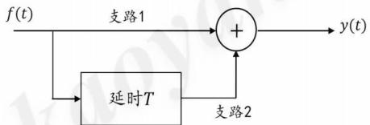

则

$$
y (t) = f (t) + f (t - T)
$$

很明显，支路1相当于

支路 2 相当于

$$
\Rightarrow h (t)
$$

例 44: 已知 LTI 系统传递函数框图如下所示

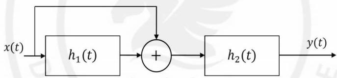

且 $h_1(t) = u(t) - u(t - 1)$ ， $h_2(t) = \delta (t - 1)$ ，求该系统单位冲激响应 $h(t)$ 。

B站up: 信号与系统\_谷哥

公众号：通信考研小马哥

例 35: 如图所示的系统, 它由几个子系统组合而成, 各子系统的冲激响应分别为

$$
\begin{array}{c} {h _ {a} (t) = \delta (t - 1)} \\ {h _ {b} (t) = u (t) - u (t - 3)} \end{array}
$$

求复合系统的冲激响应

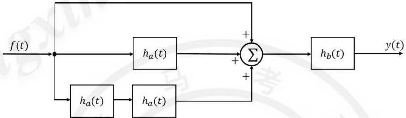

例 45: 求出如图中所示 LTI 系统的冲激响应(写出表达式)。  
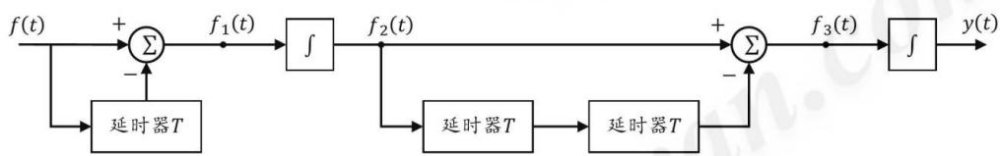

3

官网：tongxinkaoyan.com

梦马班讲义

B站up: 信号与系统\_谷哥

公众号：通信考研小马哥

## 考点 2: 卷积的微积分性质

## 1、微分性质：

两个函数卷积后的导数等于其中一函数的导数与另一函数的卷积，其表示式为

$$
\frac {d}{d t} \left[ f _ {1} (t) * f _ {2} (t) \right] = f _ {1} (t) * \frac {d f _ {2} (t)}{d t} = \frac {d f _ {1} (t)}{d t} * f _ {2} (t)
$$

由卷积定义可证明此关系式

$$
\begin{array}{r l} \frac {d}{d t} [ f _ {1} (t) * f _ {2} (t) ] & = \frac {d}{d t} \int_ {- \infty} ^ {\infty} f _ {1} (\tau) f _ {2} (t - \tau) d \tau = \int_ {- \infty} ^ {\infty} f _ {1} (\tau) \frac {d f _ {2} (t - \tau)}{d t} d \tau \\ & = f _ {1} (t) * \frac {d f _ {2} (t)}{d t} \end{array}
$$

## 2、积分性质

两函数卷积后的积分等于其中一函数之积分与另一函数之卷积。其表示式为

$$
\int_ {- \infty} ^ {t} [ f _ {1} (\lambda) * f _ {2} (\lambda) ] d \lambda = f _ {1} (t) * \int_ {- \infty} ^ {t} f _ {2} (\lambda) d \lambda = f _ {2} (t) * \int_ {- \infty} ^ {t} f _ {1} (\lambda) d \lambda
$$

证明如下

$$
\begin{array}{l} \int_ {- \infty} ^ {t} [ f _ {1} (\lambda) * f _ {2} (\lambda) ] d \lambda = \int_ {- \infty} ^ {t} \left[ \int_ {- \infty} ^ {\infty} f _ {1} (\tau) f _ {2} (\lambda - \tau) d \tau \right] d \lambda \\ = \int_ {- \infty} ^ {\infty} f _ {1} (\tau) \left[ \int_ {- \infty} ^ {t} f _ {2} (\lambda - \tau) d \lambda \right] d \tau = f _ {1} (t) * \int_ {- \infty} ^ {t} f _ {2} (\lambda) d \lambda \end{array}
$$

## 3、重点应用

设 $s(t)=\left[f_{1}(t)*f_{2}(t)\right]$ ，则有

$$
s ^ {(i)} (t) = f _ {1} ^ {(j)} (t) * f _ {2} ^ {(i - j)} (t)
$$

此处，当 $i, j$ 取正整数时为导数的阶次，取负整数时为重积分的次数。

一个简单的例子是

$$
\frac {d f _ {1} (t)}{d t} * \int_ {- \infty} ^ {t} f _ {2} (\lambda) d \lambda = f _ {1} (t) * f _ {2} (t)
$$

【梦马班点拨】在运用上式求解时必须注意 $f_{1}(t)$ 和 $f_{2}(t)$ 应满足时间受限条件，当 $t\to-\infty$ 时函数值应等于零。

B站up: 信号与系统\_谷哥

公众号：通信考研小马哥

考点 3: 卷积微积分图解法

卷积微积分图解法 $\leftrightarrow f(t) = f_1'(t) * f_2^{(-1)}(t) = f_1^{(-1)}(t) * f_2'(t)$ ，求导时选择可以出现 $\delta$ 的信号

例 46: 已知 $f(t)$ 和 $h(t)$ ，求 $g(t)=f(t)*h(t)$ 。

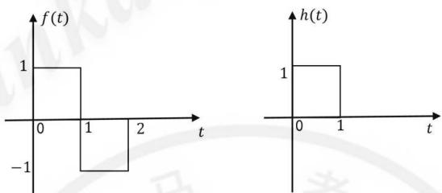

例 47: 已知 $h(t)$ ，求 $g(t) = h(t) * h(t)$ 。

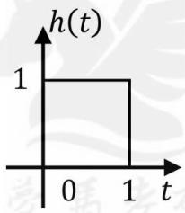

官网：tongxinkaoyan.com

梦马班讲义

B站up: 信号与系统\_谷哥

公众号：通信考研小马哥

例 48: 已知 $f(t)$ 和 $h(t)$ 如下图所示，求 $g(t) = f(t) * h(t)$ 。

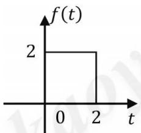

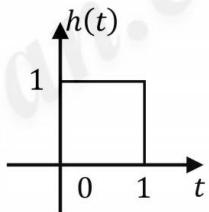

## 【梦马班点拨】结论1：卷积后信号的宽度与范围

设 $f_{1}(t)$ 范围为 $[t_{1},t_{2}]$ ， $f_{2}(t)$ 范围为 $[t_{3},t_{4}]$ ，则 $f_{1}(t)*f_{2}(t)$ 范围为 $[t_{1}+t_{3},t_{2}+t_{4}]$ 宽度为两者宽度之和。

【梦马班点拨】结论2：两个矩形的卷积结论

宽度相等，卷积结果为等腰三角形；宽度不等，卷积结果为等腰梯形。

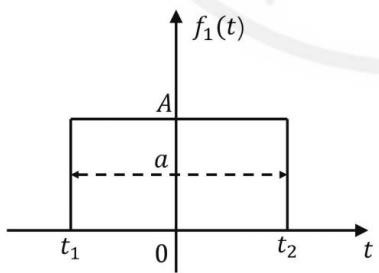

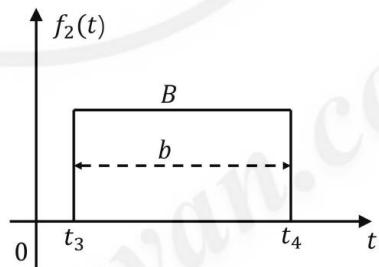

若 $a = b$ （宽度相等）则 $f(t) = f_{1}(t)*f_{2}(t)$

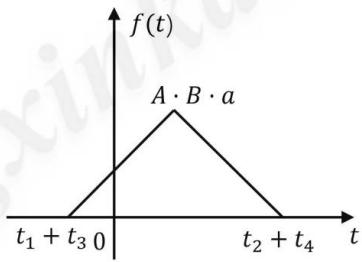  
6

官网：tongxinkaoyan.com

梦马班讲义

B站up: 信号与系统\_谷哥

公众号：通信考研小马哥

若 $a \neq b$ (假设 $a < b$ ) 则 $f(t) = f_{1}(t) * f_{2}(t)$

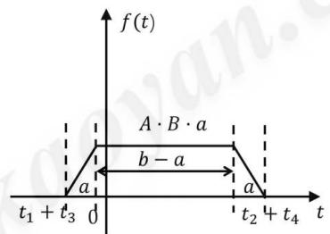

官网：tongxinkaoyan.com

梦马班讲义