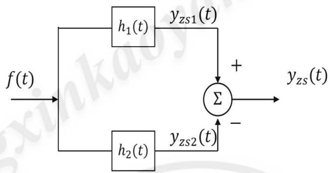
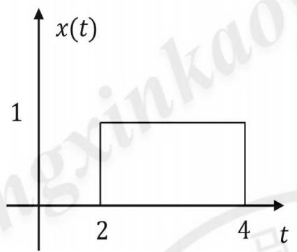
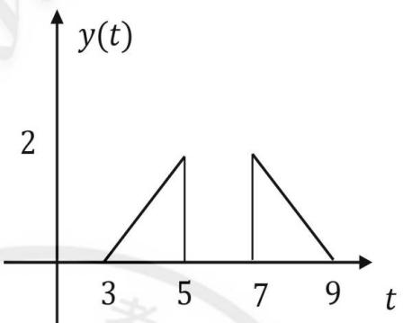

## 【第 13 节】课后作业

1、【2024 上海海事大学 2】已知连续时间信号 $x_{1}(t) = e^{-2t} u(t)$ , $x_{2}(t) = u(t) - u(t - 2)$ , 求 $x_{1}(t)$ 和 $x_{2}\left(\frac{t}{2}\right)$ 的卷积 $y(t)$ , $y(t) = x_{1}(t) * x_{2}\left(\frac{t}{2}\right)$ , 并画出 $y(t)$ 示意图;

夢馬考研

【2024 湖北大学 10】已知某连续时间系统的微分方程为

$$
y ^ {\prime} (t) + 5 y (t) = \int_ {- \infty} ^ {\infty} f (\tau) x (t - \tau) d \tau - f (t)
$$

其中 $x(t) = e^{-t}u(t) + 3\delta (t)$ ，求单位冲激 $h(t)$ 。

夢馬考研

官网：www.tongxinkaoyan.com

梦马班作业

2、【2024西安理工大学3.1】当 $f(t)=\delta(t)$ 时， $y_{zs1}(t)=\delta(t)-\delta(t-1)$ ， $y_{zs2}(t)=\delta(t-2)-\delta(t-3)$ ，求当 $f(t)=u(t)$ 时的 $y_{zs}(t)$ ;

官网：www.tongxinkaoyan.com

3、【2024合肥工业大学2】一个LTI连续时间系统的输出与输入关系关系为：

$$
y (t) = \int_ {- \infty} ^ {t} e ^ {\tau - t} x (\tau - 2) d \tau
$$

(1) 求该系统的单位冲激响应 $h(t)$ ;

(2) 当输入信号为 $x(t) = e^{-2t} u(t)$ 时, 求输出信号。

夢馬考研

官网：www.tongxinkaoyan.com

4、【2024 中国海洋大学 2】已知信号 $x(t)$ ，经系统得到响应 $y(t)$ ，其中 $x(t)$ ， $y(t)$ 如图，求该系统的单位冲激响应 $h(t)$ 。

5、【2024 浙江大学 1.2】某连续线性时不变系统，在 3 种激励下的初始状态相同：

当 $x_{1}(t) = \delta (t)$ 时，全响应 $y_{1}(t) = \delta (t) + e^{-t}u(t)$

当 $x_{2}(t) = u(t)$ 时，全响应 $y_{2}(t) = 3e^{-t}u(t)$

求当 $x_{3}(t)=e^{-2t}u(t)$ 时，全响应 $y_{3}(t)$

