一卷积定义 $f(t) = f_1(t) * f_2(t) = \int_{-10}^{10} f_1(t) \cdot f_2(t - t) d\tau$

$1^{\circ}$ 过程一般性 $\Rightarrow$ 及体信号号

3° 迹还原 → 辨识原信号

## 二. 巾积应用

$$
i ^ {0} \quad | _ {p s} (t) = f (t) + h (t)
$$

$z^0$ $f(t)$ $y(t)$ $h=h_1+h_2$

$3^{\circ}$ 串(纵)联

$$
h = h _ {1} + h _ {2}
$$

4° 并联

## 三. 若积求解

30 性质度

40 微积分证明

$\therefore {S}_{\Delta }{L}_{\Delta } = {L}_{\Delta ABE} + {L}_{\Delta ABE} + {L}_{\Delta ABE} + {L}_{\Delta ABE}$

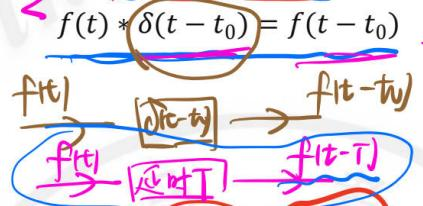

B站up: 信号与系统\_谷哥

## 专题 7 卷积求解

考点1：卷积求解：性质法

1、与中激信号进行卷积的逆向思维

(1)正向理解

公众号：通信考研小马哥

$$
f (t) * \delta (t) = f (t)
$$

$e^{\alpha t}$ u(t) ≠ $e^{\beta t}$ u(t)

$$
\Rightarrow \tau = t - t _ {0}   t - \tau - t _ {0} = 0
$$

$$
\int_ {- \infty} ^ {\infty} f (\tau) \cdot d (t - \tau - t _ {0}) d \tau
$$

$$
= f (t - t _ {0})
$$

希望一个信念与有

3° 框圆 $f\left( 1\right)$ 错 1

$$
f (t - t _ {0}) = f (t) * \delta (t - t _ {0}), \text {   即   } f _ {1} (t) * f (t - t _ {0}) = f _ {1} (t) * f (t) * \delta (t - t _ {0})
$$

$\Rightarrow  {f}_{1} + 1 \rightarrow$ 回 $\Rightarrow  {f}_{1} + y$

例42: 计算下列卷积积分。

$$
e ^ {6} \underbrace {e ^ {- 2 (t + 3)} u (t + 3)} _ {e ^ {- 2 t} u (t + 3) * u (t - 5)}
$$

$$
e ^ {6} \cdot \int_ {- \infty} ^ {\infty} e ^ {- 2 \tau} (u (\tau) u + t - \tau) d \tau
$$

$e^{6} \cdot e^{-2t} u(t) * \delta(t+3) * u(t) * \delta(t-5)$

$$
e ^ {6} \left[ \int_ {0} ^ {t} e ^ {- 2 \pi d t} \right] d (t) ^ {x _ {d (t)}}
$$

$$
e ^ {6} \quad e ^ {- 2 t} u (t) * u (t) * \delta (t - 2)
$$

$$
e ^ {6} - \frac {1}{2} e ^ {- 2 \frac {\pi}{3}} t. u (t + 1) \times 0 ^ {(t - 2)}
$$

$f(t)*(1t)$ $=f_{0}^{v0}f(t)(1t-t)d\tau$ 2、与

2、与阶跃信号的卷积

$$
e ^ {6} (- \frac {1}{2}) (e ^ {- 2 t} - 1) u (t) + o (t - 2)
$$

看到求信号的积分就等于求该信号与 $u(t)$ 的卷积

$= \int_{-\infty}^{t} f(\tau) d\tau$

$$
- \frac {1}{2} e ^ {6} [ e ^ {- 2 (t - 2)} - 1 ] (n + t - 2)
$$

$$
\int_ {- \infty} ^ {t} f (\tau) d \tau = f (t) * u (t)
$$

例如：

$$
y (t) = f _ {1 0} ^ {t} f (\pi) d \tau \Rightarrow y (t - 2) = f _ {1 0} ^ {t - 2} f (\pi) d \tau
$$

例 43: 计算下列卷积积分。

$y(t) \neq 0 \pmod{t-2}$

$$
(1) u (t) * u (t); = t u (t)
$$

$$
\begin{array}{r l} {(1) u (t) * u (t),} & {= u (t)} \\ {(2) u (t + 3) * u (t - 5);} & {= u (t) * u (t) * \sqrt [ 4 ]{(t - 2)}} \\ & {= t u (t) + (\sqrt [ 4 ]{(t - 2)}) = (t - 2) u (t - 3)} \\ & {1} \end{array}
$$

官网：tongxi nkaoyan. com

$$
\begin{array}{l} {3 ^ {\circ} \xrightarrow {f (t)} \boxed {u (t)} \xrightarrow {f _ {0} + f (t) d t}} \\ {f (t) \xrightarrow {f (t)}} \end{array}
$$

梦马班讲义

B站up: 信号与系统\_谷哥

公众号：通信考研小马哥

3、性质法对框图支路的拓展理解

例：系统框图如图所示，求该系统的单位冲激响应

则

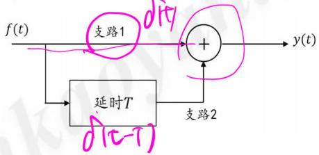

$$
\mathrm{令} f (t) = \sqrt {1 - e _ {1}} \mathrm{则} y (t) = h (x)
$$

$$
y (t) = f (t) + f (t - T)
$$

$$
h (t) = \delta (t) + \delta (t - T)
$$

很明显，支路1相当于

支路 2 相当于

$$
\Rightarrow h (t) = d (t - T)
$$

例 44: 已知 LTI 系统传递函数框图如下所示

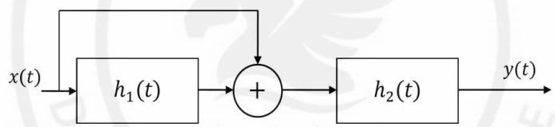

且 $h_{1}(t)=u(t)-u(t-1)$ ， $h_{2}(t)=\delta(t-1)$ ，求该系统单位冲激响应 $h(t)$ 。

$$
\begin{array}{r l} {h (t)} & {= \left[ \frac {\delta (t)}{-} + \frac {h _ {1} (t)}{-} \right] * h _ {2} (t)} \\ & {= \left[ \delta (t) + u (t) - u (t - 1) \right] * \delta (t - 1)} \\ & {= \delta (t - 1) + u (t - 1) - u (t - 2)} \end{array}
$$

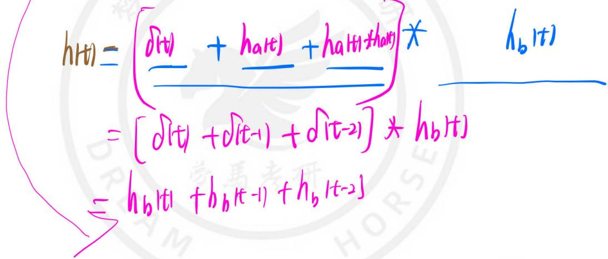

B站up: 信号与系统\_谷哥

公众号：通信考研小马哥

例 35: 如图所示的系统, 它由几个子系统组合而成, 各子系统的冲激响应分别为

$$
\begin{array}{c} {h _ {a} (t) = \delta (t - 1)} \\ {h _ {b} (t) = u (t) - u (t - 3)} \end{array}
$$

求复合系统的冲激响应

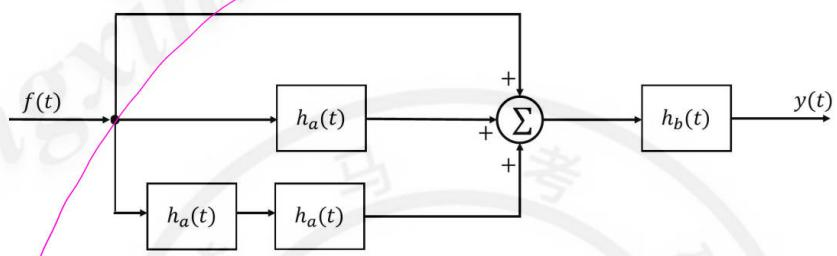

例 45: 求出如图中所示 LTI 系统的冲激响应(写出表达式)。  
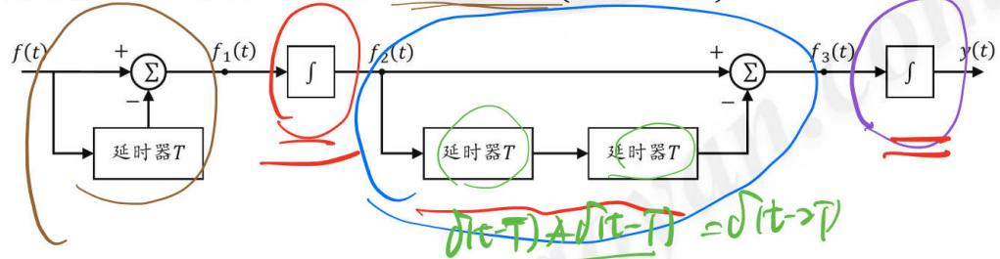

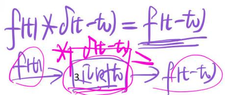

官网：tongxi nkaoyan. com

梦马班讲义

B站up: 信号与系统\_谷哥

## 考点2: 卷积的微积分性质

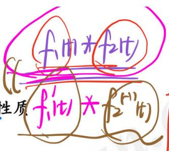

# 公众号：通信考研小马哥 希望出现δ相关 尽可能修改δ

## 1、微分性质：

两个函数卷积后的导数等于其中一函数的导数与另一函数的卷积，其表示式为

$$
\frac {d}{d t} \left[ f _ {1} (t) * f _ {2} (t) \right] = f _ {1} (t) * \frac {d f _ {2} (t)}{d t} = \frac {d f _ {1} (t)}{d t} * f _ {2} (t)
$$

由卷积定义可证明此关系式

$$
\begin{array}{r l} {\frac {d}{d t} [ f _ {1} (t) * f _ {2} (t) ] = \frac {d}{d t} \int_ {- \infty} ^ {\infty} f _ {1} (\tau) f _ {2} (t - \tau) d \tau} & {= \int_ {- \infty} ^ {\infty} f _ {1} (\tau) \frac {d f _ {2} (t - \tau)}{d t} d \tau} \\ & {= f _ {1} (t) * \frac {d f _ {2} (t)}{d t}} \\ & {= \int_ {- \infty} ^ {\infty} f _ {1} (\tau) \frac {d f _ {2} (t - \tau)}{d (t - \tau)} d \tau} \\ {\mathrm{积分性质}} \end{array}
$$

两函数卷积后的积分等于其中一函数之积分与另一函数之卷积。其表示式为

$$
\begin{array}{r l} & {\underset {- \infty} {\overset {t} {\int_ {- \infty}} [ f _ {1} (\lambda) * f _ {2} (\lambda) ] d \lambda} = f _ {1} (t) * \underset {- \infty} {\overset {t} {\int_ {- \infty}} f _ {2} (\lambda) d \lambda} = f _ {2} (t) * \underset {- \infty} {\overset {t} {\int_ {- \infty}} f _ {1} (\lambda) d \lambda}} \\ & {\text {证明如下}} \\ & {\qquad \qquad \qquad \qquad \qquad \qquad \qquad \qquad \qquad \qquad \qquad \qquad \qquad \qquad \qquad \qquad \qquad \qquad \qquad \qquad \qquad \qquad \qquad \qquad \qquad \qquad \qquad \qquad \qquad \qquad \qquad \qquad \qquad \qquad \mathrm{d} \lambda} \\ & {\qquad \qquad \qquad \qquad \qquad \qquad \qquad \qquad \qquad \qquad \qquad \qquad \qquad \qquad \qquad \qquad \qquad \qquad \qquad \qquad \mathrm{d} \lambda} \\ & {\qquad =  \int_ {- \infty} ^ {t} [ f _ {1} (\lambda) * f _ {2} (\lambda) ] d \lambda =  \int_ {- \infty} ^ {t}   \left[  \int_ {- \infty} ^ {\infty} f _ {1} (\tau) f _ {2} (\lambda - \tau) d \tau   \right] d \lambda} \\ & {\qquad =   \int_ {- \infty} ^ {\infty} f _ {1} (\tau)   \left[   \int_ {- \infty} ^ {t} f _ {2} (\lambda - \tau) d \lambda   \right] d \tau = f _ {1} (t) *   \int_ {- \infty} ^ {t} f _ {2} (\lambda) d \lambda} \end{array}
$$

## 3、重点应用

设 $s(t)=[f_{1}(t)*f_{2}(t)]$ ，则有

$$
s ^ {(i)} (t) = f _ {1} ^ {(j)} (t) * f _ {2} ^ {(i - j)} (t)
$$

此处，当 $i, j$ 取正整数时为导数的阶次，取负整数时为重积分的次数。

一个简单的例子是

$$
\frac {d f _ {1} (t)}{d t} * \int_ {- \infty} ^ {t} f _ {2} (\lambda) d \lambda = f _ {1} (t) * f _ {2} (t)
$$

【梦马班点拨】在运用上式求解时必须注意 $f_{1}(t)$ 和 $f_{2}(t)$ 应满足时间受限条件，当 $t\to-\infty$ 时函数值应等于零。

B站up: 信号与系统\_谷哥

公众号：通信考研小马哥

考点3：卷积微积分图解法

卷积微积分图解法 $\Leftrightarrow f(t)=f_{1}^{\prime}(t)*f_{2}^{(-1)}(t)=f_{1}^{(-1)}(t)*f_{2}^{\prime}(t)$ ，求导时选择可以出现δ的信号且数量少的

例 46：已知 $f(t)$ 和 $h(t)$ ，求 $g(t)=f(t)*h(t)$ 。

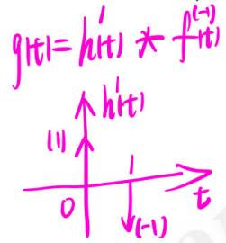

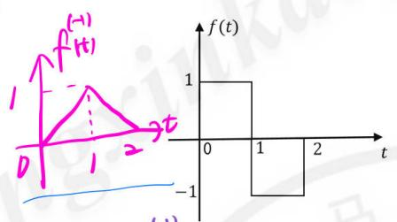

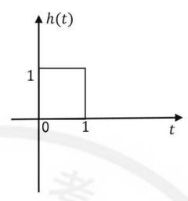

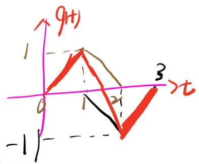

$$
\begin{array}{r l} {g (t)} & {= [ \sqrt {(t)} - \sqrt {(t - 1)} ] * f ^ {(t)}} \\ & {= f ^ {(t)} - f ^ {(t - 1)} (t - 1)} \\ & {\mathrm{例47:已知} h (t), \mathrm{求} g (t) = h (t) * h (t).} \end{array}
$$

$$
\begin{array}{r l} {\mathrm{若}} & {g (t) = f ^ {\prime} (t) * h ^ {(t)}} \\ & {= \left[ \sqrt [ 3 ]{(t)} - 2 \sqrt [ 3 ]{(t - 1)} + \sqrt [ 3 ]{(t - 2)} \right] * \binom {(- 1)} {h (t)}} \end{array}
$$

$$
\begin{array}{r l} {\mathrm{解:}} & {g (t) = h ^ {(1)} (t) * h ^ {(1 - 1)} (t)} \\ & {= A \left[ \sqrt {1 + 1} - \delta (t - 1) \right] * h ^ {(1)} (t)} \end{array}
$$

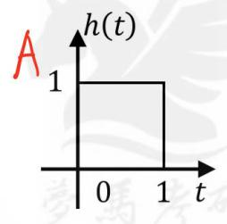

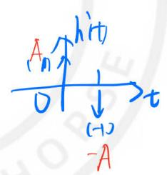

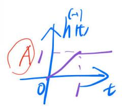

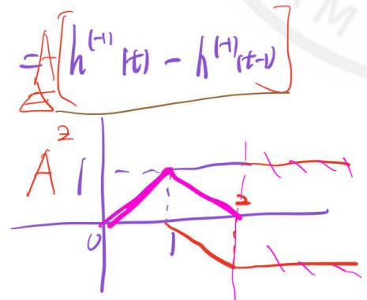

$0 \rightarrow 2 \times 0 \rightarrow 1 \Rightarrow 0 \rightarrow 3$ 寒度不同 ⇒ 对称杨丹

官网：tongxi nkaoyan. com

梦马班讲义

免费讲义Q群：1095841878

B站up: 信号与系统\_谷哥

公众号：通信考研小马哥

例 48: 已知 $f(t)$ 和 $h(t)$ 如下图所示，求 $g(t) = f(t) * h(t)$ 。

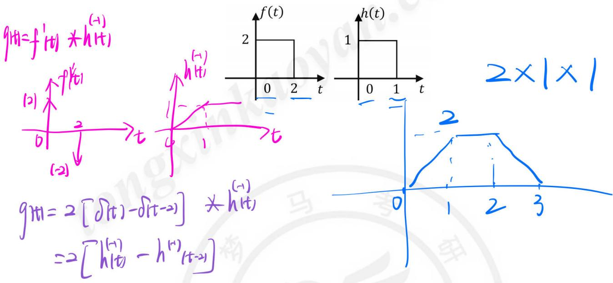

【梦马班点拨】结论1：卷积后信号的宽度与范围

n+1，n+大

设 $f_{1}(t)$ 范围为 $[t_{1},t_{2}]$ ， $f_{2}(t)$ 范围为 $[t_{3},t_{4}]$ ，则 $f_{1}(t)*f_{2}(t)$ 范围为 $[t_{1}+t_{3},t_{2}+t_{4}]$ 宽度为两者宽度之和。

【梦马班点拨】结论2：两个矩形的卷积结论

宽度相等，卷积结果为等腰三角形；宽度不等，卷积结果为等腰梯形。

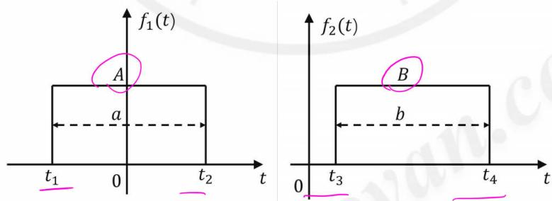

若 $a = b$ （宽度相等）则 $f(t) = f_{1}(t)*f_{2}(t)$

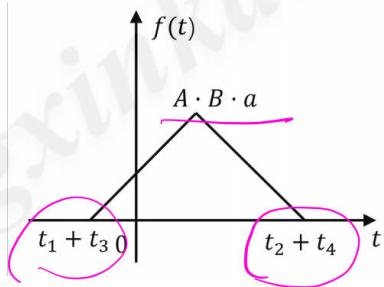  
6

官网：tongxi nkaoyan. com

梦马班讲义

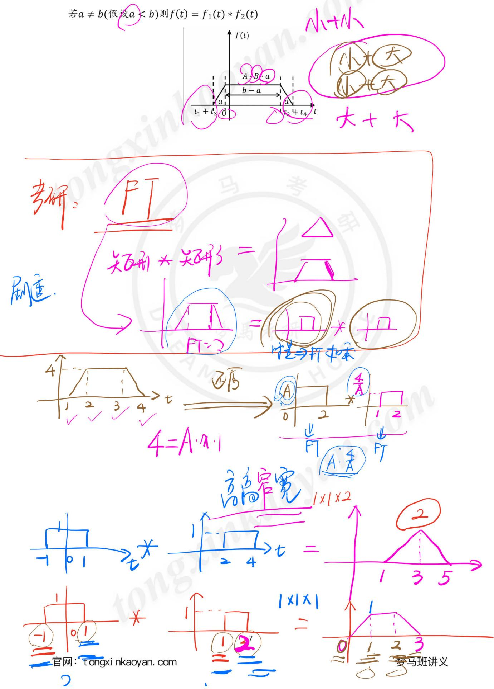

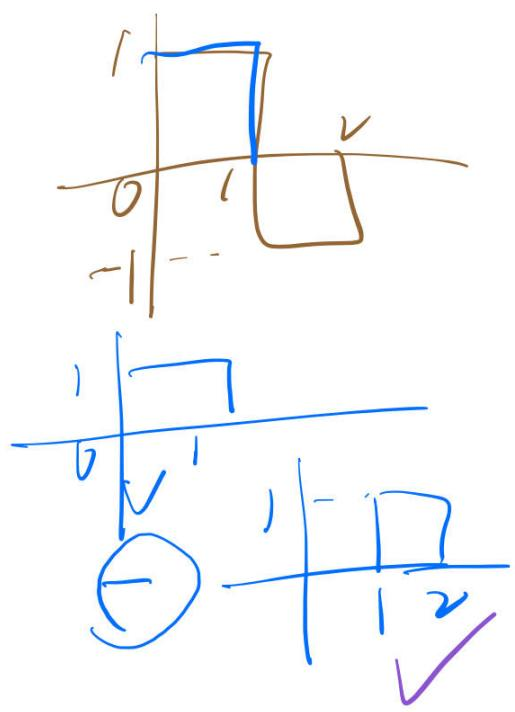

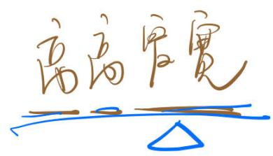

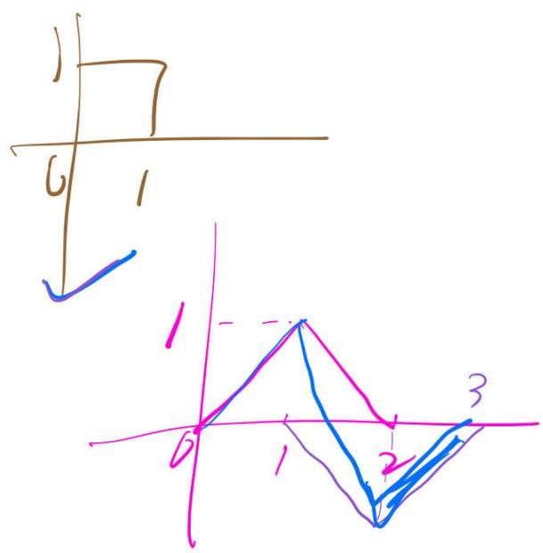

表格求解
表达式层： $u$ $\Rightarrow e^{\alpha t} a(t) + e^{\beta t} u(t)$ $u(t) + u(t) = t(u,t)$ 图明层：极大 $\Rightarrow f(t) = f_{1}(t) + f_{2}(t) / t=2$ $\Rightarrow S$ 性质层：
微积分解层
laplace变换层 $f(t) \times \delta(t) = f(t)$ ， $f(t) + \delta(t - t_0) = f(t - t_0)$ $f(t) + u(t) = \int_{-t_0}^{t} f(t) dt$ $= (t-2)(u(t-2))$ $(-t-2)(u(t-2))$ (微积分变换层)
↓
知角 × 关角了
范围（位置）
框架

记取 $12_{1}$ $y_{1+t}=y_{n}(t)+y_{0}(t)$ 35或 $x$ 双零点
双零点 $\begin{cases} y_{2i} & 3v \\ y_{3i} & 35\text{或}v\\ \Downarrow \delta_{i+t}/g_{i+t} & \rightarrow \text{球及互} \\ h_{i+t}/g_{i+t}. & [S_{i+t}=f_{\infty}^{t}h_{100k}] \\ y_{2s}\end{cases}$ $y_{2s}$ = $h(t) \times f(s)$