方法不限

## 【第 13 节】课后作业

1、【2024 上海海事大学 2】已知连续时间信号 $x_{1}(t) = e^{-2t} u(t)$ , $x_{2}(t) = u(t) -$

$u(t - 2)$ , 求 $x_{1}(t)$ 和 $x_{2}(\frac{t}{2})$ 的卷积 $y(t)$ , $y(t) = x_{1}(t) * x_{2}(\frac{t}{2})$ , 并画出 $y(t)$ 示意图;

312- 解：

$$
x _ {2} | t | = u (t) - u (t - 2)
$$

$$
\mathrm{则} x _ {2} (\frac {t}{2}) = u (t) - u (t - 4)
$$

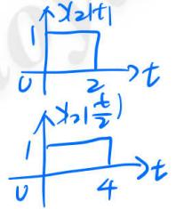

張二

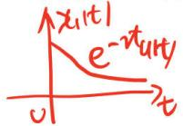

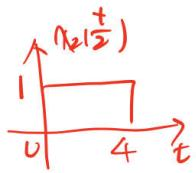

$$
1 _ {0} ^ {0} \le t <   4
$$

$$
\begin{array}{r l} {\mathrm{即} y | t |} & {= x _ {1} | t | * x _ {2} (\frac {t}{2})} \\ & {= e ^ {- 2 t} u | t | * [ u | t | - u (t - 4) ]} \end{array}
$$

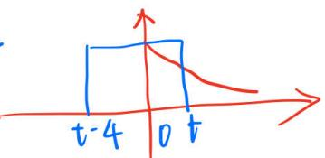

$$
\begin{array}{r l} {e ^ {- i t} u (t)} & {\times u (t) = \int_ {0} ^ {t} e ^ {- 2 \tau} d \tau \cdot u (t)} \\ & {= - \frac {1}{2} e ^ {- 2 \tau} \bigg / _ {0} ^ {t} \cdot u (t)} \\ & {= - \frac {1}{2} [ e ^ {- i t} - 1) u (t)} \end{array}
$$

$$
\begin{array}{r l} {\int_ {0} ^ {t} e ^ {- 2 \tau} d \tau} & {= - \frac {1}{2} e ^ {- 2 \tau} / _ {0} ^ {t}} \\ & {= - \frac {1}{2} (e ^ {- t} - 1)} \end{array}
$$

$$
2 ^ {0} t \geq 4
$$

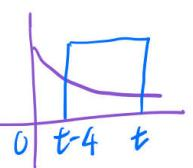

$$
\mathrm{故} y (t) = - \frac {1}{2} (e ^ {- x t} - 1) u (t) + \frac {1}{2} [ e ^ {- 2 (t - 4)} - 1 ] u (t - 4)
$$

$$
\begin{array}{r l} {\int_ {t - 4} ^ {t} e ^ {- 2 \tau} d \tau} & {= - \frac {1}{2} e ^ {- 2 \tau} / t - 4} \\ & {= - \frac {1}{2} [ e ^ {- 2 t} - e ^ {- 2 (t - 4)} ]} \\ & {= - \frac {1}{4} e ^ {- 2 t} + \frac {1}{2} e ^ {- 2 (t - 4)}} \end{array}
$$

可见两种引答案一致

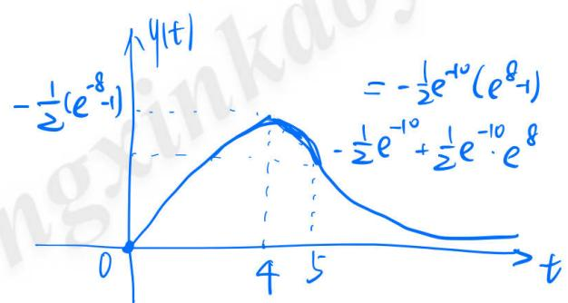

官网：www.tongxinkaoyan.com

示意图 法几个点
曲度最好结合权学
梦马班作业

【2024 湖北大学 10】已知某连续时间系统的微分方程为

$$
y ^ {\prime} (t) + 5 y (t) = \int_ {- \infty} ^ {\infty} f (\tau) x (t - \tau) d \tau - f (t)
$$

其中 $x(t) = e^{-t}u(t) + 3\delta (t)$ ，求单位冲激 $h(t)$ 。

解: $y(t) + 5y(t) = f(t) * x(t) - f(t)$ $\Rightarrow h(t) + 5h(t) = \delta(t) * x(t) - \delta(t) = x(t) - \delta(t) = e^{-t}u(t) + 2\sqrt{t}$ $\Rightarrow h(t) = A e^{-5t}$ (齐次部分) $t > 0$ 时，方切项 $= e^{-t} \Rightarrow hp(t) = Be^{-t}$ $-Be^{-t} + 5Be^{-t} = e^{-t} \Rightarrow B = \frac{1}{4}$ $\Rightarrow h(t) = A e^{-5t} + \frac{1}{4}e^{-t}$ $\begin{cases} h(t) = a\sqrt{t} + b\Delta(u(t)) \Rightarrow a = 2 \\ h(t) = a\Delta(u(t)) \Rightarrow h(0+) = h(0-1) + 2 = 2 \\ h(0+) = A + \frac{1}{4} = 2 \Rightarrow A = \frac{7}{4} \\ \therefore h(t) = (\frac{7}{4}e^{-5t} + \frac{1}{4}e^{-t})u(t) \end{cases}$

官网：www.tongxinkaoyan.com

2、【2024西安理工大学3.1】当 $f(t)=\delta(t)$ 时， $y_{zs1}(t)=\delta(t)-\delta(t-1)$ ， $y_{zs2}(t)=\delta(t-2)-\delta(t-3)$ ，求当 $f(t)=u(t)$ 时的 $y_{zs}(t)$ ;

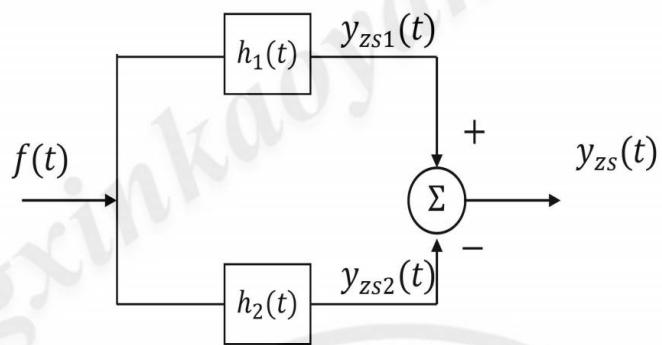

解：由题意可知： $y_{x_1}|t| = h_1(t)$ $y_{x_2}|t| = h_2(t)$ $\Rightarrow h_{1}|t| = h_1(t) - h_2|t| = \delta_{1+1} - \delta(t-1) - \delta(t-2) + \delta(t-3)$ $\Rightarrow y_{x_1}|t| = h_{1}|t + u(t)| = u(t) - u(t-1) - u(t-2) + u(t-3)$

官网：www.tongxinkaoyan.com

梦马班作业

3、【2024 合肥工业大学 2】一个LTI连续时间系统的输出与输入关系关系为：

$$
y (t) = \int_ {- \infty} ^ {t} e ^ {\tau - t} x (\tau - 2) d \tau
$$

(1) 求该系统的单位冲激响应 $h(t)$ ;

(2) 当输入信号为 $x(t) = e^{-2t} u(t)$ 时, 求输出信号。

$$
\begin{array}{r l} {y (t)} & {= \int_ {- \infty} ^ {\infty} e ^ {t - t} x (\tau - 2) u (t - \tau) d \tau} \\ & {= x (t - 2) * e ^ {- t} u (t)} \\ & {= x (t) * \sqrt {(t - 2) * e ^ {- t} u (t)}} \\ & {= x (t) * e ^ {- (t - 2)} u (t - 2)} \end{array}
$$

$$
\therefore h (- t) = e ^ {- (t - 2)} u (t - 2)
$$

(2) $y_{t1} = x_{1} t_{1} + h_{1}(t)$ $= e^{-x_{1}} u_{t1} + e^{-t_{1}} u_{t1} + d_{t-2}$

$$
\begin{array}{r l} {\mathrm{其中}} & {e ^ {- 2 t} u \mathrm{tr} t * e ^ {- t} u \mathrm{tr},} \\ & {= \int_ {0} ^ {t} e ^ {- 2 t} \cdot e ^ {- (t - \tau)} d \tau \cdot u (\tau)} \\ & {= e ^ {- t} \int_ {0} ^ {t} e ^ {- \tau} d \tau \cdot u (\tau)} \\ & {= e ^ {- t} [ - e ^ {- \tau} ] _ {0} ^ {t} u (\tau)} \\ & {= e ^ {- t} [ - e ^ {- t} + 1 ] u (\tau)} \\ & {= (- e ^ {- 2 t} + e ^ {- t}) u (\tau)} \\ & {= [ - e ^ {- 2 (t - 2)} + e ^ {- (t - 2)} ] u (\tau - 2),} \end{array}
$$

而朱

4、【2024 中国海洋大学 2】已知信号 $x(t)$ ，经系统得到响应 $y(t)$ ，其中 $x(t)$ ， $y(t)$ 如图，求该系统的单位冲激响应 $h(t)$ 。

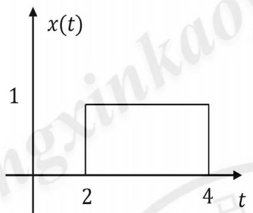

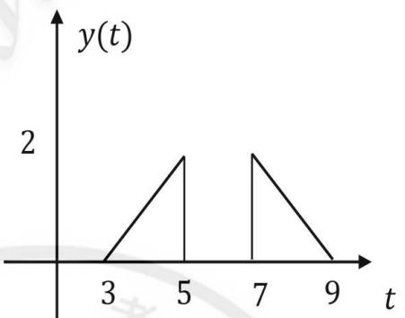  
y(t)为

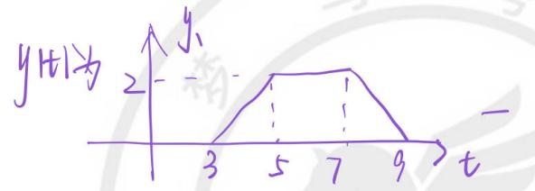

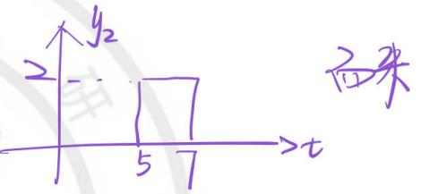  
其中 $y_{1}$ 为

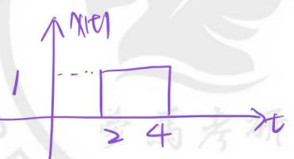

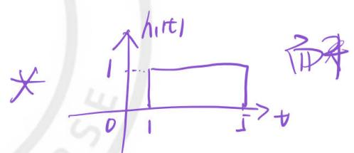  
${y}_{2}$ 为

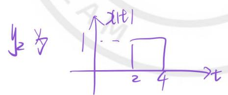

$x^{2}(t=20)(t=3)$ 而米

故 $y(t) = y_{1}(t) - y_{2}(t) = x(t) \times h_{1}(t) - x(t) \times h_{2}(t)$ $= x(t) \times [h_{1}(t) - h_{2}(t)]$ $= > h(t) = h_{1}(t) - h_{2}(t)$ $= u(t-1) - u(t-5) - 2(t-3)$

5、【2024 浙江大学 1.2】某连续线性时不变系统, 在 3 种激励下的初始状态相同:

当 $x_{1}(t) = \delta (t)$ 时，全响应 $y_{1}(t) = \delta (t) + e^{-t}u(t)$

当 $x_{2}(t)=u(t)$ 时，全响应 $y_{2}(t)=3e^{-t}u(t)$ ;

求当 $x_{3}(t) = e^{-2t}u(t)$ 时，全响应 $y_{3}(t)$

令积分输入响应为 $y_{2}(t)$ . 则

$$
\begin{array}{r l} {y _ {1} (t)} & {= y _ {2 i} (t) + h (t) = \delta (t) + e ^ {- t} u (t)} \\ {y _ {2} (t)} & {= y _ {2 i} (t) + g (t) = 3 e ^ {- t} u (t)} \\ {\frac {g (t) - g (t)}{}} & {= \delta (t) - 2 e ^ {- t} u (t)} \\ {\Rightarrow g (t)} & {[ \delta^ {i} (t) - \delta^ {i} (t) ] = \delta (t) - 2 e ^ {- t} u (t)} \\ & {\Rightarrow g (t) = e ^ {- t} u (t)} \\ & {\Rightarrow \left\{ \begin{array}{l l} {h (t)} & {= - e ^ {- t} u (t) + \delta (t)} \\ {y _ {2 i} (t)} & {= 2 e ^ {- t} u (t)} \end{array} \right.} \end{array}
$$

这样写源于

$$
\begin{array}{r l} {\mathrm{对}} & {[ e ^ {- \alpha^ {+} u (e)}} ] \\ & {= - \alpha e ^ {- \alpha^ {+} u (e)} + \delta (e)} \\ & {\mathrm{的充分学拓展}} \end{array}
$$

若无记学堆可用记

$\therefore f\left( t\right)$ 求导一原型 $= {0.5}{\left( t - 1\right) }^{ - } - 2{p}^{-t}{a}_{1}{b}_{1}$

$$
\begin{array}{r l} {y _ {3 | t |}} & {= h (t) * x _ {3 | t |} + y _ {2 | t |}} \\ & {= [ - e ^ {- t} u (t) + \sqrt {t}) ] * e ^ {- x _ {1}} u (t) + 2 e ^ {- t} u (t)} \end{array} \Rightarrow q _ {1 e _ {1}} \text {   中   } [ e ^ {- t} u (t) ] ^ {\prime} = - e ^ {- t} u (t) + o (t) \text {   涡示权   }
$$

$\Rightarrow  {910}$ 中奇定有 ${e}^{- + }{u}_{0}{e}_{1}$

$$
\begin{array}{r l} {\mathrm{其中} e ^ {- t} u _ {1 t 1} * e ^ {- 2 t} u _ {1 t 1}} & {= \int_ {0} ^ {t} e ^ {- t} e ^ {- 2 (t - t)} d t \cdot u _ {1 t 1} = e ^ {- 2 t} \int_ {0} ^ {t} e ^ {t} d t \cdot u _ {1 t 1}} \\ & {\qquad \qquad \qquad \qquad \qquad \qquad \qquad \qquad \qquad \qquad \qquad \qquad \qquad \qquad \qquad \qquad \qquad \qquad \qquad \qquad \qquad \qquad \qquad \qquad \qquad \qquad \qquad \qquad \qquad \qquad \qquad \qquad \qquad \qquad \mathrm{for} y _ {3 | t 1} = (e ^ {- 2 t} - e ^ {- t}) u _ {1 t 1} + e ^ {- 2 t} u _ {1 t 1} + 2 e ^ {- t} u _ {1 t 1}} \\ & {\qquad \qquad \qquad \qquad \qquad \qquad \qquad \qquad \qquad \qquad \qquad \qquad \qquad \qquad \qquad \qquad \qquad \qquad \qquad \qquad \qquad \qquad \qquad \qquad \qquad \qquad \qquad \qquad \qquad \mathrm{for} y _ {3 | t 1}} \\ & {\qquad = (2 e ^ {- 2 t} + e ^ {- t}) u _ {1 t 1}} \end{array}
$$

官网：www.tongxinkaoyan.com

梦马班作业