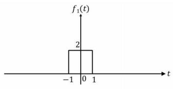
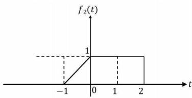
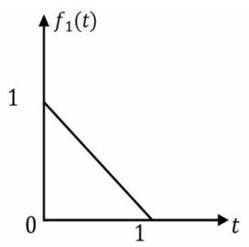
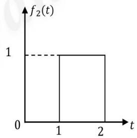
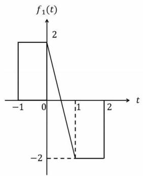
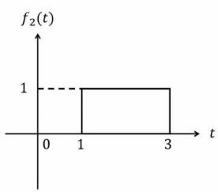
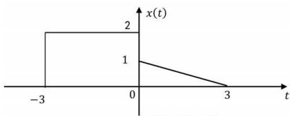
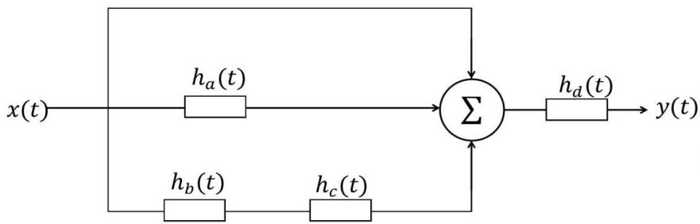

## 第2章 连续时间系统的时域分析 章节测试题

<table><tr><td>考试时间:2026年4月26日</td><td>18:00-20:30</td></tr><tr><td>提交时间:20:35</td><td>考试形式:闭卷</td></tr></table>

1、【2025 中国传媒大学 823】
若 $y(t)=f(t)*h(t)$ ，则 $f(3t)*h(3t)$ 等于()。
A. $\frac{y(3t)}{9}$ B. $\frac{y(3t)}{3}$ C. $\frac{y(9t)}{9}$ D. $\frac{y(9t)}{3}$

## 2、【2025 中国传媒大学 823】

信号 $f_{1}(t)$ 和 $f_{2}(t)$ 的波形如图一所示，设 $f(t) = f_{1}(t)*f_{2}(t)$ ，则 $f(0)$ 为（）。  
A. 0  
B. 1  
C. 2  
D. 3

  
图一

## 3、【2025 南京理工大学 891】

$[e^{-2t}u(t + 3)] * u(t - 15) =$

## 4、【2025 长春理工大学 808】

已知系统零状态响应 $y_{zs}(t)=\int_{-\infty}^{t}e^{\tau-t}f(\tau-1)d\tau$ ，其中 $f(t)$ 为激励，求系统的单位冲激响应 $h(t)$ 。

## 5、【2025 中国海洋大学 819】

已知某 LTI 连续系统的单位阶跃响应 $g(t)=e^{-2(t-1)}u(t)$ ，求当激励信号为 $e(t)=\delta(t)-2u(t-1)$ 时，系统零状态响应 $y_{zs}(t)$ 。

6、【2025 苏州大学 837】

已知某一LTI系统的激励为 $e(t)=u(t)$ ，零状态响应 $r_{zs}(t)=4e^{-t}u(t)$

(1)求系统的单位冲激响应 $h(t)$ ;

(2)当 $r(0_{-})=2$ 时，且 $e(t)=2\delta(t-1)+u(t-3)$ 时的全响应。

## 7、【2025 天津大学 815】

已知系统的激励为 $f(t)$ ，系统的响应 $y(t)=\int_{t-1}^{t}f(\tau)d\tau$ ，试判断该系统是否线性，因果，稳定，时不变并说明理由。

8、【2025 苏州大学 837】

已知 $f_{1}(t)$ 、 $f_{2}(t)$ 的图像如图所示， $y(t)=f_{1}(t)*f_{2}(t)*\delta''(t)$ ，画出 $y(t)$ 波形图。

9、【2025 陆军工程大学 807】

已知信号 $f_{1}(t)$ 和 $f_{2}(t)$ 波形如图所示，画出 $\frac{df_{1}(t)}{dt} * f_{2}(t)$ 的波形。

梦马班讲义

10、【2025 湖北工业大学 923】

已知信号 $x(t)$ 的波形图如图所示，画出的 $x_{1}(t)=x(t)*\delta'(t-1)$ 的波形并写出 $x_{1}(t)$ 的表达式。

11、【2025 黑龙江大学 888】

已知 $h_{a}(t)=2\delta(t-3)$ ， $h_{b}(t)=u(t-1)-u(t-2)$ ， $h_{c}(t)=\delta(t)$ ， $h_{d}(t)=2u(t)$ 求所示连续时间LTI系统的单位冲激响应 $h(t)$ 。

官网：tongxinkaoyan.com

## 12、【2025 中国海洋大学 819】

已知一因果 LTI 系统的微分方程为 $y''(t) + 7y'(t) + 10y(t) = 2x'(t) + x(t)$

(1)求单位冲激响应；

(2)若输入 $x(t)=e^{-t}u(t)$ ， $y(0_{-})=5$ ， $y'(0_{-})=3$ ，求系统零输入响应和零状态响应。

## 13、【2025 广东工业大学 809】

已知系统的微分方程: $y''(t) + 6y'(t) + 5y(t) = f'(t) + 5f(t)$

(1)求 $h(t)$ ;

(2)若 $f(t)=e^{-3t}u(t)$ ， $y(0_{+})=0$ ， $y'(0_{+})=1$ ，求系统的全响应。

官网：tongxinkaoyan.com

## 14、【2025 长春理工大学 808】

已知一 LTI 因果系统，当输入为 $x(t)$ 时，全响应为 $(2e^{-3t} + \sin 2t)u(t)$ ；当输入为 $2x(t)$ 时，全响应为 $(e^{-3t} + 2\sin 2t)u(t)$ 。

(1)若初始状态不变，求当输入为 $x(t-1)$ 时的全响应

(2)若初始状态变 2 倍, 求当输入为 $2 x (t)$ 时的全响应。

## 15、【2025 天津大学 815】

已知描述连续时间因果系统的微分方程为 $y''(t) + 3y'(t) + 2y(t) = f(t) + \int_0^{+\infty} f(t - \tau) d\tau$ ，初始状态 $y(0_-) = 1$ ， $y'(0_-) = -1$ ，若该系统的输入为 $f(t) = e^{-t} u(t)$ ，试求

(1)零输入响应 $y_{zi}(t)$

(2)零状态响应 $y_{zs}(t)$

(3)稳态响应

## 16、【2025宁波大学829】

已知 1 和 2 两个因果系统如下:

1 系统微分方程为： $y''(t) + 4y'(t) + 3y(t) = x(t)$ ，

单位冲激响应为： $h_1(t) = \frac{1}{2} (e^{-t} - e^{-3t})u(t)$

2 系统微分方程为： $y''(t) + 4y'(t) + 3y(t) = x'(t) + 2x(t)$

(1)求 2 系统的单位冲激响应 $h_{2}(t)$ 。

(2)若 $x(t) = e^{-4t}u(t)$ ， $y(0^{+}) = \frac{1}{3}, y'(0^{+}) = \frac{1}{3}$ ，求2系统的输出 $y(t)$ 。

(3)1 系统和 2 系统级联成 3 系统, 求 3 系统的单位冲激响应 $h_{3}(t)$ 。