## 第2章 连续时间系统的时域分析 章节测试题

考试时间：2026年4月26日

18: 00-20: 30

提交时间：20:35

考试形式：闭卷

1. 【2025 中国传媒大学 823】

若 $y(t)=f(t)*h(t)$ ，则 $f(3t)*h(3t)$ 等于(B)。
A. $\frac{y(3t)}{9}$ B. $\frac{y(3t)}{3}$ C. $\frac{y(9t)}{9}$ D. $\frac{y(9t)}{3}$

解: $y_{t+1} = f(t) * h(t) = \int_{-10}^{\infty} f(t) h(t - t) d\tau$

$$
f (3 t) * h (3 t) = \int_ {- \infty} ^ {\infty} f (3 t) \cdot h [ 3 (t - \tau) ] d \tau   \frac {a = 3 \tau}{d \tau = \frac {1}{3} d a} \frac {1}{3} \int_ {- \infty} ^ {\infty} f (a) h (3 t - a) d a   = \frac {1}{3} \int_ {- \infty} ^ {\infty} f (\tau) h (3 t - \tau) d \tau   = \frac {1}{3} y (3 t)
$$

2.【2025 中国传媒大学 823】

信号 $f_{1}(t)$ 和 $f_{2}(t)$ 的波形如图一所示，设 $f(t) = f_{1}(t)*f_{2}(t)$ ，则 $f(0)$ 为

(D)。
A. 0
B. 1
C. 2
D. 3 $\mathrm{f}(-t) = f_1(t) * f_2(t) = \int_{-\infty}^{\infty} f_2(\tau) f_1(t - \tau) d\tau$ $\Rightarrow f(0) = \int_{-\infty}^{\infty} f_2(\tau) f_1(-\tau) d\tau$

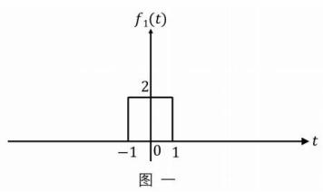

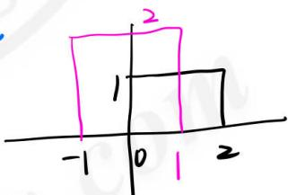

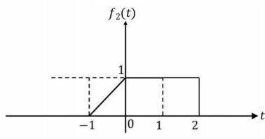

$\downarrow$ 和 $S = (1 + 2) \times 2 \div 2$ $2 \uparrow$ $= 3$ -1 0 1

$e^{2t}$ (111) $*e^{2t}$ (111) = $te^{2t}$ (111)

官网：tongxi nkaoyan. con

梦马班讲义

公众号：通信考研小马哥

3、【2025 南京理工大学 891】

$$
\begin{array}{r l} {[ e ^ {- 2 t} u (t + 3) ] * u (t - 1 5)} & {= \underline {{\quad}} e ^ {\alpha t} u (t) * e ^ {\beta t} u (t)} \\ {\mathrm{解:} e ^ {6} \cdot e ^ {- 2 (t + 3)} u (t + 3) * u (t - 1 5)} & {= \frac {1}{\alpha - \beta} [ e ^ {\alpha t} - e ^ {\beta t} ] u (t)} \\ {= e ^ {6} \cdot e ^ {- 2 t} u (t) * u (t) * \sqrt {(t - 1 2)}} & \\ {= e ^ {6} \cdot \frac {1}{- 2} (e ^ {- 2 t} - 1) ^ {u (t)} * \sqrt {(t - 1 2)}} & {= - \frac {e ^ {6}}{2} [ e ^ {- 2 (t - 1 2)} - 1 ] u (t - 1 2)} \\ & {= \frac {e ^ {6}}{2} [ 1 - e ^ {- 2 (t - 1 2)} ] u (t - 1 2)} \end{array}
$$

已知系统零状态响应 $y_{zs}(t)=\int_{-\infty}^{t}e^{\tau-t}f(\tau-1)d\tau$ ，其中 $f(t)$ 为激励，求系统的单

位冲激响应 $h(t)$ 。

$$
\begin{array}{r l} {y _ {\Delta (t)}} & {= \int_ {- \infty} ^ {t} e ^ {\tau - t} f (t - 1) d \tau = \int_ {- \infty} ^ {\infty} e ^ {- (t - \tau)} f (t - 1) u (t - \tau) d \tau} \\ & {\qquad = f (t - 1) * e ^ {- t} u (t)} \\ & {\qquad = f (t) * \delta (t - 1) * e ^ {- t} u (t)} \\ {\mathrm{极} h (t)} & {= e ^ {- (t - 1)} u (t - 1)} \\ & {= f (t) * e ^ {- (t - 1)} u (t - 1) = f (t) * d (t)} \end{array}
$$

5.【2025 中国海洋大学 819】

已知某 LTI 连续系统的单位阶跃响应 $g(t)=e^{-2(t-1)}u(t)$ ，求当激励信号为 $e(t)=\delta(t)-2u(t-1)$ 时，系统零状态响应 $y_{zs}(t)$ 。

$$
\begin{array}{r l}{\mathrm{if:}}&{\sqrt {t + 1} \rightarrow h (t), u (t) \rightarrow g (t + 1)}\\{\mathrm{故}}&{\sqrt {t + 1} - 2 u (t - 1) \rightarrow h (t) - 2 g (t - 1) = y _ {v s} (t)}\\{\therefore y _ {v s} (t)}&{= g ^ {\prime} (t) - 2 g (t - 1)}\\&{= - 2 e ^ {- 2 (t - 1)} u (t) + e ^ {- 2 (t - 1)} \sqrt {t}) - 2 e ^ {- 2 (t - 2)} u (t - 1)}\\&{= - 2 e ^ {- 2 (t - 1)} u (t) - 2 e ^ {- 2 (t - 2)} u (t - 1) + e ^ {2} \sqrt {t})}\end{array}
$$

官网：tongxi nkaoyan. con

## 6、【2025 苏州大学 837】

已知某一LTI系统的激励为 $e(t)=u(t)$ ，零状态响应 $r_{zs}(t)=4e^{-t}u(t)$

(1)求系统的单位冲激响应 $h(t)$ ;

(2)当 $r(0_{-})=2$ 时，且 $e(t)=2\delta(t-1)+u(t-3)$ 时的全响应。

(1) $h(t) = r_{2s}(t) = -4e^{-t}u(t) + 4e^{-t}\sqrt{t} = 4\sqrt{t} - 4e^{-t}u(t)$

(2) 当 $e(t)=2\sqrt{(t-1)}+u(t-3)$ 时对应应状态响应为 $2h(t-1)+r_{2}s(t-3)=8\sqrt{(t-1)}-8e^{-(t-1)}u(t-1)+4e^{-(t-3)}u(t-3)$

设 ${R}_{2i}\left| t\right|  = A{e}^{-t}$

则 ${r}_{21}\left( {0 + 1}\right)  = r\left( {0 - 1}\right)  = A = 2$

$$
\therefore r _ {2 i} (t) = 2 e ^ {- t} (u t)
$$

全响应(r(t)) = 2e^{-t}u(t) + 8\delta(t-1) - 8e^{-(t-1)}u(t-1) + 4e^{-(t-3)}u(t-3)

## 7.【2025 天津大学 815】

已知系统的激励为 $f(t)$ ，系统的响应 $y(t)=\int_{t-1}^{t}f(\tau)d\tau$ ，试判断该系统是否线性，因果，稳定，时不变并说明理由。

$$
H [ a _ {1} f _ {1} (t) + a _ {2} f _ {2} (t) ] = \int_ {t - 1} ^ {t} [ a _ {1} f _ {1} (t) + a _ {2} f _ {2} (t) ] d t \tag {①}
$$

$$
a _ {1} y _ {1} (t) + a _ {2} y _ {2} (t) = a _ {1} \int_ {t - 1} ^ {t} f _ {1} (\tau) d \tau + a _ {2} \int_ {t - 1} ^ {t} f _ {2} (\tau) d \tau
$$

$$
H [ f (t - t _ {0}) ] = \int_ {t - 1} ^ {t} f (t - t _ {0}) d t \quad ③ \quad \frac {t - t _ {0} = a}{\int_ {t - t _ {0} - 1} ^ {t - t _ {0}} f (a) d a}
$$

$$
y (t - t _ {0}) = \int_ {t - t _ {0} - 1} ^ {t - t _ {0}} f (t) d t
$$

① $=$ ②，④=⑤=③ 故线性.时不变乘法

$$
h (t) = f _ {t - 1} ^ {(t)} \delta (t) d t = u (t) - u (t - 1)
$$

可见 t<0 时 $h(t)=0$ 故为因果系统

同第一章知识也可以

$$
\int_ {- \infty} ^ {\infty} | h (t) | d t = 1
$$

官网：tongxinkaoyan.com  /  /  的后放 3

梦马班讲义

8、【2025 苏州大学 837】

已知 $f_{1}(t)$ 、 $f_{2}(t)$ 的图像如图所示， $y(t)=f_{1}(t)*f_{2}(t)*\delta''(t)$ ，画出 $y(t)$ 波形图。

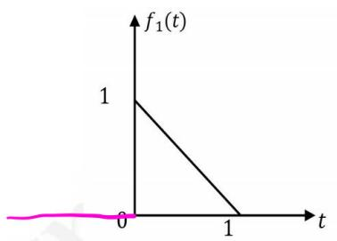

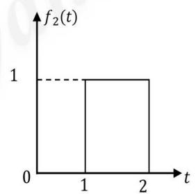

设： $y(t) = f_1(t) * f_2(t) * \delta''(t) = f_1'(t) * f_2'(t)$

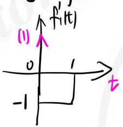

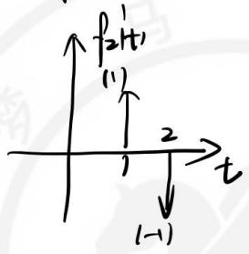

$$
\begin{array}{r l} {\mathrm{故} y (t)} & {= f _ {1} ^ {\prime} (t) \times [ \sqrt {(t - 1)} - \sqrt {(t - 2)} ]} \\ & {= f _ {1} ^ {\prime} (t - 1) - f _ {1} ^ {\prime} (t - 2)} \end{array}
$$

9、【2025 陆军工程大学 807】

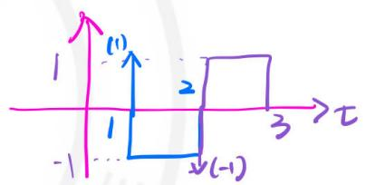

已知信号 $f_{1}(t)$ 和 $f_{2}(t)$ 波形如图所示，画出 $\frac{df_1(t)}{dt} * f_2(t)$ 的波形。

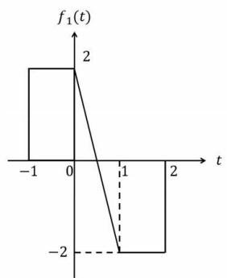

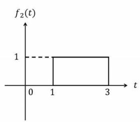

$$
\frac {d f _ {1} (t)}{d t} * f _ {2} (t) = f _ {1} (t) * \frac {d f _ {2} (t)}{d t} = f _ {1} (t) * [ \sqrt {(t - 1)} - \sqrt {(t - 3)}) ] = f _ {1} (t - 1) - f _ {1} (t - 3)
$$

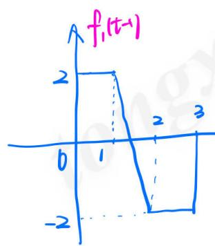

官网：tongxi nkaoyan. con

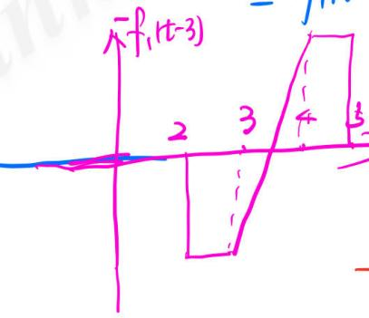

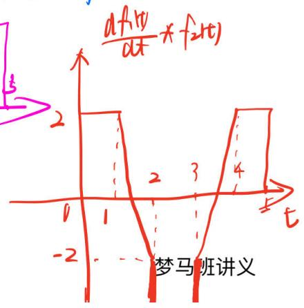

10、【2025 湖北工业大学 923】

已知信号 $x(t)$ 的波形图如图所示,画出的 ${x}_{1}\left( t\right)  = x\left( t\right)  * {\delta }^{\prime }\left( {t - 1}\right)$ 的波形并写出

$x_{1}(t)$ 的表达式。

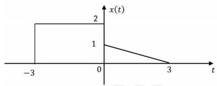

${x}_{1}\left( t\right)  = x\left( t\right)  \times  {0}^{\prime }\left( {t - 1}\right)  = {x}^{\prime }\left( {t - 1}\right)$

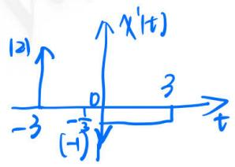

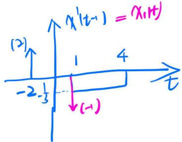

$$
\mathrm{故} x _ {1} (t) = 2 \sqrt {(t + 2)} - \sqrt {(t - 1)} - \frac {1}{3} [ u (t - 1) - u (t - 4) ]
$$

11、【2025 黑龙江大学 888】

已知 $h_a(t) = 2\delta (t - 3), h_b(t) = u(t - 1) - u(t - 2), h_c(t) = \delta (t), h_d(t) = 2u(t)$

求所示连续时间LTI系统的单位冲激响应 $h(t)$ 。

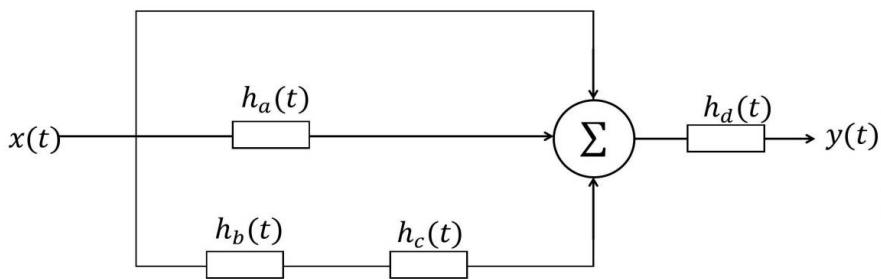

$$
\begin{array}{r l} {h (t)} & {= [ \delta (t) + h _ {a} (t) + h _ {b} (t) * h _ {c} (t) ] * h _ {a} (t)} \\ & {= [ \delta (t) + 2 \delta (t - 3) + u (t - 1) - u (t - 2) ] * 2 u (t)} \\ & {= 2 u (t) + 4 u (t - 3) + 2 (t - 1) u (t - 1) - 2 (t - 2) u (t - 2)} \end{array}
$$

官网：tongxi nkaoyan. com

B站up: 信号与系统\_谷哥

$$
\begin{array}{r l} {y _ {3} (t + 1) = x (t) * h (t)} & {= e ^ {- t} (u (t)) * [ - e ^ {- t} + 3 e ^ {- \sqrt {t}} ]} \\ & {= - (e ^ {- t} e ^ {- t}) (u (t)) + 3 [ \frac {1}{4} (e ^ {- t} e ^ {- \sqrt {t}}) ]} \end{array}
$$

$$
y _ {i} | t | = C e ^ {- 2 t} + D e ^ {- 5 t}
$$

12.【2025 中国海洋大学 819】 $= \left( {-\frac{1}{4}{e}^{-t} + {e}^{-x} - \frac{3}{4}{e}^{-f t}\text{ (1)(1)}\right)$ ${b}_{1}y\left( {4t}\right)  = y\left( {{10} - 7 = c + D = 5}\right)$

已知一因果 LTI 系统的微分方程为 $y''(t) + 7y'(t) + 10y(t) = 2x'(t) + x(t)$ $y'(t) = y'(t) = -2c - \sqrt{D} = 3$

(1)求单位冲激响应;

$$
\begin{array}{r l} {y ^ {\prime \prime} (t) + 7 y ^ {\prime} (t) + 1 0 y (t) = 2 x ^ {\prime} (t) + x (t) y _ {1} (u _ {1}) = y _ {1} (u _ {2}) = - 2 C - \sqrt {D} = 3} \\ & {\Rightarrow C = \frac {2 8}{3} \quad D = - \frac {1 3}{3}} \end{array}
$$

(2)若输入 $x(t)=e^{-t}u(t)$ ， $y(0_{-})=5$ ， $y'(0_{-})=3$ ，求系统零输入响应和零状态
响应。 $\therefore y_{i}^{1}+1=\left(\frac{28}{3}e^{-\frac{2x+13}{3}}e^{-\frac{y+1}{3}}\right)$

(1) $h'(t)+7h(t)+10h(t)=2\sqrt{t+1}+\sqrt{t}(t)$ 且 $h'(t-2)=0$

$$
\begin{array}{r l} & {\lambda (t) = A e ^ {- 2 t} + B e ^ {- 5 t}} \\ & {\left\{ \begin{array}{l l} {h ^ {\prime \prime} (t) = a \delta^ {\prime} (t) + b \sqrt [ 3 ]{(t)} + C \Delta (1 + t) \Rightarrow a = 2, b + 7 a = 1 \Rightarrow b = - 1 3} \\ {h ^ {\prime} (t) = a \sqrt [ 3 ]{(t)} + b \Delta (1 + t) \Rightarrow h ^ {\prime} (0 + t) = h (0 - 1) + b = - 1 3} \\ {h (t) = a \Delta (1 + t) \Rightarrow h (0 + t) = h (0 - 1) + a = 2} \end{array} \right.} \\ & {\lambda (0 + t) = A + B = 2 \quad A = - 1, B = 3 \Rightarrow h (t) = (- e ^ {- 2 t} + 3 e ^ {- 5 t}) (1 + t)} \\ & {\lambda^ {\prime} (0 + t) = - 2 A - 5 B = - 1 3} \end{array}
$$

13、【2025 广东工业大学 809】

已知系统的微分方程: $y''(t) + 6y'(t) + 5y(t) = f'(t) + 5f(t)$

(1) 求 $h\left( t\right)$ ;

(2)若 $f(t)=e^{-3t}u(t)$ ， $y(0_{+})=0$ ， $y'(0_{+})=1$ ，求系统的全响应。

$$
\begin{array}{r l} & {\mathrm{if:(1)} h ^ {\prime \prime} (t) + 6 h ^ {\prime} (t) + 5 h (t) = \delta^ {\prime} (t) + 5 \delta (t) \mathrm{且} h ^ {(k)} (2) = 0} \\ & {h (t) = A e ^ {- t} + B e ^ {- 5 t}} \\ & \left\{ \begin{array}{l l} {h ^ {\prime} (t) = a \delta^ {\prime} (t) + b \delta (t) + C \Delta (u t)} & {\Rightarrow a = 1, b + 6 a = 5 \Rightarrow b = - 1} \\ {h ^ {\prime} (t) = a \delta^ {\prime} (t) + b \Delta (u t)} & {\Rightarrow h ^ {\prime} (0 +) = h ^ {\prime} (0 -) + b = - 1} \\ {h (t) = a \Delta (u t)} & {\Rightarrow h (0 +) = h (0 -) + a = 1} \\ {h (0 +)} & {= A + B = 1 \quad \Rightarrow A = 1, B = 0} \\ {h ^ {\prime} (0 +)} & {= - A - 5 B = - 1} \\ & {\Rightarrow h (t) = e ^ {- t} u (t)} \\ {(2)} & {y _ {2 s} (t) = f (t) * h (t) = \frac {1}{2} (e ^ {- t} - e ^ {- 3 t}) u (t)} \\ & {\therefore y (t) = C e ^ {- t} + D e ^ {- 5 t} - \frac {1}{2} e ^ {- 3 t}} \\ & {y (0 +) = C + D - \frac {1}{2} = D \quad \Rightarrow C = \frac {1}{2}, D = 0} \\ & {y ^ {\prime} (0 +)} \\ & {= - C - 5 D + \frac {3}{2} = 1 \quad 6} \\ & {\mathrm{tongxinkaoyan.com}} \\ & {y ^ {\prime} (0 +)} \end{array} \right. \end{array}
$$

14.【2025 长春理工大学 808】

已知一LTI因果系统,当输入为 $x(t)$ 时,全响应为 $(2e^{-3t} + \sin 2t) u(t)$ ; 当输入

为 $2x(t)$ 时，全响应为 $(e^{-3t} + 2\sin 2t)u(t)$ 。

(1)若初始状态不变, 求当输入为 $x(t - 1)$ 时的全响应

(2)若初始状态变2倍，求当输入为 $2x(t)$ 时的全响应。
设：令当输入为 $x(t)$ 时，全响应 $y_{1}(t)=y_{2}(t+1+y_{3}(t))=(2e^{-3t}+\sin2t)y_{1}(t)$ ①

则当输入为 $2x(t)$ 时会响应 $y_{2}(t)=y_{2}(t)+2y_{2}(t)=k^{-3t}+2\sin(2t)(n(t))$

② -①得 $y_{2}(t)=\left(\sin2t-e^{-3t}\right)u+t$

故 $y_{2i}|t|=3e^{-3t}u(t)$ (1) $y_{3}|t|=y_{2i}|t+y_{2s}|t-1)=3e^{-3t}u(t)+[\sin2|t-1)-e^{-3|(t-1)}]u(t-1)$

(2) $y_{A}(t)=2y_{21}(t)+2y_{33}(t)=(6e^{-3t}+2\sin2t-2e^{-3t})u(t)$ 15.【2025 天津大学 815】 $=(4e^{-3t}+2\sin2t)u(h)$

已知描述连续时间因果系统的微分方程为 $y''(t) + 3y'(t) + 2y(t) = f(t) +$

$$
\int_ {0} ^ {+ \infty} f (t - \tau) d \tau
$$

$$
y (0 _ {-}) = 1, y ^ {\prime} (0 _ {-}) = - 1
$$

$$
f (t) =
$$

$$
e ^ {- t} u (t)
$$

(1)零输入响应 $y_{zi}(t)$

(2)零状态响应 $y_{zs}(t)$

(3)稳态响应

$\overline{w}_{2}$ : (1)

$$
y _ {2 i} (t) = A e ^ {- t} + B e ^ {- 2 t}
$$

$$
B = 0 \Rightarrow y _ {i} (t) = e ^ {- t} u (t)
$$

$$
\Rightarrow h (t) = (- \frac {1}{2} e ^ {- x t} + \frac {1}{2} h (t))
$$

$$
\begin{array}{r l} {(2)} & {y ^ {\prime \prime} (t) + 3 y ^ {\prime} (t) + 2 y (t) = f (t) + f (t) \times u (t)} \\ & {\Rightarrow h ^ {\prime \prime} (t) + 3 h ^ {\prime} (t) + 2 h (t) = o (t) + u (t) \mathrm{且} h ^ {(k)} (0) = 0} \\ & {h (t) = C e ^ {- t} + D e ^ {- 2 t} + \frac {1}{2}} \\ & {\left\{ \begin{array}{l l} {h ^ {\prime \prime} (t) = a o (t) + b \Delta u (t)} & {\Rightarrow a = 1} \\ {h ^ {\prime} (t) = a \Delta u (t)} & {\Rightarrow h ^ {\prime} (v +) = h ^ {\prime} (v -) + a = 1} \\ {h (t) = a t \Delta u (t)} & {\Rightarrow h (v +) = h (v -) = 0} \end{array} \right.} \end{array}
$$

$$
\begin{array}{r l} {y _ {x | t |}} & {= h (t) * f (t)} \\ & {= - \frac {1}{2} [ e ^ {- t} - e ^ {- x} ] u v} \\ & {+ \frac {1}{2} (1 - e ^ {- t}) u h)} \\ & {= (e ^ {- t} + \frac {1}{2} e ^ {- x} + \frac {1}{2}) u h)} \end{array}
$$

官网：tongxinkaoyan.com $h(0+) = c + d + \frac{1}{2} = 0$ 7 $\Rightarrow c = 0, d = -\frac{1}{2}$ (3) 状态只有在于y轴中

## 16.【2025 宁波大学 829】

已知 1 和 2 两个因果系统如下:

1 系统微分方程为： $y''(t) + 4y'(t) + 3y(t) = x(t)$ ，

单位冲激响应为： $h_1(t) = \frac{1}{2} (e^{-t} - e^{-3t})u(t)$

2 系统微分方程为: $y''(t) + 4y'(t) + 3y(t) = x'(t) + 2x(t)$

(1)求 2 系统的单位冲激响应 $h_{2}(t)$ 。

(2)若 $x(t) = e^{-4t}u(t)$ ， $y(0^{+}) = \frac{1}{3}, y'(0^{+}) = \frac{1}{3}$ ，求2系统的输出 $y(t)$ 。

(3)1 系统和 2 系统级联成 3 系统, 求 3 系统的单位冲激响应 $h_3(t)$ 。

$\overrightarrow{m}/2=(1)h_{2}^{i}(t)+4h_{2}^{i}(t)+3h_{2}^{i}(t)=0^{i}(t)+20\sqrt{i(t)}$ 且 $h_{2}^{i}(t)=0$

$$
\begin{array}{r l} & {h _ {2} (t) = A e ^ {- t} + B e ^ {- 3 t}} \\ & {h _ {2} ^ {\prime \prime} (t) = a \delta^ {\prime} (t) + b \delta^ {\prime} (t) + C \Delta (u | t) \Rightarrow a = 1, b + 4 a = 2 \Rightarrow b = - 2} \\ & {h _ {2} ^ {\prime} (t) = a \delta^ {\prime} (t) + b \Delta (u | t) \Rightarrow h _ {2} ^ {\prime} (u +) = h _ {2} ^ {\prime} (u -) + b = - 2} \\ & {h _ {2} (t) = a \Delta (u | t) \Rightarrow h _ {2} (u +) = h _ {2} (u -) + a = 1} \\ & {h _ {2} (u +) = A + B = 1 \quad \Rightarrow A = \frac {1}{2}, \quad B = \frac {1}{2}} \\ & {h _ {2} ^ {\prime} (v +) = - A - 3 B = - 2} \\ & {\Rightarrow h _ {2} (t) = \frac {1}{2} (e ^ {- t} + e ^ {- 3 t}) u | t)} \end{array}
$$

(2)

$$
\begin{array}{r l} {y _ {2 S _ {2}} (t) = x (t) + h _ {2} (t)} & {= \frac {1}{2} [ \frac {1}{3} (e ^ {- t} - e ^ {- 4 t}) ] (u (t)} \\ & {\quad + \frac {1}{2} [ e ^ {- 3 t} - e ^ {- 4 t} ] (u (t))} \\ & {= (\frac {1}{6} e ^ {- t} - \frac {2}{3} e ^ {- 4 t} + \frac {1}{2} e ^ {- 3 t}) (u (t))} \end{array}
$$

$$
\therefore y (t) = C e ^ {- t} + D e ^ {- 3 t} - \frac {2}{3} e ^ {- 4 t}
$$

$$
\therefore y (0 + 1) = C + D - \frac {2}{3} = \frac {1}{3} \Rightarrow C = \frac {1}{3}, D = \frac {2}{3}
$$

$$
\therefore y \vert u = (\frac {1}{3} e ^ {- t} + \frac {2}{3} e ^ {- 3 t} - \frac {2}{3} e ^ {- 4 t}) (u \vert t)
$$

$$
(4) h _ {3} (t) = h _ {1} (t) \times h _ {2} (t) = \frac {1}{2} (e ^ {- t} - e ^ {- 3 t}) u (t) \times \frac {1}{2} (e ^ {- t} + e ^ {- 3 t}) u (t)
$$

官网：tongxi nkaoyan. con

梦马班讲义

$$
\begin{array}{r l} & {\mathrm{免费讲义Q群:1095841878}} \\ & {= \frac {1}{2} e ^ {- t} u (t) * \frac {1}{2} e ^ {- t} u (t) + \frac {1}{2} e ^ {- t} u (t) * \frac {1}{2} e ^ {- 3 t} u (t) - \frac {1}{2} e ^ {- 3 t} u (t) * \frac {1}{2} e ^ {- t} u (t)} \\ & {= \frac {1}{4} t e ^ {- t} u (t) - \frac {1}{4} t e ^ {- 3 t} u (t)} \\ & {= \frac {1}{4} t (e ^ {- t} - e ^ {- 3 t}) u (t)} \end{array}
$$