## 第3章 傅里叶变换及其在通信系统中的应用

专题1 周期信号三角形式傅里叶....4  
专题2 周期信号指数形式傅里叶级数....8  
专题3 非周期信号的傅里叶变换....11  
专题4 傅里叶变换的性质....19  
专题5 周期信号的傅里叶变换....31  
专题6 抽样及抽样定理....35  
专题7 调制与解调-AM、DSB与FDM系统....41  
专题8 希尔伯特变换及SSB信号....52  
专题9 连续系统的频域分析....62

核心问题：响应求解、系统特性判断

四大关联：连续与离散、时域与变换域、理论与应用、表达式与图解（1）调制与解调

(2) 信号抽样

官网：tongxinkaoyan.com

B站up: 信号与系统\_谷哥

## 专题 1 周期信号三角形式傅里叶级数

## 考点 1: Sa函数及在 FT 中的应用

抽样信号，Sa函数是非常重要的连续信号之一，在FT中使用频繁，在此补充Sa函数的定义与使用。

1、定义： $Sa(t)=\frac{sin(t)}{t}$

2、图形：

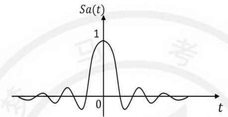

3、特点：

(1)偶对称: $Sa(-t) = Sa(t)$

(2)收敛性

(3)过零点： $Sa(t)=0\Rightarrow\frac{sin t}{t}=0\Rightarrow sin t=0$ 且 $t\neq0\Rightarrow t=k\pi,\quad k=\pm1,\quad\pm2$

(4)第一过零点: $\pi$

(5)积分性质

$$
\int_ {- \infty} ^ {\infty} S a (t) d t = \pi ; \int_ {0} ^ {\infty} S a (t) d t = \frac {\pi}{2}
$$

4、构造过程

(1)构造Sa函数；

$$
\begin{array}{c} \frac {\sin 2 t}{t} = \\ \frac {\sin 5 0 0 \pi t}{t} = \end{array}
$$

(2)构造后 Sa 函数图形

以 $2Sa(2t)$ 为例，幅值最高点仍在 t=0 处，最大幅值为 2，过零点为 $\sin 2t = 0$ 且 $t \neq 0$ ，即 $t = \frac{k\pi}{2}$ ， $k = \pm 1, \pm 2, \cdots$ ，第一过零点为 $t = \frac{\pi}{2}$ 。

公众号：通信考研小马哥

## 考点 2: 三角形式的傅里叶级数

研究对象：周期信号周期为 $T_{1}$ ，其角频率为 $\omega_{1}=\frac{2\pi}{T_{1}}$ ，频率为 $f_{1}=\frac{1}{T_{1}}$ 一般形式

$$
f (t) = a _ {0} + \sum_ {n = 1} ^ {\infty} \left[ a _ {n} \cos \left(n \omega_ {1} t\right) + b _ {n} \sin \left(n \omega_ {1} t\right) \right]
$$

直流分量

$$
a _ {0} = \frac {1}{T _ {1}} \int_ {t _ {0}} ^ {t _ {0} + T _ {1}} f (t) d t
$$

余弦分量的幅度

$$
a _ {n} = \frac {2}{T _ {1}} \int_ {t _ {0}} ^ {t _ {0} + T _ {1}} f (t) c o s (n \omega_ {1} t) d t
$$

正弦分量的幅度

$$
b _ {n} = \frac {2}{T _ {1}} \int_ {t _ {0}} ^ {t _ {0} + T _ {1}} f (t) \sin (n \omega_ {1} t) d t
$$

其中 $n = 1, 2, \cdots$ 。

(1)任何周期信号在满足狄里赫利条件就可以分解成直流分量及许多正弦、余弦分量，且这些正、余弦分量的频率必定是基频的整数倍；

(2)基波：把周期信号的频率称之为基频，对应的分量称之为基波；

(3) $n$ 次谐波: 把频率为基频整数倍 $(nf_{1}$ 或 $n\omega_{1}$ ) 的各频率分量称之为 $n$ 次谐波。

问题转换：要想求某个周期信号三角形式傅里叶级数

(1) 明确该周期信号的基本参数 $T_{1}$ 和 $\omega_{1}$

(2) $a_{0} 、 a_{n}$ 和 $b_{n}$ 的值

从一般形式公式看：（1）周期信号直流分量 $a_0$ 的求解

(2) $a _ { 0 }$ 是否存在, 不影响 $a _ { n }$ 和 $b _ { n }$ 的值

## 考点3: 信号对称性对频率分量的影响【抛开直流, 只考虑 $a_{n}$ 和 $b_{n}$ 】

1、原理——信号对称性对频率分量的影响

(1)偶函数 $f(t)=f(-t)$ ，仅含有余弦分量，肯定不含正弦分量；

(2)奇函数 $f(t) = -f(-t)$ ，仅含有正弦分量，肯定不含有余弦分量；

(3)奇谐函数 $f(t) = -f\left(t \pm \frac{T}{2}\right)$ ，仅含有基波和奇次谐波分量；

(4)偶谐函数 $f(t) = f\left(t \pm \frac{T}{2}\right)$ ，仅含有偶次谐波分量。

## 2、函数对称性的判断——观察法

(1)直流分量对谐波分量的影响, 由一般形式可知 $a_{0}$ 是否存在, 不影响 $a_{n}$ 和 $b_{n}$ 的值是否为 0 的判断, 但直流的存在会影响函数对称性的判断。

直流对函数对称性（ $a_{0}$ 对 $a_{n}$ 和 $b_{n}$ 的影响）的判断：

## (2)周期信号对称性的判断

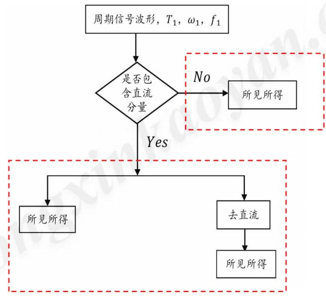  
3  
官网：tongxinkaoyan.com

梦马班讲义

B站up: 信号与系统\_谷哥

公众号：通信考研小马哥

例 1: 利用奇偶性判断下图所示各周期信号的傅里叶级数中所含的频率分量。

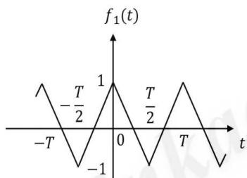  
(a)

$f_{2}(t)$

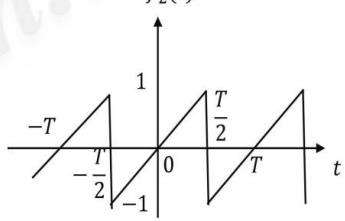  
(b)

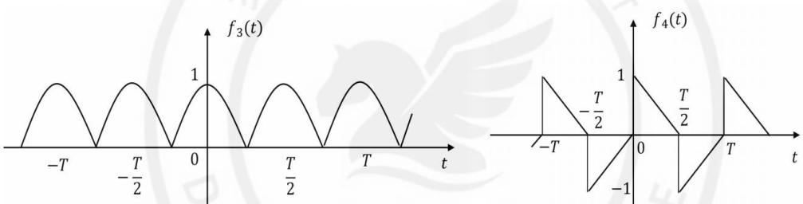  
(c)  
(d)

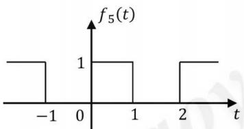

4

官网：tongxinkaoyan.com

梦马班讲义

(3) 周期信号三角形式 (一般形式) 傅里叶级数的求解流程

例 2: $f(t)$ 波形如下图所示, 求三角形式傅里叶级数表达式。

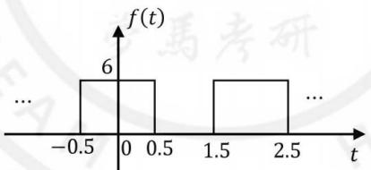

官网：tongxinkaoyan.com

梦马班讲义

B站up: 信号与系统\_谷哥

公众号：通信考研小马哥

例 3: $f\left( t\right)$ 波形如下图所示,求其三角形式傅里叶级数表达式。

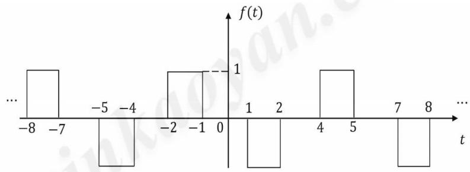

6

官网：tongxinkaoyan.com

梦马班讲义

考点3：余弦形式的傅里叶级数

两者关系

$$
f (t) = c _ {0} + \sum_ {n = 1} ^ {\infty} c _ {n} \cdot \cos \left(n \omega_ {1} t + \varphi_ {n}\right)
$$

$$
a _ {0} = c _ {0}
$$

$$
c _ {n} = \sqrt {a _ {n} ^ {2} + b _ {n} ^ {2}} (c _ {n} \mathrm{永远是正值}), n \geq 1
$$

$$
a _ {n} = c _ {n} \cos \varphi_ {n}
$$

$$
b _ {n} = - c _ {n} \sin \varphi_ {n}
$$

$$
\tan \varphi_ {n} = - \frac {b _ {n}}{a _ {n}}
$$

$$
(n = 1, 2, \dots)
$$

1、三角形式下频谱的定义

(1)频谱包含幅度谱与相位谱，其中幅度谱为 $C_{n}\sim n\omega_{1}$ ，相位谱 $\varphi_{n}\sim n\omega_{1}$ 。

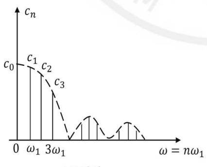  
(a)幅度谱

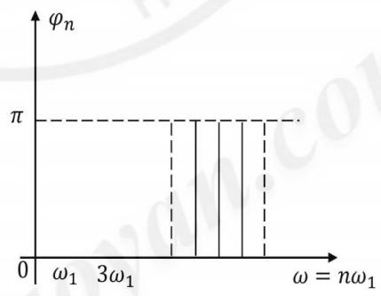  
(b)相位谱  
(2)周期信号频谱特点：离散性、谐波性和收敛性；

(3)由于谱线位于 $n\omega_{1}$ ，故谱线间隔一般为角频率 $\omega_{1}$ ，但信号频谱中可能包含不同谐波分量，即n的取值不同，故具体间隔要具体分析。

B站up: 信号与系统\_谷哥

公众号：通信考研小马哥

2、周期信号的频谱画法(余弦形式视角下)

(1)将(不规范的)周期信号傅里叶级数整理成余弦形式傅里叶级数；

$$
\left\{ \begin{array}{l} {s i n   \theta = c o s \left(\theta - \frac {\pi}{2}\right)} \\ {-   c o s   \theta = c o s   (\theta \pm \pi)} \end{array} \right. \Rightarrow C _ {0} + \sum_ {n = 1} ^ {\infty} c _ {n}   c o s   (n \omega_ {1} t + \varphi_ {n})   \text {且} C _ {n}   \text {正}
$$

(2)明确各频率分量对应的值: 幅度谱为 $C_{n} \sim n \omega_{1}$ , 相位谱 $\varphi_{n} \sim n \omega_{1}$ ;

(3)画幅度谱和相位谱。

【以下新增，同一下次课例题】

例4： $f(t) = \sin \left(\frac{5}{3}\pi t\right) + \cos \left(\frac{2}{3}\pi t\right)$ ，画出单边形式的幅度谱和相位谱。

例 5: 已知 $f(t)=1+\sin\omega_{1}t+\cos\omega_{1}t+\cos(2\omega_{1}t+\frac{\pi}{4})$ ，画出单边形式的幅度谱和相位谱。

例 6: 周期信号 $f(t) = 3 \cos t + \sin \left(5t + \frac{\pi}{6}\right) - 2 \cos \left(8t - \frac{2\pi}{3}\right)$ , 画出单边形式的幅度谱和相位谱。

B站up: 信号与系统\_谷哥

公众号：通信考研小马哥

(南京大学) 例 7: 周期信号 $f(t)$ 如下图所示

计算其三角形式的傅里叶级数中相关分量: 直流 $a_{0}, a_{1}, a_{2}, b_{1}, b_{2}$

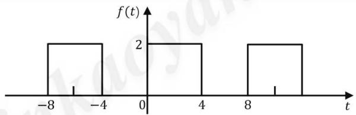

官网：tongxinkaoyan.com

梦马班讲义

# 总结——周期信号三角形式傅里叶级数（考研考点）

1、已知周期信号的图形，求其三角形式的傅里叶级数（或画单边谱）

2、已知周期信号表达式，画单边谱【已知形式 $\rightarrow$ 余弦形式】

(1) 辨识表达式形式（一般形式、大杂烩形式）

识别原则：

(2)

B站up: 信号与系统\_谷哥

公众号：通信考研小马哥