## 第3章 傅里叶变换及其在通信系统中的应用

专题 1 周期信号三角形式傅里叶..

专题 2 周期信号指数形式傅里叶级数..

神问共同信号

专题 3 非周期信号的傅里叶变换...

尚如

专题 4 傅里叶变换的性质.

专题 5 周期信号的傅里叶变换..

专题6 抽样及抽样定理..

专题 7 调制与解调-AM、DSB 与 FDM 系统.

专题 8 希尔伯特变换及 SSB 信号.

专题 9 连续系统的频域分析.

核心问题：响应求解、系统特性判断

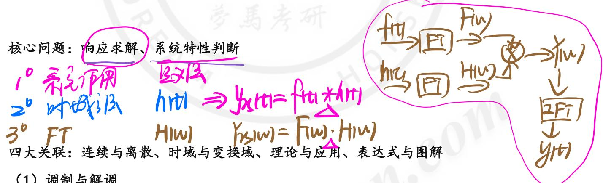

${3}^{ \circ  }{FT}\;{H(w)}\;{y}_{\left( s\right) }\left( w\right)  = F\left( w\right)  \cdot  {H\left( w\right) }$

四大关联：连续与离散、时域与变换域、理论与应用、表达式与图解

(1) 调制与解调

(2) 信号抽样

③ max. t2021

# 专题 1 周期信号三角形式傅里叶级数

考点1: Sa函数及在FT中的应用 ①构造sin[\_\_\_\_]=②第一段式求解

抽样信号，Sa函数是非常重要的连续信号之一，在FT中使用频繁，在此补充Sa函数的定义与使用。

1、定义： $Sa(t)=\frac{\sin(t)}{t}$ 一致性

2、图形：

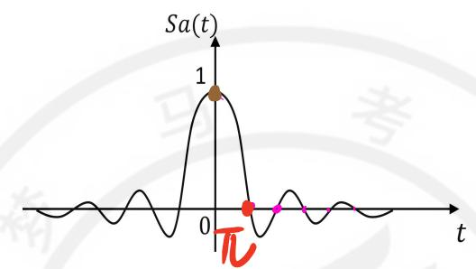

$\int_{-\infty}^{\infty} \frac{\sin t}{t} \cdot \frac{\sqrt{t}}{dt}$

3、特点：

(1)偶对称： $Sa(-t)=Sa(t)$

(2)收敛性

(3)过零点: $Sa(t)=0 \Rightarrow \frac{\sin t}{t}=0 \Rightarrow \sin t=0$ 且 $t \neq 0 \Rightarrow t=k\pi, k=\pm 1, \pm 2$

(4)第一过零点: $\pi$

(5)积分性质

$$
\int_ {- \infty} ^ {\infty} S a (t) d t = \pi ; \int_ {0} ^ {\infty} S a (t) d t = \frac {\pi}{2}
$$

4、构造过程

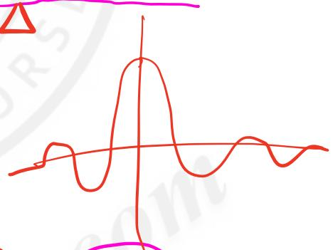

(1)构造Sa函数；

$$
\frac {\sin 2 t}{t} = 2 \cdot \frac {\sin 2 t}{2 t} = 2 S a (2 t)
$$

$$
\frac {\sin 5 0 0 \pi t}{t} = 3 0 0 \pi \frac {\sin 5 0 0 \pi t}{5 0 0 \pi t} = 3 0 0 \pi S a (5 0 0 \pi t)
$$

(2)构造后 Sa 函数图形

以 $2Sa(2t)$ 为例，幅值最高点仍在 t=0 处，最大幅值为 2，过零点为 $\sin 2t = 0$ 且 $t \neq 0$ ，即 $t = \frac{k\pi}{2}$ ， $k = \pm 1, \pm 2, \cdots$ ，第一过零点为 $t = \frac{\pi}{2}$ 。

免费讲义群:信号系统,谷哥

公众号：通信考研小马哥

$j_{0}T_{1},w_{1}\text{和}f_{1}$ 考点

周期信号①

考点2: 三角形式的傅里叶级数

研究对象：周期信号周期为 $T_{1}$ ，其角频率为 $\omega_{1}=\frac{2\pi}{T_{1}}$ ，频率为 $f_{1}=\frac{1}{T_{1}}$ 一般形式 $I=4(s)$

直流分量

$$
f (t) = \left(a _ {0} + \sum_ {n = 1} ^ {\infty} \left[ a _ {n} \cos (n \omega_ {1} t) + b _ {n} \sin (n \omega_ {1} t) \right] \right.
$$

$$
a _ {0} = \frac {1}{T _ {1}} \int_ {t _ {0}} ^ {t _ {0} + T _ {1}} f (t) d t = \frac {S _ {T _ {1}}}{T _ {1}}
$$

余弦分量的幅度

$$
a _ {n} = \left(\frac {2}{T _ {1}} \int_ {t _ {0}} ^ {t _ {0} + T _ {1}} f (t) \cos (n \omega_ {1} t) d t \right.
$$

正弦分量的幅度

an和bn互等

$$
\underline {{b _ {n}}} = \frac {2}{T _ {1}} \int_ {t _ {0}} ^ {t _ {0} + T _ {1}} \underbrace {f (t) s i n (n \omega_ {1} t)} d t
$$

其中 $n = 1, 2, \cdots$ 。

基波频平
11W $_{1}$ 因知信号
频率

(1)任何周期信号在满足狄里赫利条件就可以分解成直流分量及许多正弦、余弦分量，且这些正、余弦分量的频率必定是基频的整数倍；

(2)基波: 把周期信号的频率称之为基频, 对应的分量称之为基波;

(3)n次谐波: 把频率为基频整数倍 $(nf_{1}$ 或 $n\omega_{1})$ 的各频率分量称之为 $n$ 次谐波。

$nw_{1}$

$f(t)=a_{0}+\sum_{n=1}^{\infty}a_{n}\cos nwt+b_{n}\sin nwt$ $=a_{0}+a_{1}\cos w_{1}t+b_{1}\sin w_{1}t+a_{2}\cos 2w_{1}t+b_{2}\sin 2w_{1}t+$

问题转换: 要想求某个周期信号三角形式傅里叶级数

$$
n = 2
$$

(1) 明确该周期信号的基本参数 $T_{1}$ 和 $\omega_{1}$

(2) $a_{0} 、 a_{n}$ 和 $b_{n}$ 的值

从一般形式公式看: (1) 周期信号直流分量 $a_{0}$ 的求解

(2) $a_0$ 是否存在，不影响 $a_n$ 和 $b_n$ 的值

# ☆快速求an和bn

$\frac{2}{T_{1}} f_{T_{1}} f(t) \cos n u t d t$

考点3：信号对称性对频率分量的影响【抛开直流，只考虑 $a_{n}$ 和 $b_{n}$ 】

1、原理——信号对称性对频率分量的影响

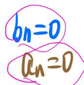

(1)偶函数 $f(t)=f(-t)$ ，仅含有余弦分量，肯定不含正弦分量；

$$
\frac {2}{T _ {1}} \int_ {T _ {1}} ^ {T} f (t) \sin n u t d t
$$

(2)奇函数 $f(t) = -f(-t)$ ，仅含有正弦分量，肯定不含有余弦分量；

(3)奇谐函数 $f(t) = -f\left(t \pm \frac{T}{2}\right)$ ，仅含有基波和奇次谐波分量；n取车

(4)偶谐函数 $f(t)=f\left(t\pm\frac{T}{2}\right)$ ，仅含有偶次谐波分量。

2、函数对称性的判断——观察法

99: 偶+偶谐 $\Rightarrow$ 只含有偶次的余点$\Rightarrow  {b}_{n} = 0\;$ 求 ${a}_{n}\left( {n\text{ 反何要}}\right)$

(1)直流分量对谐波分量的影响, 由一般形式可知 $a_{0}$ 是否存在, 不影响 $a_{n}$ 和 $b_{n}$ 的

值是否为 0 的判断，但直流的存在会影响函数对称性的判断。

直流对函数对称性（ $a_{0}$ 对 $a_{n}$ 和 $b_{n}$ 的影响）的判断：

$$
a _ {0} = \frac {S _ {\pi}}{T _ {1}}
$$

$a_{0}$ 是否存在不影响 $a_{n}$ 和 $b_{n}$ 存在

分析对称性 $\Rightarrow  {a}_{n}$ 和 ${b}_{n}$

但是 $a_{0}$ 的存在全景影响多样性

(2)周期信号对称性的判断

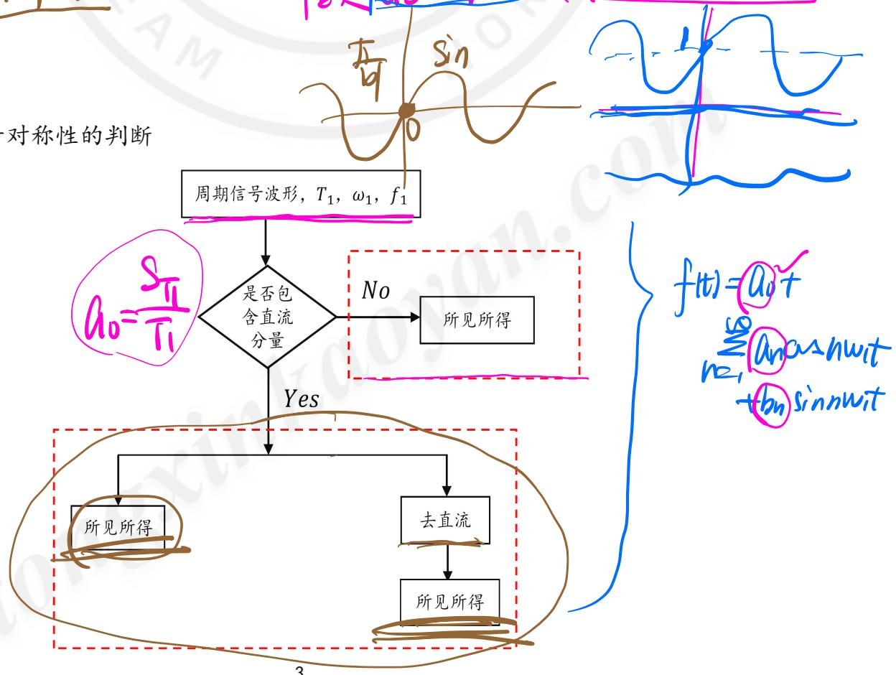

免费讲义群:信号包系统4谷哥

1. 说奇 考苦 错语

例 1: 利用奇偶性判断下图所示各周期信号的傅里叶级数中所含的频率分量。

$$
\begin{array}{r l} {f _ {1 1}} & {= a _ {1} \cos w _ {1} t} \\ & {+ a _ {3} \cos 3 w _ {1} t} \\ & {+ a _ {5} \cos 5 w _ {1} t} \end{array}
$$

无直流

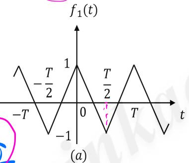

$$
b _ {n} = 0
$$

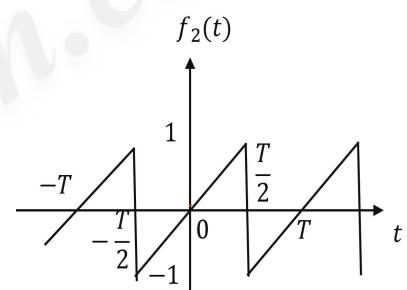

奇

无互补心 $a_n=0$ . 只存在 $b_n$ 正弦分量⇒奇偶的弦项

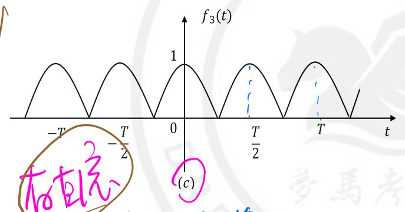

偶，偶谐

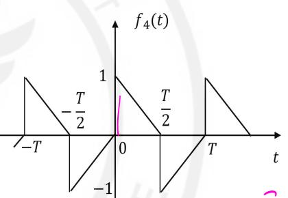

假设的集氏含量

无直流

奇汉力量

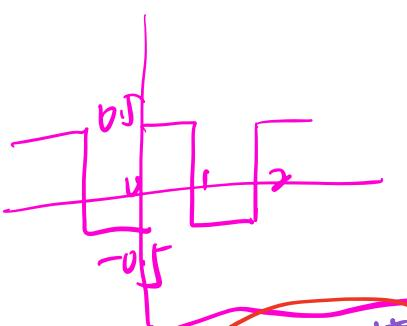

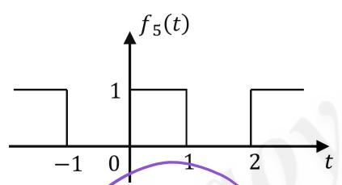

哈也不是

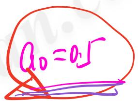

$$
^ 4 a _ {n} = 0
$$

n取奇权

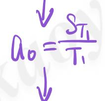

(3) 周期信号三角形式（一般形式）傅里叶级数的求解流程

已知 $f_{T}(t)$ , $T_{1}$ 和 $W_{1}$

对称性

an与bn存在情况

谁存在求难 (代公式)

所见的得

⇒ 可使所得
<去直线所见所得>

反映(π15√6)

例 2: $f(t)$ 波形如下图所示, 求三角形式傅里叶级数表达式。

参数： $T_{1}=2(s)$ $W_{1}=\frac{2\pi}{T_{1}}=\pi$

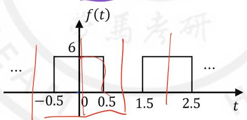

$$
\mathrm{问}: T _ {1} = 2, \quad w _ {1} = \pi
$$

$$
2 ^ {\circ} a _ {0} = \frac {S _ {\pi}}{T _ {1}} = \frac {6}{2} = 3
$$

$P_{0}$ 对称 $\Rightarrow b_{n}=0$

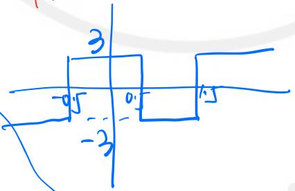

$3^{\circ}$ 偶对称 + 奇谐与直流奇数 $\Rightarrow n$ 取奇数

$b_n = 0, a_n$ 存在 $(n=奇数)$

$$
\begin{array}{r l} {a _ {n}} & {= \frac {2}{T _ {1}} \int_ {T _ {1}} f (t) \cos n w, t d t} \\ & {= \int_ {- 0. 5} ^ {0. 5} 6 \cos n \pi t d t} \\ & {= \frac {1 2}{n \pi} \sin (\frac {\pi}{2} n), n \mathrm{取奇数}} \end{array}
$$

$$
f (t) = a _ {0} + \frac {3}{n - 1} a _ {n} \cos n w _ {1} t
$$

$\star$ 压传论

官网：tongxinkaoyan.com 公众号【有涧学社考研】免费分享

$$
= 3 + \frac {1 2}{\pi} \cos \pi t - \frac {4}{3 \pi} \cos 3 \pi t + \dots
$$

例 3: $f(t)$ 波形如下图所示, 求其三角形式傅里叶级数表达式。

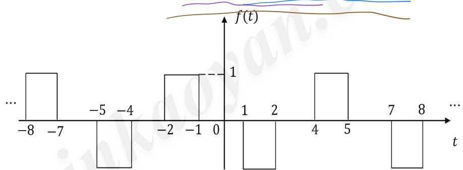

$\overline{n}A_{2}=1^{0}T_{1}=6(s)$ , $W_{1}=\frac{2\pi}{\pi}=\frac{\pi}{3}$ (rad/s)

$$
2 ^ {0} a _ {0} = 0
$$

${3}^{ \circ  }$ 奇+奇谐

${4}^{0}\;{a}_{n} = 0,\;{b}_{n}$ 存在且 $n$ 取奇数

$5^{\circ }$ $b_{n} = \frac{2}{\pi i} \int_{\pi} f(t) \sin n w_1 t dt$ $= \frac{1}{3} \left[ \int_{-2}^{-1} 1 \cdot \sin n \frac{\pi}{3} t dt + \int_ {1} ^ {2} - \sin \frac{n\pi}{3} t dt \right]$ $= \frac{2}{n\pi} \left[ \cos \left( \frac{2\pi}{3} n \right) - \cos \left( \frac{\pi}{3} n \right) \right] \quad n \text { 反奇数 1, 3.5. … }$

$$
\begin{array}{r l} {6 ^ {\circ}} & {f (t) = \underline {{a _ {0}}} + \sum_ {n = 1} ^ {\infty} \underline {{a _ {n}}} \cos n w _ {1} t + b n \sin n w _ {1} t} \\ & {= \sum_ {n = 1} ^ {\infty} \frac {2}{n \pi} \left[ \cos (\frac {2 \pi}{3} n) - \cos (\frac {2}{3} n) \right] \sin n \frac {\pi}{3} t} \\ & {= \frac {- \frac {2}{\pi} \sin \frac {\pi}{3} t}{n - 1} + \frac {4}{3 \pi} \sin \pi t - \dots .} \end{array}
$$

$$
\begin{array}{r l} {f (t)} & {= a _ {0} + \sum_ {n = 1} ^ {\infty} a _ {n} \cos n w _ {1} t + b _ {n} \sin n w _ {1} t} \\ & {= a _ {0} + a _ {1} \cos n w _ {1} t + b _ {1} \sin n w _ {1} t + a _ {2} \cos n w _ {1} t + b _ {2} \sin 2 n w _ {1} t +} \end{array}
$$

$$
\sqrt {a _ {2} ^ {2} + b _ {2} ^ {2}} \cos (2 w _ {1} t + \arctan \frac {- b _ {2}}{a _ {2}})
$$

免费讲义群:信号与系统-谷哥

公众号：通信考研小马哥

考点 3: 余弦形式的傅里叶级数

$$
\begin{array}{r l} {f (t)} & {= C _ {0} + \frac {\sqrt {2}}{n - 1} C _ {n} \cos (n w _ {1} t + \varphi_ {n})} \\ & {= C _ {0} + C _ {1} \cos (w _ {1} t + \varphi_ {1}) + C _ {2} \cos (2 w _ {1} t + \varphi_ {2}) + \dots} \\ & {C _ {0} = a _ {0}, \quad C _ {n} = \sqrt {a _ {n} ^ {2} + b _ {n} ^ {2}}, \quad \varphi_ {n} = \arctan \frac {- b _ {n}}{a _ {n}}} \end{array}
$$

两者关系

$$
\begin{array}{r l} {f (t) = c _ {0} + \sum_ {n = 1} ^ {\infty} c _ {n} \cdot \cos (n \omega_ {1} t + \varphi_ {n})} & {= a _ {0}} \\ {\mathrm{直流}} & {+ c _ {1} \cos (w _ {1} t + \varphi_ {1})} \\ {a _ {0} = c _ {0}} & {+ c _ {2} \cos (2 w _ {1} t + \varphi_ {2})} \\ {c _ {n} = \sqrt {a _ {n} ^ {2} + b _ {n} ^ {2}} (c _ {n} \mathrm{永远是正值}), n \geq 1} & {+ c _ {3} \cos (3 w _ {1} t + \varphi_ {3})} \\ {a _ {n} = c _ {n} \cos \varphi_ {n}} & {+ \dots .} \end{array}
$$

$$
\begin{array}{l l} b _ {n} = - c _ {n} \sin \varphi_ {n} \\ \tan \varphi_ {n} = - \frac {b _ {n}}{a _ {n}} & \varphi_ {n} = \arctan - \frac {b _ {n}}{a _ {n}} \end{array}
$$

$n \ge 1$

$$
(n = 1, 2, \dots)
$$

1、三角形式下频谱的定义

(1)频谱包含幅度谱与相位谱，其中幅度谱为 $C_{n}\sim n\omega_{1}$ ，相位谱 $\varphi_{n}\sim n\omega_{1}$ 。

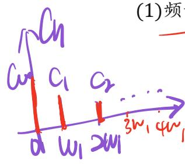

$\varphi_{n}$ 可证项

二语线沟通

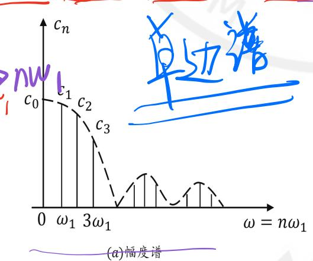

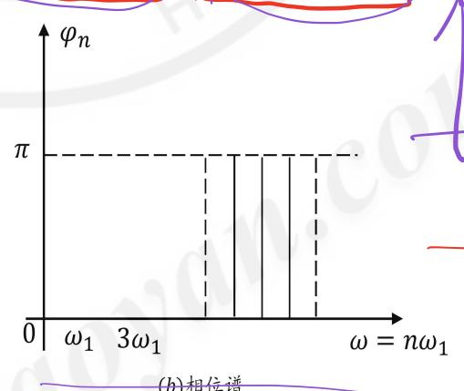

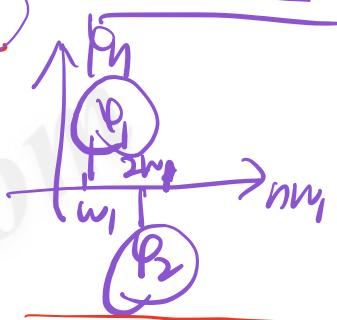

(2)周期信号频谱特点: 离散性、谐波性和收敛性;

$$
n w _ {1} \bot
$$

(3)由于谱线位于 $n\omega_{1}$ ，故谱线间隔一般为角频率 $\omega_{1}$ ，但信号频谱中可能包含不

同谐波分量,即 $n$ 的取值不同,故具体间隔要具体分析.

n=奇数

2、周期信号的频谱画法(余弦形式视角下)

(1)将(不规范的)周期信号傅里叶级数整理成余弦形式傅里叶级数;

$$
\left\{ \begin{array}{l} - \sin \theta = \cos (\theta + \frac {\pi}{2}) \\ \sin \theta = \underline {{\cos}} \left(\theta - \frac {\pi}{2}\right) \\ - \cos \theta = \cos (\theta \pm \pi) \end{array} \Rightarrow C _ {0} + \sum_ {n = 1} ^ {\infty} c _ {n} \cos (n \omega_ {1} t + \varphi_ {n}) \text {且} C _ {n} \right.
$$

(2)明确各频率分量对应的值：幅度谱为 $C_{n}\sim n\omega_{1}$ ，相位谱 $\varphi_{n}\sim n\omega_{1}$ ;

(3)画幅度谱和相位谱。

【以下新增，同一下次课例题】

$$
a _ {0} + \sum_ {n = 1} ^ {\infty} a _ {n} a s n w _ {n} t + b _ {n} \sin n w _ {n} t
$$

例 4: $f(t) = \sin \left( \frac{5}{3} \pi t \right) + \cos \left( \frac{2}{3} \pi t \right)$ , 画出单边形式的幅度谱和相位谱。

Cn $\uparrow_{i}^{1}$ $\downarrow_{i}^{1}$ $\frac{2\pi}{3}$ $\frac{5\pi}{3}$

$$
T _ {2} = 2 \lambda \cdot \frac {3}{2 \lambda} = 3 = \frac {1 5}{5} \Rightarrow T _ {1} = \frac {3 0}{5} = 6, w _ {1} = \frac {\lambda}{3}
$$

例 5: 已知 $f(t) = 1 + \sin \omega_{1} t + \cos \omega_{1} t + \cos \left(2 \omega_{1} t + \frac{\pi}{4}\right)$ ，画出单边形式的幅度谱

和相位谱。

$\frac{2}{3} = \frac{n}{3}$

$$
\begin{array}{r l} {\Rightarrow w _ {1}} & \\ {= 1 + \sqrt {2} \cos (w _ {1} t - \frac {\pi}{4}) + \cos (2 w _ {1} t + \frac {\pi}{4})} & \\ {\Rightarrow C _ {0} = 1} & \\ {C _ {1} = \sqrt {2}} & {\varphi_ {1} = - \frac {2}{4}} \\ {C _ {2} = 1} & {\varphi_ {2} = \frac {\pi}{4}} \end{array}
$$

例6：周期信号 $f(t)=3\cos t+\sin\left(5t+\frac{\pi}{6}\right)-2\cos\left(8t-\frac{2\pi}{3}\right)$ ，画出单边形式的幅度谱和相位谱。

$\overline{m}_{2}$ :

$$
\begin{array}{r l} & {T _ {1} = 2 \pi , T _ {2} = \frac {2 \pi}{5}, T _ {3} = \frac {2 \pi}{8} = \frac {\pi}{4} \Rightarrow T _ {0} = 2 \pi \Rightarrow W _ {0} = 1} \\ & {f (t) = 3 \cos t + \cos (5 t + \frac {\pi}{6} - \frac {\pi}{2}) + 2 \cos (8 t - \frac {2 \pi}{3} + \pi)} \\ & {\quad \downarrow C _ {1} = 3, \varphi_ {1} = 0 \quad C _ {5} = 1, \varphi_ {5} = - \frac {\pi}{3} \quad C _ {8} = 2, \varphi_ {8} = \frac {\pi}{3}} \\ & {\quad = 3 \cos t + \cos (5 t - \frac {\pi}{3}) + 2 \cos (8 t + \frac {\pi}{3})} \end{array}
$$

(南京大学) 例 7: 周期信号 $f(t)$ 如下图所示

计算其三角形式的傅里叶级数中相关分量：直流 $a_0, a_1, a_2, b_1, b_2$

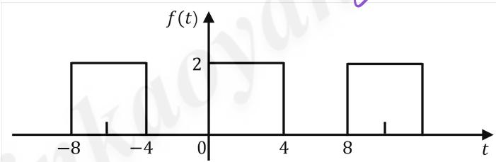

呼：

$$
T = 8
$$

$$
W = \frac {\pi}{4}
$$

$$
a _ {0} = \frac {8}{8} = 1
$$

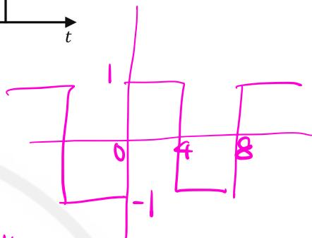

去直流后 $f(t)-a_{0}$ 呈现奇+奇谐
说明 $a_{n}=0,\quad b_{n}$ 存在且 n 反数 $\Rightarrow a_{1}=a_{2}=b_{2}=0$ $b_{n}=\frac{2}{\pi}\int_{\pi}f(t)\sin nmtdt$ $\Rightarrow b_{1}=\frac{2}{8}\int_{0}^{4}2\sin\frac{2}{4}tdt$

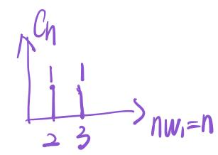

# 总结——周期信号三角形式傅里叶级数 (考研考点)

1、已知周期信号的图形，求其三角形式的傅里叶级数（或画单边谱）

$T_{1}w_{1}\rightarrow a_{0}\rightarrow$ 对称性 $\rightarrow a_{n}$ 与 $b_{n}$ 存在情况 $\rightarrow$ 班立存在求解(一般形式) $C_{0}=a_{0}$ $C_{n}=\sqrt{a_{n}^{2}+b_{n}^{2}}$ $\varphi_{n}=a_{n}\times\tan-\frac{b_{n}}{a_{n}}$ 单边语

全点形式

已知形式: 一的或大杂性
⇒ {一般形式:
杂结形式:

$$
\begin{array}{r l} {f _ {1 t 1}} & {= \sin 2 t + \sin 3 t} \\ {f _ {1 t 1}} & {= \sin 2 t + \cos 3 t} \\ {f _ {1 t 1}} & {= \sin 2 t + \cos (3 t + \frac {\pi}{3})} \end{array}
$$

2、已知周期信号表达式，画单边谱【已知形式+余弦形式】

(1) 辨识表达式形式（一般形式、大杂烩形式）

$$
\begin{array}{r l} {f (t)} & {= \cos 2 t + \cos 3 t} \\ {f (t)} & {= \cos 2 t - \cos (3 t + \frac {\pi}{3})} \end{array}
$$

识别原则：一般形式
合法形式
大杂社会

$$
9: f (t) = \frac {\cos (2 t + \frac {3}{5}) + \cos (3 t + \frac {3}{6})}{\mathrm{点并四分} 1 3}
$$

(2)

$10^{ - }$ 的形式 $\Rightarrow$ 全点形式

10 - 10的开式 $\Rightarrow T_{1}, W_{1} \rightarrow$ 100 不同 $a_{n}$ 与 $b_{n} \Rightarrow a_{n}$ 和 $\varphi_{n}$ 20 大导线 $\Rightarrow$ 及点开式

诱导公式

$$
\text {   of   } f (t) = \sin 2 t + \cos 3 t   T _ {1} = \pi - \frac {3 \pi}{3} T _ {2} = \frac {2 \pi}{3}
$$

官网：tongxinkaoyan.com 公众号【有涧学社考研】免费分享

$$
\begin{array}{l} \uparrow \varphi_ {n} \\ \frac {2}{1 3} > n w _ {1} = n \\ - \frac {2}{2} \end{array}
$$

$$
T = \frac {6 \pi}{3} <   2 \pi
$$

$$
\Rightarrow b _ {2} = 1, a _ {2} = 0
$$

$$
a _ {3} = 1. b _ {3} = 0
$$

$$
\Rightarrow C _ {2} = 1. \quad C _ {3} = 1
$$

免费讲义QQ群:信号与系统谷歌cuta $\frac{-1}{0}$ $\varphi_{2}=-\frac{\pi}{2}$ $\varphi_{3}=0$ 公众号：通信考研小马哥

