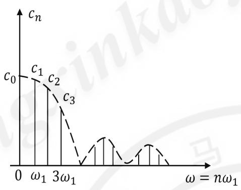
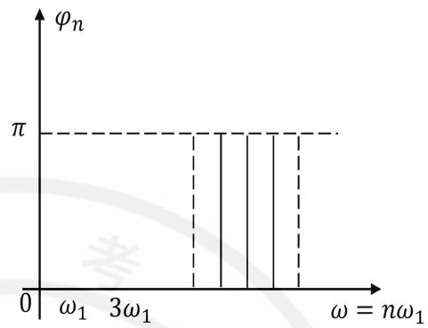
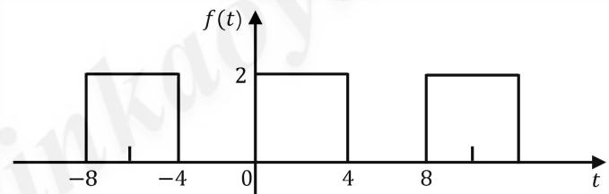
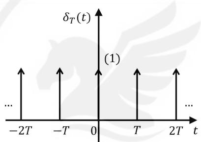
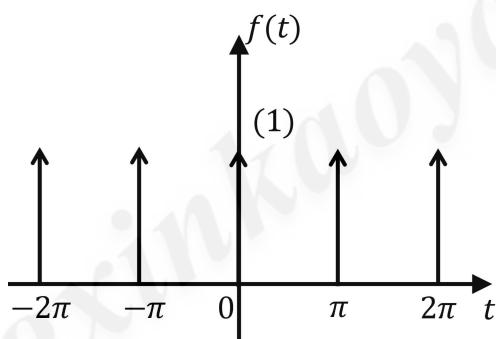

## 知识回顾：周期信号三角形式的傅里叶级数

（1）研究对象：周期信号周期为 $T_{1}$ ，其角频率为 $\omega_{1}=\frac{2\pi}{T_{1}}$ ，频率为 $f_{1}=\frac{1}{T_{1}}$ 一般形式

$$
f (t) = a _ {0} + \sum_ {n = 1} ^ {\infty} \left[ a _ {n} \cos \left(n \omega_ {1} t\right) + b _ {n} \sin \left(n \omega_ {1} t\right) \right]
$$

直流分量

$$
a _ {0} = \frac {1}{T _ {1}} \int_ {t _ {0}} ^ {t _ {0} + T _ {1}} f (t) d t \text {或} \frac {a _ {0}}{2} = \frac {1}{2 T _ {1}} \int_ {t _ {0}} ^ {t _ {0} + T _ {1}} f (t) d t
$$

余弦分量的幅度

$$
a _ {n} = \frac {2}{T _ {1}} \int_ {t _ {0}} ^ {t _ {0} + T _ {1}} f (t) c o s (n \omega_ {1} t) d t
$$

正弦分量的幅度

$$
b _ {n} = \frac {2}{T _ {1}} \int_ {t _ {0}} ^ {t _ {0} + T _ {1}} f (t) \sin (n \omega_ {1} t) d t
$$

其中 $n=1,2,\cdots$ 。

(2) 周期信号傅里叶级数的求解流程:

明确周期信号参数 $T_{1}$ ， $\omega_1$ ， $f_{1}$ ↓ 求解直流 $\frac{S_{\text{一个周期}}}{T_1}$ ↓ 判断函数对称性 ↓ $a_0$ ， $a_n$ 和 $b_{n}$ 情况(结果响应结论) ↓ 谁存在求谁 ↓ 最终结构

(3) 余弦形式的傅里叶级数

$$
f (t) = c _ {0} + \sum_ {n = 1} ^ {\infty} c _ {n} \cdot \cos \left(n \omega_ {1} t + \varphi_ {n}\right)
$$

1)频谱包含幅度谱与相位谱，其中幅度谱为 $C_{n}\sim n\omega_{1}$ ，相位谱 $\varphi_{n}\sim n\omega_{1}$ 。

  
(a)幅度谱

  
(b)相位谱  
2)周期信号的频谱画法（余弦形式视角下）

(1)将(不规范的)周期信号傅里叶级数整理成余弦形式傅里叶级数;

$$
\left\{ \begin{array}{l} {s i n   \theta = c o s \left(\theta - \frac {\pi}{2}\right)} \\ {-   c o s   \theta = c o s   (\theta \pm \pi)} \end{array} \Rightarrow C _ {0} + \sum_ {n = 1} ^ {\infty} c _ {n}   c o s   (n \omega_ {1} t + \varphi_ {n})   \text {且} C _ {n} \text {正} \right.
$$

(2)明确各频率分量对应的值：幅度谱为 $C_{n}\sim n\omega_{1}$ ，相位谱 $\varphi_{n}\sim n\omega_{1}$ ;

(3)画幅度谱和相位谱。

涉及数学知识

欧拉公式：

$$
\cos \theta = \frac {e ^ {j \theta} + e ^ {- j \theta}}{2}, \sin \theta = \frac {e ^ {j \theta} - e ^ {- j \theta}}{2 j}
$$

复数的模与相角： $z = x + jy$

$$
\text {模:} | z | = \sqrt {x ^ {2} + y ^ {2}}, \varphi = \arctan {\frac {y}{x}}
$$

三角转换公式： $a\cos\omega t + b\sin\omega t = c\cos(\omega t + \varphi), c = \sqrt{a^2 + b^2}, \varphi = \arctan\left(-\frac{b}{a}\right)$

专题 2 周期信号指数形式傅里叶级数

考点1：指数形式傅里叶级数推导

推导过程:

1、指数形式的傅里叶级数表达式

$$
f (t) = \sum_ {n = - \infty} ^ {\infty} F (n \omega_ {1}) e ^ {j n \omega_ {1} t} = \sum_ {n = - \infty} ^ {\infty} F _ {n} e ^ {j n \omega_ {1} t}
$$

谱系数

$$
F _ {n} = F (n \omega_ {1}) = \frac {1}{T _ {1}} \int_ {t _ {0}} ^ {t _ {0} + T _ {1}} f (t) e ^ {- j n \omega_ {1} t} d t
$$

## 2、指数形式下频谱的定义

幅度谱 $\left|F_{n}\right|\sim n\omega_{1}$ ，相位谱 $\varphi_{n}\sim n\omega_{1}(n\text{取}-\infty\text{到}\infty)$

## 3、三角与指数的关系及频谱特点

(1)指数形式与三角余弦形式的关系:

$$
F _ {0} = c _ {0} = a _ {0}
$$

$$
F _ {n} = | F _ {n} | e ^ {j \varphi_ {n}} = \frac {1}{2} (a _ {n} - j b _ {n})
$$

$$
F _ {- n} = | F _ {- n} | e ^ {- j \varphi_ {n}} = \frac {1}{2} (a _ {n} + j b _ {n})
$$

$$
\begin{array}{c} {| F _ {n} | = | F _ {- n} | = \frac {1}{2} c _ {n} = \frac {1}{2} \sqrt {a _ {n} ^ {2} + b _ {n} ^ {2}}} \\ {F _ {n} + F _ {- n} = a _ {n}} \\ {b _ {n} = j (F _ {n} - F _ {- n})} \\ {(n = 1, 2, \dots)} \end{array}
$$

## (2)两种频谱的关系与转换

考点2：傅里叶级数求解流程

【考试题型1：给出一个周期信号（图形），求其傅里叶级数】例8：一个周期内 $f(t)=\left\{\begin{aligned}1,&t\in[0,1)\\ -1,&t\in(1,2]\end{aligned}\right.$ ， $\omega_{1}=$ ，求 $F_{n}$ 。

例 7: 周期信号 $f(t)$ 如下图所示

(1)计算其三角形式的傅里叶级数中相关分量: 直流 $a_{0}$ , $a_{1}$ , $a_{2}$ , $b_{1}$ , $b_{2}$

(2)大致画出指数形式傅里叶级数的幅度谱。

【考试题型2：给出一个周期信号的三角表达式（不规范），求其傅里叶级数】

例4： $f(t) = \sin \left(\frac{5}{3}\pi t\right) + \cos \left(\frac{2}{3}\pi t\right)$ ，写出指数形式的傅里叶级数。

例 5：已知 $f(t) = 1 + \sin \omega_{1}t + \cos \omega_{1}t + \cos (2\omega_{1}t + \frac{\pi}{4})$ ，画出两种形式的幅度谱和相位谱。

例6：周期信号 $f(t) = 3\cos t + \sin \left(5t + \frac{\pi}{6}\right) - 2\cos \left(8t - \frac{2\pi}{3}\right)$ 。

(1)画出单边幅度谱和相位谱图;

(2)画出双边幅度谱和相位谱图。

考点 3：周期冲激串的傅里叶级数

例9: $f(t) = (2|t| - 1)[u(-t + 1) - u(-t - 1)] * \sum_{n=-\infty}^{\infty} e^{jn\pi t}$ (\*为卷积运算), 画出 $f(t)$ 的波形图。

  
夢馬考研

若已知 $f(t)=\frac{1}{\pi}\sum_{n=-\infty}^{\infty}e^{jn2t}$ ，则其图如下：

