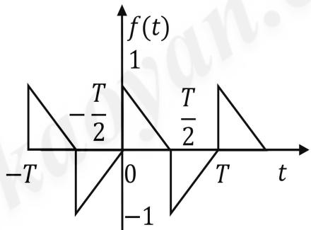
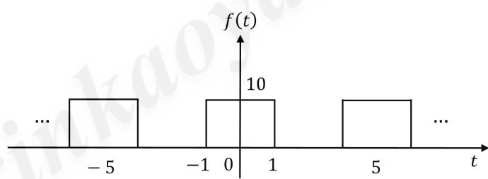
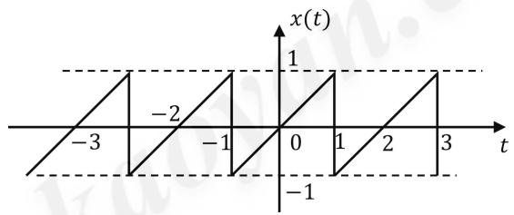

## 【第15节】课后作业

1、 $f(t)$ 的频谱中仅仅含有正弦和奇次谐波分量，则( )。

(A) $f(t)=f(-t)$ ，且 $f(t)=-f\left(t-\frac{T}{2}\right)$

(B) $f(t)=-f(-t)$ ，且 $f(t)=-f(t-T)$

(C) $f(t)=-f(-t)$ ，且 $f(t)=-f\left(t-\frac{T}{2}\right)$

(D) $f(t)=-f(-t)$ ，且 $f(t)=f\left(t-\frac{T}{2}\right)$

2、已知 $x\left(-\frac{1}{2} t + 3\right)$ 的基波频率为 $\omega_0$ ，傅里叶系数为 $F_{n}$ ，求 $x(t)$ 的傅里叶系数（）。A、 $F_{n}e^{3jn\omega_{0}}$ B、 $2F_{n}e^{3jn\omega_{0}}$ C、 $F_{n}e^{-6jn\omega_{0}}$ D、 $F_{-n}e^{-6jn\omega_{0}}$

3、如下图所示周期信号，该信号含有（）。

(A)奇次谐波

(B)偶次谐波

(C)奇次正弦波

(D)偶次余弦波

4、信号 $\delta_{T}(t)=\sum_{n=-\infty}^{\infty}\delta(t-nT)$ (n 为整数) 的指数函数形式的傅里叶级数可以表示为 $\delta_{T}(t)=\sum_{k=-\infty}^{\infty}F_{k}e^{jk\omega_{1}t}$ (k 为整数)，则下面描述不正确的是()。
A、 $\omega_{1}=\frac{2\pi}{T}$ B、 $F_{k}=\frac{1}{T}$ C、该信号的幅度谱具有偶对称特性 D、该信号的基波分量是 $\frac{1}{T}\cos\left(\frac{2\pi}{T}t\right)$

5、周期信号的波形如下图所示，则其直流分量和谱线间隔分别为（ ）。A、0; $\frac{\pi}{5}$ B、2; $\frac{\pi}{10}$ C、4; $\frac{2\pi}{5}$ D、6; $\frac{2\pi}{5}$

6、周期信号 $f(t) = \sum_{n=-\infty}^{\infty} \delta(t-2n+1)$ ，其中 $\delta(t)$ 是单位冲激信号，该周期信号指数形式傅里叶级数为\_\_\_\_。

7、如图，实周期 $x(t)$ ，求其傅里叶级数。

