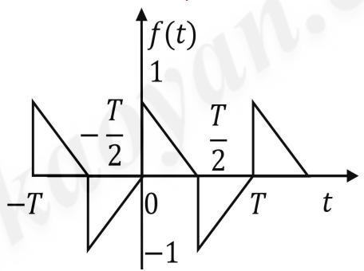
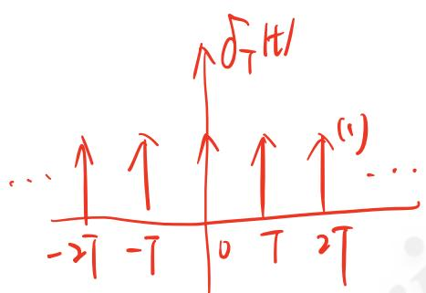
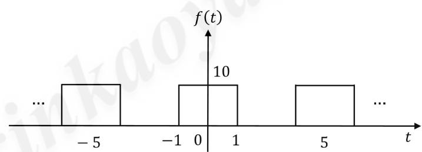
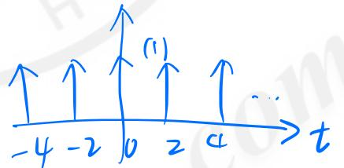
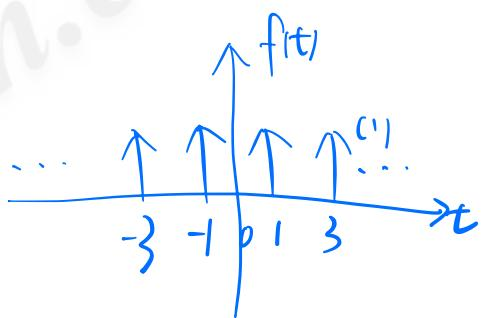
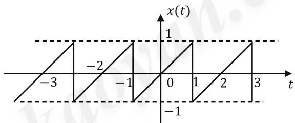

## 【第15节】课后作业

1、 $f(t)$ 的频谱中仅仅含有正弦和奇次谐波分量, 则( C )。

(A) $f(t)=f(-t)$ ，且 $f(t)=-f\left(t-\frac{T}{2}\right)$

(B) $f(t)=-f(-t)$ ，且 $f(t)=-f(t-T)$

(C) $f(t) = -f(-t)$ ，且 $f(t) = -f\left(t - \frac{T}{2}\right)$

(D) $f(t)=-f(-t)$ ，且 $f(t)=f\left(t-\frac{T}{2}\right)$

2、已知 $x\left(-\frac{1}{2}t+3\right)$ 的基波频率为 $\omega_{0}$ ，傅里叶系数为 $F_{n}$ ，求 $x(t)$ 的傅里叶系数（D）。
A、 $F_{n}e^{3jn\omega_{0}}$ B、 $2F_{n}e^{3jn\omega_{0}}$ C、 $F_{n}e^{-6jn\omega_{0}}$ D、 $F_{-n}e^{-6jn\omega_{0}}$

$x(-\frac{1}{2}t+3)$ 由 $x(t)$ 综合主乘而来,但只有扩大倍影响下和 $W$ ,故 $x(t)$ 参数 $T_{1}=\frac{10}{2}$ , $W_{1}=2W_{6}$ 已知 $F_{n}=\frac{1}{T_{0}}\int_{T_{0}}x(-\frac{1}{2}t+3)e^{-jnW_{0}t}dt$ 求的 $F_{n'}=\frac{1}{T_{1}}\int_{T_{1}}x(t)e^{-jnW_{1}t}dt$ 未知 $=\frac{2}{T_{0}}\int_{-\frac{T_{1}}{2}}^{\frac{T_{1}}{2}}x(t)e^{-jn2w_{0}t}dt$ 可知 $t=\frac{-1}{2}a+3$ $\frac{2}{T_{0}}\int_{6+T_{1}}^{6-T_{1}}x(-\frac{a}{2}+3)e^{-jn2w_{0}(-\frac{a}{2}+3)}d(-\frac{a}{2})$ 公众号【有润学社考研】免费分享

n 具有一致性 $=\frac{1}{T_{0}}\int_{-T_{1}}^{T_{1}}x(-\frac{1}{2}t+3)e^{-jnW_{0}t}dt$ $=e^{-jnW_{0}}F_{n}$ 梦马班作业

3、如下图所示周期信号，该信号含有（A）。

  
(B)偶次谐波  
(C)奇次正弦波

无直流
奇谐

(A)奇次谐波

(D)偶次余弦波

4、信号 $\delta_T(t) = \sum_{n=-\infty}^{\infty} \delta(t-nT)$ ( $n$ 为整数)的指数函数形式的傅里叶级数可以表示为 $\delta_T(t) = \sum_{k=-\infty}^{\infty} F_k e^{jk\omega_1 t}$ ( $k$ 为整数)，则下面描述不正确的是(D)。

A. $\omega_{1}=\frac{2\pi}{T}$

B、 $F_{k}=\frac{1}{T}$

C、该信号的幅度谱具有偶对称特性

D、该信号的基波分量是 $\frac{1}{T}\cos\left(\frac{2\pi}{T}t\right)$ (k就是上课讲的n)

$$
\begin{array}{r l} {f _ {k}} & {= \frac {1}{T _ {1}} f _ {T _ {1}} f (t) e ^ {- j n w _ {1} t} d t} \\ & {= \frac {1}{T _ {1}} \int_ {- \frac {\pi}{2}} ^ {\frac {\pi}{2}} d (t) e ^ {- j n w _ {1} t} d t} \\ & {= \frac {1}{T _ {1}}} \end{array}
$$

$|F_{k}|$ 知时你 $\varphi_{k}$ 奇对称

$$
\begin{array}{r l} {\mathrm{基} B \stackrel {C _ {1}} {=}} & {\cos \omega t = 2 F _ {1} \cos \frac {2 \lambda}{T} t} \\ & {= \frac {2}{T} \cos \frac {2 \lambda}{T} t} \end{array}
$$

5、周期信号的波形如下图所示，则其直流分量和谱线间隔分别为（C）。
A、0; $\frac{\pi}{5}$ B、2; $\frac{\pi}{10}$ C、4; $\frac{2\pi}{5}$ D、6; $\frac{2\pi}{5}$

$$
T = I
$$

$$
a _ {0} = \frac {S _ {T}}{T} = \frac {2 \times 1 0}{5} = 4
$$

${hw}_{1} \rightarrow  {w}_{1}$ 间隔 ${w}_{1} = \frac{2\pi }{T} = \frac{2\pi }{5}$

6、周期信号 $f(t)=\sum_{n=-\infty}^{\infty}\delta(t-2n+1)$ ，其中 $\delta(t)$ 是单位冲激信号，该周期信号指数形式傅里叶级数为 $\frac{1}{n}=\sum_{n=-\infty}^{\infty}(-1)^{n}e^{j\pi n t}$

$$
\delta (t - 2 n)
$$

面积为

$\sum_{n=-\infty}^{\infty}\delta(t+1-2n)$ 左移1个单位

T不变 T=2. W=π

$$
F _ {n} = \frac {1}{T _ {1}} \int_ {\pi_ {1}} f (t) e ^ {- j n m t} d t = \frac {1}{2} \int_ {0} ^ {2} \delta (t - 1) e ^ {- j n \pi t} d t
$$

$$
\begin{array}{r l} {f (t)} & {= \sum_ {n = - \infty} ^ {\infty} F _ {n} e ^ {j n m t}} \\ & {= \sum_ {n = - \infty} ^ {\infty} \frac {1}{2} (- 1) ^ {n} e ^ {j n \pi t}} \end{array}
$$

教难想到
后如期会学
梦马班作业

7、如图，实周期 $x(t)$ ，求其傅里叶级数。

${T}_{1} = 2,{W}_{1} = \frac{2\pi }{{T}_{1}} = \pi$

无直流 $F_{0}=a_{0}=0$ 奇对称 $\Rightarrow a_{n}=0$ $\Rightarrow F_{n}=-\frac{1}{2}b_{n}$ 经应形式

$$
\begin{array}{r l} {F _ {n}} & {= \frac {1}{T _ {1}} \int_ {T _ {1}} ^ {1} f (t) e ^ {- j n w _ {1} t} d t} \\ & {= \frac {1}{2} \int_ {- 1} ^ {1} t e ^ {- j n w _ {1} t} d t = j \frac {(- 1) ^ {n}}{n \pi}} \end{array}
$$

$$
\therefore x (t) = \sum_ {n = - v _ {0}} ^ {\infty} f _ {n} e ^ {j n w _ {1} t} = \left\{ \begin{array}{l l} 0, & n = 0 \\ \sum_ {n = - v _ {0}} ^ {\infty} \frac {j (- 1) ^ {n}}{n \pi} e ^ {j n \pi t}, & n \neq 0 \end{array} \right.
$$