周期信号停里叶级数的考查形式

一、求三角形式傳到接收

图形

## 二. 画单边坡 (全层形式)

1° 12形.

2° 老式开式 (一反形式 大朵火会)

总结：考查核心 $\Rightarrow$ 求解和转换
二次用式 $\left\{\begin{array}{l} 一般用式 \\ 完成用式 \end{array}\right.$

$f(t) = a_0 + \frac{b_0}{a_1} a_n \cos n w_t + b_n \sin n w_t$

求解直流 $\frac{S_{一个周期}}{T_{1}}$

判断函数对称性
↓

$a_{0}$ ， $a_{n}$ 和 $b_{n}$ 情况(结果响应结论)

$\pi_{1} \beta \sqrt{k}$

最终结构

## 知识回顾：周期信号三角形式的傅里叶级数

（1）研究对象：周期信号周期为 $T_{1}$ ，其角频率为 $\omega_{1}=\frac{2\pi}{T_{1}}$ ，频率为 $f_{1}=\frac{1}{T_{1}}$ 一般形式

$$
f (t) = a _ {0} + \sum_ {n = 1} ^ {\infty} \left[ a _ {n} \cos \left(n \omega_ {1} t\right) + b _ {n} \sin \left(n \omega_ {1} t\right) \right]
$$

直流分量

$$
\frac {S _ {1}}{T _ {1}} = a _ {0} = \frac {1}{T _ {1}} \int_ {t _ {0}} ^ {t _ {0} + T _ {1}} f (t) d t \text {或} \frac {a _ {0}}{2} = \left[ \frac {2}{2 T _ {1}} \int_ {t _ {0}} ^ {t _ {0} + T _ {1}} f (t) d t \right]
$$

余弦分量的幅度

$$
a _ {n} = \left(\frac {2}{T _ {1}}\right) \int_ {t _ {0}} ^ {t _ {0} + T _ {1}} f (t) \cos (n \omega_ {1} t) d t
$$

正弦分量的幅度

$$
b _ {n} = \frac {2}{T _ {1}} \int_ {t _ {0}} ^ {t _ {0} + T _ {1}} f (t) \sin (n \omega_ {1} t) d t
$$

其中 $n = 1, 2, \cdots$ 。

(2) 周期信号傅里叶级数的求解流程:

明确周期信号参数 $T_{1}$ ， $\omega_1$ ， $f_{1}$ ↓ 求解直流 $\frac{S_{\text{一个周期}}}{T_1}$ ↓ 判断函数对称性 ↓ $a_0$ ， $a_n$ 和 $b_{n}$ 情况(结果响应结论)

谁存在求谁
↓
最终结构

(3) 余弦形式的傅里叶级数

$$
f (t) = c _ {0} + \sum_ {n = 1} ^ {\infty} c _ {n} \cdot \cos \left(n \omega_ {1} t + \varphi_ {n}\right)
$$

1)频谱包含幅度谱与相位谱，其中幅度谱为 $C_n \sim n\omega_1$ ，相位谱 $\varphi_n \sim n\omega_1$ 。

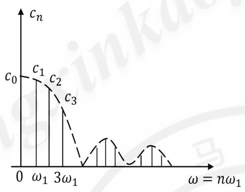  
(a)幅度谱

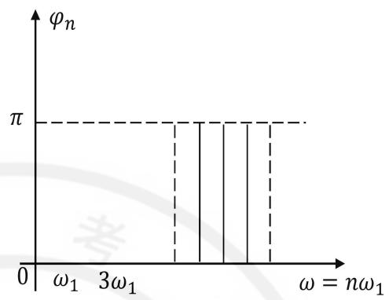  
(b)相位谱

2)周期信号的频谱画法（余弦形式视角下）

$$
\begin{array}{l} {C _ {n} = \sqrt {a _ {n} ^ {2} + b _ {n} ^ {2}}} \\ {\varphi_ {n} = \arctan - \frac {b _ {n}}{a _ {n}}} \end{array}
$$

(1)将(不规范的)周期信号傅里叶级数整理成余弦形式傅里叶级数;

$$
\left\{ \begin{array}{l} - \sin \theta = \cos (\theta + \frac {\pi}{2}) \\ \sin \theta = \cos \left(\theta - \frac {\pi}{2}\right) \\ - \cos \theta = \cos (\theta \pm \pi) \end{array} \Rightarrow C _ {0} + \sum_ {n = 1} ^ {\infty} c _ {n} \cos (n \omega_ {1} t + \varphi_ {n}) \text {且} C _ {n} \right. \text {正}
$$

(2)明确各频率分量对应的值：幅度谱为 $C_{n}\sim n\omega_{1}$ ，相位谱 $\varphi_{n}\sim n\omega_{1}$ ;

(3)画幅度谱和相位谱。

指数 $\xlongequal{欧拉兹}$ 指数免费讲义群:信号与系统、谷哥

$$
a _ {n} = a - n
$$

公众号：通信考研小马哥

$$
b _ {n} = b - n
$$

$$
f (t) = a _ {0} + \sum_ {n = 1} ^ {\infty} a _ {n} \cos n w _ {1} t + b _ {n} \sin n w _ {1} t
$$

涉及数学知识

欧拉公式：

荷 n
奇 n

$$
(\dot {i}) ^ {2} = (\dot {j}) ^ {2} = - 1
$$

$b_{n}=\frac{2}{\pi}f_{1}\pi f_{1}\sin n\omega_{1}\cot e^{-8\sqrt{n}}$

复数的模与相角: $z = x + jy$

$$
\sin \theta = \frac {e ^ {j \theta} - e ^ {- j \theta}}{2 j}
$$

$$
\mathrm{模:} | z | = \sqrt {x ^ {2} + y ^ {2}}, \varphi = \arctan \frac {y}{x} \frac {\mathrm{直部}}{\mathrm{员部分}}
$$

三角转换公式： $a\cos\omega t + b\sin\omega t = c\cos(\omega t + \varphi), c = \sqrt{a^2 + b^2}, \varphi = arctan\left(-\frac{b}{a}\right)$

专题2周期信号指数形式傅里叶级数

考点1: 指数形式傅里叶级数推导 [看惯, 勾力神]

$$
\begin{array}{r l} & {\mathrm{推导过程:}} \\ & {f (t) = a _ {0} + \sum_ {n = 1} ^ {\infty} a _ {n} \cos n w _ {1} t + b _ {n} \sin n w _ {1} t} \\ & {= a _ {0} + \sum_ {n = 1} ^ {\infty} a _ {n} \frac {e ^ {j n w _ {1} t} + e ^ {- j n w _ {1} t}}{2} + b _ {n} \frac {e ^ {j n w _ {1} t} - e ^ {- j n w _ {1} t}}{2}} \\ & {= a _ {0} + \sum_ {n = 1} ^ {\infty} \frac {a _ {n} - j b _ {n}}{2} e ^ {j n w _ {1} t} + \sum_ {n = 1} ^ {\infty} \frac {a _ {n} + j b _ {n}}{2} e ^ {- j n w _ {1} t}} \\ & {\mathrm{令} F _ {n} = \frac {a _ {n} - j b _ {n}}{2}} \\ & {F _ {n} = \frac {a _ {- n} - j b _ {- n}}{2}} \\ & {= \frac {a _ {n} + j b _ {n}}{2}} \\ & {= a _ {0} + \sum_ {n = 1} ^ {\infty} F _ {n} e ^ {j n w _ {1} t} + \sum_ {n = 1} ^ {\infty} F _ {n} e ^ {- j n w _ {1} t}} \\ & {= a _ {0} + \sum_ {n = 1} ^ {\infty} F _ {n} e ^ {j n w _ {1} t} + \sum_ {n = - \infty} ^ {- 1} F _ {n} e ^ {j n w _ {1} t}} \\ & {= \sum_ {n = - \infty} ^ {\infty} F _ {n} e ^ {j n w _ {1} t}} \\ & {\mathrm{+fo}} \end{array}
$$

${F}_{0}$ 是 ${F}_{n}$ 在 $n = 0$ 处顶

$$
a _ {0} = F _ {0}
$$

$$
f (t) = \sum_ {n = - w} ^ {w} F _ {n} e ^ {j n w _ {1} t} a _ {n} b _ {n} \frac {C _ {n} \cdot \varphi_ {n}}{l ^ {2 p + 2 p + 2}}
$$

直流

$$
F _ {0} = a _ {0} = c _ {0}
$$

1、指数形式的傅里叶级数表达式

$$
f (t) = \sum_ {n = - \infty} ^ {\infty} F (n \omega_ {1}) e ^ {j n \omega_ {1} t} = \sum_ {n = - \infty} ^ {\infty} F _ {n} e ^ {j n \omega_ {1} t}
$$

谱系数

$$
F _ {n} = F (n \omega_ {1}) = \frac {1}{T _ {1}} \int_ {t _ {0}} ^ {t _ {0} + T _ {1}} f (t) e ^ {- j n \omega_ {1} t} d t
$$

2、指数形式下频谱的定义 [双边谱] 幅度谱 $|F_{n}|\sim n\omega_{1}$ ，相位谱 $\varphi_{n}\sim n\omega_{1}(n取-\infty到\infty)$

$F_{n}=\frac{1}{2}(a_{n}-j b_{n})$ 态权

$$
F _ {n} = \frac {1}{2} (a _ {n} + j b _ {n}) \quad \varphi_ {- n} = \arctan \frac {b _ {n}}{a _ {n}}
$$

3、三角与指数的关系及频谱特点

$$
\varphi_ {n} = \arctan \frac {- b n}{a _ {n}} \quad \underline {{n \geq 1}}
$$

(1)指数形式与三角余弦形式的关系:

幅度谱 时对称

又也谱

$$
I ^ {0} \quad F _ {0} = c _ {0} = a _ {0}
$$

相位谱

$$
\begin{array}{r l} {| F _ {n} |} & {= | F _ {n} |} \\ & {= \frac {1}{2} C _ {n}} \end{array}
$$

$$
F _ {n} = | F _ {n} | e ^ {j \varphi_ {n}} = \frac {1}{2} (a _ {n} - j b _ {n})
$$

$$
3 ^ {0} F _ {- n} = | F _ {- n} | e ^ {- j \varphi_ {n}} = \frac {1}{2} (a _ {n} + j b _ {n})
$$

单边诺 $\frac{1}{2}C_{n}$

$$
| F _ {n} | = | F _ {- n} | = \frac {1}{2} c _ {n} = \frac {1}{2} \sqrt {a _ {n} ^ {2} + b _ {n} ^ {2}}
$$

$$
| F _ {1} | \neq | F _ {- 1} | = \frac {1}{2} C _ {1}
$$

$$
F _ {n} + F _ {- n} = a _ {n}
$$

馬

$$
b _ {n} = j (F _ {n} - F _ {- n})
$$

$$
(n = 1, 2, \dots)
$$

(2)两种频谱的关系与转换

$$
\frac {\uparrow \frac {\varphi_ {n}}{1 4}}{w _ {1} \beta w _ {1}} \rightarrow w _ {1}
$$

草四浩(扣法语)

$a_{0}=2$ $\frac{CN}{w_{1}w_{1}}$ 单边谱 (幅度谱) $C_{n}=\sqrt{a_{n}^{2}+b_{n}^{2}}$ $F_{0}=a_{0}=a_{0}$ $|F_{n}|=\frac{1}{2}C_{n}\quad n\geq 1$ $|F_{0}|$ $\frac{\frac{1}{6}\frac{c_{n}}{2}\frac{1}{6}}{w_{1}w_{1}}$ $\downarrow$ $|F_{n}|=\frac{1}{2}C_{n}\quad n\geq 1$ $|F_{0}|$ $\downarrow$ $|F_{0}|$ $\uparrow$ $|F_{n}|$ $\downarrow$ $|F_{0}|$ $\uparrow$ $|F_{n}|$ $\uparrow$ $|F_{0}|$ $\uparrow$ $|F_{n}|$ $\uparrow$ $|F_{0}|$ $\uparrow$ $|F_{n}|$ $\uparrow$ $|F_{0}|$ $\uparrow$ $|F_{n}|$ $\uparrow$ $|F_{0}|$ \( \uparrow
\text{双边谱} [|F\_{0}|, |F\_{n}|, F\_{0}] \) $14$

(4)

$$
\varphi_ {n} = \arctan \frac {- b _ {n}}{a _ {n}}
$$

$$
\varphi_ {n} = \arctan \frac {- b _ {n}}{a _ {n}} \mathrm{to}
$$

$$
a _ {0} = a _ {0}
$$

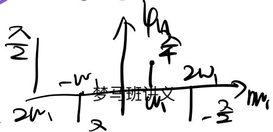

免费讲

求的

B站群:信号与系统\_谷哥78

公众号：通信考研小马哥

轻损(单边滑和双边滑)

考点2：傅里叶级数求解流程

[≡ n-1式 抗取n-1式]

${T}_{1}.{W}_{1}.{f}_{1}$

$$
f _ {n} = \frac {1}{2} (a _ {n} - j b _ {n})
$$

fore as sin

$$
F _ {n} = \frac {1}{T _ {1}} \int_ {T} A g e ^ {- j m n T} u t
$$

谁在求解

$$
a _ {0} = a _ {0}
$$

$a_{n}=\sqrt{a_{n}^{2}+b_{n}^{2}}$ 全球形式

【考试题型1：给出一个周期信号（图形），求其傅里叶级数】

例8：一个周期内 $f(t)=\left\{\begin{aligned}1,&t\in[0,1)\\ -1,&t\in(1,2]\end{aligned}\right.$ ， $\omega_{1}=$ ，求 $F_{n}$ 。

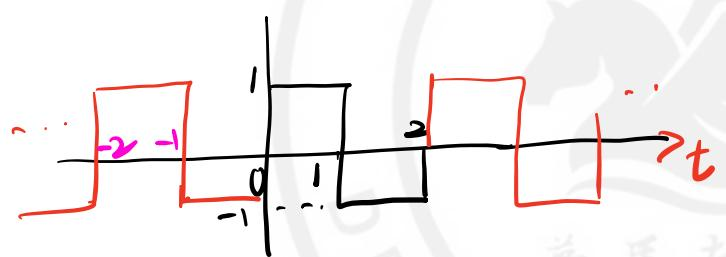

$$
T _ {1} = 2, \quad W _ {1} = \pi
$$

$F_{0}=a_{0}=0$ ，奇+奇谐 $\Rightarrow a_{n}=0$ ， $b_{n}$ 存在 n 取奇变

流程 直求

$$
= \frac {1}{2} \left[ \int_ {0} ^ {1} 1 \cdot e ^ {- j n x t} d t + \int_ {1} ^ {2} - i e ^ {- j n x t} d t \right]
$$

[无法识别]

$=  - \frac{2j}{n\pi }$ n取奇数

$b_{n}=\frac{2}{T_{1}}f_{T_{1}}f(t)\sin n m t\cot$

$$
= \frac {2}{n \pi} [ - (- 1) ^ {n} + 1 ] = \left\{ \begin{array}{l l} \end{array} \right.
$$

$$
n = \overline {{\sqrt {n}}}
$$

$$
F _ {n} = \frac {- j b n}{2} = \frac {- 2 j}{n \pi}
$$

官网：tongxinkaoyan.com 公众号【有涧学社考研】免费分享

听李仪

梦马班讲义

a. 才化方否

例7: 周期信号 $f\left( t\right)$ 如下图所示

(1)计算其三角形式的傅里叶级数中相关分量: 直流 $a_{0}, a_{1}, a_{2}, b_{1}, b_{2}$

(2)大致画出指数形式傅里叶级数的幅度谱。

$$
\underline {{f (t) - a _ {0}}}
$$

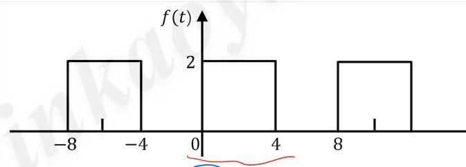

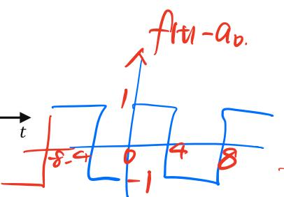

(1)

$$
T _ {1} = 8,
$$

$$
w _ {1} = \frac {\pi}{4}
$$

$$
\begin{array}{r l} {b _ {n}} & {= \frac {2}{8} \int_ {T _ {1}} f t i \sin n w _ {1} t d t} \\ & {= \frac {1}{4} [} \end{array}
$$

$$
a _ {0} = 1
$$

$$
\Rightarrow a _ {n} = 0
$$

$$
\Rightarrow a _ {1} = a _ {2} = b _ {2} = 0
$$

$$
\begin{array}{r l} {b _ {n}} & {= \frac {2}{\pi} \int_ {\pi_ {1}} f (t) \sin n w _ {1} t d t} \\ & {= \left\{ \begin{array}{l l} {0} & {n = 1 0} \\ {\frac {4}{n \pi}} & {n = \frac {\pi}{0 1}} \end{array} \right.} \end{array}
$$

$$
b _ {p} = \frac {4}{\pi}
$$

(2)

$$
f _ {n} = \frac {1}{2} (a _ {n} - j b _ {n})
$$

$$
= \left| \frac {2}{n \pi} \right|
$$

n取奇

$$
n w _ {1} = n \frac {\lambda}{4}
$$

$$
\mathrm{中段情}
$$

经极时
单.双

$$
\begin{array}{r l} {a _ {0}} & {= a _ {0}} \\ {a _ {n}} & {= \sqrt {a _ {n} ^ {2} + b _ {n} ^ {2}} \cdot \varphi_ {n} = \arctan \alpha .} \end{array}
$$

$$
F _ {0} = C _ {0} = 0
$$

\- 取别式

大杂烩

$$
a _ {0}. a _ {n} b _ {n}
$$

$$
\sqrt {\frac {L}{2 \pi} | F - n |}
$$

16 欧拉公式

$$
F _ {n}: \varphi_ {n}
$$

【考试题型2：给出一个周期信号的三角表达式（不规范），求其傅里叶级数】

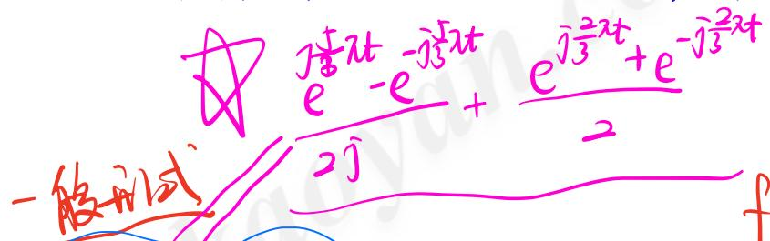

$f(t)=\sum_{n=0}^{\infty} F_n e^{-j n w_1 t}$

例4: $f(t) = \sin \left( \frac{5}{3} \pi t \right) + \cos \left( \frac{2}{3} \pi t \right)$ , 写出指数形式的傅里叶级数。

$$
T _ {1} = 2 \pi \cdot \frac {3}{5 \pi} = \frac {6}{5}
$$

说明

$$
w _ {0} = \frac {\pi}{3}
$$

诺波

$$
b _ {5} = 1
$$

$$
a _ {2} = 1
$$

$$
\begin{array}{r l} {F _ {n}} & {= \frac {\Rightarrow 1}{2} (a _ {n} - j b _ {n})} \\ {F _ {- n}} & {= \frac {1}{2} (a _ {n} + j b _ {n})} \end{array}
$$

$$
\overline {{F _ {2}}} = \frac {1}{2} (a _ {2} - j b _ {2}) = \frac {1}{2}
$$

$$
F _ {- 2} = \frac {1}{2} (a _ {n} + j b _ {n}) = \frac {1}{2}
$$

$$
F _ {5} = \frac {1}{2} (a _ {5} + j b _ {5}) = \frac {j}{2}
$$

$$
f (t) = 1 + \sin \omega_ {1} t + \cos \omega_ {1} t + \cos (2 \omega_ {1} t ^ {\mathsf {J}} + \frac {\pi}{4})
$$

谱和相位谱。

$$
= 1 + \sqrt {2} \cos (w _ {1} t - \frac {\pi}{4}) + \cos (2 w _ {1} t + \frac {\pi}{4})
$$

写：

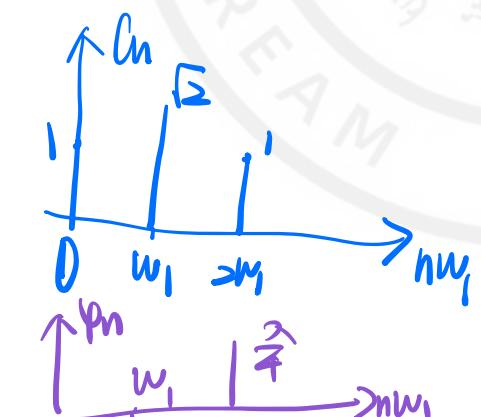

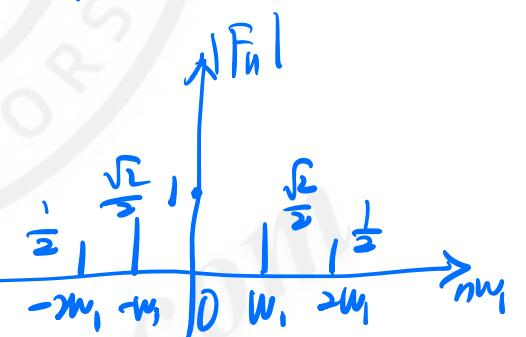

例6: 周期信号 $f(t) = 3 \cos t + \sin \left(5t + \frac{\pi}{6}\right) - 2 \cos \left(8t - \frac{2\pi}{3}\right)$ 。

(1)画出单边幅度谱和相位谱图;

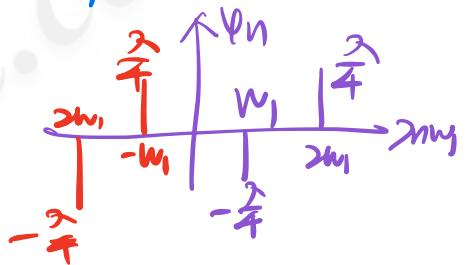

(2)画出双边幅度谱和相位谱图。

$$
\begin{array}{r l} {f (t)} & {= 3 \cos t + \cos (5 t + \frac {\pi}{6} - \frac {\pi}{2}) + 2 \cos (8 t - \frac {2 \pi}{3} + \pi)} \\ & {= 3 \cos t + \cos (5 t - \frac {\pi}{3}) + 2 \cos (8 t + \frac {\pi}{3})} \\ {T _ {1}} & {w _ {1} = \overline {{3 h ^ {2}}} a \overline {{c _ {n}}} p _ {n}} \end{array}
$$

$$
a _ {0} = F _ {0} = \frac {S _ {T _ {1}}}{T _ {1}}
$$

担心

$$
a _ {n} = \frac {2}{\pi} \int_ {\pi} ^ {1} f + a \sin n t
$$

$$
d _ {n} = \frac {2}{T _ {1}} \int_ {T} f e _ {1} \sin n u t a t
$$

求 $(3\sqrt{1+1})$ 停至函数

官网：tongxinkaoyan.com
公众号【有涧学社考研】免费分享

$$
\frac {a _ {0} ^ {1 7} a _ {n} b _ {n}}{f _ {n}}
$$

$$
\begin{array}{r l} {f _ {\mathrm{t1}}} & {= a _ {0} + \frac {\mathrm{当}}{\pi} a _ {n} \cos n w t + b _ {n} \sin n m v t} \\ {f _ {\mathrm{t1}}} & {= \frac {\mathrm{当}}{\pi} F _ {n} e ^ {- j n w t}} \end{array}
$$

2010th

$$
\frac {1}{2} = \frac {\sqrt {a ^ {2} + b ^ {2}} \cdot \sqrt {a ^ {2} + b ^ {2}}}{\sqrt {a ^ {2} + b ^ {2}}}.
$$

免费讲义群: 信号与系统、谷歌

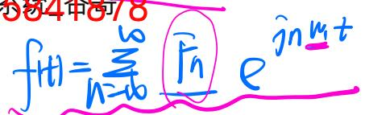

考点3：周期冲激串的傅里叶级数

$$
t <   1 \begin{array}{l l} - t > - 1 \\ - t + 1 \geq 0 \end{array}
$$

公众号：通信考研小马哥

$$
P _ {n} = \frac {1}{T _ {1}} \int_ {T _ {1}} f (t) e ^ {- j n m _ {1} t} d t
$$

，画出 $f(t)$ 的波形图。

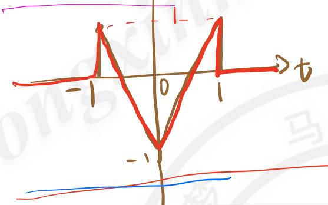

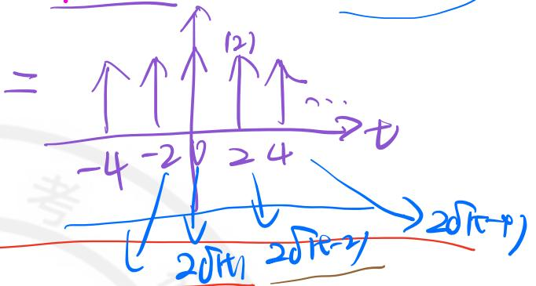

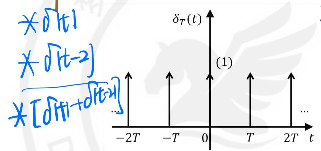

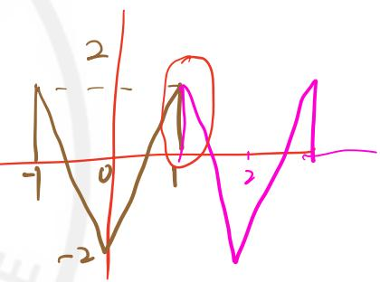

若已知 $f(t)=\frac{1}{\pi}\sum_{n=-\infty}^{\infty}e^{jn2t}$ ，则其图如下：

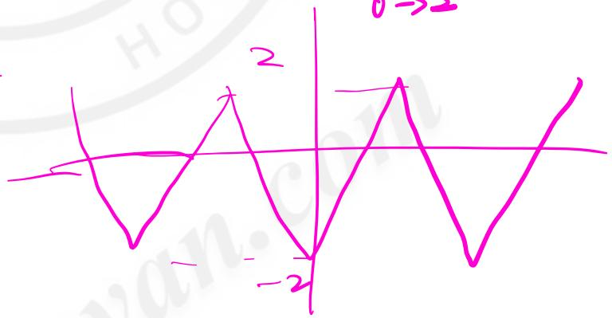

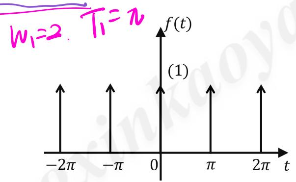

免聚讲义Q群：1095841878

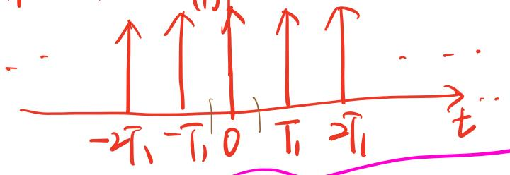

求：推拉式浮显计取数

$$
\begin{array}{r l} {F _ {n}} & {= \frac {1}{\pi} \int_ {\pi_ {1}} f (t) e ^ {- j n w _ {1} t} d t} \\ & {= \frac {1}{\pi_ {1}} \int_ {- \frac {\pi}{2}} ^ {\frac {\pi}{2}} \delta (t) e ^ {- j n w _ {1} t} d t} \\ & {= \frac {1}{\pi_ {1}} \int_ {- \frac {\pi}{2}} ^ {\frac {\pi}{2}} f (0)} \\ & {= \frac {1}{\pi_ {1}}} \end{array}
$$

免费讲义Q群：1095841878