16. 常见信号FT结果及FT性质(一)

17. 打广性质(二)

假设 $\Rightarrow FT$

3问：FT互义，FT传播报 $^{3}$ 等

理证： $\frac{F\left( {n - 1}\right) \left( {n + 3}\right) }{F\left( {n - 2}\right) } = \frac{3}{2}$

掌握：结果（简）． $F$ 手质（应用）

## 专题 3 非周期信号的傅里叶变换

## 考点1：非周期信号傅里叶变换的由来

1、周期信号的傅里叶级数

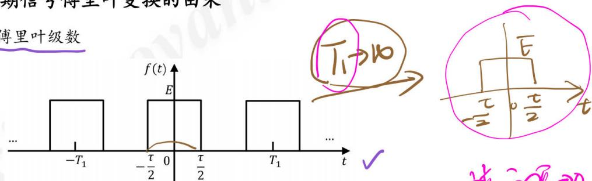

由 $f(t)$ 可知:

${w}_{1} \rightarrow  0 \rightarrow$ 球间隔 $\Rightarrow  0$

周期为 $T_{1}$ ，角频率为 $\omega_{1} = \frac{2\pi}{T_{1}}$

有直流 $F_{0}=\frac{S_{T_{1}}}{T_{1}}=\frac{E\cdot\tau}{T_{1}}$

奇数→近法国

偶函数 $\Rightarrow b_{n} = 0, a_{n}$ 存在 $\Rightarrow F_{n} = \frac{1}{2}(a_{n} - jb_{n}) = \frac{a_{n}}{2}$ ，为实数

$$
\begin{array}{r l} F _ {n} & = \frac {1}{T _ {1}} \int_ {T _ {1}} f (t) e ^ {- j n \omega_ {1} t} d t = \frac {1}{T _ {1}} \int_ {- \frac {\tau}{2}} ^ {\frac {\tau}{2}} E e ^ {- j n \omega_ {1} t} d t = \frac {E}{T _ {1}} \cdot \left. \frac {e ^ {- j n \omega_ {1} t}}{- j n \omega_ {1}} \right| _ {- \frac {\tau}{2}} ^ {\frac {\tau}{2}} \\ & = - \frac {E}{j n 2 \pi} \left[ e ^ {- j n \omega_ {1} \frac {\tau}{2}} - e ^ {j n \omega_ {1} \frac {\tau}{2}} \right] = \frac {E}{n \pi} \sin \left(n \omega_ {1} \frac {\tau}{2}\right), \\ & = \frac {E}{n \pi} \cdot \frac {n \omega_ {1} \tau}{2} S a \left(\frac {n \omega_ {1} \tau}{2}\right) = \frac {E \tau}{T _ {1}} S a \left(\frac {n \omega_ {1} \tau}{2}\right) \\ & F _ {n} = | F _ {n} | \cdot e ^ {j \varphi_ {n}} \\ & | F _ {n} | \sim n \omega_ {1}, \varphi_ {n} \sim n \omega_ {1} \end{array}
$$

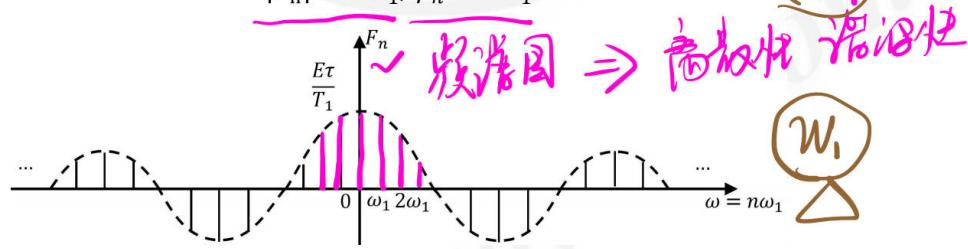

2、带宽—针对频谱为Sa函数而言，带宽为第一过零点

$$
\begin{array}{r l} S a \left(\frac {n \omega_ {1} \tau}{2}\right) & = 0 \Rightarrow s i n \left(\frac {n \omega_ {1} \tau}{2}\right) = 0 \Rightarrow \frac {n \omega_ {1} \tau}{2} = \pi \Rightarrow n \omega_ {1} = \frac {2 \pi}{\tau} \\ B _ {\omega} & = \frac {2 \pi}{\tau} (r a d / s) \\ B _ {f} & = \frac {1}{\tau} (H z) \end{array}
$$

可见带宽与信号持续时间呈反比

官网：tongxi nkaoyan. con

梦马班讲义

3、非周期信号到周期信号的过渡

$$
T _ {1} \rightarrow \infty , f _ {T _ {1}} (t) \xrightarrow {T _ {1} \rightarrow \infty} f (t)
$$

$$
f _ {T} (t) \rightarrow f _ {T _ {1}} (t)
$$

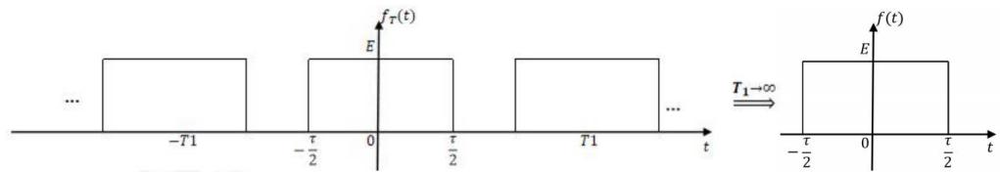

周期信号 $f(t)$ 频谱特点：离散性，谐波性和收敛性

$n\omega_{1}\rightarrow$ 谱线间隔 $\omega_{1}=\frac{2\pi}{T_{1}}\rightarrow0$ ，则离散谱变为连续谱

高度： $\frac{E\tau}{T_1}\rightarrow 0$ ， $\frac{2\pi}{\tau}$ 不影响。

考点2: 傅里叶变换定义及应用

1、傅里叶变换存在的充分条件是在无限区间内满足绝对可积条件，即要求

$$
\int_ {- \infty} ^ {\infty} | f (t) | d t <   \infty
$$

傅里叶正变换

$$
F (\omega) = \mathcal {F} [ f (t) ] = \int_ {- \infty} ^ {\infty} f (t) e ^ {- j \omega t} d t
$$

傅里叶逆变换

【定义的理解】

$$
F (2) = \int_ {0} ^ {\infty} f (t) e ^ {- j 2 t} d t
$$

2、中心对称点——自变量的前后一致性

$f_{1} > f, 1 \infty, f_{2} < f = d z$

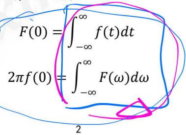

官网：tongxi nkaoyan. com

  
梦马班讲义

B站up: 信号与系统\_谷哥

1878
未知→不知系统

例11: 已知 $x(t)$ 的傅里叶变换为 $X(j \omega)$ , $x(t)$ 如下图所示, 求 $X(0)$ ,

$$
\int_ {- \infty} ^ {\infty} X (\omega) d \omega , \int_ {- \infty} ^ {\infty} X (\omega) e ^ {j \frac {3}{2} \omega} d \omega .
$$

$f(t)=\frac{1}{2\pi}\int_{-\infty}^{\infty}F(w)e^{j\omega t}d w$

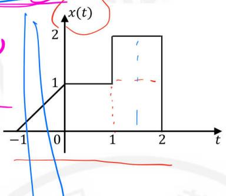

$$
x (w) = \int_ {- w} ^ {w} x (t) e ^ {- j w t} d t
$$

$$
x (0) = \frac {1}{2 \lambda} \int_ {- \infty} ^ {\infty} x (\omega) d \omega
$$

$$
\begin{array}{r l} {x _ {(0)}} & {= \int_ {- \infty} ^ {\infty} x (t) d t} \\ & {= s} \end{array}
$$

$$
2 \pi (1 0) = 2 \pi
$$

$$
2 \pi \times (\frac {3}{2}) = 4 \pi
$$

$$
\sqrt {x ^ {2} + y ^ {2}}
$$

3、幅度谱与相位谱

$f(x) \xleftarrow{FT} [F(w)]$ 颖增词、义义

因 $F(\omega)$ 一般是复数函数，故可表示为

$$
F (w) = R e [ F (w) ] + j \frac {T _ {m} [ F (w) ]}{2}
$$

$$
F (\omega) = | F (\omega) | e ^ {j \varphi (\omega)}
$$

$\left| {F\left( \omega \right) }\right|$ 与 $\varphi \left( \omega \right)$ 分别称为信号 $f\left( t\right)$ 的幅度谱与相位谱。

如果 $f(t)$ 为实函数，则

$$
\begin{array}{l} {[ F (w) ] = \sqrt {x ^ {2} + y ^ {2}}} \\ {\varphi_ {(w)} = \arctan \frac {y}{x}} \end{array}
$$

$$
F (- \omega) = \int_ {- \infty} ^ {\infty} f (t) e ^ {j \omega t} d t = F ^ {*} (\omega)
$$

由此可推出

$$
| F (- \omega) | = | F (\omega) |, \varphi (- \omega) = - \varphi (\omega)
$$

即幅度谱 $|F(\omega)|$ 是 $\omega$ 的偶函数，相位谱 $\varphi(\omega)$ 是 $\omega$ 的奇函数。

例 12: $F(\omega) = -5e^{-j\omega t_0}$ , 幅度谱为 \_\_\_\_, 相位谱为 $\pi - \omega t_0$

$$
\begin{array}{r l} {\mathrm{频谱}} & {= | F (w) | e ^ {j \varphi (w)}} \\ & {= 5 \cdot e ^ {j \pi} e ^ {- j w t _ {0}}} \\ & {= 5 \cdot e ^ {j [ \frac {\pi - w t _ {0}}{\varphi (w) ^ {3}}}} \end{array}
$$

官网：tongxi nkaoyan. com

$$
\begin{array}{r l} {e ^ {\pm i \pi}} & {= - 1} \\ {e ^ {- \mathrm{正}}} & {[ - \pi \cdot \pi ]} \\ {- \pi - w t o} & \\ {\mathrm{梦马班讲义}} & \end{array}
$$

考点3：常见信号的傅里叶变换

1、单边指数信号

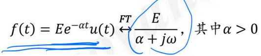

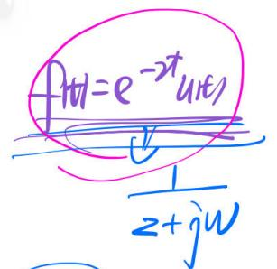

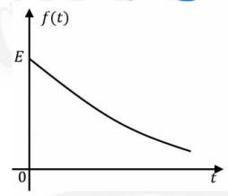

根据 $FT$ 定义 $\int_{-\infty}^{\infty}\left|f(t)\right|dt < \infty$

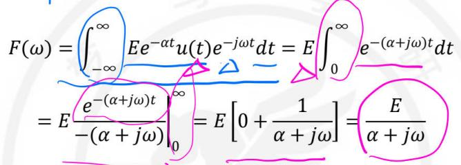

2、双边指数信号

$$
f (t) = E e _ {\Delta} ^ {- \alpha | t |}, \text {   其中   } \alpha > 0
$$

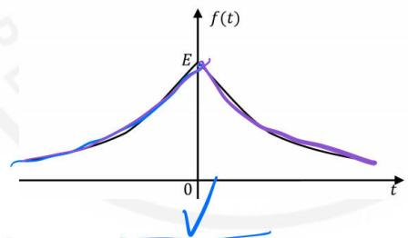

根据FT定义 $\int_{-\infty}^{\infty}\left|f(t)\right|dt<\infty$

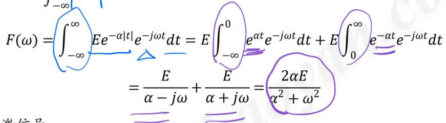

3、冲激信号

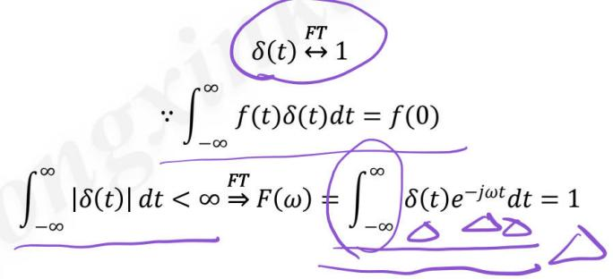

官网：tongxi nkaoyan. con

梦马班讲义

4、冲激偶信号

$$
\begin{array}{c} \delta^ {\prime} (t) \stackrel {F T} {\leftrightarrow} j \omega \\ \therefore \int_ {- \infty} ^ {\infty} f (t) \delta^ {\prime} (t) d t = - f ^ {\prime} (0) \end{array}
$$

由于 $\int_{-\infty}^{\infty}|\delta'(t)|dt < \infty$ ，故可进行傅里叶变换，则

$$
F (\omega) = \int_ {- \infty} ^ {\infty} \delta^ {\prime} (t) e ^ {- j \omega t} d t = - [ e ^ {- j \omega t} ] _ {t = 0} ^ {\prime} = - [ - j \omega e ^ {- j \omega t} ] _ {t = 0} = j \omega
$$

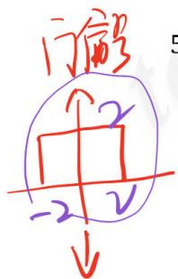

5、门信号

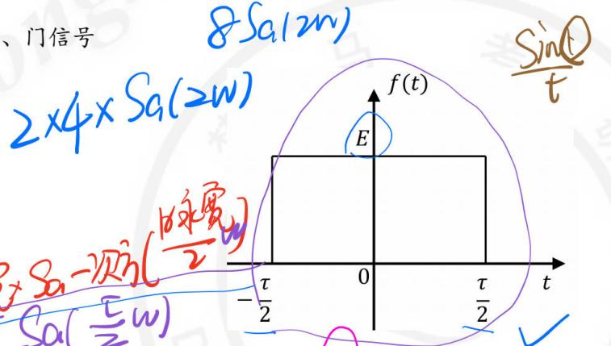

$$
\begin{array}{r l} & {\stackrel {F T} {\leftrightarrow} F (\omega) = \int_ {- \infty} ^ {\infty} f (t) e ^ {- j \omega t} d t = \int_ {- \frac {\tau}{2}} ^ {\frac {\tau}{2}} E e ^ {- j \omega t} d t = E \frac {e ^ {- j \omega t}}{- j \omega} \Bigg | _ {- \frac {\tau}{2}} ^ {\frac {\tau}{2}} = \frac {E}{- j \omega} \left[ e ^ {- j \omega \frac {\tau}{2}} - e ^ {j \omega \frac {\tau}{2}} \right]} \\ & {\qquad = \frac {2 E}{\omega} \cdot \frac {- e ^ {- j \omega \frac {\tau}{2}} + e ^ {j \omega \frac {\tau}{2}}}{2 j} = \frac {2 E}{\omega} \sin \frac {\omega \tau}{2} = \frac {2 E \tau}{2} \frac {\sin \frac {\omega \tau}{2}}{\frac {\omega \tau}{2}} = E \tau S a (\frac {\omega \tau}{2})} \end{array}
$$

6、符号函数

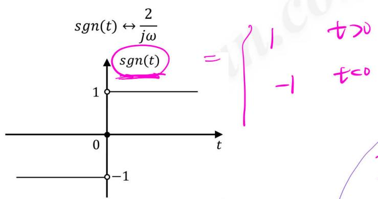

不满足绝对可积⇒不能定义来求。令:

官网：tongxi nkaoyan. con

梦马班讲义

当 $\alpha \to 0$ 时，如下图所示

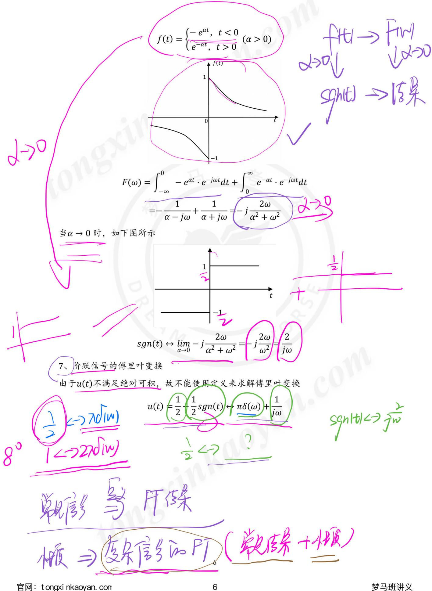

7、阶跃信号的傅里叶变换

由于 $u\left( t\right)$ 不满足绝对可积,故不能使用定义来求解傅里叶变换

$\sin |t| \rightarrow \frac{2}{j\omega}$

官网：tongxi nkaoyan. com

梦马班讲义

专题 4 傅里叶变换的性质

考点1: 线性性质

若 $f_{1}(t)\leftrightarrow F_{1}(\omega),f_{2}(t)\leftrightarrow F_{2}(\omega)$ ，则

$$
a _ {1} f _ {1} (t) + a _ {2} f _ {2} (t) \leftrightarrow a _ {1} F _ {1} (\omega) + a _ {2} F _ {2} (\omega)
$$

$$
u (t) = \frac {1}{2} + \frac {1}{2} \sin (t)
$$

例如：

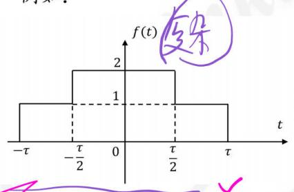

## 考点2: 对称性

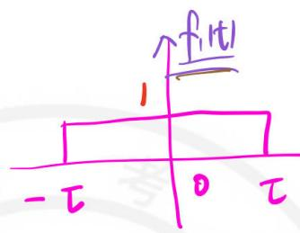

## 1、对称性：

同形上证明：若 $f(t) \leftrightarrow F(\omega)$ ，则

若 $f\left( t\right)$ 为偶函数,则 $f\left( t\right)  \leftrightarrow  {2\pi f}\left( \omega \right)$ 。

$$
F (t) \leftrightarrow 2 \pi f (- \omega)
$$

eq: $\vert\angle\rightarrow2\pi d(w)$ (2)对称性求傅里叶逆变换：

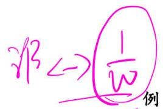

$$
\Leftrightarrow \frac {2}{j w}
$$

$$
f (t) = \frac {1}{t} \rightarrow 2 \pi f (- w) = \frac {- 2 \pi}{w}
$$

$$
F (w) = - j \pi s g n (w) \leq F (t) = - j \pi s g n (t)
$$

$$
1 \times 2 T \times S _ {a} (T w) + 1 \times T \times S _ {a} (\frac {T}{2} w)
$$

例14: 求 $cos(4 \omega)$ 的傅里叶逆变换。

现在套路

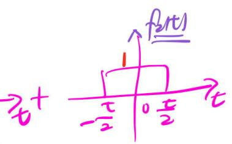

$$
f (t) = \frac {1}{2 ^ {2}} \int \cos 4 w e ^ {3 w} d w
$$

$$
\begin{array}{r l} {f (t)} & {\leftrightarrow F (w)} \\ {F (t)} & {\leftrightarrow 2 \pi f (- w)} \\ & {= 1 1} \\ & {2 \pi f (w)} \end{array}
$$

$$
\begin{array}{l} {\mathrm{eq:}} \\ {f (t) = 1} \\ {\mathrm{2入} f (- w)} \\ {\mathrm{进}} \end{array}
$$

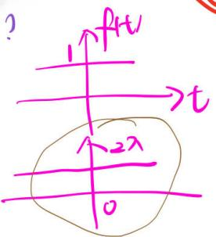

$$
\begin{array}{c} \delta (t + 1) \leftrightarrow 1 \\ w _ {2 \lambda} \delta (t + 1) \leftrightarrow 2 \lambda \end{array}
$$

$$
\frac {1}{2} \uparrow \uparrow \uparrow^ {(n)} 7
$$

官网：tongxi nkaoyan. com

$$
f (t) = 2 \pi \sqrt {1 + t}
$$

$$
\rightarrow F (w) = 2 \pi \delta (w)
$$

$$
\rightarrow f (t) =
$$

$$
= \pi [ \delta (w + 4) + \delta (w - 4)
$$

【增加 Sa 函数的 FT】

$Sa(At) \xrightarrow{FT} ?$

$$
f (t) = S a (A t)
$$

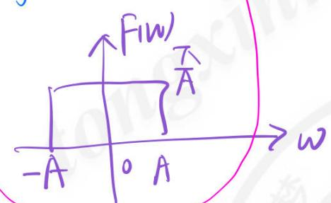

胸高×阴宽 $S_{n}$ ( $\frac{阴宽}{2}$ )

考点3: 尺度变换

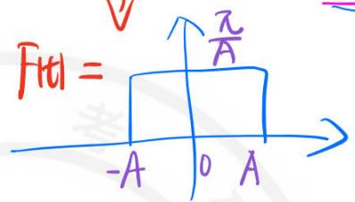

$$
\begin{array}{r l} {x \cdot 2 A} & {= 2 \pi} \\ {x} & {= \frac {\pi}{A}} \end{array}
$$

若 $f(t)\leftrightarrow F(\omega)$ ，则

$$
f (a t) \leftrightarrow \frac {1}{| a |} F \left(\frac {\omega}{a}\right)
$$

特例：令 $a =  - 1$ ,则 $f\left( {-t}\right)  \leftrightarrow  F\left( {-\omega }\right)$

$f(t) \Rightarrow f(x) \leftrightarrow \frac{1}{2} F(\frac{w}{2}) \leqslant F(w)$ $\Rightarrow \frac{3}{8} f(\frac{t}{2}) \leftrightarrow 2 F(2w)$

【梦马班点拨】理解方式：傅里叶变换中所有 $\omega$ 换成 $\frac{\omega}{a}$ 后，再乘 $\frac{1}{|a|}$ 。时域压缩、

频域扩展；时域扩展，频域压缩，也验证了带宽与脉冲宽度呈反比。

一方不移
8-3和70时，不受

考点5: 时域移位性质(只影响相位)

时移性质: 若 $f(t) \leftrightarrow  F\left( \omega \right)$ 则

不时,则发

$$
f (t \pm t _ {0}) \leftrightarrow F (\omega) e ^ {\pm j \omega t _ {0}}
$$

应用：已知 $\left| {F\left( \omega \right) }\right|$ 和 $\varphi \left( \omega \right)$ ,求 $f\left( t\right)$ 。

$$
\leftarrow \rightarrow
$$

官网：tongxinkaoyan.com ② $f\left( {1 + \mathrm{e}}\right)  \rightarrow  f\left( {1 + \mathrm{e}}\right)$ 8

$f(t) \hookrightarrow F(w) = |F(w)|e^{j(\varphi|w)}$ $f(t-2) \hookrightarrow F(w)e^{-j2w}$ $|F(w)|e^{j(\varphi|w)}e^{-j2w}$ $= |F(w)|e^{j[(\varphi|w)-2w]}$

<table><tr><td colspan="2"></td><td rowspan="2"> $\frac{\pi }{w_0}$ </td></tr><tr><td>- w_0</td><td>w_0</td></tr></table>

例15: 利用傅里叶变换性质, 求下图所示函数的傅里叶逆变换。

<table><tr><td>|F(ω)|</td></tr><tr><td>A</td></tr><tr><td>-ω0 0 ω0</td></tr></table>

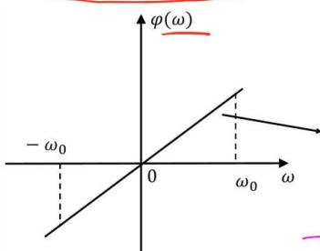

$f_{1}(t) \xrightarrow{at} f_{1}(t+t)$

$$
j \varphi (w) = F _ {1} (w) \cdot e ^ {j \underline {{\varphi (w)}}}
$$

$f_{1}||t|$

$$
\begin{array}{r l} {F (w)} & {= | F (w) | \cdot e} \\ {\downarrow} & \\ {f (t)} & \end{array}
$$

$\frac{w_{0}A}{\pi}Sa(W_{0}t)$ 只需要对恒定谐适度接

$$
\begin{array}{r l} {F (w)} & {= | F (w) | \cdot e ^ {j 4 w t _ {0}}} \\ & {= | F (w) | \cdot e ^ {j w t _ {0}}} \\ & {= F _ {1} (w) \cdot e ^ {j w t _ {0}}} \end{array}
$$

① $F_{1}(w) \xrightarrow{\frac{v}{a}} f_{1}(t)$ ② $f_{1}(t) \xrightarrow{m} f_{1}(t+t_{0}) = f(t)$

$$
\begin{array}{l} {f _ {1} | t | = \frac {w _ {0} A}{\pi} S a (w _ {0} t)} \\ {\therefore f _ {1} | t | = f _ {9} (t + t _ {0}) = \frac {w _ {0} A}{\pi} S a [ w _ {0} (t + t _ {0}) ]} \\ {\mathrm{梦马班讲义}} \end{array}
$$

官网：tongxi nkaoyan. con

# $f(t) \rightarrow F_{1}(w) \quad f(t-2) \rightarrow F_{1}(w)e^{-j2w}$

公众号：通信考研小马哥

$f(t+3) \Rightarrow F(w)e^{t}$

【梦马班点拨】一方平移，另一方乘e指数，(或：看到e指数，想到对方平移)

符号速记口诀：时，不变；不时，则变。

考点6：频域移位性质

频移性质：若 $f(t)\leftrightarrow F(\omega)$ 则

$$
f (t) e ^ {\mp j \omega_ {0} t} \leftrightarrow F (\omega \pm \omega_ {0})
$$

$f(x)e^{-j2t} \Leftrightarrow F(w+2)$

⑩ $F(w+2)$ 的还有什么 x

【常见信号FT结果】

8、余弦信号的傅里叶变换

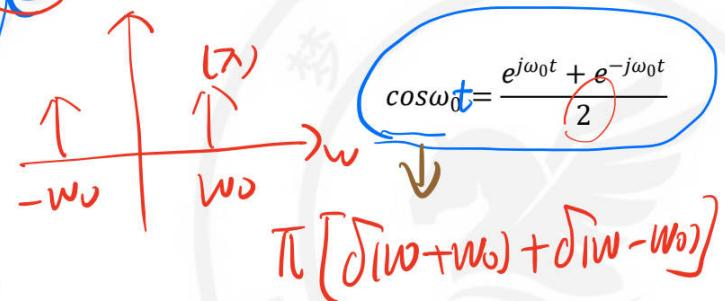

9、正弦信号的傅里叶变换

$$
\sin \omega_ {0} t = \frac {e ^ {j \omega_ {0} t} \bullet e ^ {- j \omega_ {0} t}}{2 j}
$$

$$
\mathrm{问} f (t) e ^ {- j u} \rightarrow F T = ?   \Leftrightarrow F (w + 2)
$$

$1 \leftarrow 2 \times \sqrt{10}$

$$
\begin{array}{l} 1 \cdot e ^ {j w _ {0} t} \leftrightarrow 2 \pi \sqrt {(w - w _ {0})} \\ 1 \cdot e ^ {- j w _ {0} t} \leftrightarrow 2 \pi \sqrt {(w + w _ {0})} \end{array}
$$

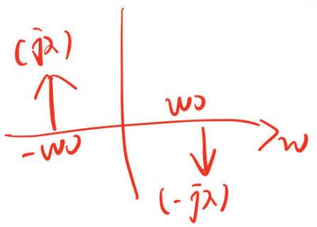

$$
j \pi [ \delta i w + (w _ {0}) - \delta i w - (w _ {1}) ]
$$

信号与系统\_谷哥

例 16: 若已知 \( f(t) \leftrightarrow F(\omega) \)，试求下列函数的频谱。

(1) \( f(2t-5) \);

(2) \( e^{jt}f(3-2t) \)

\( f(t) \rightarrow f(t-5) \)

\( F(w)e^{-j\omega} \)

\( f(t) \rightarrow f(-2t+5) \)

\( F(w)e^{j\omega t} \)

\( f(t) \rightarrow f(-2t+5) \)

\( F(w)e^{j\omega t} \)

\( f(t) \rightarrow f(-2t+5) \)

\( F(w)e^{j\omega t} \)

\( f(t) \rightarrow f(-2t+5) \)

\( F(w)e^{j\omega t} \)

\( f(t) \rightarrow f(-2t+5) \)

(1) \( f(2t-5) \);

(2) \( e^{jt}f(3-2t) \)

\( f(t) \rightarrow f(-5) \)

\( F(w)e^{-j\omega t} \)

\( f(t) \rightarrow f(-5) \)

\( F(w)e^{-j\omega t} \)

\( f(t) \rightarrow f(-5) \)

\( F(w)e^{-j\omega t} \)

\( f(t) \rightarrow f(-5) \)

\( F(w)e^{-j\omega t} \)

\( f(t) \rightarrow f(-5) \)

\( F(w)e^{-j\omega t} \)

\( F(t) \rightarrow f(-5) \)

\( F(w)e^{-j\omega t} \)

\( f(t) \rightarrow f(-5) \)

\( F(w)e^{-j\omega t} \)

\( f(t) \rightarrow f(-5) \)

\( F(w)e^{-j\omega t} \)

\( f(t) \rightarrow f(-5) \)

\( F(w)e^{-j\omega t} \)

\( f(t) \to f(-5) \to f(-5) \to f(-5) \to f(-5) \to f(-5) \to f(-5) \to f(-5) \to f(-5) \to f(-5) \to f(-5) \to f(-5) \to f(-5) \to f(-5) \to f(-5) \to f(-5) \to f(-5) \to f(-5) \to 0 \)

\( f(t) \to f(-5) \to f(-5) \to f(-5) \to f(-5) \to f(-5) \to f(-5) \to f(-5) \to 0 \)

\( F(w)e^{-j\omega t} = j\omega t - j\omega t + j\omega t - j\omega t + j\omega t + j\omega t + j\omega t + j\omega t + j\omega t + j\omega t + j\omega t + j\omega t + j\omega t + j\omega t + j\omega t + j\omega t + j\omega t + j\omega t + j\omega t + j\omega t + j\omega t + j\omega t + j\omega t + j\omega t - j\omega t - j\omega t - j\omega t - j\omega t - j\omega t - j\omega t - j\omega t - j\omega t - j\omega t - j\omega t - j\omega t - j\omega t - j\omega t - j\omega t - j\omega t - j\omega t - j\omega t - j\omega t - j\omega t - j\omega t + 0,0,0,0,0,0,0,0,0,0,0,0,0,0,0,0,0,0,0,0,0,0,0,0,0,0,0,0,0,0,0,0,0,0,0,0,0,0,0,0,0,0,0,0,0,0,0,0,0,0,0

$f(t) \rightarrow e^{jt} f(3-2t)$ $-2(t-\frac{3}{2})$ $f(t) \rightarrow f(-2t)$ $\xrightarrow{+\frac{3}{2}}$ $f(-2t+3)$ $\xrightarrow{频}$ $e^{\frac{jt}{2}} f(3-2t)$ $F(w)$ $\frac{1}{2}F\left(\frac{w}{2}\right)$ $\frac{1}{2}F\left(-\frac{w}{2}\right)e^{-j\frac{3}{2}w}$ $\frac{1}{2}F\left(-\frac{w-1}{2}\right)e^{-j\frac{3}{2}(w-1)}$

【常见信号的傅里叶变换一览表】

<table><tr><td>常见信号表达式或图形</td><td>常见信号的傅里叶变换结果</td></tr><tr><td>双边指数信号 ${E}{e}^{-\alpha \left| t\right| },\alpha >0$ </td><td> $\frac{E \cdot 2\alpha }{{\omega }^{2} + {\alpha }^{2}},a > 0$ </td></tr><tr><td>单边指数信号 $E{e}^{-\alpha u(t)},\alpha >0$ </td><td> $\frac{E}{j\omega + \alpha },a > 0$ </td></tr><tr><td>冲激信号  $\delta \left( t\right)$ </td><td>1</td></tr><tr><td>冲激偶信号  ${\delta }^{\prime }\left( t\right)$ </td><td>jω</td></tr><tr><td>阶跃信号  $u\left( t\right)$ </td><td> $\pi \delta \left( \omega \right) + \frac{1}{j\omega }$ </td></tr><tr><td>符号函数  ${sgn}\left( t\right)$ </td><td> $\frac{2}{j\omega }$ </td></tr><tr><td>直流分量  $E$ </td><td> ${2\pi E\delta }\left( \omega \right)$ </td></tr><tr><td>门信号</td><td>例如: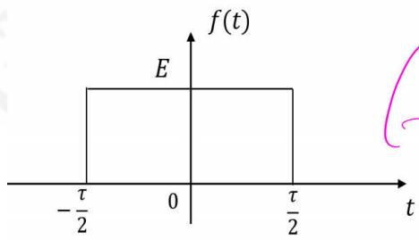 脉高×脉宽×Sa( $\frac{脉宽}{2}\omega$ ) $\leftrightarrow {EtSa}\left( \frac{\tau }{2}\omega \right)$ </td></tr><tr><td>三角信号</td><td>例如: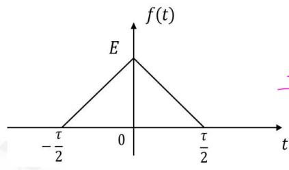 脉高× $\frac{脉宽}{2}$ ×Sa $^{2}$ ( $\frac{脉宽}{4}\omega$ ) $\leftrightarrow {E\frac{t}{2}{Sa}^{2}}\left( \frac{t}{4}\omega \right)$ </td></tr></table>

<table><tr><td>E·Sa(At)</td><td>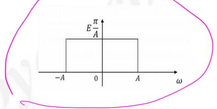</td></tr><tr><td>E·Sa2(At)</td><td>[67×5]</td></tr><tr><td>余弦信号cos ω0t</td><td>π[δ(ω+ω0)+δ(ω-ω0)]</td></tr><tr><td>正弦信号sin ω0t</td><td>jπ[δ(ω+ω0)-δ(ω-ω0)]</td></tr><tr><td>周期冲激信号δT(t)=∑n=-∞δ(t-nT1)</td><td>ω1∑n=-∞δ(ω-nω1)</td></tr><tr><td>理想抽样信号f(t)·δT(t)</td><td>周期延拓,幅度变为原来1/T1 $\frac{1}{T_1}\sum_{n=-∞}^{\infty}F(\omega-n\omega_1)$ </td></tr><tr><td>调制信号f(t)cos ω0t</td><td>左右平移,幅度减半 $\frac{1}{2}[F(\omega+\omega_0)+F(\omega-\omega_0)]$ </td></tr><tr><td>|t|</td><td> $-\frac{2}{\omega^{2}}$ </td></tr><tr><td> $-\frac{1}{\pi^{2}}$ </td><td>|ω|</td></tr><tr><td> $\frac{1}{\pi t}$ </td><td>-jsgn(ω)</td></tr></table>

性质： $1^{\circ}$ 线性： $w(t) = \frac{1}{2} + \frac{1}{2}\sinh(t) \Rightarrow \pi(\sqrt{i(w)} + \frac{1}{jw})$ $2^{\circ}$ 对称性： $A \rightarrow B$ 正，且③为
则 $B \rightarrow A$ $E$ ， $S_a$ 带宽±时宽点反比 $f(-t)$ 与 $F(-w)$ $f(t \pm t_0) \Leftrightarrow F(w)e^{\pm jw t_0} > -3$ $f(t) e^{f(jw t_0)} \Leftrightarrow F(w \pm (w_0))$ 看引 $Q$ 另量移位 $5^{\circ}$ 颜荷 $2^{\circ}$ 左后顺序
(优先级)
信号运算 $f(t) \rightarrow f(-x + t)$ 移位反尺 $f(t) \xrightarrow{反} f(-t) \xrightarrow{右5} f\left[\frac{[-(t - t)]}{f(-t + t)}\right] \xrightarrow{反} f(-t + t)$ $F(w) \quad F(-w)$ $F(w)e^{-j5w} \xrightarrow{反} F(-w)e^{-j5w} \xrightarrow{反} f(0t) \rightarrow \frac{1}{|a|} f\left(\frac{w}{a}\right)$

免费讲义Q群：1095841878

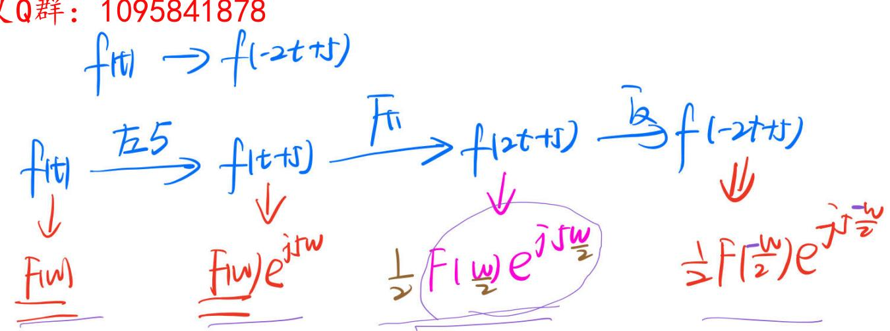

## 傅里叶性质相关证明

(1)对称性:

若 $f(t)\leftrightarrow F(\omega)$ ，则

$$
F (t) \leftrightarrow 2 \pi f (- \omega)
$$

证明：

$$
f (t) = \frac {1}{2 \pi} \int_ {- \infty} ^ {\infty} F (\omega) e ^ {j \omega t} d \omega
$$

$$
f (- t) = \frac {1}{2 \pi} \int_ {- \infty} ^ {\infty} F (\omega) e ^ {- j \omega t} d \omega
$$

$$
\Rightarrow 2 \pi f (- t) = \int_ {- \infty} ^ {\infty} F (\omega) e ^ {- j \omega t} d \omega \stackrel {t \text {与} \omega \text {互换}} {\Longrightarrow} 2 \pi f (- \omega) = \int_ {- \infty} ^ {\infty} F (t) e ^ {- j \omega t} d t
$$

$\Rightarrow F(t)$ 与 $2\pi f(-\omega)$ 是 $FT$ 变换对

(2)尺度变换

若 $f(t)\leftrightarrow F(\omega)$ ，则

$$
f (a t) \leftrightarrow \frac {1}{| a |} F \left(\frac {\omega}{a}\right)
$$

证明：

已知 $F(\omega)=\int_{-\infty}^{\infty}f(t)e^{-j\omega t}dt,$ 则

$$
\int_ {- \infty} ^ {\infty} f (a t) e ^ {- j \omega t} d t ①
$$

令 $at = x$ ，则 $dt = \frac{1}{a} dx$

若 $a > 0$

$$
① = \frac {1}{a} \int_ {- \infty} ^ {\infty} f (x) e ^ {- j \omega \frac {x}{a}} d x = \frac {1}{a} \int_ {- \infty} ^ {\infty} f (t) e ^ {- j \frac {\omega}{a} t} d t = \frac {1}{a} F (\frac {\omega}{a})
$$

若 $a < 0$

$$
① = \frac {1}{a} \int_ {- \infty} ^ {\infty} f (x) e ^ {- j \omega \frac {x}{a}} d x = - \frac {1}{a} \int_ {- \infty} ^ {\infty} f (t) e ^ {- j \frac {\omega}{a} t} d t = - \frac {1}{a} F (\frac {\omega}{a})
$$

综上所述

$$
f (a t) \leftrightarrow \frac {1}{| a |} F \left(\frac {\omega}{a}\right)
$$

特例：令 $a = -1$ ，则 $f(-t)\leftrightarrow F(-\omega)$

若 $f(t)=jf_{r}(t)$ ，则

$$
\begin{array}{r l} f ^ {*} (t) & = - j f _ {r} (t) \Rightarrow f ^ {*} (t) \stackrel {F T} {\leftrightarrow} - R e \{F [ \omega ] \} - j I m \{F [ \omega ] \} = - R e \{F [ \omega ] \} - j I m \{F [ \omega ] \} \\ & = R e \left\{F [ - \omega ] \right\} + j I m \{F [ - \omega ] \} \\ & \Rightarrow f ^ {*} (t) \stackrel {F T} {\leftrightarrow} F ^ {*} (- \omega) \end{array}
$$

## (4) 时域性质

时移性质：若 $f(t)\leftrightarrow F(\omega)$ 则

$$
f (t \pm t _ {0}) \leftrightarrow F (\omega) e ^ {\pm j \omega t _ {0}}
$$

证明：

$$
\begin{array}{r l} & {\int_ {- \infty} ^ {\infty} f (t \pm t _ {0}) e ^ {- j \omega t} d t \xrightarrow {\text {令} x = t \pm t _ {0}} \int_ {- \infty} ^ {\infty} f (x) e ^ {- j \omega (x \mp t _ {0})} d x} \\ & {\qquad = e ^ {\pm j \omega t _ {0}} \int_ {- \infty} ^ {\infty} f (t) e ^ {- j \omega t} d t = e ^ {\pm j \omega t _ {0}} F (\omega)} \end{array}
$$

## (5) 频移性质

频移性质：若 $f(t)\leftrightarrow F(\omega)$ 则

$$
f (t) e ^ {\mp j \omega_ {0} t} \leftrightarrow F (\omega \pm \omega_ {0})
$$

证明：

$$
\begin{array}{c} {{F (\omega) =  \int_ {- \infty} ^ {\infty} f (t) e ^ {- j \omega t} d t}} \\ {{F (\omega \mp \omega_ {0}) =  \int_ {- \infty} ^ {\infty} f (t) e ^ {- j (\omega \mp \omega_ {0}) t} d t =  \int_ {- \infty} ^ {\infty} f (t) e ^ {\pm j \omega_ {0} t} e ^ {- j \omega t} d t}} \\ {{\Rightarrow \mathrm{说明} F (\omega \mp \omega_ {0}) \mathrm{与} f (t) e ^ {\pm j \omega_ {0} t} \mathrm{为变换对}}} \end{array}
$$

## (6) 时域卷积定理:

$$
f _ {1} (t) * f _ {2} (t) \leftrightarrow F _ {1} (\omega) \cdot F _ {2} (\omega)
$$

证明过程:

$$
f _ {1} (t) * f _ {2} (t) = \int_ {- \infty} ^ {\infty} f _ {1} (\tau) \cdot f _ {2} (t - \tau) d \tau
$$

B站up: 信号与系统\_谷哥

$$
\begin{array}{r l} & {F T [ f _ {1} (t) * f _ {2} (t) ] = \int_ {- \infty} ^ {\infty} \int_ {- \infty} ^ {\infty} f _ {1} (\tau) f _ {2} (t - \tau) d \tau e ^ {- j \omega t} d t} \\ & {\quad \text {令} m = t - \tau} \\ & {\qquad = \int_ {- \infty} ^ {\infty} f _ {1} (\tau) \int_ {- \infty} ^ {\infty} f _ {2} (\mathrm{m}) e ^ {- j \omega m} d m e ^ {- j \omega \tau} d \tau} \\ & {\qquad \frac {d F (\omega)}{d \omega} = \int_ {- \infty} ^ {\infty} f (t) (- j t) e ^ {- j \omega t} d t} \\ & {\qquad \qquad - j t f (t) \leftrightarrow \frac {d F (\omega)}{d \omega}} \\ & {\qquad \qquad t f (t) \leftrightarrow j \frac {d F (\omega)}{d \omega}} \end{array}
$$

(7) 频域卷积定理:

$$
f _ {1} (t) \cdot f _ {2} (t) \leftrightarrow \frac {1}{2 \pi} F _ {1} (\omega) * F _ {2} (\omega)
$$

证明：

$$
\begin{array}{r l} & F ^ {- 1} \left[ \frac {1}{2 \pi} F _ {1} (\omega) * F _ {2} (\omega) \right] = \frac {1}{2 \pi} \int_ {- \infty} ^ {\infty} F _ {1} (a) F _ {2} (\omega - a) d a \\ & \qquad = \frac {1}{2 \pi} \int_ {- \infty} ^ {\infty} \frac {1}{2 \pi} \int_ {- \infty} ^ {\infty} F _ {1} (a) F _ {2} (\omega - a) d a e ^ {j \omega t} d \omega \\ & = \frac {1}{2 \pi} \int_ {- \infty} ^ {\infty} F _ {1} (a) \frac {1}{2 \pi} \int_ {- \infty} ^ {\infty} F _ {2} (\omega - a) e ^ {j \omega t} d \omega d a = \frac {1}{2 \pi} \int_ {- \infty} ^ {\infty} F _ {1} (a) f _ {2} (t) e ^ {j a t} d a \\ & \qquad = \frac {1}{2 \pi} \int_ {- \infty} ^ {\infty} F _ {1} (a) e ^ {j a t} d a \cdot f _ {2} (t) = f _ {1} (t) \cdot f _ {2} (t) \end{array}
$$

(8) 时域微分:

证明：

$$
\begin{array}{c} {f ^ {\prime} (t) = \frac {d f (t)}{d t}} \\ {f (t) = \frac {1}{2 \pi} \int_ {- \infty} ^ {\infty} F (\omega) e ^ {j \omega t} d \omega} \\ {\frac {d f (t)}{d t} = \frac {1}{2 \pi} \int_ {- \infty} ^ {\infty} F (\omega) j \omega e ^ {j \omega t} d \omega} \\ {\frac {d f (t)}{d t} \leftrightarrow j \omega F (\omega)} \end{array}
$$

(9) 时域积分:

证明

$$
\int_ {- \infty} ^ {t} f (\tau) d \tau = f (t) * u (t)
$$

官网：tongxi nkaoyan. com

梦马班讲义

$$
\leftrightarrow F (\omega) \cdot [ \pi \delta (\omega) + \frac {1}{j \omega} ] = \pi F (\omega) \delta (t) + \frac {F (\omega)}{j \omega} = \pi F (0) \delta (\omega) + \frac {F (\omega)}{j \omega}
$$

(10) 频域微分:

证明：

$$
\begin{array}{c} F (\omega) = \int_ {- \infty} ^ {\infty} f (t) e ^ {- j \omega t} d t \\ \frac {d F (\omega)}{d \omega} = \int_ {- \infty} ^ {\infty} f (t) (- j t) e ^ {- j \omega t} d t \\ - j t f (t) \leftrightarrow \frac {d F (\omega)}{d \omega} \\ t f (t) \leftrightarrow j \frac {d F (\omega)}{d \omega} \end{array}
$$

(11) 频域积分:

$$
\int_ {- \infty} ^ {\omega} \mathrm{F} (\Omega) d \Omega = F (\omega) * u (\omega)
$$

对称性：

$$
u (\omega) = F (\omega)
$$

$$
u (t) = F (t)
$$

$$
\pi \delta (\omega) + \frac {1}{j \omega} = 2 \pi f (- \omega)
$$

$$
\frac {1}{2 \pi} \Big [ \pi \delta (- t) - \frac {1}{j t} \Big ] = f (t) = \frac {1}{2 \pi} \Big [ \pi \delta (t) - \frac {1}{j t} \Big ]
$$

$$
\begin{array}{r} \int_ {- \infty} ^ {\omega} F (\Omega) d \Omega = F (\omega) * u (\omega), \frac {1}{2 \pi} F (\omega) * u (\omega) \leftrightarrow f (t) \times \frac {1}{2 \pi} \Big [ \pi \delta (t) - \frac {1}{j t} \Big ] \\ F (\omega) * u (\omega) \leftrightarrow - \frac {f (t)}{j t} + \pi f (0) \delta (t) \end{array}
$$

<table><tr><td> $E \cdot Sa(At)$ </td><td>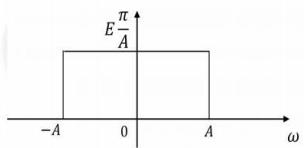</td></tr><tr><td> $E \cdot Sa^{2}(At)$ </td><td>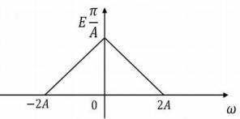</td></tr><tr><td>余弦信号  $cos\omega_{0}t$ </td><td> $\pi[\delta(\omega+\omega_{0})+\delta(\omega-\omega_{0})]$ </td></tr><tr><td>正弦信号  $sin\omega_{0}t$ </td><td> $j\pi[\delta(\omega+\omega_{0})-\delta(\omega-\omega_{0})]$ </td></tr><tr><td>周期冲激信号 $\delta_{T}(t)=\sum_{n=-\infty}^{\infty}\delta(t-nT_{1})$ </td><td> $\omega_{1}\sum_{n=-\infty}^{\infty}\delta(\omega-n\omega_{1})$ </td></tr><tr><td>理想抽样信号  $f(t)\cdot\delta_{T}(t)$ </td><td>周期延拓,幅度变为原来  $1/T_{1}$  $\frac{1}{T_{1}}\sum_{n=-\infty}^{\infty}F(\omega-n\omega_{1})$ </td></tr><tr><td>调制信号  $f(t)\cos\omega_{0}t$ </td><td>左右平移,幅度减半 $\frac{1}{2}[F(\omega+\omega_{0})+F(\omega-\omega_{0})]$ </td></tr><tr><td> $|t|$ </td><td> $-\frac{2}{\omega^{2}}$ </td></tr><tr><td> $-\frac{1}{\pi t^{2}}$ </td><td> $|\omega|$ </td></tr><tr><td> $\frac{1}{\pi t}$ </td><td> $-jsgn(\omega)$ </td></tr></table>

一方平移，另一方乘？指数，（或：看到？指数，想到对方平移）符号速记口诀：时，不变；不时，则变。

考点5: 时域移位性质(只影响相位)

<table><tr><td>时移性质:若 $f(t) \leftrightarrow F(\omega)$ 则</td></tr><tr><td> $f(t \pm t_0) \leftrightarrow F(\omega)e^{\pm j\omega t_0}$ </td></tr><tr><td>应用:已知 $|F(\omega)|$ 和 $\varphi(\omega)$ ,求 $f(t)$ 。</td></tr></table>

## 考点6：频域移位性质

频移性质：

$$
\text { 若 } f (t) \leftrightarrow F (\omega) \text { 则 }
$$

$$
f (t) e ^ {\mp j \omega_ {0} t} \leftrightarrow F (\omega \pm \omega_ {0})
$$

## 考点 4: 奇偶虚实性

若 $f(t)\leftrightarrow F(\omega)$ 则

$$
f (- t) \leftrightarrow F (- \omega)
$$

时域反转，频域反转

$$
f ^ {*} (t) \leftrightarrow F ^ {*} (- \omega)
$$

时域共轭，频域共轭且反转

若 $f(t)$ 为实函数，则

$$
\begin{array}{l} f _ {e} (t) = \frac {f (t) + f (- t)}{2} \leftrightarrow \frac {F (\omega) + F (- \omega)}{2} = R e \{F (\omega) \} \\ f _ {o} (t) = \frac {f (t) - f (- t)}{2} \leftrightarrow \frac {F (\omega) - F (- \omega)}{2} = j I m \{F (\omega) \} \end{array}
$$

【同例 24】：已知 $f(t)$ 图形如下，且 $f(t) \leftrightarrow F(\omega)$ ，求

(1) $\varphi(\omega)$ ;

(2) $F(0)$ ;

(3) $\int_{-\infty}^{\infty} F(\omega) d\omega$ ;

(4)画 $Re[F(\omega)]$ 的逆变换的图。

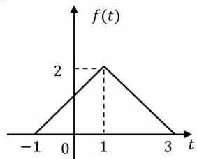

## 考点 8: 时域微分性质

在信号 $f(t)$ 满足 $\int_{-\infty}^{\infty}f(t)dt<\infty$ 条件下

若 $f(t)\leftrightarrow F(\omega)$ ，则

$$
f ^ {\prime} (t) \leftrightarrow (j \omega) F (\omega)
$$

$$
f ^ {(n)} (t) \leftrightarrow (j \omega) ^ {n} F (\omega)
$$

例 20: 如图所示, 已知 $f(t) = u(t)$ , 求 $f_{2}(t) = 1 + u(t)$ 的傅里叶变换。

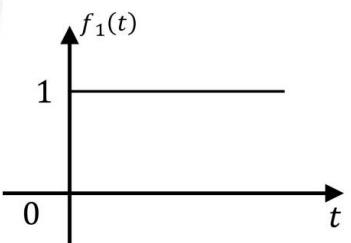

【正常求解】

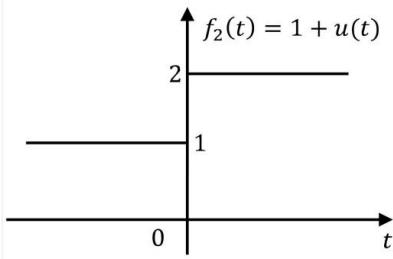

【时域微分性质——不满足条件】

【时域积分的理解——卷积】

【时域积分性质看例20】

B站up: 信号与系统\_谷哥

公众号：通信考研小马哥

例 22: 求图(a)、(b)、(c)所示信号的傅里叶变换。

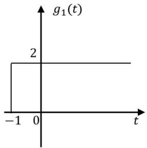

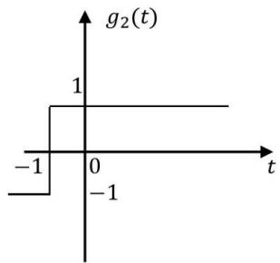

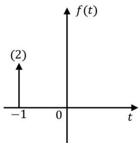

【从信号分解的角度看结论表达式】

若 $f(t)$ 的傅里叶变换为 $F(\omega),\phi (t) = \frac{df(t)}{dt},\phi (t)\leftrightarrow \Phi (\omega)$ ，试证明

$$
F (\omega) = \frac {\Phi (\omega)}{j \omega} + [ f (\infty) + f (- \infty) ] \pi \delta (\omega)
$$

其中 $f(\infty), f(-\infty)$ 为有限值。

## 考点 12: 信号功率与能量(帕萨瓦尔定理)

1、帕萨瓦尔能量公式

$$
E = \int_ {- \infty} ^ {\infty} | f (t) | ^ {2} d t = \frac {1}{2 \pi} \int_ {- \infty} ^ {\infty} | F (\omega) | ^ {2} d \omega
$$

【梦马班点拨】解题思路：求时域形式的能量用频域公式，求频域公式能量用时域公式。

## 2、周期信号的功率谱

$$
P = \frac {1}{T} \int_ {- \frac {T}{2}} ^ {\frac {T}{2}} | f (t) | ^ {2} d t = \sum_ {n = - \infty} ^ {\infty} | F _ {n} | ^ {2} = | F _ {0} | ^ {2} + 2 \sum_ {n = 1} ^ {\infty} | F _ {n} | ^ {2}
$$

其中 $F_{n}$ 为指数形式的傅里叶级数的系数, 如果已知余弦形式的傅里叶级数 $C_{n}$ , 则

$$
| F _ {n} | = \frac {C _ {n}}{2}, F _ {0} = C _ {0}
$$

例 25: 利用能量等式

$$
\int_ {- \infty} ^ {\infty} f ^ {2} (t) d t = \frac {1}{2 \pi} \int_ {- \infty} ^ {\infty} | F (j \omega) | ^ {2} d \omega
$$

计算下列积分的值。

(1) $\int_{-\infty}^{\infty}\left[\frac{sin t}{t}\right]^2 dt$

(2) $\int_{-\infty}^{\infty}\frac{dx}{(1 + x^2)^2}$ 。

B站up: 信号与系统\_谷哥

FT 变换性质一览表

<table><tr><td>#</td><td>性质名称</td><td>f(t)</td><td>F(ω)</td></tr><tr><td>1</td><td>唯一性</td><td>f(t)</td><td>F(ω)</td></tr><tr><td>2</td><td>线性</td><td> $\sum_{i=1}^{n}A_i f_i(t)$   $A_i$ 为常数, n为正整数</td><td> $\sum_{i=1}^{n}A_i F_i(\omega)$ </td></tr><tr><td>3</td><td>对称性</td><td>F(t)</td><td> $2 \pi f(-\omega)$ </td></tr><tr><td rowspan="3">4</td><td rowspan="3">奇偶虚实性</td><td>f*(t)</td><td>F*(-ω)</td></tr><tr><td>fe(t)</td><td>Re[f(ω)]</td></tr><tr><td>fo(t)</td><td>jIm[f(ω)]</td></tr><tr><td rowspan="2">5</td><td rowspan="2">尺度变换特性</td><td>f(at)(a为非零实常数)</td><td> $\frac{1}{|a|} F\left(\frac{\omega}{a}\right)$ </td></tr><tr><td>f(-t)</td><td>F(-ω)</td></tr><tr><td rowspan="2">6</td><td rowspan="2">时移性</td><td>f(t-t0)(t0为实常数)</td><td>F(ω)e- jωt0</td></tr><tr><td>f(at-t0)(a, t0为实常数)</td><td> $\frac{1}{|a|} F\left(\frac{\omega}{a}\right)e^{-j\frac{\omega}{a} t_0}$ </td></tr><tr><td rowspan="3">7</td><td rowspan="3">频移</td><td>f(t)e±jω0t(ω0为实常数)</td><td>F(ω≠ω0)</td></tr><tr><td>f(t)cos(ω0t)</td><td> $\frac{1}{2}[F(\omega + \omega_0) + F(\omega - \omega_0)]$ </td></tr><tr><td>f(t)sin(ω0t)</td><td> $\frac{j}{2}[F(\omega + \omega_0) - F(\omega - \omega_0)]$ </td></tr><tr><td rowspan="2">8</td><td rowspan="2">时域微分要求: $\int_{-\infty}^{\infty}f(t)dt<\infty$ 否则不能用</td><td> $\frac{df(t)}{dt}$ </td><td>jωF(ω)</td></tr><tr><td> $\frac{d^k f(t)}{dt^k}$ </td><td>(jω)kF(ω)</td></tr></table>