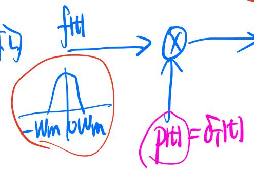

抽样与恢复

朱铭

$\alpha^{\circ}$ 恢复 $f_{s}(t) \xrightarrow{抛掉过程} f(t)$

$$
\frac {F _ {s} (w) \xrightarrow {\quad H (w) \quad} \boxed {\mathrm{low-pars}} \longrightarrow F (w)}{\overline {{F _ {s} (w)}} \longrightarrow \boxed {H (w)} \longrightarrow \overline {{F (w)}}} = \frac {F _ {s} (w) \cdot H (w)}{\overline {{\mathrm{日本}}}}.
$$

专题 7 调制与解调-AM、DSB 与 FDM 系统

调制与解调的应用背景——通信系统

1、根据电磁场理论

任何低频信号要得到

(1)波长=光速/频率, $\lambda  = c/f$ , 光速 $c = 3 \times  {10}^{8}\mathrm{m}/\mathrm{s}$

(2)天线最佳长度计算: 天线尺寸= $\lambda/4$ ，理论和实践证明，当天线的长度为无线电信号波长的1/4时，天线的发身和接收转换效率最高

(3)信号频率与发射天线的尺寸呈反比

举例: 天线尺寸为波长的 $1 / 4$ , 对于 $3000 \mathrm{~Hz}$ 的基带信号, 天线尺寸约为 $25 \mathrm{~Km}$ 。

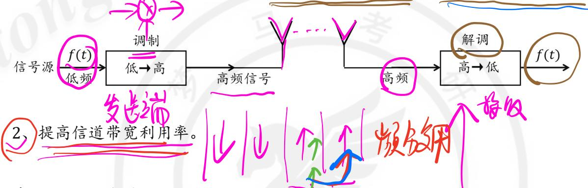

考点1：调制与解调

调制目的：将低频信号变成高频信号→频谱的搬移
解调目的：从已调信号中恢复低频信号

1、调制与解调结构模型

低恨
甚常
冯香
词句

$g(t)$ 称为调制信号，频带受限， $\omega_{m}$ 为信号 $g(t)$ 的带宽， $cos\omega_{c}t$ 称为载波， $\omega_{c}$ 称为载波角频率， $f(t)$ 称为已调信号， $\omega_{c}\gg\omega_{m}$ ，。

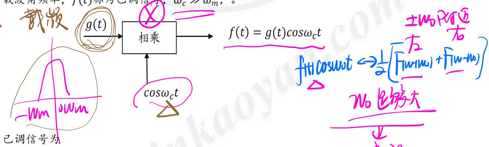

$f(t)$ 的频谱函数 $F(\omega)$

$$
f (t) = g (t) \cos \omega_ {c} t
$$

$$
F (\omega) = \frac {1}{2} [ G (\omega + \omega_ {c}) + G (\omega - \omega_ {c}) ]
$$

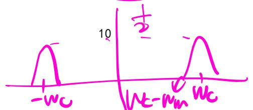

梦马班讲义

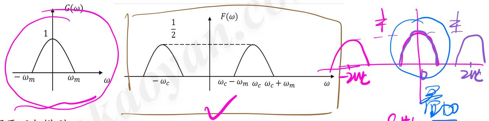

2、解调原理与模型

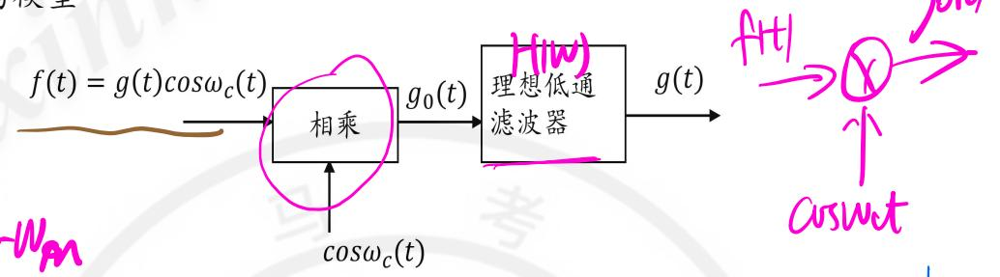

$$
W _ {m} \leq W _ {j l} \leq 2 W _ {c} - W _ {A n}
$$

$A = 2$

$$
g _ {0} (t) = f (t) \cos \omega_ {c} t
$$

$g_{0}(t)$ 的频谱函数为

$$
\mathcal {F} [ g _ {0} (t) ] = \frac {1}{2} [ F (\omega + \omega_ {c}) + F (\omega - \omega_ {c}) ]
$$

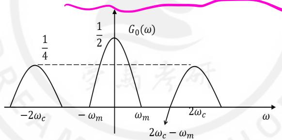

再利用一个低通滤波器 $(\omega_{m} < |\omega| < 2\omega_{c} - \omega_{m})$ ，滤除在频率为 $2\omega_{c}$ 附近的分量，即可取出 $g(t)$ ，完成解调。

3、调制与解调系统

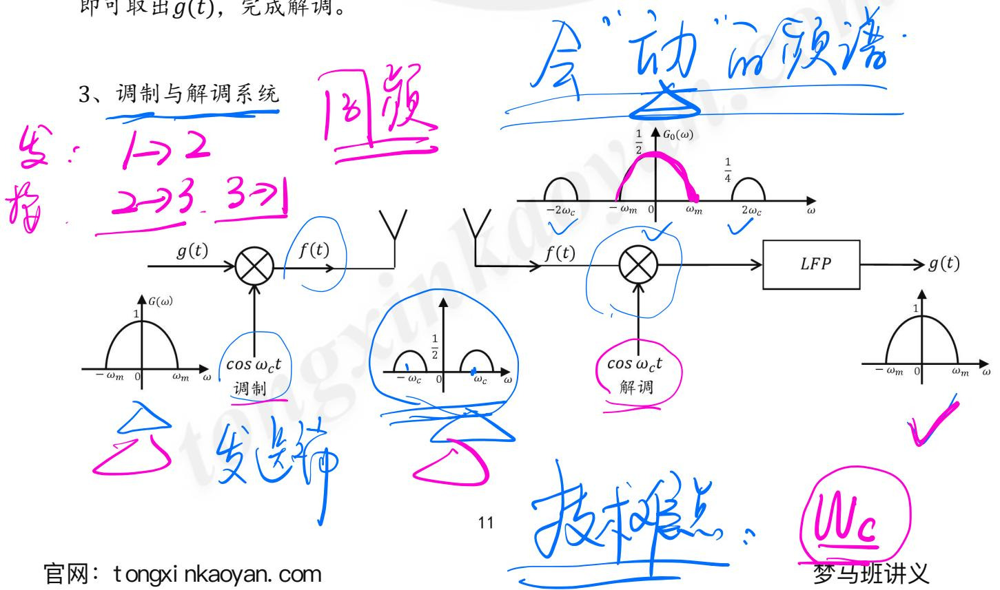

官网：tongxi nkaoyan.com

会动的预谱

“动”恢复

$\rightarrow  \bigotimes_{\text{aswd }} \rightarrow  \sqrt{1 + \left( w\right) } \rightarrow$

1→2
2→3 3→1

例 36: 如图(a)所示系统, 已知乘法器的输入 $f(t)=\frac{\sin 2 t}{t}$ , $s(t)=\cos(3 t)$ , 系统频率特性如图(b)所示,

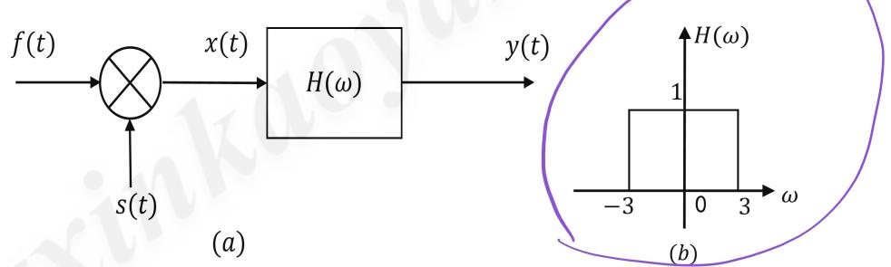

(1)求出 $f(t)$ 的频谱 $F(\omega)$ ;

(2)画出 $x(t)$ 和 $y(t)$ 的频谱图；

(3)写出 $y(t)$ 的表达式。

12] $x(t)=f(t)\cdot s(t)=f(t)\cdot\cos(3t)$

(1) $f(t)=2\cdot\frac{\sin2t}{2t}=2Sa(2t)$

$$
\therefore x (w) = \frac {1}{3} [ F (w + 3) + F (w - 3) ]
$$

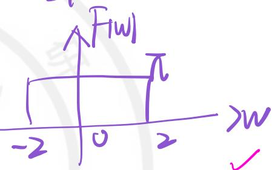

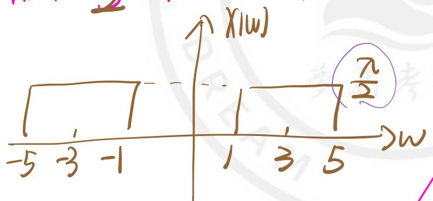

$$
Y (w) = X (w) \cdot H (w)
$$

$$
\begin{array}{r l} {(3)} & {y _ {\mathrm{H1}} = \int_ {a} (t) \cdot \cos 2 t} \\ & {= \frac {\sin t}{t} \cdot \cos 2 t} \end{array}
$$

$$
F (w) = \pi G _ {4} (w)
$$

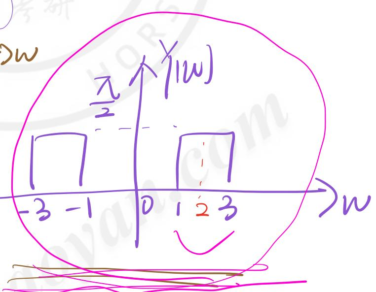

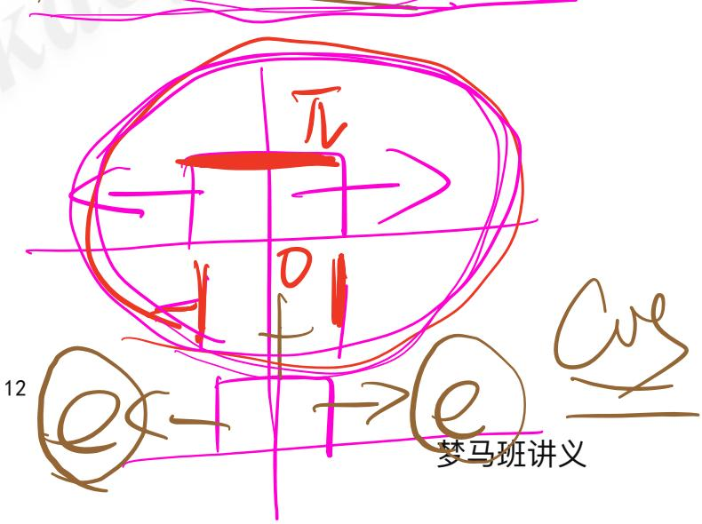

例 37: 图(a)为通信系统的原理框图, $f(t)$ 为被传送的基带信号, 设其频谱 $F(\omega)$ 如图(b)所示。 $s_1(t) = s_2(t) = \cos \omega_0 t, \omega_0 \gg \omega_m, s_1(t)$ 为发送端的载波信号, $s_2(t)$ 为接收端的本地振荡信号。

(1)求解并画出 $y_{1}(t)$ 的频谱 $Y_{1}(\omega)$ ;

(2)求解并画出 $y_{2}(t)$ 的频谱 $Y_{2}(\omega)$ ;

(3)欲使输出信号 $y(t)=f(t)$ (无失真恢复原信号),求理想低通滤波器的频响函数 $H(\omega)$ ，并画出图形。

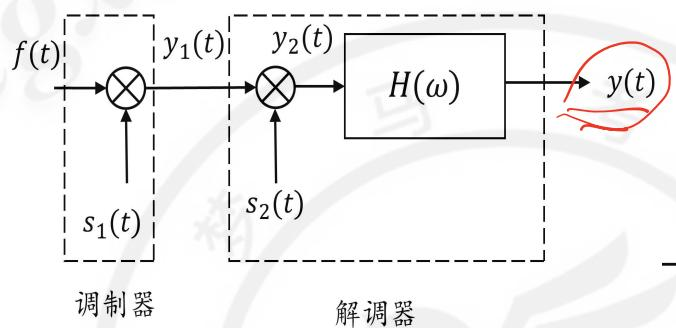  
图(a)

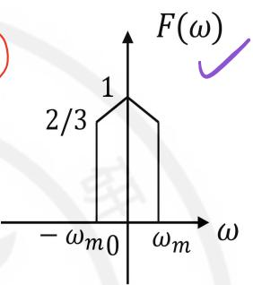

$$
(1) \therefore y _ {1} (t) = f (t) \cdot S _ {1} (t) = f (t) \cdot \cos W _ {0} t
$$

图(b)  
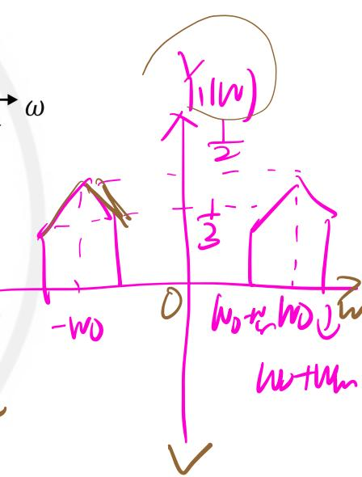

$$
\therefore Y _ {1} (w) = \frac {1}{2} [ F (w + w _ {0}) + F (w - w _ {0}) ]
$$

$$
y _ {2} | t | = y _ {1} | t | \cdot S _ {2} | t | = y _ {1} | t | \cos \omega t
$$

$$
\therefore Y _ {2} (w) = \frac {1}{2} [ Y _ {1} (w + w _ {0}) + Y _ {1} (w - w _ {0})
$$

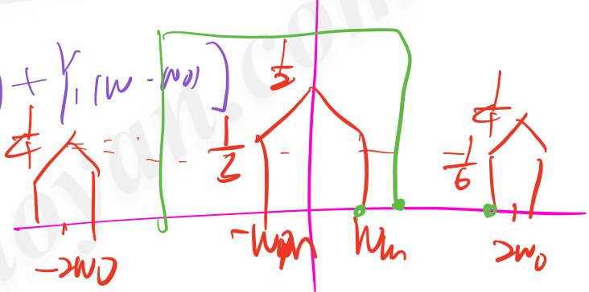

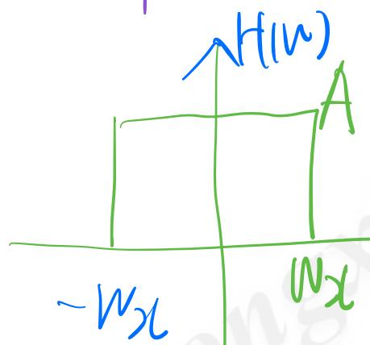

$$
\begin{array}{l}\rightarrow w \quad A = 2\\w _ {m} \leq w _ {x} \leq 2 w _ {0} - w _ {m}\end{array}
$$

$$
H (w) = 2 G _ {2 w x} ^ {(w)}
$$

## 考点2: 频分复用系统 FDM

在发送端将各路信号频谱搬移到各不相同的频率范围，使它们互不重叠，这样就可复用同一信道传输。在接收端利用带通滤波器将各路信号分离，再经解调即可还原信号为各路原始信号。

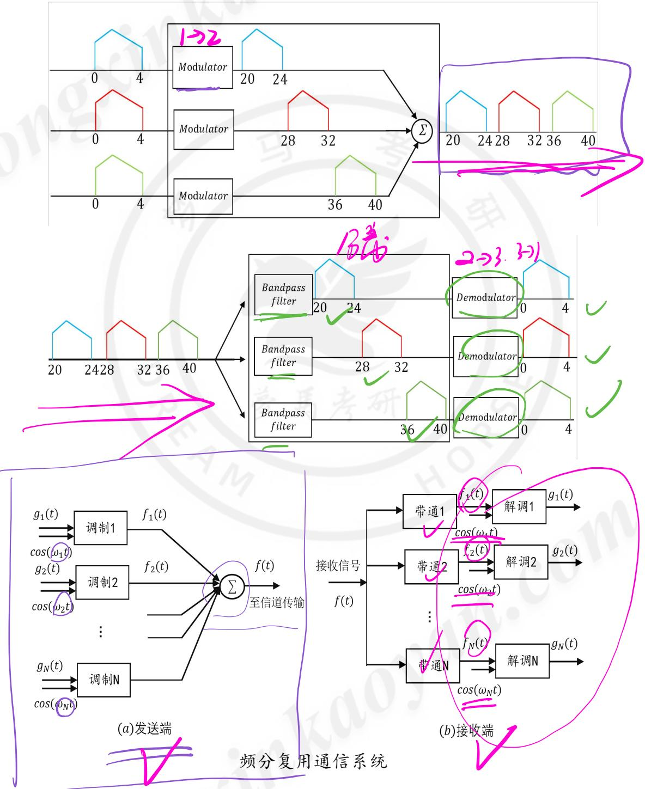

例 38: 如图所示系统, 已知激励信号 $f(t)$ 的频谱函数为 $F(\omega)$ 。试画出响应 $y(t)$ 的频谱函数 $Y(\omega)$ 。

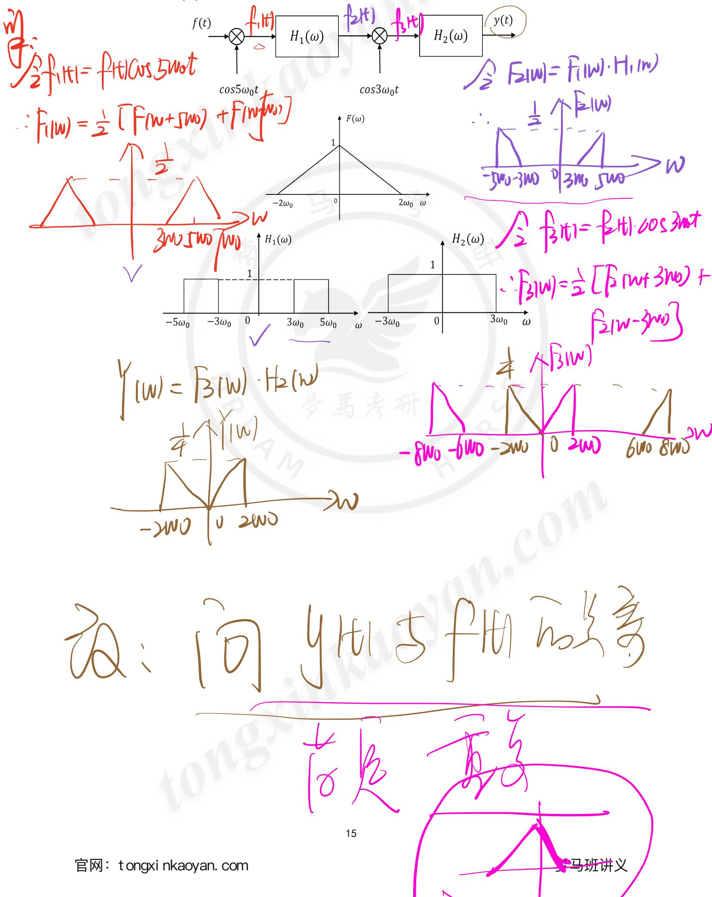

例 39: 在下图系统中, 已知输入信号 $f(t)$ 的频谱 $F(\omega)$ , 试分析系统中 A、B、C、

D、E 各点的频谱并画出频谱图，求出 $y(t)$ 与 $f(t)$ 的关系。

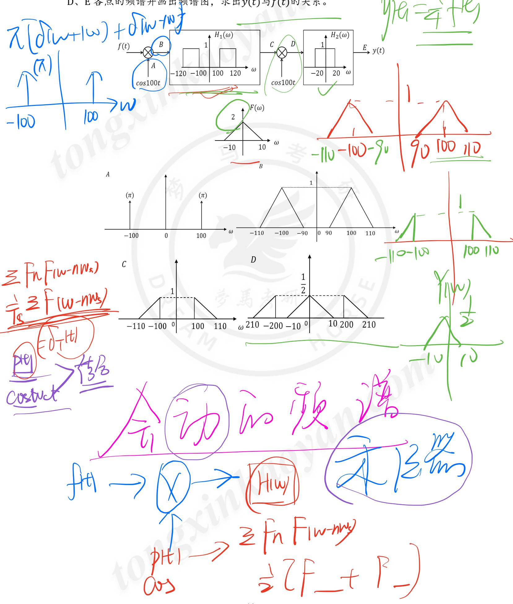

考点 3：基于乘法器的 FT 频谱分析  
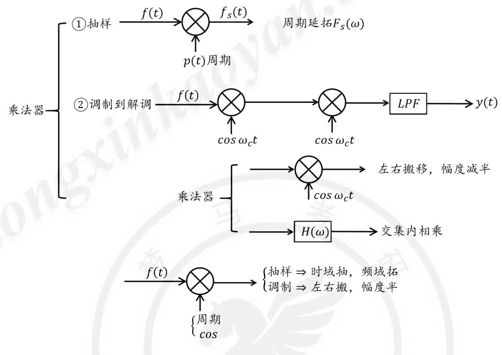  
夢馬考研

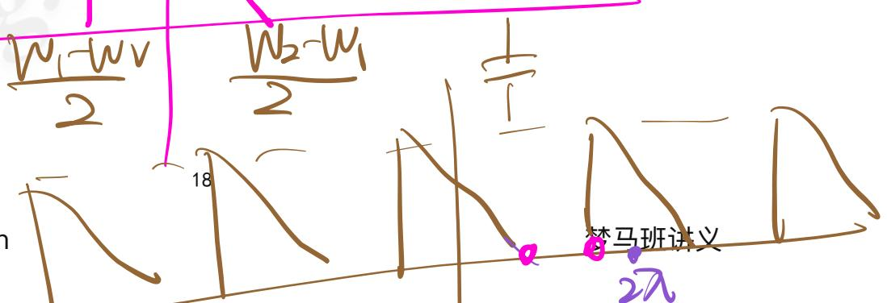

例40: 如图所示系统中, $x(t)$ 为实信号, 调制频率 $\omega_0 = \frac{1}{2} \cdot (\omega_1 + \omega_2)$ , 信号通过图(a)所示的系统, 低通滤波器 $H(\omega)$ 的截止频率为 $\frac{1}{2} (\omega_2 - \omega_1)$ , 幅频特性为 1,

(1)求 $X_{p}(\omega)$ 的频谱图；

(2)确定能从 $x_{p}(t)$ 恢复出 $x(t)$ 最大采样周期T。

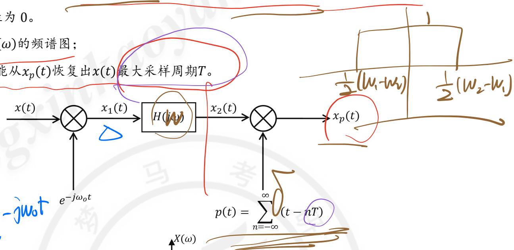

$$
x _ {1} | t | = x (t) \cdot e ^ {- j w _ {0} t}
$$

$$
\therefore X _ {1} (W) = X (W + W _ {0})
$$

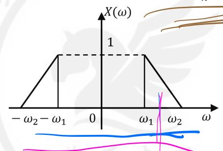

$$
W _ {0} = \frac {1}{2} | W _ {1} + W _ {2} |
$$

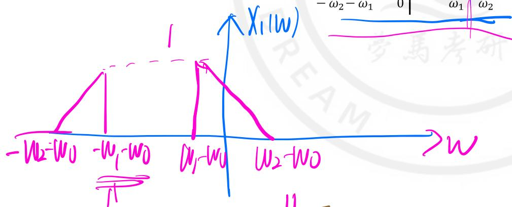

$$
- w _ {1} - \frac {1}{2} w _ {1} - \frac {1}{2} w _ {2}
$$

$$
W _ {2} - \frac {1}{2} W _ {1} - \frac {1}{2} W _ {2} = \frac {1}{2} (W _ {2} - W _ {1})
$$

$$
T \leq \frac {\pi}{W m}
$$

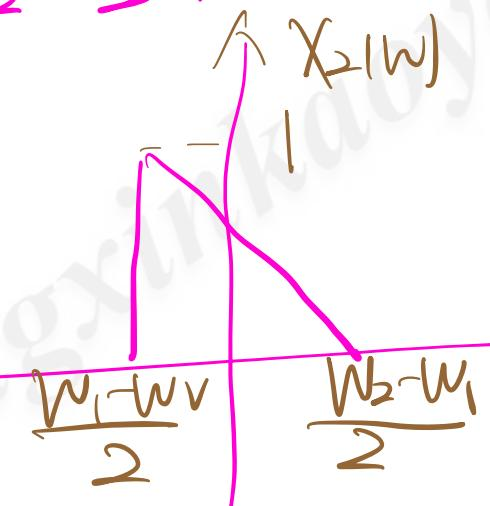

$$
\frac {1}{T} \ge F (w - n \frac {2 x}{T})
$$

$W_{2}-W_{1}$ 官网：tongxinkaoyan.com

B站up: 信号与系统\_谷哥

$y_{3}|t|=y_{2}|t|-y_{1}|t)$ 公众号：通信考研小马哥

例 41: 已知某系统的框图如下图(a)所示, 其中 $\delta_{T}(t)$ 表示周期为 T = 1, 强度为

1 的冲激串函数，输入信号 $f(t)$ 波形图如下图所示：

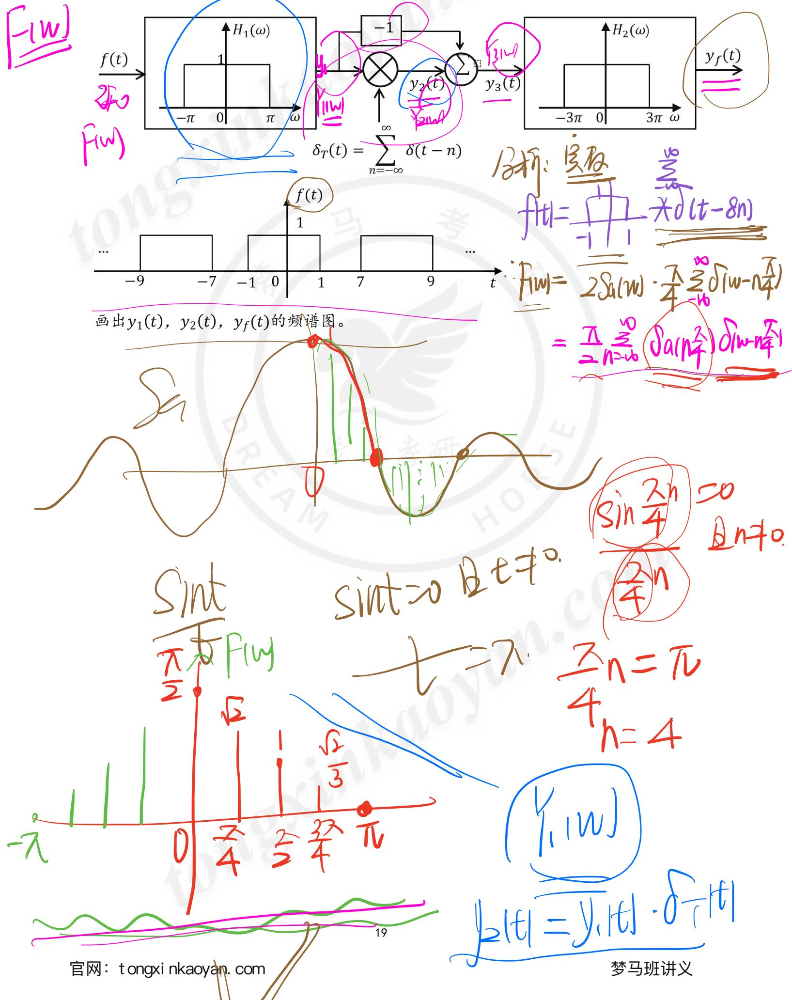

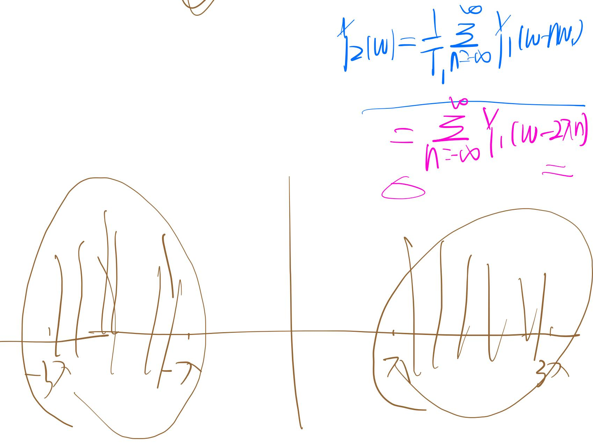

求 $k_{\mathrm{e}}$ 常
时
反限 $f_0$ →
→ $p_0 = \delta - 19$ $\Rightarrow \frac{1}{3} \sum \phi(w - nm_3)$ as $\rightarrow \frac{1}{2} [- + -]$ 频
→ $\sqrt{1 + (w)}$ →
结论