专题 8 希尔伯特变换及 SSB 信号

考点 1：振幅调制 AM(常规双边带)信号

$$
s _ {A M} (t) = [ A + m (t) ] c o s \omega_ {c} t = A c o s \omega_ {c} t + m (t) c o s \omega_ {c} t
$$

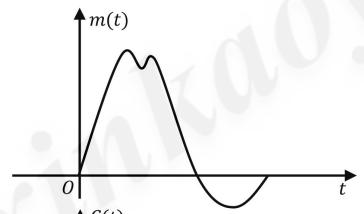

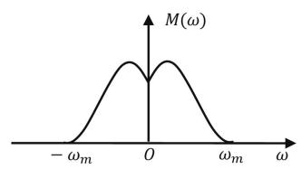

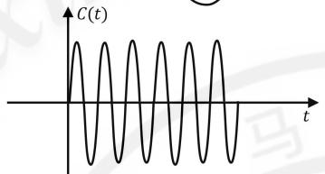

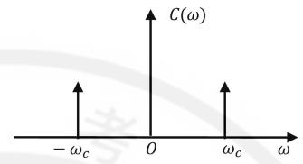

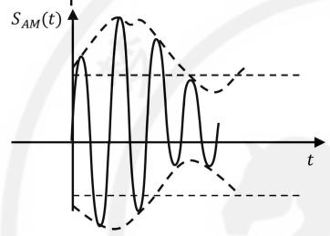

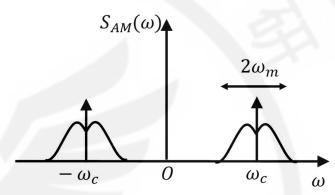

由 AM 信号频谱图可以看出，AM 信号中携带了载波频率信息，传输 AM 信号的带宽需要 $2\omega_{m}$ 。

考点 2: DSB: 双边带信号

$$
s _ {D S B} (t) = m (t) \cos \omega_ {c} t
$$

DSB 信号的波形和频谱，因为不存在载波分量，调制效率为 100%，比 AM 高，但传输 DSB 信号的带宽也为 $2\omega_{m}$

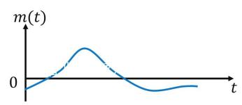

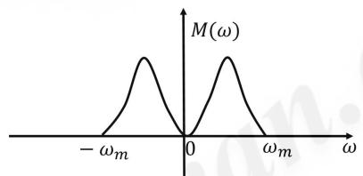

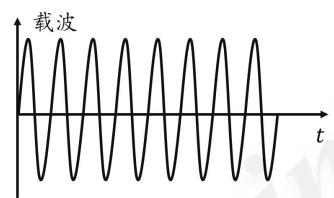

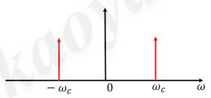  
$S_{DSB}(t)$

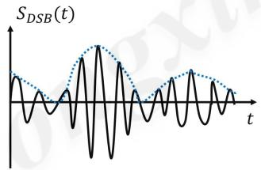

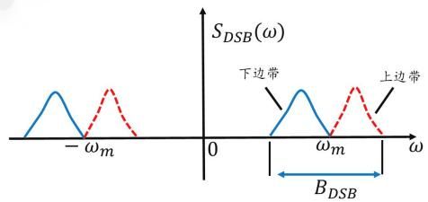

## 考点 3: SSB: 单边带信号

在 AM 信号频谱中，将频率低于载频的谱线为下边带(LSB)，频率高于载频的谱线为上边带(USB)，在调幅波频谱中的上下两个边带都含有相同的信息，只传送一个边带也就可以完成信息的传送，且传输SSB信号的带宽只需要 $\omega_{m}$ .

## 考点 4: SSB信号的产生——滤波法和移相法

1、滤波法：先产生一个 DSB 信号，然后在通过一个边带滤波器，滤除不需要的边带，即可获得单边带信号。

SSB 滤波法产生结构:

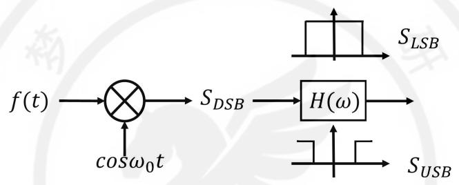

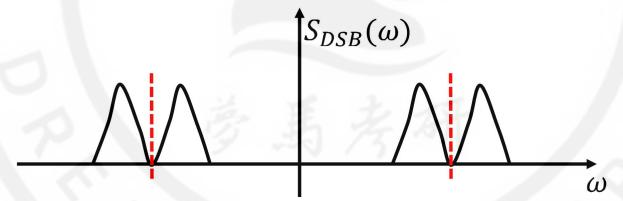

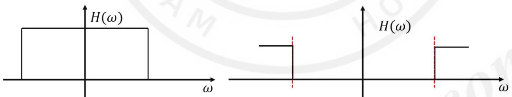

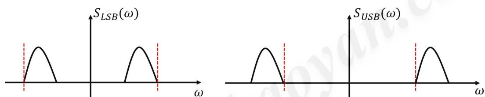

2、相移法SSB产生：利用相移网络，对载波和调制信号进行适当的相移，以便在合成过程中将其中一个边带抵消，从而获得SSB信号。

例 42: 试证明题图: 所示之系统可以产生单边带信号。图中, 信号 $g(t)$ 的频谱 $G(\omega)$ 受限于 $\sim \omega_{m} \sim +\omega_{m}$ 之间, $\dot{\omega}_{0} \gg \omega_{m}$ ; $H(\omega) = -jsgn\omega$ 。设 $v(t)$ 的频谱为 $V(\omega)$ , 写出 $V(\omega)$ 表示式, 并画出图形。

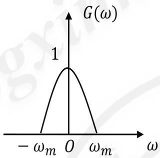

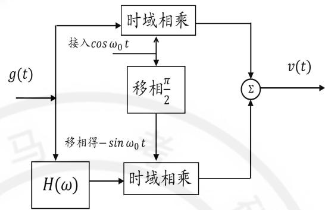

例 43：下图所示为一个幅度调制系统，该系统由以下两部分组成：先把调制信号与载波之和平方，然后通过带通滤波器获得已调信号，若 $g(t)$ 是带限信号，即 $|\omega| > \omega_{m}$ 时， $G(\omega) = 0$ 。试确定带通滤波器的参数A， $\omega_{1}$ ， $\omega_{h}$ ，使得 $f(t) = g(t)\cos\omega_{c}t$ ，并给出 $\omega_{c}$ 和 $\omega_{m}$ 的约束。

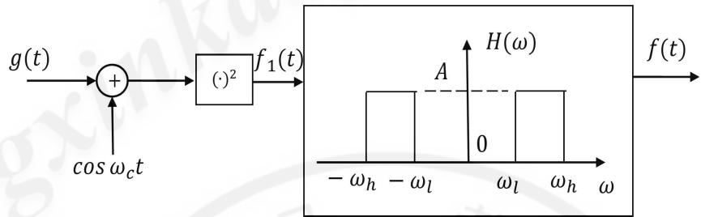

## 考点5：希尔伯特变换

一个实值函数 $x(t)$ 的希尔伯特变换是 $x(t)$ 和 $1 / \pi t$ 的卷积。

假设 $x(t)$ 是一个实值函数，求该函数的希尔伯特变换。

$$
\hat {x} (t) = H [ x (t)) ] = x (t) * \frac {1}{\pi t} = \frac {1}{\pi} \int_ {- \infty} ^ {\infty} \frac {x (\tau)}{t - \tau} d \tau
$$

因此 $\hat{x}(t)$ 可以被解读为 $x(t)$ 的线性时不变系统的输出，该线性时不变系统的脉冲响应为：

$$
h (t) = \frac {1}{\pi t}
$$

该脉冲响应的傅里叶变换为:

$$
H (\omega) = - j s g n (\omega) = \left\{ \begin{array}{l l} - j, & \omega > 0 \\ j, & \omega \leq 0 \end{array} \right.
$$

## 考点 6: 希尔伯特变换—90°移相器

信号经过希尔伯特变换之后，频域内各频率成分的幅值不变，但相位出现 $90^{\circ}$ 相移。即正频率滞后 $\pi/2$ ，负频率导前 $\pi/2$ ，因此希尔伯特变换器又称 $90^{\circ}$ 移相器。希尔伯特变换器又称 $90^{\circ}$ 移相器，如下图。两次希尔伯特变换之后，原信号相位翻转了 $180^{\circ}$ ，四次希尔伯特变换之后又变回本身。

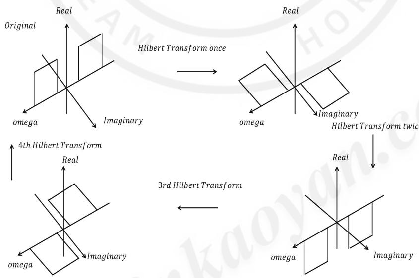

例 44: 如图所示, 理想 $-\pi/2rad$ 全通相移器的频响特性定义为

$$
H (\omega) = \left\{ \begin{array}{l l} - j & \omega > 0 \\ j & \omega <   0 \end{array} \right.
$$

(1)求该相移器的单位冲激响应 $h(t)$ 。

(2)对于任意输入 $e(t)$ ，求该相移器的输出 $r(t)$ 。

(3)当 $e(t)=\cos\omega_{0}t$ 时，求该相移器的输出 $r(t)$ 。

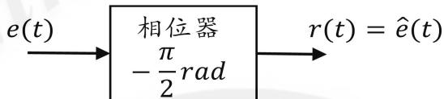

## 考点7：系统可实现的(因果)的约束条件—希尔伯特变换变换对

系统可实现性的实质是具有因果性。本节将要证明，由于因果性的限制，系统函数的实部与虚部或模与辐角之间将具备某种相互制约的特性，这种特性以希尔伯特(Hilbert)变换的形式表现出来。

对于因果系统，其冲激响应 $h(t)$ 在t<0时等于0，仅在t>0时存在，因此

$$
h (t) = h (t) u (t) ①
$$

设 $h(t)$ 的傅里叶变换即系统函数 $H(\mathrm{j}\omega)$ 可分解为实部 $R(\omega)$ 和虚部 $jX(\omega)$ 之和

$$
H (j \omega) = \mathcal {F} [ h (t) ] = R (\omega) + j X (\omega)
$$

对式①运用傅里叶变换的频域卷积定理得到

$$
\mathcal {F} [ h (t) ] = \frac {1}{2 \pi} \{\mathcal {F} [ h (t) ] * \mathcal {F} [ u (t) ] \}
$$

于是有

$$
\begin{array}{r} R (\omega) + j X (\omega) = \frac {1}{2 \pi} \bigg \{[ R (\omega) + j X (\omega) ] * \bigg [ \pi \delta (\omega) + \frac {1}{j \omega} \bigg ] \bigg \} \\ = \frac {1}{2 \pi} \bigg \{R (\omega) * \pi \delta (\omega) + X (\omega) * \frac {1}{\omega} \bigg \} + \frac {j}{2 \pi} \bigg \{X (\omega) * \pi \delta (\omega) - R (\omega) * \frac {1}{\omega} \bigg \} \\ = \left\{\frac {R (\omega)}{2} + \frac {1}{2 \pi} \int_ {- \infty} ^ {\infty} \frac {X (\lambda)}{\omega - \lambda} d \lambda \right\} + j \left\{\frac {X (\omega)}{2} - \frac {1}{2 \pi} \int_ {- \infty} ^ {\infty} \frac {R (\lambda)}{\omega - \lambda} d \lambda \right\} \end{array}
$$

解得

$$
R (\omega) = \frac {1}{\pi} \int_ {- \infty} ^ {\infty} \frac {X (\lambda)}{\omega - \lambda} d \lambda ②
$$

$$
X (\omega) = - \frac {1}{\pi} \int_ {- \infty} ^ {\infty} \frac {R (\lambda)}{\omega - \lambda} d \lambda ③
$$

式②与式③称为希尔伯特变换对。它说明了具有因果性的系统函数 $H(\omega)$ 的一个重要特性：实部 $R(\omega)$ 被已知的虚部 $X(\omega)$ 唯一地确定，反过来也一样。

从以上推证过程可以看出，傅氏变换实部与虚部构成希尔伯特变换对的特性，不只限于具有因果性的系统函数，对于任意因果函数，其傅氏变换的这种特性都是成立的。也即，若函数 $f(t)$ 满足

$$
f (t) = f (t) u (t)
$$

且 $f(t)$ 的傅里叶变换为

$$
F (\omega) = R (\omega) + \mathrm{j} X (\omega)
$$

则 $R(\omega)$ 与 $X(\omega)$ 之间构成希尔伯特变换对[满足式②与式③的互换关系]。

例 45：已知因果LTI系统频响特性 $H(\omega)$ 的实部为 $\pi\delta(\omega)$ ，求该系统的频响特性 $H(\omega)$ 和单位冲激响应 $h(t)$ 。

## 考点8：希尔伯特变换在通信系统中应用—SSB信号产生

希尔伯特变换在通信系统中的应用体现在单边带信号的产生，具体框图如下，其分析过程可详见 P162。

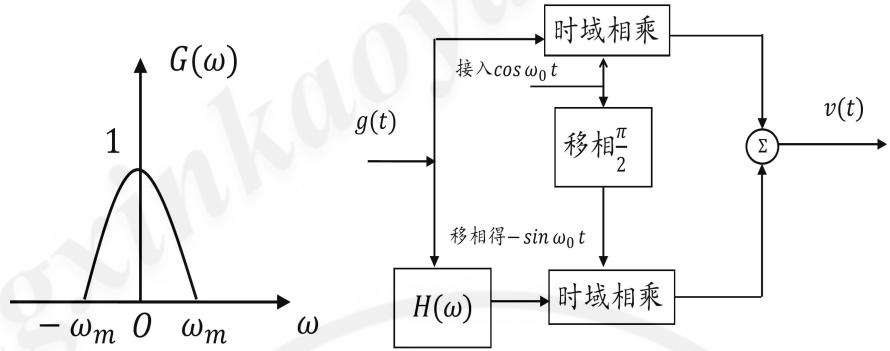

