1. 解: $\because x(t) = \sin 200\pi t + 2\sin 400\pi t$ $\therefore x(w) = j\pi [\sqrt{w + 200\pi} + \sqrt{w - 200\pi}] + 2j\pi [\sqrt{w + 400\pi} + \sqrt{w - 400\pi}]$

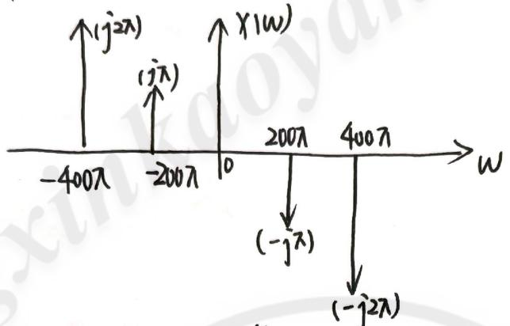

$$
\sin^ {2} 4 0 0 \pi t = \frac {1 - \cos 8 0 0 \pi t}{2}
$$

$\sqrt{2}x_{1}|t|=x_{1}|t\cdot\sin^{2}400\tan t=x_{1}|t$

$$
\frac {1 - \cos 8 0 0 \pi t}{2} = \frac {\lambda (t)}{2} - \frac {1}{2} \lambda (t) \cdot \cos 8 0 0 \pi t
$$

$$
\therefore x _ {1} (w) = \frac {x (w)}{2} - \frac {1}{4} [ x (w + 8 0 0 \pi) + x (w - 8 0 0 \pi) ]
$$

由于 $Y(w) = x_1(w) \cdot H(w)$ ，其中 $H(w)$ 频域范围为 -400π 到 400π

故只需关注 $x_{1}(w)$ 该范围图形.

$\therefore Y\left( w\right)$ 在 $- {400}\pi$ 到 ${400}\pi$ 国形为

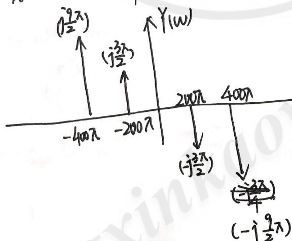

故 $y(t)=\frac{3}{2}\sin200\pi t+\frac{9}{2}\sin400\pi t$

(2) 令 $x_{1}(t) = x(t) \cos 5w_{0}t$

$\Rightarrow  {x}_{1}\left( w\right)  = \frac{1}{2}\left\lbrack  {x\left( {w + 5{w}_{0}}\right)  + x\left( {w - 5{w}_{0}}\right) }\right\rbrack$

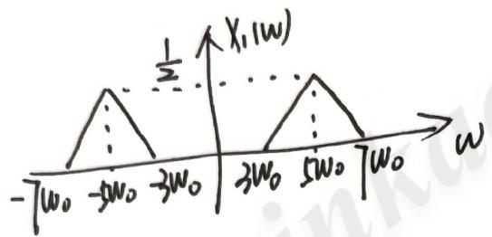

$\therefore {x}_{2}\left| w\right)  = {x}_{1}\left| w\right)  \cdot  H_{1}\left| w\right)$

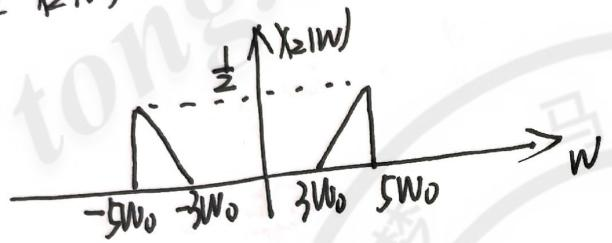

令 $x_{3}|t| = x_{2}|t| \cdot \cos 3w_{0}t$ $\Rightarrow x_{3}|w| = \frac{1}{2} [x_{2}(w + 3w_{0}) + x_{2}(w - 3w_{0})]$

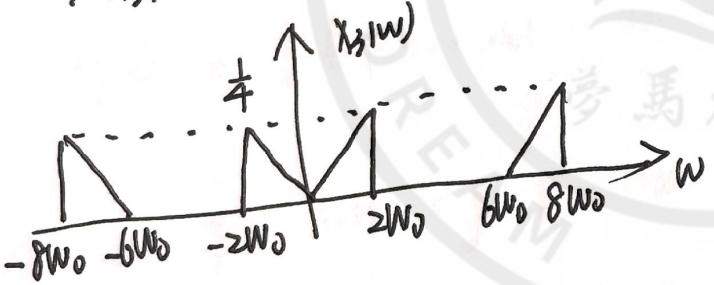

$$
Y _ {(w)} = \lambda_ {3} (w) \cdot H _ {2} (w)
$$

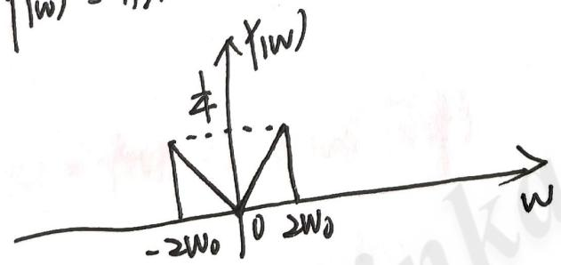

2.

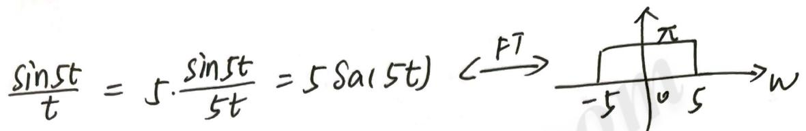

故 $(x(w))$ 固形为

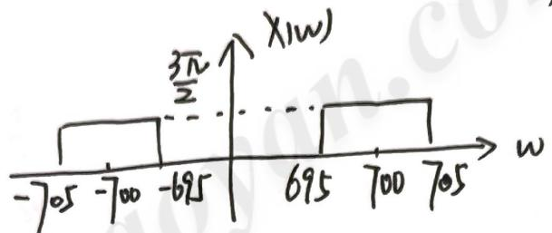

$$
\begin{array}{r l} {E} & {= \frac {1}{2 \pi} \int_ {- \infty} ^ {\infty} | x (w) | ^ {2} d w} \\ & {= \frac {1}{2 \pi} \times 2 \times \frac {9 \pi^ {2}}{4} \times 1 0} \\ & {= \frac {4 5 \pi}{2}} \end{array}
$$

3. (1) $y_{1}|t| = f|t| \cdot x_{1}|t| = f|t| \cdot \cos(wot)$ $\Rightarrow y_{1}|w| = \frac{1}{2} [F(w + w_0) + F(w - w_0)]$

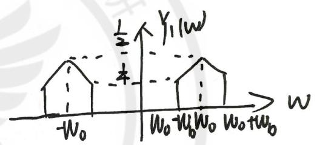

(2) $y_{21t1} = y_{11t1} \cdot x_{21t1} = y_{11t1} \cdot \cos(w_0 t)$ $\Rightarrow y_{21}(w) = \frac{1}{2} \left[ y_1 (w + w_0) + y_1 (w - w_0) \right]$

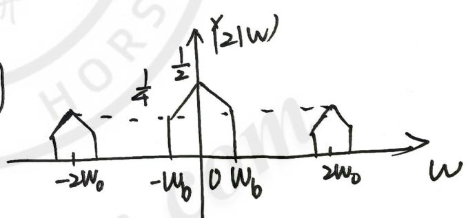

若 $y(t)=f(t)$ 故 $H(w)$ 回形

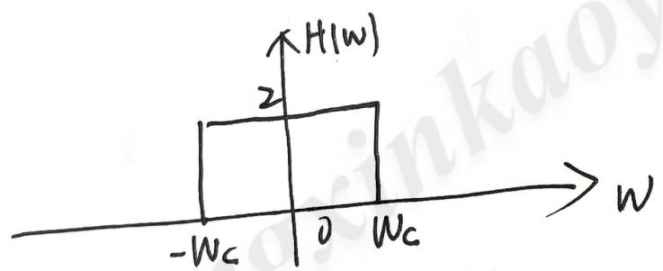

$$
W _ {b} \leq W _ {c} \leq 2 W _ {0} - B W _ {b}
$$