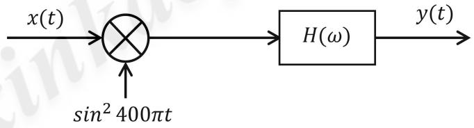
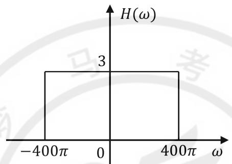
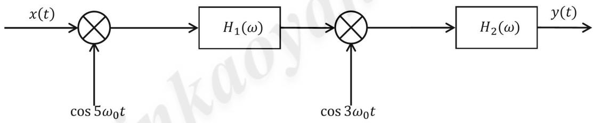
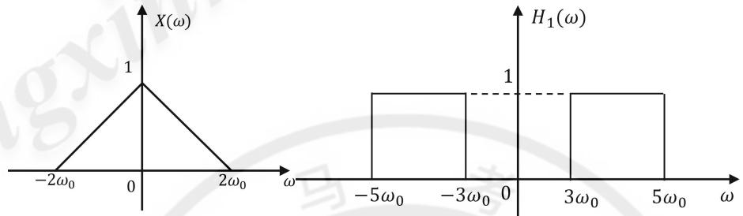
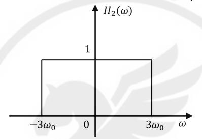
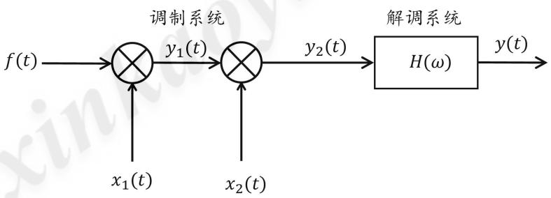
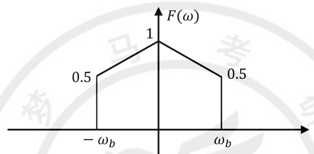

## 【第 20 节】课后作业

## 1、【2024 复旦大学】

（1）某调制框图如下图所示，输入信号 $x(t)=\sin200\pi t+2\sin400\pi t$ ， $H(\omega)$ 为如图所示的理想低通波波器，求输出信号 $y(t)$ 。

  
夢馬考研

(2) 某系统框图如图所示, 其中输入信号 $x(t)$ 的频谱如图所示, $H_{1}(\omega)$ 为理想带通滤波器, $H_{2}(\omega)$ 为理想低通滤波器, 频谱如图所示, 画出输出信号 $y(t)$ 的频谱。

  
夢馬考研

2、【2024 福州大学】

$x(t) = \frac{3sin5t}{t}\cos 700t$ ，求频谱函数 $X(\omega)$ 和能量 $E$ 。

## 3、【2024 西安电子科技大学】

系统如题图所示, $f(t)$ 为被传送的信号,设其频谱 $F(\omega)$ 如题所示, $x_{1}(t)=x_{2}(t)=\cos(\omega_{0}t)$ , $\omega_{0}\gg\omega_{b}$ , $x_{1}(t)$ 为发送端的载波信号, $x_{2}(t)$ 为接收端的本地振荡信号。

(1) 求解 $y_{1}(t)$ 的频谱 $Y_{1}(\omega)$ ;

(2) 若使输出信号 $y(t) = f(t)$ ，求理想低通滤波器的传递函数 $H(\omega)$ 。