e: $f(t) \rightarrow$ A + $f(t)$ [A + $f(t)$ ]coswct $\leftrightarrow$ -wc

(每元)

发点

接收

含有载射

到波信息

典型两种调幅

AM
善画双边带调幅

≤3.3%

DTB
抑到载波双边带调幅

(及熵双半高)

相同:

常宽2Wm

f(t) → x →

单边带调幅信号 SSB

$1^{0}$ 浪泻法

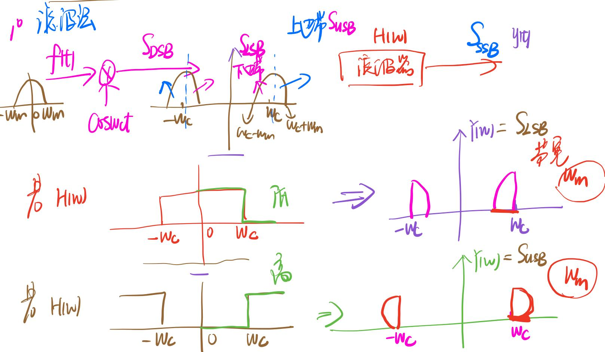

登陆中用漏洞队，得不到SSB → VSB 弹也带

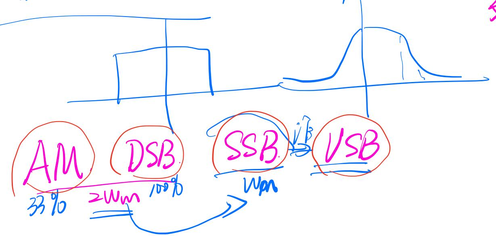

$S_{DSB}(t)$

B站up: 信号与系统\_谷哥

专题 8 希尔伯特变换及 SSB 信号

考点 1：振幅调制 AM(常规双边带)信号

$$
s _ {A M} (t) = [ A + m (t) ] c o s \omega_ {c} t = A c o s \omega_ {c} t + m (t) c o s \omega_ {c} t
$$

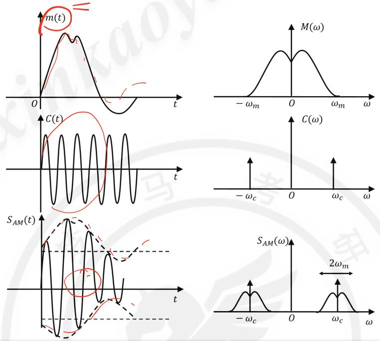

由 AM 信号频谱图可以看出，AM 信号中携带了载波频率信息，传输 AM 信号的带宽需要 $2 \omega_{m}$ 。

考点 2: DSB: 双边带信号

$$
s _ {D S B} (t) = m (t) \cos \omega_ {c} t
$$

DSB 信号的波形和频谱，因为不存在载波分量，调制效率为 $100\%$ ，比 AM 高，但传输 DSB 信号的带宽也为 $2 \omega_{m}$

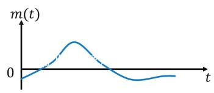

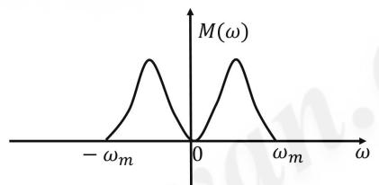

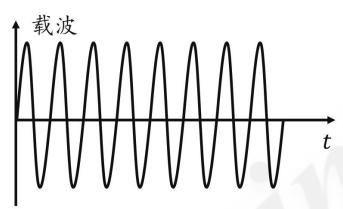

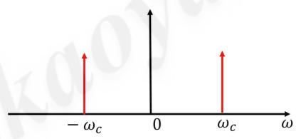

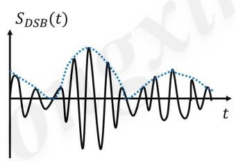

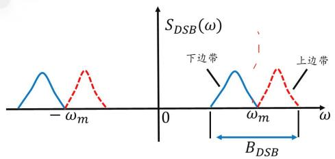

## 考点 3: SSB: 单边带信号

在 AM 信号频谱中，将频率低于载频的谱线为下边带(LSB)，频率高于载频的谱线为上边带(USB)，在调幅波频谱中的上下两个边带都含有相同的信息，只传送一个边带也就可以完成信息的传送，且传输SSB信号的带宽只需要 $\omega_{m}$ .

## 考点 4: SSB信号的产生——滤波法和移相法

1、滤波法：先产生一个 DSB 信号，然后在通过一个边带滤波器，滤除不需要的边带，即可获得单边带信号。

SSB 滤波法产生结构:

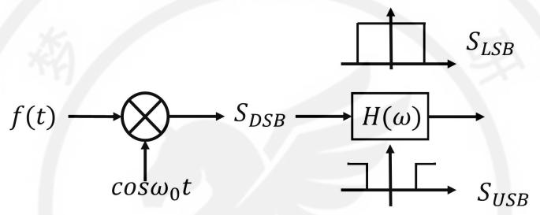

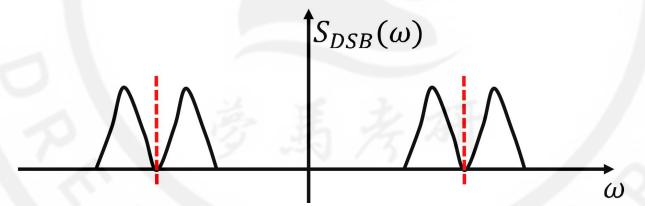

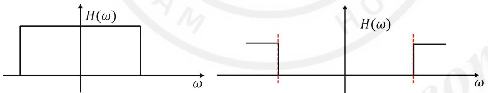

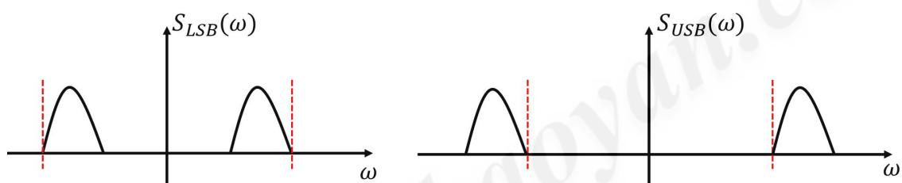

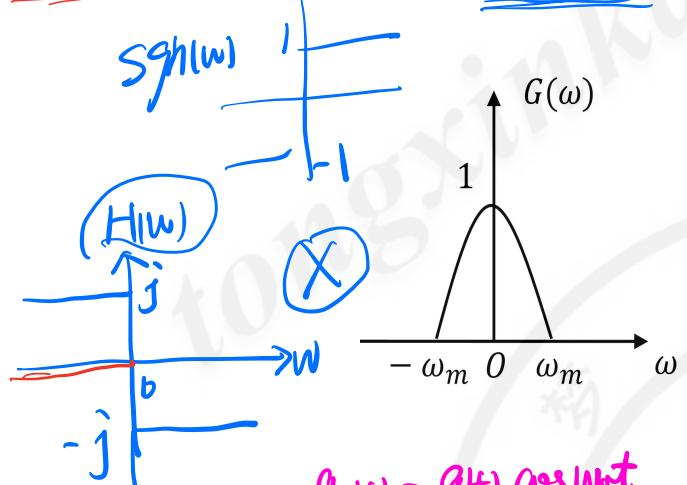

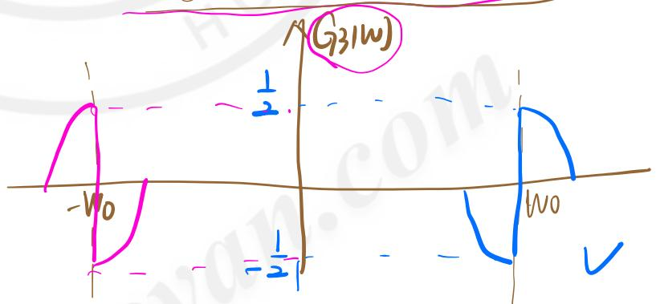

2、相移法SSB产生：利用相移网络，对载波和调制信号进行适当的相移，以便在合成过程中将其中一个边带抵消，从而获得SSB信号。

相因
1° V(W)
2° 说明系统作用

例42: 试证明题图: 所示之系统可以产生单边带信号。图中, 信号 $g(t)$ 的频谱 $G(\omega)$ 受限于 $\sim \omega_{m} \sim +\omega_{m}$ 之间, $\dot{\omega}_{0} \gg \omega_{m}$ ; $H(\omega) = -jsgn\omega$ 。设 $v(t)$ 的频谱为 $V(\omega)$ , 写出 $V(\omega)$ 表示式, 并画出图形。

$$
V (w) = G _ {1} (w) + G _ {3} (w)
$$

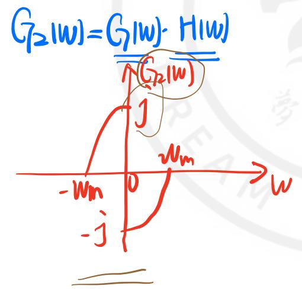

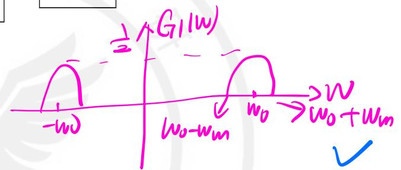

$$
\begin{array}{r l} {g _ {3} (t)} & {= g _ {2} (t) \cdot [ - \sin w o t ]} \\ & {= \frac {j}{2} [ - G _ {2} (w + w _ {0}) + G _ {2} (w - w _ {0}) ]} \end{array}
$$

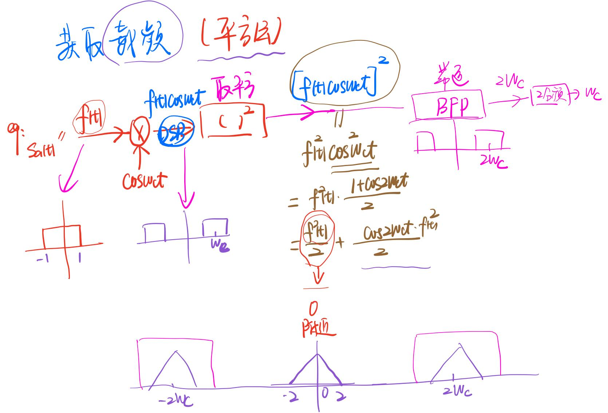

例43: 下图所示为一个幅度调制系统, 该系统由以下两部分组成: 先把调制信号与载波之和平方, 然后通过带通滤波器获得已调信号, 若 $g(t)$ 是带限信号, 即 $|\omega| > \omega_{m}$ 时, $G(\omega) = 0$ 。试确定带通滤波器的参数 $A, \omega_{1}, \omega_{h}$ , 使得 $f(t) = g(t)\cos \omega_{c} t$ , 并给出 $\omega_{c}$ 和 $\omega_{m}$ 的约束。

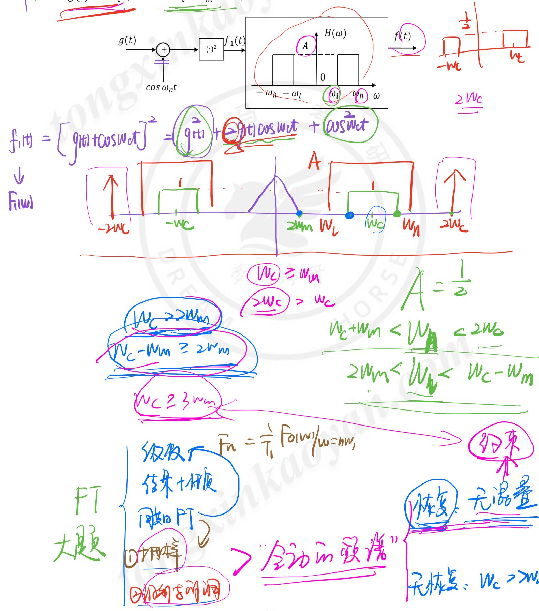

FT
大题
级数
结果+频数
同频FT
①用掉
②用掉的调 $F_n = \frac{1}{T_1} F_0(w)/w = nW_1$ >“心动的频谱”
恢复：无温度
无恢复： $W_c > W_m$

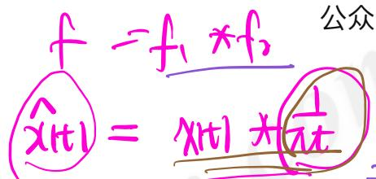

考点 5: 希尔伯特变换

$= \int \limits_{-{b0}}^{b0} f_{1}(t) f_{2}(t \cdot 2)b$

一个实值函数 $x(t)$ 的希尔伯特变换是 $x(t)$ 和 $1/\pi t$ 的卷积。

$$
= \frac {1}{\pi} \int_ {- \infty} ^ {\infty} x | \tau | \cdot \frac {1}{t - \tau} d \tau
$$

假设 $x(t)$ 是一个实值函数，求该函数的希尔伯特变换。

$$
\hat {x} (t) = H [ x (t)) ] = x (t) * \frac {1}{\pi t} = \left(\frac {1}{\pi} \int_ {- \infty} ^ {\infty} \frac {x (\tau)}{t - \tau} d \tau\right)
$$

$\rightarrow  \left\lbrack  {h + 1}\right\rbrack   = {3}^{y + 1}$

因此 $\hat{x}(t)$ 可以被解读为 $x(t)$ 的线性时不变系统的输出，该线性时不变系统的脉冲

f(n \* h(eg)

响应为：

$$
\varphi = \frac {\pi}{2}
$$

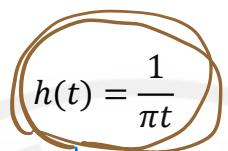

该脉冲响应的傅里叶变换为:

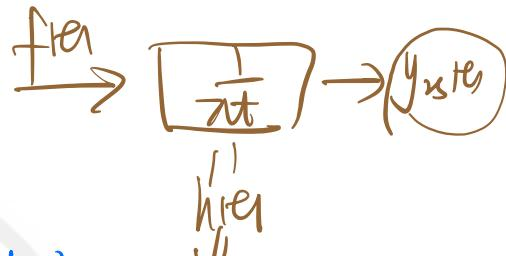

$$
\begin{array}{r l} {H (w)} & {= \left| H (w) \right| \cdot e ^ {j (\varphi w)} = e ^ {j}} \\ & {= \left\{ \begin{array}{l l} {- j, w > 0} & {\varphi (w) =} \\ {j, w <   0} & \end{array} \right.} \\ & {\mathrm{考点6:希尔伯华}} \end{array}
$$

$$
H (\omega) = \boxed {- j s g n (\omega)} = \left\{ \begin{array}{l l} - j, & \omega > 0 \\ j, & \omega \leq 0 \end{array} \right.
$$

考点6：希尔伯特变换—90°移相器

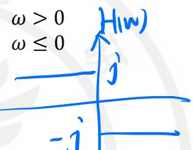

$$
\begin{array}{l} {H (w) = | H (w) | \cdot e ^ {j (q w)}} \\ {\mathrm{问} | H (w) | = 1} \end{array}
$$

信号经过希尔伯特变换之后，频域内各频率成分的幅值不变，但相位出现 $90^{\circ}$ 相移。即正频率滞后 $\pi/2$ ，负频率导前 $\pi/2$ ，因此希尔伯特变换器又称 $90^{\circ}$ 移相器。希尔伯特变换器又称 $90^{\circ}$ 移相器，如下图。两次希尔伯特变换之后，原信号相位翻转了 $180^{\circ}$ ，四次希尔伯特变换之后又变回本身。

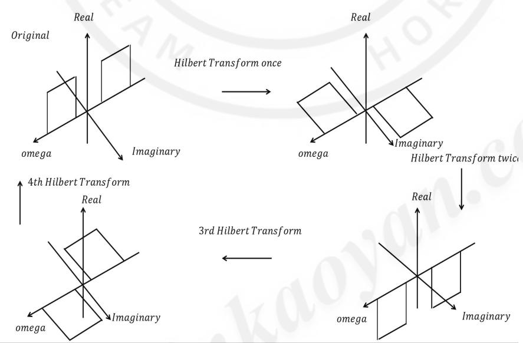

例 44: 如图所示, 理想 $-\pi / 2 \mathrm{rad}$ 全通相移器的频响特性定义为

$$
H (\omega) = \left\{ \begin{array}{l l} - j & \omega > 0 \\ j & \omega <   0 \end{array} \right.
$$

(1)求该相移器的单位冲激响应 $h(t)$ 。 $=\frac{1}{\pi t}$ (2)对于任意输入 $e(t)$ ，求该相移器的输出 $r(t)$ 。 $=e(t)\times\frac{1}{\pi t}$ = $\frac{1}{\pi}\int_{-\infty}^{+\infty}\frac{e(\tau)}{t-\pi}d\tau$

(3)当 $e(t)=\cos\omega_{0}t$ 时求该相移器的输出 $r(t)$ 。

$$
e (t) \xrightarrow {\text {相位器}} \boxed {- \frac {\pi}{2} r a d} \xrightarrow {r (t) = \hat {e} (t)}
$$

张

$\hat{3}k = 2$

李良作用$r(t)=e(t-\frac{2}{2})$ $=cos(wot-\frac{\pi}{2})$ $=sinwot\sin wot$

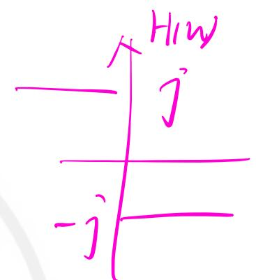

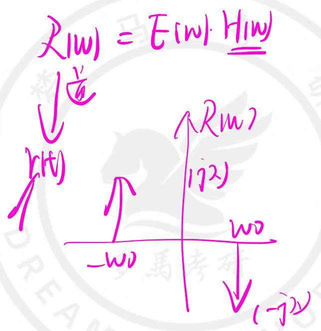

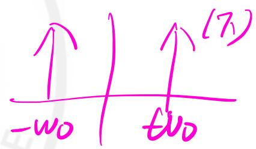

考点7：系统可实现的(因果)的约束条件—希尔伯特变换变换对

系统可实现性的实质是具有因果性。本节将要证明，由于因果性的限制，系统函数的实部与虚部或模与辐角之间将具备某种相互制约的特性，这种特性以希尔伯特(Hilbert)变换的形式表现出来。
对于因果系统，其冲激响应 $h(t)$ 在t<0时等于0，仅在t>0时存在，因此
设 $h(t)$ 的傅里叶变换即系统函数 $H(j\omega)$ 可分解为实部 $R(\omega)$ 和虚部 $jX(\omega)$ 之和
对式①运用傅里叶变换的频域卷积定理得到

于是有

$$
\mathcal {F} [ h (t) ] = \frac {1}{2 \pi} \{\mathcal {F} [ h (t) ] * \mathcal {F} [ u (t) ] \}
$$

$$
\begin{array}{r l} & {R (\omega) + j X (\omega) = \frac {1}{2 \pi} \Bigl \{\left[ R (\omega) + j X (\omega) \right] * \left[ \pi \delta (\omega) + \frac {1}{j \omega} \right] \Bigr \}} \\ & {= \frac {1}{2 \pi} \Bigl \{R (\omega) * \pi \delta (\omega) + X (\omega) * \frac {1}{\omega} \Bigr \} + \frac {j}{2 \pi} \Bigl \{X (\omega) * \pi \delta (\omega) - R (\omega) * \frac {1}{\omega} \Bigr \}} \\ & {= \left\{\frac {R (\omega)}{2} + \frac {1}{2 \pi} \int_ {- \infty} ^ {\infty} \frac {X (\lambda)}{\omega - \lambda} d \lambda \right\} + j \left\{\frac {X (\omega)}{2} - \frac {1}{2 \pi} \int_ {- \infty} ^ {\infty} \frac {R (\lambda)}{\omega - \lambda} d \lambda \right\}} \end{array}
$$

$$
R (\omega) = \frac {1}{\pi} \int_ {- \infty} ^ {\infty} \frac {X (\lambda)}{\omega - \lambda} d \lambda ②
$$

$$
X (\omega) = - \frac {1}{\pi} \int_ {- \infty} ^ {\infty} \frac {R (\lambda)}{\omega - \lambda} d \lambda ③
$$

$$
R (w) - \frac {R (w)}{\frac {2}{R (w)}} = \frac {1}{2 \pi} \int d \lambda .
$$

式②与式③称为希尔伯特变换对。它说明了具有因果性的系统函数 $H(\omega)$ 的一个重要特性：实部 $R(\omega)$ 被已知的虚部 $X(\omega)$ 唯一地确定，反过来也一样。

从以上推证过程可以看出, 傅氏变换实部与虚部构成希尔伯特变换对的特性, 不只限于具有因果性的系统函数, 对于任意因果函数, 其傅氏变换的这种特性都是成立的。也即, 若函数 $f(t)$ 满足

$$
f (t) = f (t) u (t)
$$

且 $f(t)$ 的傅里叶变换为

$$
F (\omega) = R (\omega) + \mathrm{j} X (\omega)
$$

则 $R(\omega)$ 与 $X(\omega)$ 之间构成希尔伯特变换对[满足式②与式③的互换关系]。

例 45: 已知因果LTI系统频响特性 $H(\omega)$ 的实部为 $\pi\delta(\omega)$ ，求该系统的频响特性 $H(\omega)$ 和单位冲激响应 $h(t)$ 。

$$
\begin{array}{r l} & {\mathrm{if:}} \\ & {\mathrm{and}} \\ & {\frac {H (w) = R (w) + j \lambda (w)}{R (w) = \frac {1}{\pi} \int_ {- \infty} ^ {w} \frac {\lambda (\lambda)}{w - \lambda} d \lambda}} \\ & {\frac {x (w) = - \frac {1}{\pi} \int_ {- \infty} ^ {\infty} \frac {2 (\lambda)}{w - \lambda} d \lambda}{= - \frac {1}{\pi} \int_ {- w} ^ {\infty} \frac {\pi d (\lambda)}{w - \lambda} d \lambda}} \\ & {\quad = - \frac {1}{w}} \\ & {H (w) = \lambda d (w) - j \frac {1}{w} = \lambda d (w) + \frac {1}{j w}} \\ & {\Rightarrow h (t) = u (t)} \end{array}
$$

考点8：希尔伯特变换在通信系统中应用—SSB信号产生

希尔伯特变换在通信系统中的应用体现在单边带信号的产生，具体框图如下，其分析过程可详见 P162。

夢馬考研  
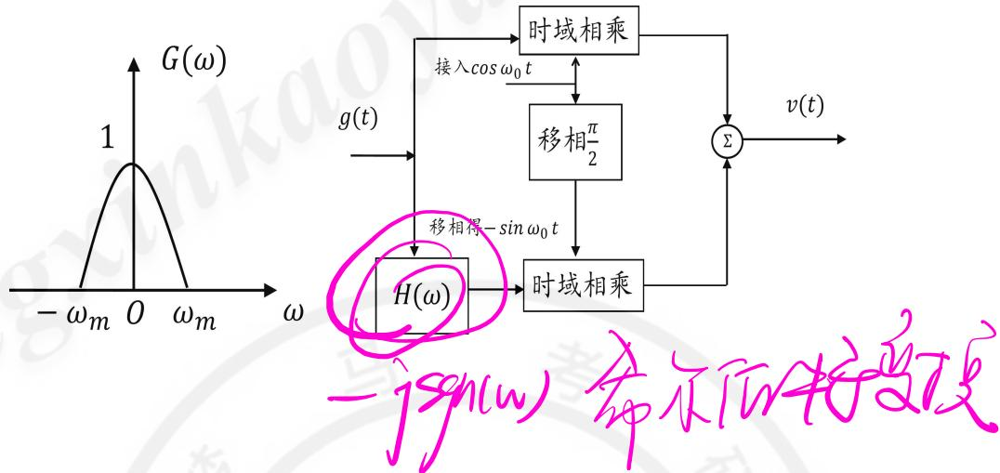